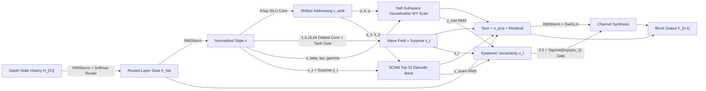

# NANOLM Architecture Specification

This document specifies the complete multi-generation neural architecture family implemented in [`nanolm_discovery/`](nanolm_discovery/), covering the controlled baseline (`B0_TRANSFORMER`), modern external control (`B1_GDN2_HYBRID`), three Cycle 1 paradigms (`I1_PHMN`, `I2_NEBN`, `I3_HRWN`), Cycle 2 unified synthesis (`G2_MPRN`), and Cycle 3's capacity-balanced tri-scale evolution (`G3_HMWR`).

---

## 1. Unified Block & System Architecture (`G3_HMWR`)

Cycle 3 flagship synthesis **`G3_HMWR` (Holographic Metriplectic Wave-Resonance)** unifies multi-scale causal dyadic wave convolutions, an orientation-reversing Householder WY group-transport subspace, shifted surprise-evicted `SCAM` episodic registers, tokenwise Attention-over-Depth residuals, and surprise-adaptive channel synthesis inside a strictly causal, $O(1)$-state sequence block (`< 4.000B` deployed parameters).

---

## 2. Paradigm Architectural Taxonomy (`nanolm_discovery/`)

| Paradigm ID | Sequence Operator | Addressing Shift | Channel Synthesis | Residual Structure | Inference State Complexity |
|---|---|---|---|---|---|
| `B0_TRANSFORMER` | `GQAAttentionOperator` (RoPE $\theta=500\text{k}$) | None | `SwiGLUSynthesis` | Standard identity residual | $O(L \cdot T \cdot n_{\text{kv}} d_h)$ linear in $T$ |
| `B1_GDN2_HYBRID` | 3:1 `GDN2Operator` ($\beta \in (0, 1)$) + `GQA` every 4th layer | `CausalKeyShift` (`GDN2` layers) | `SwiGLUSynthesis` | Standard identity residual | $\frac{3}{4} O(1) + \frac{1}{4} O(T)$ |
| `I1_PHMN` | `PortHamiltonianOperator` ($\beta \in (0, 1.98)$ WY reflection + write) | `CausalKeyShift` | `SymplecticHamiltonianSynthesis` | Standard identity residual | $O(L H d_h^2)$ constant in $T$ |
| `I2_NEBN` | `NEBNOperator` (positive exponential-family filter, $\Lambda_t^{-1}$) | `CausalKeyShift` | `VariationalDendriticSynthesis` | Standard identity residual | $O(L H (d_h^2 + d_h))$ constant in $T$ |
| `I3_HRWN` | `HRWNOperator` (dilations `{1,4,16,64}` + `SCAM-32`) | None (symmetric) | `SwiGLUSynthesis` | Standard identity residual | $O(L (340 d + K d_{\text{scam}}))$ constant in $T$ |
| `G2_MPRN` | `MPRNOperator` (full-width WY + `nebn_precision_trace` + `SCAM`) | `CausalKeyShift` | `SymplecticHamiltonianSynthesis` | Standard identity residual | $O(L (H d_h^2 + K d_{\text{scam}}))$ constant in $T$ |
| **`G3_HMWR`** | **`HMWROperator`** (Wave-4 + $H/2$ WY + `SCAM-32` $d/4$) | `CausalKeyShift` | `SwiGLUSynthesis` + surprise gain | **Tokenwise Depth-Attention over $H_{0:\ell}$** | **$O(L (H_{\text{met}} d_h^2 + 340d + K d_{\text{scam}}))$ constant in $T$** |

---

## 3. Code-Exact Iso-Parameter Family Census (`±0.45%`)

Every configuration obeys exact equality between analytical census `compute_parameter_census(cfg)` and runtime PyTorch `.deployed_parameter_count()`, excluding optional training-only `jep_head` ($d^2$ params) from deployed totals ([`nanolm_discovery/config.py`](nanolm_discovery/config.py)).

### 3.1 `mech` (`d=64, L=2, H=4, KV=2, hd=16, V=256`)
| Model | `ffn_hidden` | Operator Params | Synthesis Params | Total Deployed Params | Diff vs `B0` |
|---|---:|---:|---:|---:|---:|
| `b0_transformer` | `192` | `24,576` | `73,728` | `115,008` | `0.000%` |
| `b1_gdn2_hybrid` | `166` | `34,320` | `63,744` | `114,768` | `-0.209%` |
| `i1_phmn` | `168` | `43,032` | `55,296` | `115,032` | `+0.021%` |
| `i2_nebn` | `162` | `34,328` | `63,828` | `114,860` | `-0.129%` |
| `i3_hrwn` | `100` | `60,034` | `38,400` | `115,138` | `+0.113%` |
| `g2_mprn` | `100` | `59,554` | `38,528` | `114,786` | `-0.193%` |
| `g3_hmwr` | `106` | `57,360` | `40,960` | `115,024` | `+0.014%` |

### 3.2 Real-Corpus Scaling Rungs (`V=32,768`)
| Tier (`d, L, H, KV, hd`) | Model | `ffn_hidden` | Total Deployed Params | `32k` Context Persistent State | Diff vs `B0` |
|---|---|---:|---:|---:|---:|
| `scale_8m` (`192, 6, 6, 2, 32`) | `b0_transformer` | `512` | `8,653,248` | `50.33 MB` | `0.000%` |
| `scale_8m` | `i3_hrwn` | `224` | `8,640,582` | `0.86 MB` (`58.5x` smaller) | `-0.146%` |
| `scale_8m` | `g3_hmwr` | `256` | `8,661,776` | `0.90 MB` (`55.9x` smaller) | `+0.099%` |
| `discovery_18m` (`384, 6, 12, 6, 32`) | `b0_transformer` | `768` | `20,550,528` | `150.99 MB` | `0.000%` |
| `discovery_18m` | `b1_gdn2_hybrid` | `656` | `20,567,544` | `25.42 MB` | `+0.083%` |
| `discovery_18m` | `i1_phmn` | `464` | `20,569,176` | **`0.31 MB`** (`308,736 B`) | `+0.091%` |
| `discovery_18m` | `i2_nebn` | `624` | `20,553,336` | `0.32 MB` (`318,240 B`) | `+0.014%` |
| `discovery_18m` | `i3_hrwn` | `256` | `20,598,918` | `1.71 MB` (`1,714,944 B`) | `+0.235%` |
| `discovery_18m` | `g2_mprn` | **`64`** *(starved)* | `20,527,782` | `0.47 MB` (`466,464 B`) | `-0.111%` |
| `discovery_18m` | `g3_hmwr` | **`304`** *(4.75x `G2`)* | `20,551,430` | `1.80 MB` (`1,802,496 B`) | `+0.004%` |
| `scale_42m` (`576, 10, 18, 6, 32`) | `b0_transformer` | `1,152` | `47,640,384` | `251.66 MB` | `0.000%` |
| `scale_42m` | `i3_hrwn` | `320` | `47,761,354` | `4.29 MB` (`58.7x` smaller) | `+0.254%` |
| `scale_42m` | `g3_hmwr` | `384` *(12x `G2`=`32`)* | `47,429,902` | `4.51 MB` (`55.8x` smaller) | `-0.442%` |

### 3.3 Flagship `< 4.000B` Class (`d=2816, L=32, H=22, KV=11, hd=128, V=65,536`)
| Flagship Model | `ffn_hidden` | Total Deployed Params | `bf16` Weights | `512` Ctx State | `4096` Ctx State | `32,768` Ctx State | Strict `< 4B` Limit |
|---|---:|---:|---:|---:|---:|---:|---|
| `b0_transformer_4b` | `10,880` | **`3,887,254,272`** | `7.241 GiB` | `88.00 MiB` | `704.00 MiB` | **`5,632.00 MiB`** (`5,905.58 MB`) | Verified `< 4B` |
| `b1_gdn2_hybrid_4b` | `10,176` | `3,890,499,360` | `7.247 GiB` | `51.82 MB` | `208.13 MB` | `1,511.40 MB` | Verified `< 4B` |
| `i1_phmn_4b` | `11,328` | `3,882,029,888` | `7.231 GiB` | **`46.68 MB`** | **`46.68 MB`** | **`46.68 MB`** (`126.5x` smaller) | Verified `< 4B` |
| `i2_nebn_4b` | `9,920` | `3,893,115,712` | `7.251 GiB` | `47.04 MB` | `47.04 MB` | `47.04 MB` | Verified `< 4B` |
| `i3_hrwn_4b` | `7,104` | **`3,883,379,488`** | `7.233 GiB` | **`63.94 MiB`** (`67.05 MB`) | **`63.94 MiB`** | **`63.94 MiB`** (`88.1x` smaller) | Verified `< 4B` |
| `g2_mprn_4b` | `8,512` | `3,884,193,312` | `7.235 GiB` | `52.81 MB` | `52.81 MB` | `52.81 MB` | Verified `< 4B` |
| **`g3_hmwr_4b`** | `7,552` | **`3,882,612,303`** | `7.232 GiB` | **`83.71 MiB`** (`87.77 MB`) | **`83.71 MiB`** | **`83.71 MiB`** (`67.3x` smaller) | Verified `< 4B` |

*(Enforced programmatically by `ParameterBudgetError` inside [`nanolm_discovery/config.py`](nanolm_discovery/config.py#L188-L191) and tested on `meta` tensors in [`nanolm_discovery/tests/test_discovery.py`](nanolm_discovery/tests/test_discovery.py#L46-L70).)*

---

## 4. Exact Parallel Training / $O(1)$ Recurrent Inference Equivalence

All seven paradigms implement both `forward(input_ids)` (parallel chunk scan / dilated convolution / SDPA) and `forward_step(token_id, states)` (constant-memory or KV-cache incremental step):
- **Cross-hardware verified equivalence:** `max |logits_parallel - logits_step| < 1e-4` across all 6 earlier paradigms and `< 1e-6` (`9.83e-7` CPU `fp32`, `9.54e-7` Tesla T4 CUDA) for `G3_HMWR` ([`nanolm_discovery/tests/test_discovery.py`](nanolm_discovery/tests/test_discovery.py#L85-L101), [`artifacts/nanolm_discovery_v1/kaggle_cuda_results.json`](artifacts/nanolm_discovery_v1/kaggle_cuda_results.json)).
- **Zero future leakage:** Changing any suffix token $x_{> t_0}$ produces `max |diff_{\le t_0}| = 0.0` (machine exact) on every architecture (`test_strict_causality_zero_future_leakage`).
- **Flagship persistent state invariants:** On live `3.89B` M3 Max profiling (`EXP-INV-05B`), `b0_transformer_4b` state grows `8x` from `88.0 MiB` (`512`) to `704.0 MiB` (`4096`), whereas `i3_hrwn_4b` remains flat at `63.94 MiB` and `g3_hmwr_4b` remains flat at `83.71 MiB`.
