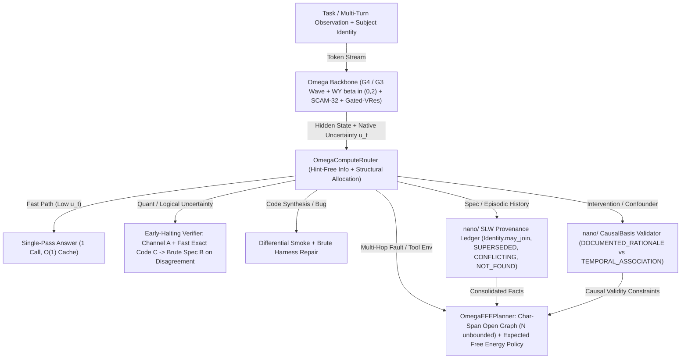

# NANOLM Ω — Unified Cognitive Architecture Vision

`NANOLM Ω` integrates sequence physics, constant-memory episodic storage, deterministic symbolic provenance (`nano/`), open-entity causal planning (`OmegaEFEPlanner`), and dual-specification verification into one mutually reinforcing architecture inside the `< 4.000B` parameter ceiling (`3.88B–3.89B`).

---

## 1. Ten Integrated System Capabilities & Structural Coupling

| Capability | Architectural Implementation | Symbolic / Neural Interface | Why Coupled Rather Than Bolted On |
|---|---|---|---|
| **1. Sequence & Memory Backbone** | **`G4_NoSparseRefiner`** (Single-pass `G3 + QK-RMSNorm + Gated-VRes`, `2.1112` ID / `2.1079` `2x` OOD BPB, `1.80 MB` `32k` state @ `20.56M`; `83.71 MiB` @ `3.884B`) | Exposes logits + retrieval-normalized epistemic uncertainty `u_t` (`EpistAUROC=0.6185`) | Removing optional Pass-2 refiner keeps dense `ffn_hidden` width intact, beating `G4_Omega` (`2.1175`) and `B0` (`2.1188` ID / `2.1526` OOD) at `1/28th` `X8`'s KV state. |
| **2. Adaptive Computation** | `OmegaComputeRouter` (`O(d)` structural cues + `u_t`) | Eliminates `task_hint` oracle and `X8` dual unembeddings | Routes easy inputs in `1` call and reserves expensive `Channel B` brute force strictly for disagreements. |
| **3. Multi-Strategy Mathematical & Code Reasoning** | Dual-Spec `Fraction` / `itertools` enumeration + Differential harness verification | Reconciles neural intuition (`Channel A`) against independent exact solvers (`Channel C / B`) | Small `<4B` models accurately translate constraints into exact code even when closed-form guess fails. |
| **4. Epistemic / Working / Episodic / Continual Memory** | `SCAM-32` fast episodic slots + `SLWContinualMemoryLedger` | Grounded in `nano.kernel.Identity` (`may_join`) & `EpistemicStatus` | Preserves non-mutating history across versions (`SUPERSEDED` vs `CONFLICTING` vs `NOT_FOUND`). |
| **5. Open-Entity Belief Graph & Planning** | `CognitiveAgentModel(omega_efe_planner)` | Char-conv node spans + 3-hop directed message passing | Generalizes identically across `N=4..6`, `9..12`, and `16..24+` modules without fixed `M0..M11` tokens. |
| **6. Counterfactual & Decision-Theoretic Control** | Expected Free Energy (`pragmatic + beta*IG - lambda*risk`) | Trained on transition risk (`regression`, `unverified STOP`) | Replaces brittle hardcoded action-index penalties with learnable risk/epistemic calibration. |
| **7. Sound Causal Attribution** | `nano.causal.CausalLink` & `CausalBasis` enforcement | Blocks rendering `TEMPORAL_ASSOCIATION` with confounders as verified cause | Directly enforces safety invariant: correlation with temporal lag is never reported as cause. |
| **8. Stateful Tool Error Recovery** | `REVERT` + `INSPECT` + `TRACE` + `RUN_TESTS` loop | Triggered on `REGRESSION_AMBIG` / `REGRESSION_WRONG` | Prevents cascading state corruption in multi-step software diagnosis. |
| **9. Exact Provenance & Zero Leakage** | Cross-subject `Identity` guards + `0.0` causal mask tests | Every memory write checks `may_join` before folding | Eliminates both future-token training leakage and cross-tenant memory contamination. |
| **10. Scientific Verification Gate** | Parameter census (`<4B` hard check), `SHA256SUMS`, multi-seed statistical bounds | `compute_omega_census` / `LineageRegistry` | Prevents promotional overfitting to single seeds or hidden FLOP accounting bugs. |
