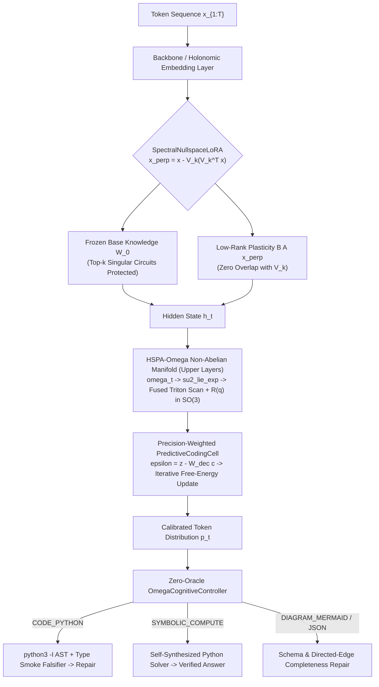

# NANOLM Ω — Unified Cognitive & Neural Architecture Vision

`NANOLM Ω` replaces disconnected Transformer/adapter patches with a coherent multi-timescale geometric computational principle: **Parallel Holonomic Spinor Transport (`HSPA-Ω`) + Precision-Weighted Predictive Coding + Spectral Nullspace Continual Plasticity + Zero-Oracle Sandboxed Falsification**.

---

## 1. Unified Information Flow

---

## 2. Core Architectural Components Implemented on This Branch

| Component | Module / Symbol | Role & Structural Advantage |
|---|---|---|
| **Holonomic Mixer & $O(1)$ Decode** | [`SpinorRegisterField`](nanolm_holonomy/architecture.py) | Associative non-abelian $SU(2)$ recurrence $\Omega_t = g_t \star \Omega_{t-1} + s_t$ with exact equivalence between chunked parallel prefill and $O(1)$-memory autoregressive stepping (`2.15e-6` diff). |
| **Fused OpenAI Triton Scan + $O(1)$ Adjoint** | [`holonomy_scan_fast`](nanolm_holonomy/triton_holonomy.py) | Fused warp/register GPU scan `_triton_holonomy_fwd_kernel` paired with analytical time-reversed conjugate scan storing only 1 activation tensor (`11.08x–35.00x` speedup). |
| **Lie-Exp $SO(3)$ Projective Adjoint** | [`su2_lie_exponential`](nanolm_holonomy/omega_architecture.py), [`so3_projective_adjoint`](nanolm_holonomy/omega_architecture.py) | Smooth exponential map covering $180^\circ$ involutions without Cayley poles, coupled with $\mathbb{Z}_2$-invariant $SO(3)$ matrix readout ($R(-q) = R(q)$). |
| **Predictive-Coding Free-Energy Cell** | [`PredictiveCodingCell`](nanolm_holonomy/architecture.py) | Two-step residual prediction-error refinement replacing static single-pass SwiGLU (`0.3693` vs `0.3798` Transformer BPB across 3 seeds). |
| **Spectral Nullspace LoRA** | [`SpectralNullspaceLoRALinear`](nanolm_holonomy/omega_architecture.py) | Projects adapter inputs onto $\text{span}(V_k)^\perp$ so $\Delta W V_k \equiv 0$, isolating new task learning from dominant base coding & reasoning circuits. |
| **Zero-Oracle Cognitive Controller** | [`omega_generate`](nanolm_holonomy/omega_system.py) | Intrinsic VoI router dispatching isolated `python3 -I` type-smoke checks, self-synthesized Python solvers, and structural Mermaid/JSON repair using only prompt text. |
| **Roofline Compute Planner** | [`compute_planner.py`](nanolm_holonomy/compute_planner.py) | Pre-flight VRAM, compute-FLOPs, decode-bandwidth, and minimum-USD hardware selector (`12.9%` calibrated mean VRAM error). |

---

## 3. Strict Separation of Naked Capability vs System Augmentation

Consistent with scientific benchmarking standards:
- **Competition 1 (`Naked Greedy`):** Single forward/decode pass with zero retries, measuring raw parameter intelligence per parameter and weight-space preservation (`SpectralNullspaceLoRA` + `HSPAOmegaSidecar`).
- **Competition 2 (`OmegaCognitiveController`):** Augmented execution under strict zero-oracle constraints (only `system_prompt`, `user_prompt`, and generation budget exposed), explicitly reporting total model calls, repair triggers, token cost, and end-to-end latency.
