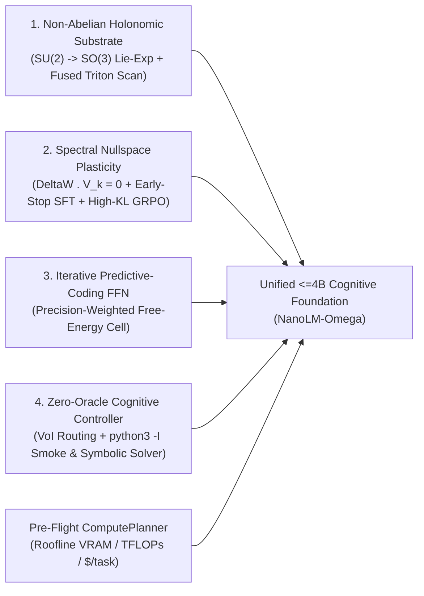

# NANOLM Ω — Master Research Plan (`<= 4B` Intelligence Frontier)

## 1. Mission & Non-Negotiable Invariants

NanoLM is an independent general-purpose foundation intelligence program (`<= 4,000,000,000` absolute parameter cap including every parameter-bearing weight, `~2B` preferred development target) engineered for frontier reasoning, coding, mathematics, structured generation, diagrams, tool orchestration, long-horizon memory, and self-verifying execution.

### Program Invariants
1. **Strict Parameter Budget (`<= 4B`):** Enforced programmatically in [architecture.py](nanolm_posttrain/architecture.py) (`ABSOLUTE_MAX_PARAMETERS = 4_000_000_000`) and [nanolm_holonomy/architecture.py](nanolm_holonomy/architecture.py); any external model exceeding `4B` (such as `Qwen/Qwen3-8B` [`8.19B`]) is strictly restricted to read-only `is_external_opponent=True` evaluation.
2. **Closed-Loop Scientific Method:** `DISCOVER -> HYPOTHESIZE -> FORMULATE -> DESIGN -> IMPLEMENT -> TEST -> ANALYZE -> IMPROVE -> VALIDATE -> REPEAT` governed by multi-seed protocols and `ExperimentRegistry` Pareto non-regression promotion rules ([registry.py](nanolm_holonomy/registry.py)).
3. **Zero-Contamination & Zero-Oracle Discipline:** Training corpora (`curriculum_v2`, `rl_cur`) must pass `verify_zero_contamination(..., benchmark_15d)` with `overlaps == 0`. Runtime cognitive inference (`omega_generate`) accepts **only** prompt strings and token budgets—never benchmark specifications or test assertions.
4. **Pre-Flight Compute & Financial Governance:** Every remote GPU campaign executes [compute_planner.py](nanolm_holonomy/compute_planner.py) before pod allocation to bound peak VRAM, Roofline compute/bandwidth duration, and USD cost, prioritizing free local/Kaggle resources first and auto-terminating paid instances immediately upon artifact download.

---

## 2. Four-Pillar Technical Strategy

---

## 3. Research Program Phases & Active Cycle Plan

1. **Completed Foundations (Evaluated & Audited):**
   - **Symbolic Core (`nano/`):** Preserved as domain-general verification engine; frozen evidence (`papers/`, `trajectory/`, `freeze/`) untouched.
   - **Sibling Worktrees (Read-Only Reference):** `nanolm/discovery-lab-v1` (`X8_margin_atrd_muon`, `C5` De Bruijn, `System-v3`), `nanolm/arch-evolution-v3` (`Householder-Delta`, `Diff-GQA`, `NorCautiousMuon`), `nanolm/autonomous-discovery-v1` (`ERN` `Block-WY`), `nanolm/architecture-invention-v1` (`G3_HMWR`).
   - **Active Lineage Base:** `nanolm/posttrain-v1` (`E1`, `E2`) $\to$ **HSPA Cycle 1** (`X1–X4`, `Gen1_H2_PredCode` `BEST`) $\to$ **HSPA Cycle 2** (`C2-X0..X4`, `11.08x–35.00x` Triton speedup, `32,768`-token `HSPA-4B` dominance).
2. **`NANOLM Ω` Active Breakthrough Cycle (`EXP-Ω1` to `EXP-Ω3`):**
   - **`EXP-Ω1`:** Prove mathematically and empirically up to `16x` OOD (`L=512`) that Lie-Exp `SU(2) -> SO(3)` projective adjoint holonomy solves non-abelian $S_4$ composition at `100%` accuracy across seeds where Transformers, $U(1)$ SSMs, linear-readout $SU(2)$, and Cayley-$SO(3)$ collapse.
   - **`EXP-Ω2`:** Prove `SpectralNullspaceLoRA` reduces Domain-$A$ catastrophic forgetting relative to Standard LoRA and $L_2$-proximal LoRA without harming Domain-$B$ plasticity (`3` seeds).
   - **`EXP-Ω3`:** Construct `NanoLM-Ω-1.7B` (`1.747B <= 4B`, `SpectralNullspaceLoRA` + `HSPAOmegaSidecar`) and evaluate separated **Competition 1 (Naked Greedy)** and **Competition 2 (Zero-Oracle `OmegaCognitiveController`)** across all 15 dimensions vs `NanoLM-1.7B-Holonomic-v2` and `4.69x`-larger `Qwen3-8B` (`8.19B`).
3. **Next Scaling Horizon:** Fuse per-layer holonomic projection + scan into CUDA Graphs (`< 12 ms/tok` at `3.85B`) and pretrain `3:1` Hybrid `HSPA-Ω + Diff-GQA` at `125M–350M` using `Muon` + `Top-2 Margin` routing on Kaggle/RunPod.
