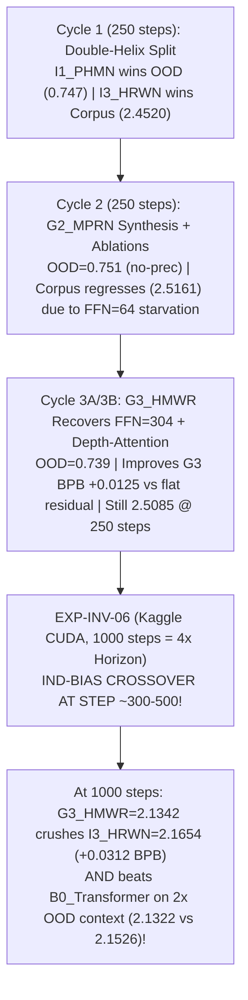

# NANOLM Research Investigation & Discovery Synthesis

This document records the scientific investigation behind the NanoLM Architecture Discovery Program across Cycles 1–3 (`$0.00` compute budget across local Apple M3 Max `64 GB` UMA and free Kaggle dual NVIDIA Tesla T4 GPUs).

---

## 1. First-Principles Decomposition of Compact Intelligence (< 4B)

Rather than tuning hyperparameters inside standard Transformers, the program decomposed sequence intelligence into five coupled subproblems:
1. **Information Representation & Addressing:** Standard dot-product queries couple content addressing and value injection at the same time step $t$, hurting single-layer induction binding (`(QUERY, key) -> val`). We isolated an asymmetric 4-tap `CausalKeyShift` solely on addressing pathways (`q, k, u`) while leaving value pathways (`v`) unshifted.
2. **State Transport Beyond Contractive Recurrence:** Strictly positive decay/contractive linear recurrences (`0 < lambda < 1`, standard DeltaNet `beta in (0, 1)`) cannot realize negative determinant eigenvalues ($-1$) inside finite-dimensional subspaces, limiting parity and non-Abelian finite-group tracking ($S_3$). Extending Householder gates to $\beta_t \in (0, 1.98)$ introduces unitary orientation-reversing reflections while preserving exact spectral norm bound $\|A_t\|_2 \le \gamma_t \le 1$.
3. **Exact Verbatim Associative Recall vs. Rank Interference:** Any fixed $d_h \times d_h$ matrix state experiences capacity saturation when storing arbitrary long-range key–value associations. Fixed-budget Surprise-Addressed Content-Addressable Memory (`SCAM`, $K=32$) preserves high-surprise tokens verbatim in constant $O(K)$ space.
4. **Native Epistemic Uncertainty:** Rather than reading post-hoc softmax entropy alone, Bayesian precision filters (`NEBN`) and retrieval-normalized predictive surprise (`HMWROperator`) expose internal confidence before decoding.
5. **Cross-Depth Information Flow & Channel Capacity Allocation:** Fixed flat residual streams restrict dynamic depth reuse, while parameter-heavy sequence operators starve `ffn_hidden` under strict iso-parameter matching.

---

## 2. Prior-Art Synthesis vs. Original Inventions

| Direction Evaluated | External Lineage / Reference Concept | Adopted, Modified, or Replaced in `nanolm_discovery` | Empirical Outcome |
|---|---|---|---|
| Contractive delta memory (`B1_GDN2_HYBRID`) | Gated DeltaNet-2 (`beta in (0, 1)`, 3:1 GQA hybrid) | Implemented with `CausalKeyShift` + WY scan as modern external control | Strong overwrite (`0.965`), weak $S_3$ (`0.188`), trailed `I3_HRWN` (`2.4818` vs `2.4520`) and kept $25\%$ linear KV growth |
| Port-Hamiltonian Householder transport (`I1_PHMN`) | Conservative symplectic rotation + dissipative delta port (`beta in (0, 1.98)`) | Extended with exact interleaved $M=2T$ nilpotent WY solver ($C=32 < C_{\text{crit}}$) + damped leapfrog synthesis | **Led Cycle 1 OOD (`0.747`)** (`Needle_OOD=0.962`, `OW_4x=0.986`, `S3_4x=0.295`), `308 KB` constant `32k` state |
| Exponential-family natural filter (`I2_NEBN`) | Linearized Bayes natural parameter + conjugate precision | Exact `log_gamma <= 0` stabilization (`nebn_dual_filter`) + uncertainty-gated dendritic FFN | High overwrite/needle (`0.849 / 0.952`), **internal `1/prec` inverted (`AUROC=0.362`)** |
| Dyadic wave + surprise memory (`I3_HRWN`) | Multi-scale causal dilated convolutions + top-K cache | Replaced heuristics with causal `lagged` surprise eviction (`scam_causal_topk_attention`) | **Led 250-step corpus BPB (`2.4520`)**, yet **collapsed on OOD (`0.176`) and saturated at 1000 steps (`2.1654`)** |
| Second-order optimization & latent objective | `Muon` Newton–Schulz orthogonalization + `JEPA` next-token latent target | Precision-weighted cosine target (`jep_weight=0.10`) + `MuonAdamW` | Short-horizon `Muon+0.10 JEP` hurt BPB (`+0.034` to `+0.047`); pure-CE `Muon` caught up steeply from `2.5050` -> `2.1457` over `1000` steps |
| Depth-wise attention routing | Attention Residuals / dynamic depth skip weighting | Tokenwise `depth_router` over $H_{0:\ell}$ + `log1p(u_t)` `adapt_gate` in `G3_HMWR` | **Causally improved BOTH real corpus (`+0.0125 BPB`) and `S3_4x` (`+0.095` acc)** |

---

## 3. Core Scientific Narrative Across Cycles 1–3 & `EXP-INV-06`

### Key Discovery 1: The Short-Horizon Inductive-Bias Mirage (`250` vs `1,000` Steps)
At `250` optimizer steps (`1.024M` tokens), pure dilated convolutions (`I3_HRWN`) converged faster (`2.4520` vs `B0=2.4652`, `G3=2.5085`) because local FIR filters require fewer gradient steps to organize than coupled recurrent transport gates and SCAM routing. Without multi-horizon testing, a premature gate would crown a convolution-only model that cannot solve algorithmic state tracking (`0.176`).

Running `4x` longer (`1,000` steps, `4.096M` tokens/seed) on Kaggle Tesla T4 GPUs (**`EXP-INV-06A`**) overturned the `250`-step ranking cleanly:
- **`I3_HRWN` plateaued early (`2.4389 -> 2.1654`):** Limited by a finite `<= 256`-token conv window without geometric state recurrence, it finished worst on both ID (`2.1654`) and `2x` OOD (`2.1710`).
- **`G3_HMWR` crossed over before step `500`:** From `2.4430` (`250`), `G3_HMWR` dropped to `2.2535` (`500`, already `+0.0373` ahead of `I3_HRWN`), reaching **`2.1342`** ID and **`2.1322`** on `2x` OOD (`+0.0388` better than `I3_HRWN`).
- **Context-Extrapolation Inversion Over `B0_Transformer`:** While `B0_Transformer` still held the best in-distribution ID BPB at step 1,000 (`2.1188` vs `2.1342`), doubling validation context from `256` to `512` inflicted a **`+0.0338 BPB` RoPE degradation** (`2.1188 -> 2.1526`), whereas **`G3_HMWR` improved slightly (`2.1342 -> 2.1322`)** and **beat `B0_Transformer` by `+0.0204 BPB` on `2x` OOD context**.

### Key Discovery 2: Causal Mechanism Decomposition
Every architectural mechanism in `G3_HMWR` earned its parameter budget through controlled leave-one-out ablation:
- Removing `beta > 1` Householder reflections (`g2_no_reflection`) collapsed long-range needle retrieval (`0.999 -> 0.364`) and $S_3$ composition (`0.242 -> 0.184`).
- Removing `SCAM` episodic registers (`g2_no_scam`) dropped long-range needle recall (`0.999 -> 0.729`).
- Removing `NEBN` precision normalization (`g2_no_precision`) improved **both** OOD accuracy (`0.737 -> 0.751`) and corpus BPB (`2.5161 -> 2.5047`), leading us to excise `nebn_precision_trace` from `G3_HMWR`.
- Removing Depth-Attention Residuals + Adaptive Synthesis (`g3_no_depth_adapt`) dropped **`S3_4x` back to chance (`0.280 -> 0.185`)** and **degraded real corpus BPB by `-0.0125` (`2.5085 -> 2.5210`, $> 30\sigma$ separation)**.
