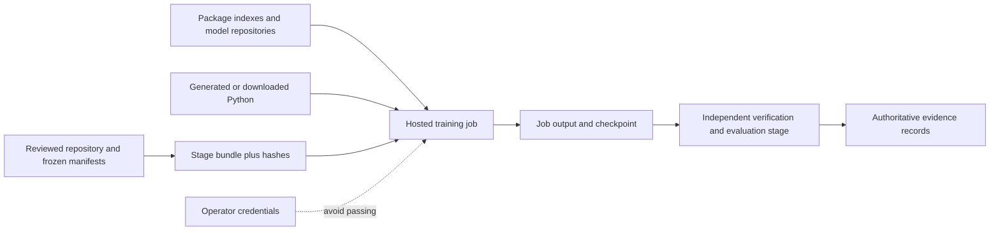

# Nano-LM execution isolation assessment

Assessment date: 2026-10-23 (local). Baseline: `origin/master`
`dbbeb84eaaaeaa128a1cc206f1adf02eb172678c`. Scope: repository code and recorded
artifacts, local synthetic CPU probes, published platform documentation. No
account credentials were read, cloud jobs launched, or original experiments rerun.

## Decision

**No-go for adding Anthropic SRT to the training/evaluation dependency path.**
Retain hosted job isolation and existing stage-separated, hash-verified bundles.
Remove unnecessary custom Hugging Face code execution from the Qwen control
adapter. This is a demonstrated, narrow improvement independent of sandboxing.

Additional per-job isolation is warranted when executing unreviewed generated
scripts or downloaded repository code with access to valuable files or credentials.
Use a disposable, credential-free job with only its stage inputs and output
directory. Do not run such code in the authoritative evidence checkout. SRT may
be useful for CPU agent commands, but this assessment does not certify it for ML
training. Its tested policy blocks real operations after process startup, yet
also breaks the representative multiprocessing workload. No production wrapper
or new runtime dependency is introduced.

## Research reconstruction and preservation

| Program | Grounded evidence and constraints | Status retained |
|---|---|---|
| E1 | `trajectory/results_e1_utility.json`: M1 U=0.9989993963; best official M0 Pythia-160M LoRA U=0.9252173640; ownstack LoRA U=0.8984580064. Frozen improvement threshold 0.05. | Scoped KILL on the old closed task and frozen utility; not a program-wide stop. Public reproduction of latency/cost normalization remains partial. |
| E2 | `trajectory/PREREG_E2_lora_universes.md`: preregistered U1–U4 and fixed LoRA comparisons; >=5-point target improvement and <2-point other-task constraint. | Gated/stopped, no completed confirmatory result established. Interrupted U3 material is not a successful result. No hypothesis, target-module selection, or execution gate changed. |
| E3 | `results_e3_normalize_construct.json`: M0 4,995 fields, 486 exact failures, zero normalized rescues. `results_e3_human.json`: frozen 100-item exact-error audit, zero accepted faithful. | EXACT_SURVIVES retains its bounded meaning. The audit is agent-applied rubric evidence, not clinician dual-IAA validation. |
| Native / P1 | `nano/` symbolic substrate; `nano_ai/` learned path. H6 terminal evaluation must not be replayed. H7 packager separates fit/calibration from screen/control and hashes bundles/checkpoints. | Master ACTIVE_NOW says H7 execution-ready. The pre-existing dirty `codex/p1-h7-scribing-path` checkout records newer H7 invalid-gold follow-up; this is separate branch evidence, not an integrated master result. Neither state authorizes a rerun here. |

Historical harnesses include 3.15M/10M controls, custom 160M ownstack and Pythia
LoRA. `trajectory/kaggle_ownstack_160m_lora.py` fixes width 1024, 14 layers,
16 attention heads / 4 KV heads, FFN 2752, sequence 512, vocabulary 4098,
batch 8 with accumulation 4, 12,000 generated dialogues (overlength skipped),
3 epochs, LR 1e-4, 3% warmup, LoRA rank 16 / alpha 32 / dropout 0 over the
declared projections. Its seed is FT_SEED (default 0). Historical train/eval
seeds and token budgets belong to their individual manifests; this probe does
not replace them with its synthetic seed 123. Existing checkpoint loads using
`weights_only=True` and integrity manifests are useful controls.

No dataset, preregistration, ledger, checkpoint, metric, token budget, split,
baseline, or freeze tag was changed. `isolation-evidence/research-input-hashes.json`
compares four central records byte-for-byte with the baseline. The patch changes
only the Qwen adapter policy and adds tests, a diagnostic script, and this report
with synthetic evidence. The original dirty checkout was not edited.

## System model and trust boundaries



The cloud tenant boundary is outside the job. Python, shell subprocesses,
installers and custom model code inside a job generally share that job's file
access and identity. Hashes detect changes only when the expected manifest is
trusted separately; a process able to replace both artifacts and hashes defeats
that check. Synthetic dialogue strings parsed as data are not inherently code.

Assets: frozen configurations and ledgers (highest scientific integrity), held-out
evaluation data, model checkpoints, runtime provenance, operator tokens, and
compute budget. Attackers considered: compromised packages/model repositories,
malicious downloaded scripts, or erroneous agent-generated commands. No evidence
of a compromise was found or assumed. PHI/private owner material is out of scope
and remains unauthorized. Host/kernel/GPU-driver exploitation is outside local
probe coverage.

## Prioritized threats and existing controls

| Priority | Entry point / abuse path | Existing control and residual gap | Action |
|---|---|---|---|
| High | Qwen `weights_path` selects a repository with `auto_map`; `trust_remote_code=True` executes its Python under the job identity. | Operator-controlled input, not a public endpoint; still unnecessary execution authority for a native Qwen model. | Set False for tokenizer and model. Synthetic positive-control tests demonstrate the former execution path. |
| High | Package installation or unreviewed agent script reads credentials and uploads them. | Hosted boundary isolates tenants, not credential environment variables or mounted home within the same job. No live credential exposure was established. | Build reviewed pinned dependencies separately; pass only required inputs, no operator home/tokens, fetch data before disabling network. Avoid arbitrary repository code on the evidence host. |
| High | Training job reads held-out data or rewrites gold/results and matching hashes. | H7 stage bundles, allowlists and hashes reduce accidental mixing; hashes are not authorization. | Keep training/evaluation jobs and authoritative manifests separate; read-only input mounts and output-only write paths where supported. Independent promotion of outputs. |
| Medium | Mutable images/dependencies change numerical behavior. | Pins/manifests exist, but root requirements and observed runtimes differ. H6 RUNTIME_DISCLOSURE records visible P100 with CPU execution and a non-exact Torch pin. | Record effective Python/Torch/CUDA, GPU, image digest, seed, precision, backend flags and hashes per run. Changed environments need an explicit equivalence gate. |
| Medium | Checkpoint corruption or malicious deserialization. | Hashes and weights-only loads in examined training code help. They do not establish origin if manifest is writable by the attacker. | Keep trusted expected hashes outside job output; use native safe formats / weights-only loading; export and verify before teardown. |
| Medium | Forgotten pod, lost ephemeral checkpoints, exposed service. | `scripts/p1_runpod_smoke.sh` prints manual remote/teardown steps, uses a mutable image and exposes SSH; it does not guarantee readiness or cleanup. | Do not use it unattended as a managed lifecycle. Verify exact runtime, bounded job, export, and teardown separately. No claim of an actually exposed live pod. |

Other executable entry points include runtime pip installation in
`trajectory/e1/runpod_official_m0.py`, repository-sourced `exec(compile(...))`
in the historical ownstack harness, and mutable action tags in CI. The compile
input is reviewed repository code, not an observed data-to-code exploit.
Historical execution recipes were not rewritten to change preserved evidence.

## Alternatives

| Approach | Benefit / compatibility | Decision |
|---|---|---|
| Existing Kaggle or RunPod job | Already separates the project job from other tenants. Actual GPU/runtime/persistence still must be checked. Does not isolate mutually hostile code inside that job. | Retain for reviewed experiments. |
| Native Linux permissions + fresh job/container | Read-only input mounts, non-root UID, dropped capabilities, bounded resources, controlled egress, no host sockets or secrets. CUDA device/driver and `/dev/shm` access can be explicitly configured. | Preferred narrow boundary for unreviewed job code, when the host permits these settings. Not implemented or tested on Linux here. |
| SRT 0.0.81 | macOS sandbox profile; Linux bubblewrap and seccomp plus network proxy. Explicit read-deny/write-allow policy needs careful scope. Local controls work but Torch shared-memory operation fails. | No default training adoption. Optional diagnostic only. |
| Separate VM | Stronger kernel separation for hostile native code; GPU passthrough and cost/operations increase. GPU-driver risks remain. | Only for a justified hostile-code workload; no demonstrated need for current reviewed synthetic research. |

Pinned SRT Linux source constructs `--dev /dev`, a fresh PID namespace and
network isolation, and normally filters AF_UNIX socket creation. **Source-based
compatibility concern:** GPU device visibility and multiprocessing IPC require
validation; macOS results cannot establish CUDA support. Do not enable weaker
nested sandboxing or privileged containers just to make a probe pass. Review
the pinned implementation rather than assuming generic bubblewrap options are
exposed by SRT.

## Executed evidence

Raw observations, including failures, are in `isolation-evidence/` with SHA256SUMS.
Temporary SRT npm install used version 0.0.81 and `--ignore-scripts`; its lockfile
is preserved. Nothing was added to project dependencies. The host is ARM macOS
26.7.2, Python 3.14.7, Torch 2.11.0, Transformers 5.5.3, no CUDA.

The initial SRT invocation inside the agent's outer sandbox failed to bind its
socket (EPERM). Retesting outside that boundary successfully executed `/usr/bin/true`.
Only the latter environment was used for the recorded paired probes. A startup
failure is not counted as enforcement.

The synthetic workload attempts a secret read, child-process secret read,
protected-file write, loopback TCP connection, and permitted artifact write/read;
then runs eight deterministic CPU optimizer steps using two spawned dataloader
workers and reloads a weights-only checkpoint. Three repetitions per condition:

| Observation | Baseline | SRT |
|---|---|---|
| Worker actually starts | 3/3 | 3/3 |
| Synthetic secret read and protected write | Allowed | Permission denied |
| Child secret read | Allowed | Permission denied traceback |
| Local TCP connection | Allowed | Permission denied |
| 1,179,648-byte artifact round trip | Same SHA256 all repeats | Same SHA256 all repeats |
| Initial Torch attempt | Completes | Fails: SRT replaces TMPDIR with `/tmp/claude`, no writable temp |
| After explicitly restoring job TMPDIR | 8 steps, checkpoint equality, identical state hash | Fails: `torch_shm_manager` operation not permitted |

The initial run differs from the committed script only in the SRT command's
TMPDIR override and timeout cleanup (the added control function is independent).
Do not interpret the diagnostic process exit 0 as workload success: inspect
`torch_error` versus `torch` in its JSON.

Corrected-probe baseline median end-to-end time is 4.190 s; median training plus
checkpoint time is approximately 0.85 s. SRT median 1.564 s reflects **incomplete
training**, not a speedup. Main-worker CPU times are 0.975–1.027 s baseline and
0.977–1.002 s SRT; peak main-worker RSS is 306–308 MB versus 296–299 MB. These do
not include all descendants/proxies and cannot establish sandbox memory or CPU
overhead. Warm-cache artifact read/write medians are 1.090 ms versus 1.367 ms;
this tiny buffered I/O check is not dataset throughput or durable-storage evidence.
GPU utilization, VRAM, Linux shared memory, CUDA kernels and training throughput
are **not measured**.

Five successful no-op startup samples give medians 2.792 ms baseline and
178.789 ms SRT (about 176 ms additional startup on this host). Cancellation
probes wait for a started marker then signal the process group: both conditions
prevent the delayed descendant write. SRT returns exit 0 on this cancellation;
callers must not treat that as successful experiment completion. This tests a
cooperative process tree, not a malicious daemon escaping a process group.

The Qwen regression tests use temporary synthetic repositories whose Python
writes a marker and raises a sentinel. Both tokenizer and model fixtures execute
under the old policy and are rejected without execution under the new policy.
A tiny native Qwen2 checkpoint gives exactly equal logits and three greedy tokens
under old/new loading, with unchanged caching. This is CPU loading equivalence,
not proof of full-size Qwen, CUDA, or historical experiment equivalence. Models
requiring custom repository code now intentionally fail closed.

Validation executed successfully:

```text
python3 scripts/check_active_now.py
python3 scripts/check_docs_integrity.py
python3 fabric/test_fabric.py                  # 8/8
python3 trajectory/test_recompute_c3.py        # 7/7
python3 nanoscribe/benchmark.py                # 4 exact synthetic cases
.venv/bin/python -m pytest -q -p no:cacheprovider nanoscribe nano nano_ai/tests benchmarks
```

The broad suite exited 0 with optional skips; collection separately confirms
1,398 tests. The three new offline Qwen integration cases all executed and passed.
The benchmark is a software simulation, not a new model result. Local installed
versions differ from root requirements; no claim of testing that pinned GPU
environment is made.

## Compute and cost decision

Incremental cloud spend: **$0**. No new pod, GPU job, paid endpoint, dataset
upload, or H6/H7 evaluation. Existing campaign balance and live GPU availability
were not queried; previous access is not current availability. Preserve the
$180 autonomous envelope / $200 hard campaign cap / $20 reserve; this assessment
does not expand authorization.

Prefer Kaggle when its actual accelerator, session duration, dependency versions,
internet policy and export limits meet the frozen experiment contract. Its
published Docker recipes are useful provenance, not proof of the assigned GPU
or quotas. Use RunPod only for an exact required runtime/GPU or persistence.
Verify GPU name, VRAM, CUDA compute capability, Torch support, driver, `/dev/shm`,
disk space and effective device before running a bounded smoke test.

RunPod container disk is ephemeral across stop/restart; pod volume lasts until
pod deletion; independent network storage has a separate lifecycle. Published
storage rates consulted were $0.10/GB-month container/running volume,
$0.20/GB-month stopped volume, and $0.07/GB-month network storage. Check current
rates and billing state before allocation. A future 5-minute GPU probe costs
`GPU_hourly_rate / 12` plus storage and billable setup time; no GPU rate or
availability is assumed here. There is insufficient demonstrated benefit to
purchase GPU time solely to rescue this SRT policy.

If reconsidered during an already-authorized GPU job, first prove baseline and
sandbox both complete the identical small workload: same seed/config/data and
dependency/image hashes, precision/TF32/determinism settings, two-worker loader,
checkpoint persistence/export, cancellation, and independent security probes.
Measure startup, process-tree CPU/RSS, tokens/s, I/O, GPU utilization/VRAM; declare
tolerances before seeing results. A failing or changed workload cannot qualify
as equivalent. Keep authoritative evaluation data outside both jobs.

## Reproduction and sources

```sh
# Optional disposable installation, not a project dependency:
npm install --prefix /tmp/nano-srt-check --ignore-scripts --no-audit --no-fund @anthropic-ai/sandbox-runtime@0.0.81
python scripts/probe_execution_isolation.py --srt /tmp/nano-srt-check/node_modules/.bin/srt --output /tmp/new-isolation-run
# Startup/cancellation: call control_probes(srt_path, Path(new_output_directory))
# from scripts.probe_execution_isolation using the same Python environment.
python -m pytest -o addopts='' -q nanoscribe/test_qwen_loading_security.py
```

Use an unused output directory and inspect every JSON outcome. The saved npm
lock records the actual assessed dependency graph; a fresh npm resolution can
differ. Scripts operate only on generated fixtures; do not point them at research
outputs. These checks are not a sandbox escape audit or platform certification.

Primary references consulted:

- [Anthropic sandbox-runtime](https://github.com/anthropics/sandbox-runtime), installed 0.0.81 source and saved package lock.
- [Transformers native Qwen2](https://huggingface.co/docs/transformers/model_doc/qwen2).
- [PyTorch multiprocessing](https://docs.pytorch.org/docs/stable/multiprocessing) and [data loading](https://docs.pytorch.org/docs/main/data.html).
- [Kaggle Docker images](https://github.com/Kaggle/docker-python) and [notebook documentation](https://www.kaggle.com/docs/notebooks).
- [RunPod storage types and lifecycle](https://docs.runpod.io/pods/storage/types).
