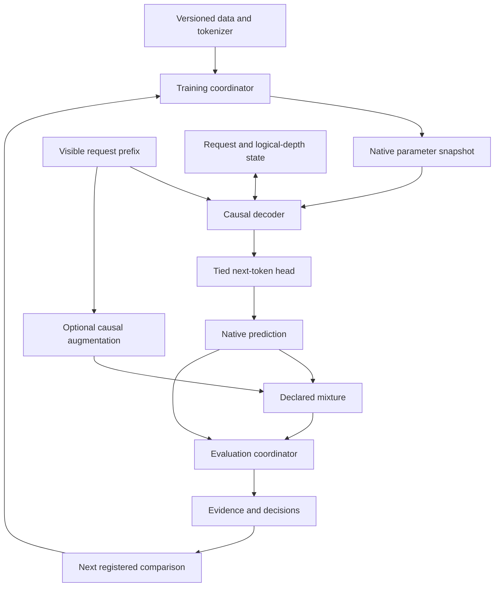

# Nano LM V6 — Full architecture, state contracts and theoretical basis

**Review date:** November 23, 2026, America/New_York.  
**Document status:** current research specification and evidence map. V6 is a documentation, measurement and implementation release; it is not the name of a newly trained checkpoint.  
**Research cutoff:** `3a38b5f1529a718838b5bc83a010574bfa9a4c6e`. Separate correction studies retain their own pinned commits.  
**Project:** Nano LM. APS and AETHER remain names for unselected hypotheses.

## 1. What the system is intended to become

Nano LM aims to produce its own general-purpose foundation model and core architecture, with language, code and reasoning capability assessed against explicit training and deployment costs. The current research direction recorded in the project investigation is native training rather than adopting an external pretrained base. External models remain useful comparators. This direction does not itself select recurrence, a memory algorithm, a model size or a new training campaign. [R6-NATIVE]

The architecture has a concrete implemented center: tokenization, a causal learned decoder, a tied next-token head, a declared training update, immutable inference snapshots and an evaluation interface. Three implementations must be kept distinguishable. The small NumPy reference specifies dense and shared-block forward computation and training mechanics. The upstream JAX implementation supplies the reported 386M native language-model result. Candidate mechanisms such as learned state migration and adaptive depth are research branches with additional acceptance gates. A passing small reference test is not a verification of the large checkpoint; a reported large-model benchmark is not proof that the optional mechanisms work. [07], [10], [R6-NATIVE]

| Layer of the project | Current concrete state | What that establishes |
|---|---|---|
| Native language-model baseline | Upstream 386,062,080-parameter dense decoder; 7,698,841,600 training token presentations reported | A meaningful native baseline to beat under declared protocols |
| Inspectable correctness reference | Float 64 NumPy dense/shared-block models, gradients, AdamW, versioned snapshots and checkpoints | Small, reproducible computational contracts |
| Controlled update measurement | Immutable events, acquisition and revision-aware horizons; completed V5 tiny comparison | A working way to distinguish acquisition, survival and cost |
| New V6 generation instrument | Prompt-only candidate boundary, counterfactual worlds, direct and two-hop tasks, strict offline scoring | A measurement implementation; learned-model results remain pending |
| Optional augmented prediction | Prefix-only n-gram cache and declared mixture | A separately counted augmented-system arm |
| Research alternatives | Shared depth, constrained updates, state transport, copy/store mechanisms | Candidates requiring quality, retention and resource evidence |

The central design decision is to keep these interfaces explicit while letting evidence choose the final backbone. The latest shared-depth toy results are mixed; memory experiments have trade-offs and measurement qualifications; transfer tests do not yet show the sought new-family transfer. None warrants declaring a complete superior architecture. [15], [17]

## 2. System boundary and information flow

The inference path consumes only the visible prefix and a fixed parameter snapshot. Labels, oracle answers, future events, evaluation split identities and experiment conditions belong to the coordinator. They do not become model input merely because they are available in the same experiment process. Test-time learning, retrieval and tools require separately named arms with their state, exposure and cost included. The reference boundary is a program interface, not a security sandbox against malicious code. [10], [16]

Three scoreboards are maintained: **native**, using the project's own learned weights; **adapted**, using an external pretrained base; and **augmented**, using additional retrieval, memory or tools. These can share tasks and reporting formats while retaining their distinct sources of capability. A large store cannot be omitted from the resource account because it is outside the learned parameter tensor. [01], [13]

### 2.1 Three clocks and four state owners

| Object | Clock and lifetime | Owner | Rule |
|---|---|---|---|
| Observed token position `t` | One advance per consumed token | Request coordinator | Refinement or repeated layers must not consume the token twice |
| Logical depth or refinement `k` | Several computations at one token position | Decoder | Shared weights still have distinct logical states |
| Training update `n` | One committed parameter update | Trainer | Evaluation uses a fixed `n` unless adaptation is declared |
| KV or working state | One permitted request/document prefix | Inference session | Reset at boundaries and reject incompatible snapshots |
| Parameters and optimizer state | Training/checkpoint lifetime | Trainer | Commit together with validated configuration and receipts |
| Evaluation oracle and event schedule | Experiment lifetime | Coordinator | Never delivered through the model input contract |
| Evidence and decisions | Append-only research history | Ledger maintainer | Correct a claim through a new event, preserving earlier evidence |

Loss masking is not a substitute for attention isolation. Packed independent documents need explicit attention boundaries, position behavior and reset rules. The small reference does not implement packed-document training. Any production adapter that does so must supply and test those rules. [07], [10]

## 3. The native decoder

### 3.1 Common computation

Let token IDs be \(X\in\{0,\ldots, V-1\}^{B\times T}\), embeddings \(E\in\mathbb R^{V\times d}\), and initial residual states \(H^0=E[X]\). Each decoder layer applies pre-normalized causal attention and a gated feed-forward transformation with residual additions:

$$
\widetilde H^\ell=H^\ell+\operatorname{Attn}_\ell(\operatorname{RMSNorm}(H^\ell)),
$$

$$
H^{\ell+1}=\widetilde H^\ell+
\left[\operatorname{SiLU}(N^f W^G_\ell)\odot(N^f W^U_\ell)\right]W^D_\ell,
\quad N^f=\operatorname{RMSNorm}(\widetilde H^\ell).
$$

The final logits are

$$
\Lambda=\operatorname{RMSNorm}(H^L)E^\top,
\qquad p_\theta=\operatorname{softmax}(\Lambda).
$$

The embedding and output table are tied. RoPE rotates query/key coordinates according to token position. A causal mask prevents position `t` from using later input tokens. Logits at `t` predict the token at `t+1`, so attending to the observed token at `t` is allowed. RMSNorm, rotary positions and gated feed-forward units are established building blocks; combining their names makes no novelty or quality claim. [07], [P-38–P-40]

### 3.2 The reported 386M implementation

The upstream JAX model adds RMS normalization of queries and keys and grouped key/value heads. It is not byte-for-byte the small NumPy reference. Its inspected configuration is:

| Field | Frozen 386M baseline |
|---|---:|
| Vocabulary size `V` | 32,768 |
| Residual width `d` | 1,280 |
| Distinct layers `L` | 20 |
| Query heads `H` | 20 |
| KV heads `Hkv` | 4 |
| Head dimension `dh` | 64 |
| Feed-forward width `f` | 3,456 |
| Tied embedding/head | Yes |
| Training crop length | 512 targets |
| Reported learned scalars | 386,062,080 |

For this implementation, with query/key gains each of length `dh` and KV width \(d_{kv}=H_{kv}d_h\), the source-derived parameter formula is

$$
P=Vd+L\left(2d^2+2d\,d_{kv}+3df+2d+2d_h\right)+d.
$$

The terms are embedding; Q/output matrices; K/V matrices; gated feed-forward matrices; two residual normalization gains; query/key normalization gains; and final normalization. Substitution gives the reported 386,062,080. This is an independently checked source-shape inventory, not an independent loading and hash verification of the remote checkpoint. [R6-NATIVE]

The recorded run uses bfloat16 compute with float32 normalization statistics and attention softmax, 234,950 updates, batch 64, two microbatches, seed 1000 and four data-parallel TPU v5 lite devices. It reports Muon on block matrices and AdamW on embedding/gain tensors, peak learning rate 0.002, warm-up 500, weight decay 0.1 on all tensors and learning-rate floor 0.01 of peak. Run metadata, rather than a stale trainer docstring, controls the recipe description. The exact exposure is 7,698,841,600 scored training-token presentations, approximately 19.94 per parameter. Repeated crops mean exposure is not unique corpus coverage. [15], [R6-NATIVE]

The result reports completion and a mixed evaluation score 0.8049. That score is a weighted combination of domain BPB values on fixed sampled crops. It is not the pooled BPB of the entire held-out corpus. The current audit recovered the historical trainer whose SHA prefix matches the recorded run; it did not execute the training or recover all checkpoint, tokenizer and data bytes independently. [15]

### 3.3 Dense versus shared-depth correctness reference

The NumPy reference uses full multi-head attention without the JAX model's query/key gains or grouped KV projections. It permits `L` logical layers and `U` unique blocks, using block `l mod U`, where `L` is a multiple of `U`. Its parameter formula is

$$
P_{\rm ref}=Vd+U(4d^2+3df+2d)+d.
$$

An illustrative width 256, vocabulary 32,768, FFN768, eight-layer dense model has 15,208,704 learned scalars. Sharing four blocks across eight logical layers gives 11,798,784. Both execute eight layers and retain eight logical KV caches. These are exact inventory examples, not trained quality comparisons or a matched-parameter experiment. [07]

For full attention, the K/V storage account is \(2LBTd\, b\), where `b` is bytes per element. For the grouped-KV model it is \(2LBTd_{kv}\, b\). At batch 1, prefix 512 and two-byte elements, the latter gives 10,485,760 bytes, or 10MiB, for the 386M configuration. This is a hypothetical cache tensor budget if an incremental implementation allocates those tensors; it is not a measured serving-memory result for the inspected full-prefix evaluator. Allocator overhead, temporary activations, output logits, runtime workspaces and weight storage are additional. [07], [R6-NATIVE]

## 4. Training, update and checkpoint contracts

The default objective is next-token cross-entropy over declared eligible targets:

$$
\mathcal L(\theta)=-\frac{1}{N}\sum_{b,t}q_{bt}
\log p_\theta(x_{b,t+1}\mid x_{b,\le t}),\qquad N=\sum q_{bt}>0.
$$

A training recipe must pin tokenizer, document split, BOS/EOS and padding conventions, sample order, loss mask, optimizer, clipping, weight decay, scheduling, precision, accumulation and all shared-parameter registration. Auxiliary retention or state losses remain zero until their exact target, reduction, gradient path and tuning budget are defined. [01], [10]

The small training implementation analytically differentiates attention, normalization, rotary coordinates, gated feed-forward units and both uses of the tied embedding. Shared weights accumulate contributions from every logical use and enter the optimizer once. Tests cover finite-difference directions, forward parity and shared-gradient identities on small cases. These are mechanics checks rather than a scale or convergence theorem. [10]

A checkpoint records the model configuration, named tensors, optimizer state and hashes. An inference snapshot is independent of mutable training state. A cache created under one snapshot is invalid under another. The implemented NumPy checkpoint uses exclusive, pickle-free NPZ creation and tests exact resume in its supported environment; it does not yet provide full production crash recovery, authenticated provenance or a corpus-sampler cursor. Those remain explicit integration requirements. [10]

### 4.1 Actual updates are the object to protect

Let a proposed optimizer move be \(\Delta\theta\). A raw gradient projection does not imply that momentum, preconditioning and decoupled decay produce a protected actual move. The trainer must measure the committed displacement, validate protected-output residuals after dtype conversion and report new-task acquisition. A solver status or a mathematical candidate vector cannot replace checking the vector actually installed in the model. [10], [12], [17]

In the audited bilinear correction code, zeroing the present gradient of an old address does not enforce a constant address when Adam retains moments. The available code also does not log every old-address displacement. This leaves decoder-only causal attribution unverified. It does not demonstrate that address drift was large in the reported correction runs: after 200 zero-gradient steps a first moment with beta 0.9 is multiplied by approximately 7.1e-10. An enforced invariant or a measured bound is required before making the stronger attribution. [17]

## 5. Optional mechanisms and their adoption gates

| Mechanism | Insertion point | Mandatory controls | Status and decision rule |
|---|---|---|---|
| Shared depth | Reuse decoder blocks at several logical depths | Dense controls, tuned learning rates, equal-exposure and equal-compute views | Mixed toy results; compare at native scale before selection |
| Adaptive refinement | Additional transition at one token position | Fixed 0/fixedK controls, hard compute cap, router overhead | Proposed; a discrete loop count is not automatically differentiable |
| Replay | Additional or reallocated training targets | Same event history, full target/update counts, retention and acquisition | V5 tiny experiment had mixed/negative primary outcome |
| Constrained actual updates | Candidate optimizer displacement | Unconstrained and replay arms, actual residuals, full address/decoder state | Promising scoped retention trade-offs; no general no-forgetting proof |
| Representation transport | Explicit compatible feature/readout boundary | Frozen model, replay, re-encoding, anchor and rewrite cost | Conditional algebra exists; useful learned migration unshown |
| Causal n-gram cache | Declared predictive mixture after native logits | Equal prefix, score-before-observe, document resets, storage/latency | Implemented comparator; historical invalid cache result stays excluded |
| External learned store or copy path | Separately counted augmented output | Independent valid control, training data and memory costs, same-prefix evaluation | Scale-specific results and negative branches restrict current claims |
| Reusable procedures across tasks | Learned representations and adaptation | Fresh task families, valid adaptation interface, learning curves | Tested transfer protocol negative; broad impossibility unproved |

A candidate is adopted only if it improves a registered quality/resource trade-off against a strong tuned control while satisfying retention, data and operational constraints. Improvements in one endpoint can justify follow-up without selecting the architecture. A parameter-count win does not imply lower compute; a kernel speedup does not imply lower end-to-end cost. [03], [13], [15], [17]

## 6. Evaluation architecture

### 6.1 Four complementary measurements

| Measurement | What the system must record | What it cannot establish alone |
|---|---|---|
| Held-out next-token loss / BPB | Exact data bytes or defined sampled estimand, tokenization, masks, crop IDs and domain weights | Free-generation correctness or transfer |
| Continuation ranking | Prompt/continuation token boundary, normalization, options, tie policy and item-level results | Unconstrained answer generation |
| Controlled generation | Visible facts, counterfactual worlds, decoder settings, exact output and failure denominators | General reasoning from a small grammar |
| Continual learning / transfer | Common event histories, adaptation budget, acquisition, uncensored survival and new-family curves | A universal capacity or nonexistence theorem |

The upstream native scorer and external Hugging Face scorer tokenize context/continuation boundaries differently. This is a contract risk requiring item-level parity checks, not demonstrated invalidity of every recorded score. Claims that all inputs fit the window need a committed token-length manifest and actual tokenizer/checkpoint identities. The V6 instrument makes these receipts mandatory for an eligible real-model run. [R6-CONTEXT], [16]

### 6.2 Controlled generation implemented in V6

The new instrument generates direct retrieval and two-hop relational tasks with arbitrary names and values. Each base world produces five conditions: original complete facts A; counterfactual facts B with the same query and a different correct answer; reordered facts A; no facts; and a broken chain. Development and evaluation have separate world IDs and entity/value vocabularies while sharing grammar templates. The default package has 96 worlds and 480 records. [16]

The primary endpoint, separately for each split and task family, is

$$
J=\frac1{N_{\rm worlds}}\sum_i
\mathbf1[\hat y_{i,A}=y_{i,A}\ \land\ \hat y_{i,B}=y_{i,B}].
$$

Every world remains in the denominator. Missing, context-ineligible, backend-error, malformed and budget-exhausted outputs do not disappear from the score. Contextual gain uses the original A answer for both full-context and no-context predictions. Proper UNKNOWN abstention on no-context or broken-chain prompts is reported separately, because changing the gold answer would otherwise change the meaning of the subtraction. [16]

The adapter receives only a prompt. Actual tokenizer input IDs, checkpoint/tokenizer/config/adapter hashes, context limit, output IDs, stop reason, state reset and truncation=false form the run receipt. Input length plus the 32-token output allowance must fit. Unknown counts cannot be replaced with characters or bytes to establish eligibility. The offline scorer accepts prediction files, verifies dataset/protocol identities and retains explicit failure counts. Symbolic parsers and answer shortcuts are instrument controls. They never become learned-model evidence by passing the same scorer. [16]

RULER motivates controlled retrieval and multi-hop tests; GSM-Symbolic motivates testing controlled variations of an underlying template. The Nano LM instrument is narrower than either benchmark. It does not reproduce their scores, establish natural-language generalization or adopt sweeping claims about the absence of reasoning. Pythia offers checkpoint series for studying training progress, but matching a nominal checkpoint step does not match data, tokenizer, context, optimizer or total compute. [P-46–P-48]

### 6.3 Contamination and uncertainty

The generated-world split prevents the instrument from deliberately reusing its own world identities across development and evaluation. It does not establish that training data were free of related templates or that published cases will remain unseen. Status stays **NOT_CHECKED** until an actual corpus-overlap procedure and its coverage are recorded. The upstream overlap filter samples 13-word windows at stride 7; it cannot certify absence of every possible 13-word overlap. [15], [16]

Report exact numerators and denominators and use the base world as the dependence unit. For later efficacy work, freeze paired resampling or an appropriate paired test before evaluation; do not infer exact paired significance from rounded aggregate accuracies. The current small generation recipe has no confirmatory success threshold. Its purpose is to make a missing measurement executable and falsifiable before scoring an actual checkpoint. [16]

## 7. Theoretical basis and proof boundaries

### 7.1 Causal execution

If each layer at position `t` reads only earlier/current observed tokens, and all carried state is derived from that allowed prefix, then its output depends only on that prefix. The proof is induction over layers, token positions and any fixed-prefix refinement steps. A later unseen suffix cannot change an earlier output under fixed parameters. Reset rules and correct cache ownership are premises. Small suffix-noninterference and incremental/full-prefix checks test the implementation; the induction does not certify arbitrary uninspected adapters. [07]

### 7.2 Coherent representation transport

For an encoder `E`, decoder `D` and bijection `T`, define \(E'=T\circ E\) and \(D'=D\circ T^{-1}\). Substitution gives \(D'(E'(x))=D(E(x))\). This elementary identity shows that coordinates need not remain fixed to preserve a function. It does not show that a neural model can learn a cheap suitable `T`. Whole-network compatibility must include tied weights, normalization, rotary coordinates, attention dual maps and cached state. A rank-deficient map can merge distinct states and destroy recoverability. [01]

If logits change by at most epsilon in infinity norm, a top 1 margin greater than 2epsilon preserves the winner. This follows because the winner can fall by epsilon while a rival rises by epsilon. The premise is a measured or proved logit bound; preserving covariance does not supply it. [01]

### 7.3 Actual-displacement protection and finite horizons

For protected outputs \(f(\theta)\), Taylor expansion gives

$$
f(\theta+\Delta)-f(\theta)=J\Delta+R(\Delta).
$$

An exact nullspace move makes the linear term zero. Under a stated Hessian bound, the remainder is quadratic in the displacement. Without such a bound, finite nonlinear updates have no exact protection guarantee. In a bilinear model, decoder changes, address changes and their interaction all contribute. Over a fixed-semantic finite horizon, the sum of bounds on actual margin losses must remain below the initial margin to certify retention. Failure of this sufficient bound is inconclusive rather than proof of forgetting. [01], [11], [17]

### 7.4 Soft attenuation is not exact nullspace projection

For \(A\in\mathbb R^{m\times r}\) and \(\alpha>0\), consider

$$
P_\alpha=\alpha(AA^\top+\alpha I)^{-1}.
$$

Since \(AA^\top\) is symmetric positive semidefinite, its eigenvalues are \(\sigma_i^2\ge 0\). The corresponding eigenvalues of \(P_\alpha\) are \(\alpha/(\sigma_i^2+\alpha)\), strictly positive and at most 1. Therefore this finite-alpha operator is full rank. It attenuates supported directions and preserves exact null directions; it does not eliminate a positive-eigenvalue direction. The trace divided by `m` is average attenuation, not a literal fraction of available directions. An exact projector requires a separately declared spectral cutoff or zero-alpha limiting construction with its own numerical analysis. [17]

### 7.5 Counterfactual context dependence

Take two prompts with the same query and distinct correct answers \(y_A\ne y_B\). A context-blind predictor with the same output distribution `p` in both worlds has mean accuracy

$$
\tfrac12[p(y_A)+p(y_B)]\le\tfrac12.
$$

A deterministic context-blind predictor returns the same answer in both worlds, so its joint A/B correctness is zero. The inequality follows because probabilities of distinct answers sum to at most 1. A stochastic joint bound needs assumptions about dependence between draws and is not asserted here. A high joint score demonstrates sensitivity sufficient for these generated pairs; it does not prove general reasoning. Fact-order controls further test position shortcuts, and broken-chain controls test unsupported guessing. [16]

### 7.6 Exact storage and edit costs

A finite state containing `b` reliable bits can distinguish at most \(2^b\) states. Encoding every arbitrary assignment of `N` independent facts with `K` values losslessly requires \(b\ge N\log_2K\). Real knowledge has structure, loss is permitted, external state may be present and finite precision must be specified; this bound is not a universal facts-per-parameter law. [01]

The V5 coordinate example remains exact: from(2, 1), target margin \(y-x\ge 3\) needs minimum L1 movement 4; additionally requiring \(x-\frac 25y\ge\mu\), for \(\mu\ge 0\), raises the minimum to \(4+10\mu/3\). At zero protected margin one endpoint ties. This demonstrates a specified trade-off, not that all successful edits necessarily corrupt facts or require replay forever. [12]

No theorem here proves that Nano LM will outperform dense models, learn a suitable representation migration, achieve unbounded continual learning or acquire general intelligence. The proofs identify the assumptions a successful implementation and experiment would have to satisfy.

## 8. Resources, acceptance gates and practical execution

The resource vector includes parameter storage, optimizer state, active and persistent memory, train-token exposure, total training computation, inference computation, wall time, latency distribution, data movement, energy when measured and external store construction/update cost. Keep these units distinct. A rough `6ND` training-compute estimate is labeled an approximation and is not a substitute for hardware measurements. [13], [15]

| Gate | Required evidence | Present disposition |
|---|---|---|
| Contract correctness | Causality, state reset, gradients, receipt validation, checkpoint identity | Small reference checks exist; V6 adds generation-instrument checks |
| Current native baseline | Exact recipe and source, recovered evaluation receipts, defined metrics | Upstream 386M source audited; independent full checkpoint/data recovery pending |
| Context-dependent generation | Actual checkpoint/tokenizer adapter and frozen public/oracle instrument | Instrument implemented; learned-model execution pending |
| Architecture comparison | Tuned dense/shared/hybrid arms at fixed experience and measured compute | Native-scale controlled comparison pending |
| Durable updates | Same events, acquisition and finite-horizon survival, actual state drift | Scoped pilots and defects documented; native efficacy open |
| Forward transfer | Learnable new families, informative adaptation controls, paired learning curves | Current finite protocol negative; stronger follow-up needed |
| Deployment/resource frontier | Quality guardrails, peak memory, latency, hardware/workload repeatability | No adoption or production performance certificate |

The source project lists four next directions: continuing the 386M baseline with decay, a native recurrent/dense comparison, generated reasoning training data, and generative reasoning evaluation. This continuation implements the last as a bounded local instrument. Training or paid infrastructure is not launched by this documentation release. [15], [16]

## 9. Decision history, provenance and maintenance

Each new decision event records the decision, rationale, alternatives, evidence type, source identities, scope, outcome, unresolved questions and next gate. An event referring to an existing decision links to that decision's previous event. Published historical results remain byte-identical; changed interpretations are appended. Hashes demonstrate byte identity against the recorded digest, not scientific truth or authentic authorship. [02]

The repository owner relocated this workstream's historical contributions from the shared `LEDGER.md` into `LEDGER-FIRST-PRINCIPLES.md`. V6 preserves that current prefix and appends there. It does not restore an obsolete whole shared ledger or overwrite the other workstream's current decisions. The frozen V5 machine-event prefix is retained, and V6 source manifests distinguish the main research cutoff from separately inspected correction branches. [02], [06]

The full evidence package includes source copies, arithmetic reanalysis, mathematical diagnostics, generation code/tests, protocol, decision history and reading-depth-qualified references. The primary entry point is this standalone architecture. Detailed historical chapters remain available so that current conclusions can be traced to earlier choices and reversals.

## 10. References and navigation

| Key | Source |
|---|---|
| [01] | [Historical architecture and conditional propositions](01_ARCHITECTURE_AND_THEOREMS.md) |
| [02] | [Decision ledger and current V6 additions](02_DECISION_LEDGER.md) |
| [03] | [Execution plan](03_EXPERIMENTS_AND_EXECUTION.md) |
| [06] | [Verification and unresolved work](06_VALIDATION_AND_UNRESOLVED_WORK.md) |
| [07] | [Exact NumPy forward/tensor contract](07_IMPLEMENTATION_CONTRACT.md) |
| [10] | [Native training, optimizer and checkpoint contract](10_TRAINING_AND_CONTROLLED_UPDATE_CONTRACT.md) |
| [11] | [Conditional durability and margin evidence](11_MARGIN_RESULTS_AND_DURABILITY_THEORY.md) |
| [12] | [Optimizer factorial and exact edit geometry](12_OPTIMIZER_FACTORIAL_AND_UPDATE_GEOMETRY.md) |
| [13] | [Causal memory and resource frontier](13_CAUSAL_MEMORY_AND_RESOURCE_FRONTIER.md) |
| [15], [R6-NATIVE] | [V6 native/scaling/transfer evidence review](15_NATIVE_BASELINE_AND_RESEARCH_UPDATE.md) |
| [16], [R6-CONTEXT] | [V6 generation evaluation and context contract](16_GENERATIVE_REASONING_EVALUATION.md) |
| [17] | [V6 correction measurement and protection theory](17_CORRECTION_MEASUREMENT_AND_PROTECTION.md) |
| [P-38–P-40], [P-44–P-48] | [Primary references and exact reading scope](04_EVIDENCE_AND_REFERENCES.md) |

**Current scientific conclusion:** there is a stronger reported native baseline and a more precise, executable route to testing its weaknesses. Architecture superiority, robust new-family transfer and durable native learning remain questions to answer with the specified comparisons.
