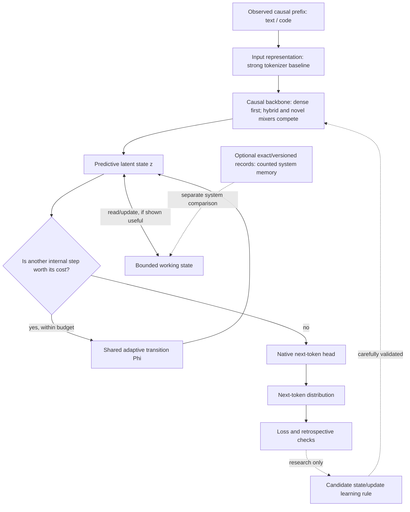
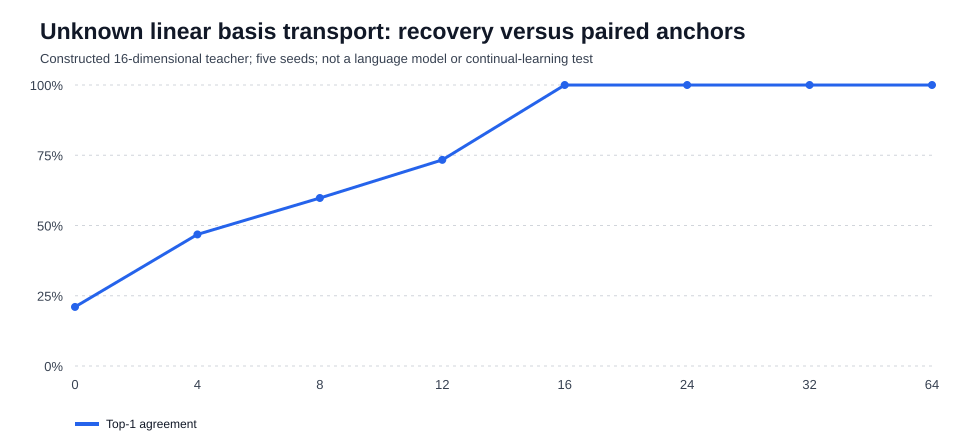
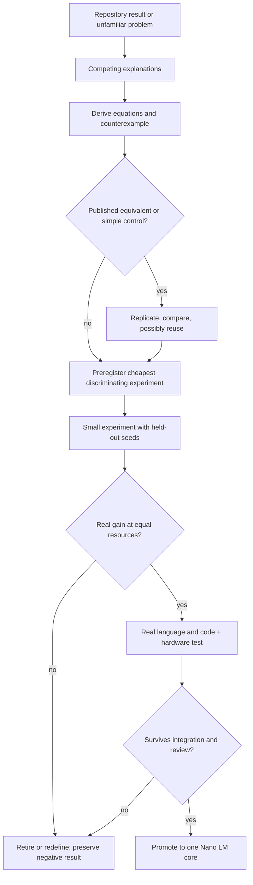
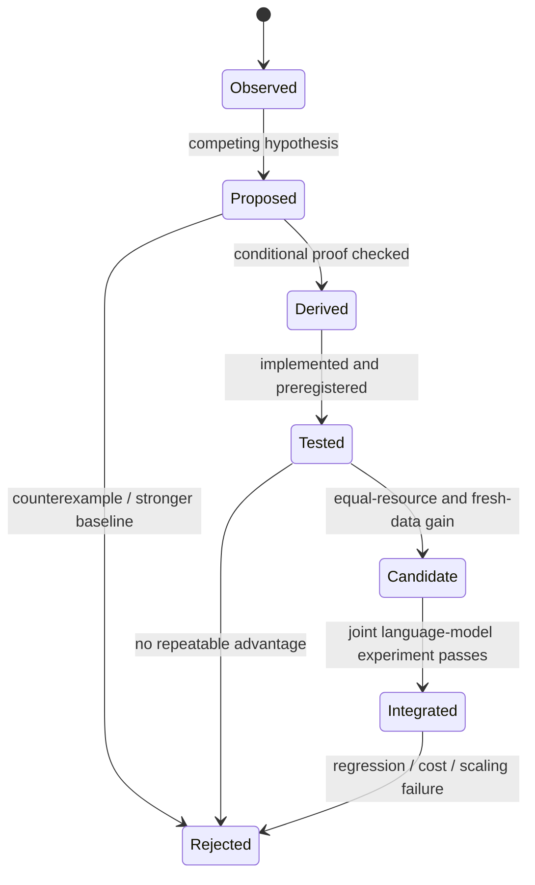

# 01 — Nano LM candidate architecture, falsifiable hypotheses and mathematical propositions

**Research status:** reviewed candidate specification, not an adopted architecture; 2026-11-21. **Repository name unchanged:** Nano LM.  
**Scientific aim:** one native-trained model, multiple controlled research alternatives, maximum verified language/code/reasoning competence for constrained compute, power, memory and data.  
**Theorem scope:** the proofs in this document establish properties of particular algorithms *under stated assumptions*. They neither prove that the proposed neural model can learn those algorithms nor that it will exceed a dense Transformer.

> **Current formal revision (2026-11-21).** This revision corrects the V2 interpretation of architecture-compatible transport, optimizer displacements, temporal history and hypothesis rejection. Read [the earlier gap-closure review](05_GAP_CLOSURE_AND_FORMAL_REVIEW.md) as review history; the precise statements below control where it is less specific. APS remains an **unselected interface hypothesis**. The native model has no required external database or tool dependency. Conditional proofs and deterministic examples provide no architecture-level quality result.

**Executable companion:** [07 Implementation contract](07_IMPLEMENTATION_CONTRACT.md) instantiates dense/shared-block forward passes and exact counts; [09 Evidence refresh](09_EVIDENCE_REFRESH_AND_PROTOCOL_REPAIRS.md) supersedes stale experiment-status descriptions.

## Executive summary

The principal new proposal is **not** 'combine Mamba, attention, copy, recurrence and a database'. It is to examine whether **predictive state may be reorganized and updated without sacrificing access to what the model previously learned**, while **variable computation is allocated only where its marginal benefit justifies its cost**. A single model could, if experiments succeed, learn both reusable transformations and changing representations, without forcing all experience into slowly updated parameters or depending entirely on ever-longer context. We call this *adaptive predictive-state computation* (APS) solely to identify a testable candidate; it is not a model rename or novelty claim.

The default measurement reference is a well-optimized **dense causal Transformer**. Competing references include a **published hybrid mixer**, a **weight-tied recurrent-depth network**, **exact and replay-based correction baselines**, and independently tuned data/optimizer recipes. Which reference is strongest depends on the task, scale and resource constraint; the preliminary evidence does not select an overall winner.

| Functional ability | Proposed physical realization | Mathematical object | What is tested independently | A reason to reject |
|---|---|---|---|---|
| Language/code generation | Causal learned backbone and next-token head | $p_\theta(x_{t+1}\mid x_{\leq t})$ | Same-byte BPB and fresh code | Worse LM quality at equal train time |
| Active computation | Repeated shared transition with input re-injection | $z_{t,k+1}=\Phi_\theta(z_{t,k},c_t,m_t)$ | Accuracy vs actual additional joules | Unnecessary loops, latency |
| Working state | Resettable recurrent/KV state | $m^{\mathrm{work}}_t$ | Long dependencies and state tracking | Interference or poor hardware efficiency |
| Persistent knowledge | Slow parameters; optional versioned external records counted separately | $\theta_t$, optional $L_t$ | Retention, revision, forward transfer | External answers misattributed to model |
| State reorganization | Learned transport of features and addresses, only if safe | $T_t$ | Old-task logit drift vs new-task learning | Unknown/noninvertible drift; high rewrite cost |
| Interference control | Replay, gradient projection or other local update rules | $P_t\nabla\ell_t$ | Retained old performance at equal new skill | Constraints prevent all new learning |
| Operation reuse | Candidate learned, reused state transformations | $\mathcal O_\theta$ | **Cross-episode** procedure transfer | Ordinary ICL or scratchpad matches it |
| Exact copy when needed | Optional causal span mode | $p_{\mathrm{copy}}(y\mid c)$ | Copyable and noncopyable BPB | Always-on mechanism harms prose/code |

## 1. The core computational problem

Given future task distribution $\mathcal D$, model design $d$, hardware $h$, and serving regime $s$, seek a feasible Pareto-efficient design:

$$
\max_d \; (Q_{\mathrm{language}},Q_{\mathrm{code}},Q_{\mathrm{reason}},Q_{\mathrm{transfer}},Q_{\mathrm{retention}},Q_{\mathrm{calibration}})
$$

subject to explicit resource budgets

$$
R(d)=(P, N_{\mathrm{train\ tokens}}, F_{\mathrm{train}},J_{\mathrm{train}}, F_{\mathrm{task}},J_{\mathrm{task}},M_{\mathrm{peak}},B_{\mathrm{moved}}, T_{p95}, S_{\mathrm{external}}).
$$

**Never** add these quantities into one arbitrary score before defining the use case and exchange rates. Report Pareto fronts, performance at fixed time/joules, and resource expense at a fixed independently verified quality.

A system with a 50M-parameter processor and a 50GB searchable store is not a 50M-parameter *complete* system. A pretrained adapted model is not a native Nano LM checkpoint. For comparisons, maintain three distinct scoreboards: native learned model; adapted pretrained model; augmented system with retrieval/tools.

## 2. Architecture candidate: one model with separately testable state timescales

The diagram is a **competition map**. Dotted paths are candidates, not deployed components. A learned controller does not change parameters without an explicit update mechanism; a read/write store is an additional resource, not evidence of intrinsic intelligence.

### 2.1 Causal forward computation

Use three different clocks: $t$ is the observed token position, $k$ is a refinement step, and $n$ identifies the training update/checkpoint. Before consuming $x_t$, let $s_{t-1}$ contain only permitted state from $x_{<t}$. The causal core consumes this token **once**, producing $(h_t,\widetilde s_t)=H_{\theta_n}(x_t,s_{t-1})$. Here $\widetilde s_t$ includes the core's cache/state for $x_{\le t}$. Initialize $z_{t,0}=h_t$. For $k=0,\ldots,K_t-1$:

$$
z_{t,k+1}=z_{t,k}+\alpha_{\theta_n}(z_{t,k},h_t)F_{\theta_n}(z_{t,k},h_t).
$$

Input reinjection through $h_t$ is a candidate design choice and must be compared with using $h_t$ only for initialization; it is not a mathematical necessity. Refinement does not advance the token position or append $x_t$ again to the cache. The integer $K_t$ is a discrete routing decision and **does not become trainable by ordinary backpropagation simply because it appears in this equation**. Begin with fixed $K$ and compare controller methods only after these controls earn further work. The head produces

$$
p_{\theta_n}(x_{t+1}\mid x_{\le t})=\operatorname{softmax}(W_{\mathrm{out}}z_{t,K_t}).
$$

This expression forces neither improved reasoning nor convergence. $K_t=0$ is a mandatory ablation. Extra recurrent steps cost arithmetic and memory traffic even when weights are shared.

### 2.2 Optional multiscale state

Only test extra memory when a demonstrated failure motivates it:

$$
s_t=\operatorname{Commit}(\widetilde s_t,U_{\theta_n}(s_{t-1},h_t,z_{t,K_t})),
\qquad \theta_{n+1}=\theta_n+\Delta\theta_n.
$$

The commit combines the core's cache and an optional working-memory write, each exactly once for the observed token. The minimal model omits $U$ and sets $s_t=\widetilde s_t$. It must not use the unrevealed target $x_{t+1}$. State is scoped to one document/request and reset at its boundary. Model parameters stay fixed during ordinary evaluation; the $n$ update occurs only in an explicit training/editing protocol. In an augmented-system arm, a versioned exact collection $L$ is additional storage with reported bytes, indexes, read/write costs, provenance and staleness handling.

### 2.3 Learning proposal

The initial executable objective is causal cross-entropy:

$$
\mathcal L_{\rm CE}=\frac1{|\mathcal I|}\sum_{t\in\mathcal I}
-\log p_\theta(x_{t+1}\mid x_{\le t}),
$$

where $\mathcal I$ contains valid next-token targets within allowed document boundaries. Optional state, retention, operation-reuse or compute terms have coefficient zero until their exact formula, target construction, reduction, gradient path and tuning budget are registered. Naming an auxiliary loss is not an executable definition.

Supervised training may use the next-token label in its loss; a routing decision's input may contain only information available at that decision. Training a causal controller from retrospective labels is permissible on training data, while using those labels to choose test-time routes is oracle leakage. Test-time updates, if studied, require their own predict-before/update-before ordering and scoreboard.

## 3. Mathematical proposition A — representation transport can preserve predictions

**Statement (elementary algebra, not original).** Let $E:\mathcal X\to\mathcal Z$ encode inputs, $D:\mathcal Z\to\mathcal Y$ decode states, and $T:\mathcal Z\to\mathcal Z$ be a bijection. If $E'=T\circ E$ and $D'=D\circ T^{-1}$, then for every $x$:

$$D'(E'(x))=D(T^{-1}(T(E(x))))=D(E(x)).$$

**Proof:** by substitution and the definition of inverse; no probabilistic assumptions needed. **Consequence:** fixed latent coordinates are *not* mathematically necessary to preserve outputs. Old memory keys may be remapped consistently with the encoder and decoder. This does **not** prove that a model can discover $T$, that the migration is cheap, or that storing historical knowledge in new parameters is solved.

**Linear readout case.** If $D(z)=Wz$, $T(z)=Az$ with invertible $A$, use $W'=WA^{-1}$ at that readout boundary. For orthogonal $A$, $A^{-1}=A^\top$. This proves equality of the specified decoder outputs. Extending the transformation through a whole network requires a compatible transformation of each operation and state; the original architecture family need not be closed under arbitrary conjugacy. The accompanying deterministic check verifies only a linear readout example.

**Bounded approximation result.** Suppose original logits $\ell$ and remapped logits $\ell'$ satisfy $\|\ell'-\ell\|_\infty\le\varepsilon$. If the original top-1 margin $\ell_{(1)}-\ell_{(2)}>2\varepsilon$, the predicted class is unchanged. **Proof:** the winner can decrease by at most $\varepsilon$ and a competitor increase by at most $\varepsilon$. This is a **classification** guarantee under an assumed logit-error bound, not a guarantee about factual truth or calibration. Moreover, the softmax log-probabilities satisfy $|\log p_i-\log p_i'|\le 2\varepsilon$ and $D_{KL}(p\|p')\le2\varepsilon$: the log-normalizer changes by at most $\varepsilon$. These are assumed-perturbation bounds for one prediction step, not claims of low generative-sequence drift.

**Counterexample.** A rank-deficient $T$ can merge $z_1\ne z_2$, making them indistinguishable for any downstream decoder. Then exact old behavior generally cannot be recovered. The problem of *learning* a valid, low-cost migration is precisely the research question.

**Research question:** can a learned, architecture-compatible migration preserve useful predictions while improving the acquisition/retention/cost trade-off relative to replay and freezing? Covariance preservation alone is insufficient: rotating isotropic features preserves their covariance while changing a fixed classifier's decisions. The required target is prediction or task preservation on specified distributions, with independent out-of-sample evaluation. No novelty is claimed for conjugacy or linear identifiability.

### 3.1 Proposition A.1 — identifying a completely unknown linear migration

Let \(A\in\mathbb R^{d\times d}\) be an unknown linear transformation, and let \(m\) anchor pairs \((x_i, Ax_i)\) be observed. Stack anchors into \(X\in\mathbb R^{d\times m}\). If \(\operatorname{rank}(X)=d\), then \(A=(AX)X^+\) is uniquely identified. Otherwise choose nonzero \(u\in\ker(X^\top)\) and \(v\neq0\); \(A'=A+vu^\top\) differs from \(A\) but matches it on all observed anchors since \(A'X=AX\). QED.

**Scope:** This is basic linear identifiability of an unrestricted map, NOT a universal lower bound on how many examples are necessary to preserve useful predictions. Low-rank, orthogonal, sparse, or output-specific transformations may be learned from fewer well-chosen observations.

**Synthetic five-seed demonstration (2026-11-21).** With 16D Gaussian features and an unknown orthogonal basis rotation, the constructed teacher's top-1 agreement under no transport was 21.0%; an exactly known inverse restored 100%. Pseudoinverse estimates using 4, 8, 12 and 16 paired anchors yielded 46.8%, 59.8%, 73.4% and 100%, respectively. This is NOT training an LM or demonstrating efficient self-improving intelligence. Reproduction code: `checks/transport_anchor_pilot.py`; raw JSON `results/transport_anchor_pilot_v0.json`.

**Decision implication:** structured migration is worth investigating only if it beats replay, freezing and re-encoding when counting anchor selection, read/write amplification, model-state accuracy and actual energy.

### 3.2 Compatibility with actual model operations

All vectors in this table are columns. These are algebraic requirements for the stated transformations, not claims that no other equivalent parameterization exists.

| Operation or state | Sufficient transformation / obstruction | Implementation decision |
|---|---|---|
| Linear readout $Wz$ | $z'=Az$, $W'=WA^{-1}$ | A post-normalization readout-boundary probe is the smallest valid transport experiment |
| Transition $z_{k+1}=\Phi(z_k)$ | $\Phi'=A\circ\Phi\circ A^{-1}$ | Establish that the implemented operator family represents this conjugate, or count explicit wrappers |
| Dot-product attention | $q'=A^{-\top}q$, $k'=Ak$ preserve $q^\top k$; transforming both by $A$ generally does not | Queries and keys require dual maps, not one shared arbitrary map |
| Unchanged RMS normalization | $N(z)=z/\sqrt{\|z\|^2/d+\epsilon}$ is orthogonally equivariant; generic invertible $A$ changes the norm anisotropically | Enumerate gains, residual paths and projections; do not assume generic basis changes commute with normalization [FREF02] |
| Fixed RoPE after transformed queries/keys | With $q'=A^{-\top}q,k'=Ak$, preserve scores if $A$ commutes with every relative rotation $R_t^\top R_s$ | Alternatively absorb a residual-stream transform into Q/K projections and leave head coordinates unchanged; RoPE then need not change [FREF03] |
| Tied embedding/head $E,E^\top$ | If $E'=AE$, its head is $E^\top A^\top$, while transport requires $E^\top A^{-1}$; with full-row-rank $E$, universal equality requires orthogonal $A$ | Keep the tie, restrict the map, or declare/count an untied or adapter head |
| Optimizer dynamics | Under $\theta'=A\theta$, gradients transform as $A^{-\top}g$; generic SGD steps do not transform as $A\Delta\theta$. Coordinatewise Adam moments are not generally rotation equivariant | One-checkpoint prediction preservation does not preserve subsequent training; compare resets and explicit optimizer-state migration |

**Concrete obstruction.** In two dimensions with $\epsilon=0$, $z=(1,1)^\top$ and $A=\operatorname{diag}(2,1)$, $N(Az)=(2,1)^\top/\sqrt{5/2}$ while $AN(z)=(2,1)^\top$. The unchanged normalization does not commute with this map. In floating point, an inverse with large condition number can amplify estimation and rounding error; record conditioning, precision and output drift.

### 3.3 Conditional extension to a finite generated sequence

Let $P$ and $Q$ be autoregressive distributions of fixed horizon $T$, starting from the same allowed prefix. Suppose, for every relevant prefix $h=x_{<t}$, their next-token logits satisfy $\|\ell_P(h)-\ell_Q(h)\|_\infty\le\epsilon_t$. Then for every sequence with finite logits,

$
\left|\log P(x_{1:T})-\log Q(x_{1:T})\right|\le2\sum_{t=1}^T\epsilon_t,
\qquad D_{\rm KL}(P\Vert Q)\le2\sum_{t=1}^T\epsilon_t.
$

**Proof:** factor each joint into its conditional probabilities, apply the one-step log-probability bound at the same prefix, and sum. Taking expectation under $P$ gives the KL inequality. This is useful only when the prefix-wise premise is established; an average drift measurement on finite anchors does not establish it. The bound grows with horizon and does not imply identical independently sampled continuations. Equality of greedy trajectories additionally needs the margin condition at every prefix reached by that trajectory.

## 4. Mathematical proposition B — local constraints can protect previous outputs to first order

Let old anchor logits be concatenated in $f_\theta\in\mathbb R^m$, with Jacobian $J=\partial f_\theta/\partial\theta\in\mathbb R^{m\times P}$. Let $P_\perp=I-J^+J$, where $J^+$ is the Moore–Penrose pseudoinverse. For an update direction $g$ choose $\Delta\theta=-\eta P_\perp g$. Then

$$J\Delta\theta=-\eta J(I-J^+J)g=0$$

since $JJ^+J=J$. Thus a Taylor expansion gives

$$f_{\theta+\Delta\theta}=f_\theta+O(\|\Delta\theta\|^2)$$

provided the model is differentiable and the relevant second derivatives are bounded near $\theta$.

**What this proves:** old *sampled anchor logits* do not change to first order. If the Jacobian of these logits is $L$-Lipschitz along the update segment, then their finite-step displacement satisfies $\|f(\theta+\Delta)-f(\theta)\|_2\le(L/2)\|\Delta\|_2^2$ when $J\Delta=0$. An approximate projection adds $\|J\Delta\|_2$ to this bound. This does **not** extend to unseen anchors without additional assumptions. **What it does not prove:** no forgetting on unsampled tasks, preservation under large steps, numerical stability, efficient computation at billions of weights, or successful acquisition. If $g\in\operatorname{row}(J)$, then $P_\perp g=0$ and *new learning is completely blocked*. That is the crucial adverse control.

**Experiment:** compare replay, no replay, weight regularization, projected-update approximations, and state transport on identical correction streams. Measure both retention *and* new-rule acquisition. This is related to published orthogonal-gradient/continual-learning methods; no novelty claim.

### 4.1 Project the realized displacement and measure the residual

The constraint is on $\Delta=\theta_{n+1}-\theta_n$, not on a gradient before the optimizer changes it. For $J=(1,1)$, a projected gradient $g_\perp=(1,-1)^\top$ and diagonal preconditioner $D=\operatorname{diag}(1,2)$, $Jg_\perp=0$ but $JDg_\perp=-1$. Preconditioning, carried momentum, decay, coordinatewise clipping and rounding can violate a raw-gradient projection.

One well-defined local edit first forms the entire proposed optimizer displacement $u$ (including decay), then computes

$
\Delta^*=\arg\min_\Delta\tfrac12\|\Delta-u\|_2^2\ \text{subject to }J\Delta=0
=u-J^\top(JJ^\top)^+Ju.
$

**Proof:** row space and nullspace of $J$ are orthogonal; removing the row-space component yields the unique Euclidean projection of $u$ onto the feasible subspace. The finite-step bound applies to this actual displacement, subject to its smoothness premise. Scalar rescaling preserves the linear constraint; coordinatewise transformations generally do not.

Do not materialize a $P\times P$ projector for a large model. Matrix-free JVP/VJP solves can approximate the constraint and report $\rho=\|J\Delta\|_2$. With Tikhonov damping $\gamma>0$, the update $u-J^\top(JJ^\top+\gamma I)^{-1}Ju$ has residual $\gamma(JJ^\top+\gamma I)^{-1}Ju$, generally nonzero. Count anchors, solver iterations, forward/backward work and optimizer-state bytes. Check the final rounded checkpoint's actual displacement. This is related to established orthogonal-gradient approaches [FREF01]; it creates no new no-forgetting theorem.

**Target policy matters.** Remove or replace constraints representing a deliberately corrected false fact under the registered edit policy. Preserving that fact can directly contradict the new target. For nonsmooth operations, the Lipschitz-Jacobian premise requires an appropriate smooth segment or another justified bound; differentiating at the starting point alone does not cover crossing a ReLU kink.

## 5. Mathematical proposition C — exact independent facts have a storage lower bound

For $n$ independent arbitrary values, each chosen from a set of size $V$, there are $V^n$ possible databases. A fully lossless fixed-length representation with $b$ bits must distinguish all possibilities, hence $2^b\ge V^n$ and

$$ b\ge \lceil n\log_2 V\rceil.$$

**Proof:** pigeonhole principle. **Scope:** worst-case exact decoding with no extra side information, and fixed-length encoding of all possible databases. It is *not* a bound that a 2B model cannot learn a concise reusable procedure, nor a universal bits-per-parameter limit for pretrained LMs. Data regularity, approximate answers and external memory change the problem.

**Architectural consequence:** investigate compressing *regularities and procedures* into weights while counting residual exceptional information elsewhere; do not claim unbounded independent knowledge in a fixed-size state.

## 6. Mathematical proposition D — a versioned record implements a declared historical policy

For a fixed finite event set $E$, each event has immutable fields

$$
e=(k,v,[a,b),r,id,authority,action),
$$

where $[a,b)$ is its valid-time interval and $r$ its recorded-time sequence. The append transaction assigns that sequence; replay never backdates or changes it. For a fixed policy version $\pi$, authorized view $A$ and query $(k,t,r_*)$, define

$$
E_{k,t,r_*,A}=\{e\in E:e.k=k,\ a_e\le t<b_e,\ r_e\le r_*,\ e\text{ is visible in }A\}.
$$

Choose the maximum under a declared total order, for example $(\operatorname{priority}_\pi(authority_e),a_e,r_e,id_e)$. This policy gives authority priority over recency; that priority is a choice, not a theorem about truth. A chosen set event returns its value; a chosen retraction returns **RETRACTED_IN_SCOPE**; an empty eligible set returns **UNKNOWN_IN_SCOPE**. Permission denial does not establish global absence. Identical duplicates can be idempotent; conflicting payloads for one ID must be rejected.

**Two exact properties.** First, permuting storage/replay order while preserving the same immutable events, timestamps, view and policy leaves the maximum unchanged. Second, appending events with recorded sequence greater than $r_*$ cannot change this query, because none becomes eligible. Both follow from equality of the eligible set. Changed permissions or conflict policies can legitimately change an answer; historical queries must identify their view and policy.

**Counterexample to the earlier wording.** A value **old**, valid from 1 and recorded at 1, is followed by **new**, also valid from 1 but recorded at 5. The current reconstruction of valid time 2 can change to **new**. The answer to **valid time 2, recorded cutoff 2** remains **old**. A single timestamp alone cannot preserve what was known earlier.

**Scope:** this is consistency of a specified augmented-store policy. It does not prove that input assertions are true, that every authority is trusted, that storage indexes are correct, or that a native model acquired the knowledge. Unresolved conflicts may require a domain-specific adjudication policy.

## 7. Mathematical proposition E — adaptive compute has a conditional decision rule

For a one-action decision, let $\Delta U(s)$ be expected utility improvement from continuing and $\Delta c(s)=c_{continue}(s)-c_{stop}(s)$ the full incremental cost. Use one physical unit with an explicit utility conversion $\lambda$, or a declared vector of exchange rates. Maximizing $\mathbb E[U-\lambda c]$ selects continuation when

$$
\mathbb E[\Delta U\mid s]>\lambda\mathbb E[\Delta c\mid s].
$$

**Proof:** subtract the stop objective from the continue objective. Costs already paid for the current decision cancel. Extra controller, head and memory costs incurred only on continuation belong in $\Delta c$. This avoids charging common control overhead only against one branch or adding joules directly to utility.

For multiple actions, let $s$ contain enough state (or a belief/history state) to specify transitions, and let $b$ be a remaining hard budget. With a finite horizon or a strictly positive minimum action cost, a finite-action optimal-stopping recursion is

$$
V(s,b)=\max\left\{U_{stop}(s),\ \max_{a:c_a\le b}
\left[-\lambda c_a+\mathbb E[V(S',b-c_a)\mid s,a]\right]\right\}.
$$

Here $c_a$ includes all newly incurred action costs and stopping yields terminal utility once. If no action is affordable, stop. The recursion assumes a known transition/utility model; learned estimates do not inherit optimality. A two-step computation can have negative immediate gain and positive eventual gain, so myopic stopping can be premature.

Learned stopping such as PonderNet is relevant prior art [FREF04]. A Nano controller must be compared with fixed-depth controls, include training and serving costs, and obey the causal input boundary. A hindsight oracle is a diagnostic ceiling. Neither the threshold nor the Bellman identity supplies a learner with unobserved counterfactual utility.

## 8. The conjecture that would actually matter scientifically

> **APS conjecture (unproven).** There exists a trainable causal language-model architecture, within a fixed practical system-resource envelope, that can perform controlled state reorganization and selective additional computation so that cumulative acquisition, retention, correction, and *positive forward transfer* improve jointly over a strong dense model, a strong published hybrid, replay/memory controls and adaptive-compute baselines on unseen tasks, with no material cross-domain LM regression.

This is an **existential research ambition**, not a hypothesis falsified by one architecture or training failure. A finite experiment tests a particular configuration, distribution, budget and comparator set. Failure retires or revises that tested claim; it does not exclude every possible APS-like architecture.

**Operational hypothesis for candidate $C$.** Before evaluation, fix its code/configuration, development search budget, test families, seed rule, primary endpoint $M$, minimum useful improvement $\delta$, retention/domain-loss tolerances $\epsilon_j$, and full resource envelope $B$. The claim is that $C$ improves expected $M$ over the named comparators by at least $\delta$ while every registered regression stays within $\epsilon_j$ and cost stays within $B$. State uncertainty and multiplicity rules before confirmatory data. A failed guardrail prevents promotion; a wide interval is inconclusive. This requires a concrete protocol, not a retrospective choice of the best-looking metric.

**Nontrivial distinguishing prediction:** after experience with a family of compositional procedures, the model learns a *new* procedure from fewer examples than it did earlier, even when earlier demonstration inputs and their solutions are unavailable in its context, **while retained-task accuracy stays stable**. The improvement must persist against a meta-trained Transformer and against a replay/memory baseline with counted resources. No benchmark currently in this project's record establishes this.

## 9. What deserves research first, and what must remain optional

| Candidate axis | Small decisive experiment | Strongest simpler comparator | Promotion rule |
|---|---|---|---|
| Representation transport | Force an invertible transform of stored keys; recover old answers with tracked mapping; then learn mappings | Frozen indexing, full rebuild/replay | Better old/new trade-off including migration cost |
| Constrained correction | One-fact editing vs same-entity replay vs projected gradients | Replay + tuned AdamW | Correct new value without same-entity collateral loss |
| Reused procedures | Unseen cross-episode compositions with no stored in-context examples | Meta-trained dense and explicit scratchpad | Fewer examples at matched compute across task families |
| Conditional depth | Difficulty strata with fixed and varying steps | Equal-FLOP fixed depth and written CoT | Better verified successes/joule after controller overhead |
| Global communication | Remove/relocate full-attention layers from hybrid | Equal-time modern dense/hybrid | BPB and compositional long-range quality retained |
| Source-copy control | Selective copy/length/stop vs frozen LM and M21 | Deterministic string copy, posthoc CopyGen | Copy gains without general BPB/latency loss |
| Optimization of address capacity | Hash/uniform/frozen/learned, Adam reset and beta2 sweeps | Exact hash + replay | Improvement beyond simple optimizer/address fixes |

### One constructive candidate implementation path (NOT a lock)

**Reference V0:** strong 15M dense pre-norm causal LM, 32k-token baseline, same training data and evaluation code as repository. **V1:** introduce a single shared latent transition after a stable block, fixed $K=2$ then ablate to $K=1$. **V2:** introduce a controlled working-state updater with frozen and learned addressing and explicit state-reset tests. **V3:** trial task-level representation transport or correction-safe update, one mechanism at a time. **V4:** adaptive compute only if fixed-state improvements survive. **V5:** integration at 125M *only after* full-text/code and engineering evidence passes. The 2B–4B goal remains a funding-conditional destination.

**Current conclusion:** these proofs establish conditional properties only. A native LM advantage, practical learned migration and cumulative forward transfer remain empirical questions.

## 10. Diagrams for the final architecture decision process

## 11. Primary, checked research touchpoints

- [P-02] Mamba-3, ICLR 2026, [conference page](https://proceedings.iclr.cc/paper_files/paper/2026/hash/8abd2043b71a074278d5f687947bff9c-Abstract-Conference.html): expressive recurrent state and hardware costs.
- [P-03] Kimi Linear, 2025, [arXiv](https://arxiv.org/abs/2510.26692): efficient hybrid attention, but at a much larger total parameter scale.
- [P-01] Qwen3.5 architecture, [official Transformers documentation](https://huggingface.co/docs/transformers/en/model_doc/qwen3_5): 3:1 DeltaNet/full-attention is a reference implementation, not a universal optimum.
- [P-04] Ye et al., ICML 2026, [provable expressiveness hierarchy](https://proceedings.mlr.press/v306/ye26h.html): scope-specific limitations of hybrid recurrent/linear substitutes.
- [P-05] LOTUS, June 2026, [Microsoft Research](https://www.microsoft.com/en-us/research/publication/bridging-the-gap-between-latent-and-explicit-reasoning-with-looped-transformers/): latent looped reasoning trained with intermediate supervision.
- [P-10] Titans, NeurIPS 2025, [Google Research](https://research.google/pubs/titans-learning-to-memorize-at-test-time-2/): trainable test-time neural memory; results are not guarantees for Nano LM.
- [P-12] Kim et al., ICML 2025, [representation shifts](https://proceedings.mlr.press/v267/kim25p.html): a relevant prior-art foundation for representational transport.
- [P-14] Lyle et al., 2025, [disentangling plasticity loss](https://proceedings.mlr.press/v274/lyle25a.html): normalization plus weight decay can be an effective strong control.
- [P-13] Dohare et al., Nature 2024, [loss of plasticity](https://www.nature.com/articles/s41586-024-07711-7): sustained learning failure is distinct from forgetting; continual backpropagation as published comparator.
- [P-11] Nested Learning, NeurIPS 2025, [paper](https://proceedings.neurips.cc/paper_files/paper/2025/hash/4309616aaed8e848009bc4a7ef73b493-Abstract-Conference.html): multi-timescale optimization literature.
- [P-08] CopyGen, October 2026, [paper](https://arxiv.org/abs/2610.28393): published copy gating, length and stop controls.
- [P-07] Byte Latent Transformer, ACL 2025, [paper](https://aclanthology.org/2025.acl-long.453/): byte patching as a competing input design.
- [P-17] FlashAttention-4, MLSys 2026, [paper](https://proceedings.mlsys.org/paper_files/paper/2026/hash/ae8b0b5838ba510daff1198474e7b984-Abstract-Conference.html): hardware-specific performance, not portability guarantee.
- [P-20/P-21] OpenAI 2026 SWE benchmark audits, [Verified](https://openai.com/index/why-we-no-longer-evaluate-swe-bench-verified/) and [Pro](https://openai.com/index/separating-signal-from-noise-coding-evaluations/): do not assume public benchmark labels establish valid generalization.

Repository evidence sources and a larger bibliography are in `04_EVIDENCE_AND_REFERENCES.md`.

## 12. Review precedence and remaining evidence

The earlier [gap-closure audit](05_GAP_CLOSURE_AND_FORMAL_REVIEW.md) records F-01–F-18. This revision supplies more precise formal statements where V2 left an ambiguity: actual architecture compatibility, prefix-wise sequence drift, realized optimizer displacements, immutable recorded-time history, cost-consistent stopping and finite candidate-specific hypotheses. Neither review constitutes native LM validation.

**Architecture status remains unselected.** Strong modern dense D0 is the measurement reference, published hybrid H1 and recurrent R1 are genuine competitors, A1/APS is merely one potentially testable interface, and X0 reserves space for new mathematical structures. One native parametric model is the eventual scientific output; an optional source ledger forms a separate, resource-counted augmented system. Never promote a mechanism on theoretical elegance, a toy result, or novelty alone.

### Nonnegotiable experimental outcomes

- **Language:** per-domain same-byte held-out BPB and cross-domain generalization, tokenizer and training-energy receipts.
- **Learning:** acquisition, *new-rule* transfer, corrected-current accuracy, stale-answer rate, retention at matched old-task difficulty, and past-task access after features evolve.
- **Reasoning:** unseen heterogeneous compositions where additional latent steps have a matched explicit-scratchpad and untied-depth control.
- **Compute:** measured time, physical joules when available, activation and external bytes, memory bandwidth, retry cost and separate prefill/decode.
- **Scientific validation:** independent seeds, separate dev vs confirmation, published-equivalent searches, causal ablations, and an explicit stop/reject path.

**The scientific conjecture remains open:** a new trainable organization might improve *both* retention and the ability to learn new capabilities at fixed end-to-end resource cost. None of the present proofs or scripts verifies that conjecture.

### Stable primary references for this formal revision

These sources establish the methods and operation definitions cited above. The compatibility conditions, counterexamples and bounds are elementary derivations explicitly written here; the references provide no Nano LM performance proof. Primary paper landing pages/abstracts were checked during this revision.

- **FREF01:** Farajtabar, Azizan, Mott and Li (2020), [Orthogonal Gradient Descent for Continual Learning](https://proceedings.mlr.press/v108/farajtabar20a.html), AISTATS, PMLR 108:3762–3773. Prior art for constrained update directions.
- **FREF02:** Zhang and Sennrich (2019), [Root Mean Square Layer Normalization](https://arxiv.org/abs/1910.07467). Definition and motivation of RMS normalization.
- **FREF03:** Su et al. (2021; revised 2023), [RoFormer: Enhanced Transformer with Rotary Position Embedding](https://arxiv.org/abs/2104.09864). Rotary operations and relative-position attention.
- **FREF04:** Banino, Balaguer and Blundell (2021), [PonderNet: Learning to Ponder](https://arxiv.org/abs/2107.05407). Prior art for learned allocation of computation.
