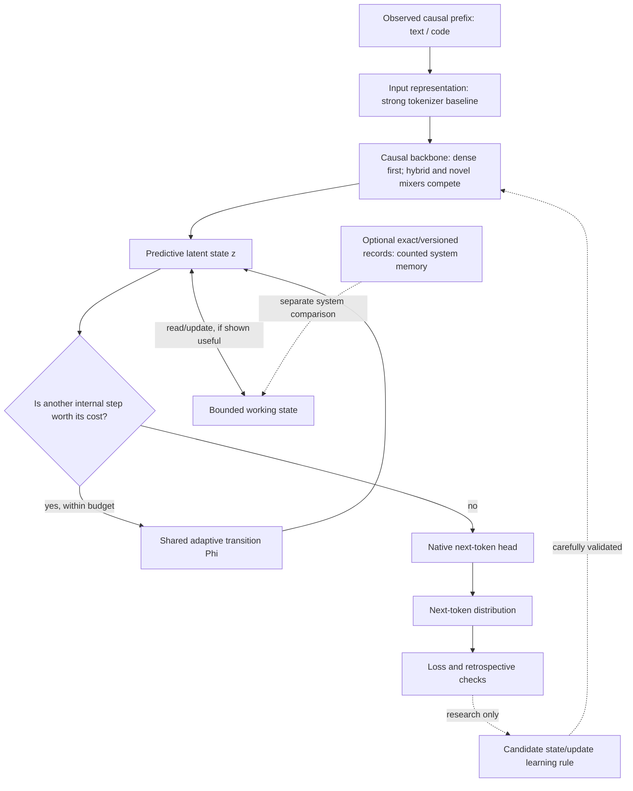
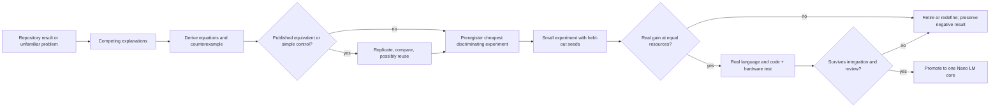
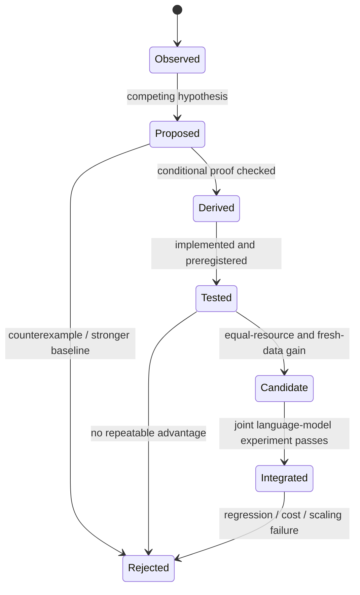

# 01 — Nano LM candidate architecture, falsifiable hypotheses and mathematical propositions

**Research status:** candidate, not an adopted architecture; 2026-11-21. **Repository name unchanged:** Nano LM.  
**Scientific aim:** one native-trained model, multiple controlled research alternatives, maximum verified language/code/reasoning competence for constrained compute, power, memory and data.  
**Theorem scope:** the proofs in this document establish properties of particular algorithms *under stated assumptions*. They neither prove that the proposed neural model can learn those algorithms nor that it will exceed a dense Transformer.

## Executive summary

The principal new proposal is **not** 'combine Mamba, attention, copy, recurrence and a database'. It is to examine whether **predictive state may be reorganized and updated without sacrificing access to what the model previously learned**, while **variable computation is allocated only where its marginal benefit justifies its cost**. A single model could, if experiments succeed, learn both reusable transformations and changing representations, without forcing all experience into slowly updated parameters or depending entirely on ever-longer context. We call this *adaptive predictive-state computation* (APS) solely to identify a testable candidate; it is not a model rename or novelty claim.

The current strongest simpler reference remains the same well-optimized **dense causal Transformer**. Competing references include a **published hybrid mixer**, a **weight-tied recurrent-depth network**, **exact and replay-based correction baselines**, and a **state-of-the-art data/optimizer recipe**. The preliminary evidence does not select a winner.

| Functional ability | Proposed physical realization | Mathematical object | What is tested independently | A reason to reject |
|---|---|---|---|---|
| Language/code generation | Causal learned backbone and next-token head | $p_\theta(x_{t+1}\mid x_{\leq t})$ | Same-byte BPB and fresh code | Worse LM quality at equal train time |
| Active computation | Repeated shared transition with input re-injection | $z_{t,k+1}=\Phi_\theta(z_{t,k},c_t,m_t)$ | Accuracy vs actual additional joules | Unnecessary loops, latency |
| Working state | Resettable recurrent/KV state | $m^{\mathrm{work}}_t$ | Long dependencies and state tracking | Interference or poor hardware efficiency |
| Persistent knowledge | Slow parameters; optional versioned external records counted separately | $\theta_t$, optional $L_t$ | Retention, revision, forward transfer | External answers misattributed to model |
| State reorganization | Learned transport of features and addresses, only if safe | $T_t$ | Old-task logit drift vs new-task learning | Unknown/noninvertible drift; high rewrite cost |
| Interference control | Replay, gradient projection or other local update rules | $P_t\nabla\ell_t$ | Retained old performance at equal new skill | Constraints prevent all new learning |
| Operation reuse | Candidate learned, reused state transformations | $\mathcal O_\theta$ | **Cross-episode** procedure transfer | Ordinary ICL or scratchpad matches it |
| Exact copy when needed | Optional causal span mode | $p_{\mathrm{copy}}(y\mid c)$ | Copyable and noncopyable BPB | Always-on mechanism harms prose/code |

## 1. The core computational problem

Given future task distribution $\mathcal D$, model design $d$, hardware $h$, and serving regime $s$, seek a feasible Pareto-efficient design:

$$
\max_d \; (Q_{\mathrm{language}},Q_{\mathrm{code}},Q_{\mathrm{reason}},Q_{\mathrm{transfer}},Q_{\mathrm{retention}},Q_{\mathrm{calibration}})
$$

subject to explicit resource budgets

$$
R(d)=(P, N_{\mathrm{train\ tokens}}, F_{\mathrm{train}},J_{\mathrm{train}}, F_{\mathrm{task}},J_{\mathrm{task}},M_{\mathrm{peak}},B_{\mathrm{moved}}, T_{p95}, S_{\mathrm{external}}).
$$

**Never** add these quantities into one arbitrary score before defining the use case and exchange rates. Report Pareto fronts, performance at fixed time/joules, and resource expense at a fixed independently verified quality.

A system with a 50M-parameter processor and a 50GB searchable store is not a 50M-parameter *complete* system. A pretrained adapted model is not a native Nano LM checkpoint. For comparisons, maintain three distinct scoreboards: native learned model; adapted pretrained model; augmented system with retrieval/tools.

## 2. Architecture candidate: one model with separately testable state timescales

The diagram is a **competition map**. Dotted paths are candidates, not deployed components. A learned controller does not change parameters without an explicit update mechanism; a read/write store is an additional resource, not evidence of intrinsic intelligence.

### 2.1 Causal forward computation

Let $c_t$ summarize only the prefix $x_{\le t}$, and $m_t$ be any permitted recurrent state. Initialize a latent state $z_{t,0}=E_\theta(c_t,m_t)$. For $k=0,\ldots,K_t-1$:

$$
 z_{t,k+1}=z_{t,k} + \alpha_\theta(z_{t,k},c_t,m_t) F_\theta(z_{t,k},c_t,m_t).
$$

**Important:** reintroduce causal input $c_t$ on **every** iteration, not only the first. The learned integer $K_t$ may be replaced by a fixed value in the cheapest ablation. The head produces

$$
 p_\theta(x_{t+1}\mid x_{\le t})=\operatorname{softmax}(W_\mathrm{out}z_{t,K_t}).
$$

No mathematical property of this expression forces better reasoning, automatic convergence or improved scaling. It is a trainable hypothesis. A path with $K_t=0$ is required for a fair fixed-depth control. Extra recurrent steps increase arithmetic even if weights are shared.

### 2.2 Optional multiscale state

Only test memory states that a demonstrated failure motivates:

$$
 m_{t+1}=U_\theta(m_t,z_{t,K_t},x_t),\qquad \theta_{n+1}=\theta_n+\Delta\theta_n.
$$

Here $m$ is an inference-time state; $\theta$ is slow learned information. In an augmented-system arm, a versioned exact record collection $L_t$ is additional non-parametric storage and must be reported with its complete bytes, indexing, retrieval work, write costs, provenance, and staleness checks. Keep the three states separately observable to avoid disguising extra memory as learned ability.

### 2.3 Learning proposal

Primary objective always includes causal language modeling:

$$
 \mathcal L=\underbrace{\mathbb E[-\log p_\theta(x_{t+1}\mid x_{\le t})]}_{\mathcal L_{\rm CE}}
 +\lambda_s\mathcal L_{\rm state}
 +\lambda_r\mathcal L_{\rm retention}
 +\lambda_o\mathcal L_{\rm reusable\ operations}
 +\lambda_c\mathbb E[C_{\rm true}].
$$

Each auxiliary term is optional and individually ablated. Set $\lambda=0$ for the dense and recurrent controls. An uncalibrated controller trained on expected utility can hurt task quality; test it only after fixed-depth results establish the need. Never train with future labels or downstream answer leakage in routing decisions.

## 3. Mathematical proposition A — representation transport can preserve predictions

**Statement (elementary algebra, not original).** Let $E:\mathcal X\to\mathcal Z$ encode inputs, $D:\mathcal Z\to\mathcal Y$ decode states, and $T:\mathcal Z\to\mathcal Z$ be a bijection. If $E'=T\circ E$ and $D'=D\circ T^{-1}$, then for every $x$:

$$D'(E'(x))=D(T^{-1}(T(E(x))))=D(E(x)).$$

**Proof:** by substitution and the definition of inverse; no probabilistic assumptions needed. **Consequence:** fixed latent coordinates are *not* mathematically necessary to preserve outputs. Old memory keys may be remapped consistently with the encoder and decoder. This does **not** prove that a model can discover $T$, that the migration is cheap, or that storing historical knowledge in new parameters is solved.

**Linear case.** If $D(z)=Wz$, $T(z)=Az$ with invertible $A$, use $W'=WA^{-1}$ and transform every state $z_i'=Az_i$. For orthogonal $A$, $A^{-1}=A^\top$. The accompanying deterministic check verifies this at floating-point precision.

**Bounded approximation result.** Suppose original logits $\ell$ and remapped logits $\ell'$ satisfy $\|\ell'-\ell\|_\infty\le\varepsilon$. If the original top-1 margin $\ell_{(1)}-\ell_{(2)}>2\varepsilon$, the predicted class is unchanged. **Proof:** the winner can decrease by at most $\varepsilon$ and a competitor increase by at most $\varepsilon$. This is a **classification** guarantee under an assumed logit-error bound, not a guarantee about factual truth, calibration, or language distribution equality.

**Counterexample.** A rank-deficient $T$ can merge $z_1\ne z_2$, making them indistinguishable for any downstream decoder. Then exact old behavior generally cannot be recovered. The problem of *learning* a valid, low-cost migration is precisely the research question.

**Prior art:** representation-discrepancy analysis in Kim, Kim & Sohn, ICML 2025 [R07]. Proposed novelty is **not** the algebra; the untested claim is that approximately covariance-preserving learned migrations can improve the acquisition/retention/cost trade-off in an LM without full replay.

## 4. Mathematical proposition B — local constraints can protect previous outputs to first order

Let old anchor logits be concatenated in $f_\theta\in\mathbb R^m$, with Jacobian $J=\partial f_\theta/\partial\theta\in\mathbb R^{m\times P}$. Let $P_\perp=I-J^+J$, where $J^+$ is the Moore–Penrose pseudoinverse. For an update direction $g$ choose $\Delta\theta=-\eta P_\perp g$. Then

$$J\Delta\theta=-\eta J(I-J^+J)g=0$$

since $JJ^+J=J$. Thus a Taylor expansion gives

$$f_{\theta+\Delta\theta}=f_\theta+O(\|\Delta\theta\|^2)$$

provided the model is differentiable and the relevant second derivatives are bounded near $\theta$.

**What this proves:** old *sampled anchor logits* do not change to first order. **What it does not prove:** no forgetting on unsampled tasks, preservation under large steps, numerical stability, efficient computation at billions of weights, or successful acquisition. If $g\in\operatorname{row}(J)$, then $P_\perp g=0$ and *new learning is completely blocked*. That is the crucial adverse control.

**Experiment:** compare replay, no replay, weight regularization, projected-update approximations, and state transport on identical correction streams. Measure both retention *and* new-rule acquisition. This is related to published orthogonal-gradient/continual-learning methods; no novelty claim.

## 5. Mathematical proposition C — exact independent facts have a storage lower bound

For $n$ independent arbitrary values, each chosen from a set of size $V$, there are $V^n$ possible databases. A fully lossless fixed-length representation with $b$ bits must distinguish all possibilities, hence $2^b\ge V^n$ and

$$ b\ge \lceil n\log_2 V\rceil.$$

**Proof:** pigeonhole principle. **Scope:** worst-case exact decoding with no extra side information, and fixed-length encoding of all possible databases. It is *not* a bound that a 2B model cannot learn a concise reusable procedure, nor a universal bits-per-parameter limit for pretrained LMs. Data regularity, approximate answers and external memory change the problem.

**Architectural consequence:** investigate compressing *regularities and procedures* into weights while counting residual exceptional information elsewhere; do not claim unbounded independent knowledge in a fixed-size state.

## 6. Mathematical proposition D — a correctly versioned exact record can answer history consistently

Represent events $e=(k,v,\tau,id,action)$ with unique $id$ and a deterministic total order on $(\tau,id)$. For a key $k$ and time $t$, define

$$ e^*(k,t)=\arg\max_{e:\;e.k=k,\;e.\tau\le t}(e.\tau,e.id).$$

Answer $e^*.v$ if the last action is `set`; return no active value if it is `retract`. If all events are preserved and the index executes this rule correctly, the answer is **deterministic under permutation of insertion order** and is the latest valid stored event by definition. It also preserves earlier `as-of` answers. Formal proof follows immediately from the maximum of the same finite set under a total order.

**Limit:** a deterministic result is not evidence of *truth*. A stale or fabricated event remains stale/fabricated; conflicting authorities may require human adjudication and a domain-specific conflict policy. Timestamps must be semantically meaningful. The order of learning **real-world** corrections is not generally commutative. An append-only log can preserve all records while still depending on temporal order.

**Role:** this is an **augmented system** safety/consistency baseline. It is not an intrinsic neural representation innovation.

## 7. Mathematical proposition E — adaptive compute has an explicit decision threshold, not a free win

Let a candidate extra computation step have conditional expected verified utility increase $\Delta U(s)$ and marginal physical cost $\Delta C(s)$; suppose adding control overhead costs $C_0(s)$ in the same units after a declared conversion $\lambda$. Maximizing $\mathbb E[U-\lambda C]$ selects the extra step only when

$$\mathbb E[\Delta U\mid s]>\lambda\Delta C(s)+C_0(s).$$

**Proof:** compare the objective for `stop` and `continue`, cancel their shared terms. **Key limit:** $\mathbb E[\Delta U\mid s]$ is a counterfactual quantity that the model may estimate badly. A learned controller cannot assume perfect calibration; it may stop before a necessary step, spend more compute on easy questions, or overfit to the benchmark. Actual joules include controller operation and all additional memory traffic.

## 8. The conjecture that would actually matter scientifically

> **APS conjecture (unproven).** There exists a trainable causal language-model architecture, within a fixed practical system-resource envelope, that can perform controlled state reorganization and selective additional computation so that cumulative acquisition, retention, correction, and *positive forward transfer* improve jointly over a strong dense model, a strong published hybrid, replay/memory controls and adaptive-compute baselines on unseen tasks, with no material cross-domain LM regression.

This conjecture makes no predetermined decision about attention, recurrence, latent code, graph memory or physics-inspired dynamics. It **fails** if the new architecture cannot learn reindexing cheaply; if preserving old outputs prevents new learning; if only synthetic tasks improve; if auxiliary objectives damage general language; or if physical cost erases gains.

**Nontrivial distinguishing prediction:** after experience with a family of compositional procedures, the model learns a *new* procedure from fewer examples than it did earlier, even when earlier demonstration inputs and their solutions are unavailable in its context, **while retained-task accuracy stays stable**. The improvement must persist against a meta-trained Transformer and against a replay/memory baseline with counted resources. No benchmark currently in this project's record establishes this.

## 9. What deserves research first, and what must remain optional

| Candidate axis | Small decisive experiment | Strongest simpler comparator | Promotion rule |
|---|---|---|---|
| Representation transport | Force an invertible transform of stored keys; recover old answers with tracked mapping; then learn mappings | Frozen indexing, full rebuild/replay | Better old/new trade-off including migration cost |
| Constrained correction | One-fact editing vs same-entity replay vs projected gradients | Replay + tuned AdamW | Correct new value without same-entity collateral loss |
| Reused procedures | Unseen cross-episode compositions with no stored in-context examples | Meta-trained dense and explicit scratchpad | Fewer examples at matched compute across task families |
| Conditional depth | Difficulty strata with fixed and varying steps | Equal-FLOP fixed depth and written CoT | Better verified successes/joule after controller overhead |
| Global communication | Remove/relocate full-attention layers from hybrid | Equal-time modern dense/hybrid | BPB and compositional long-range quality retained |
| Source-copy control | Selective copy/length/stop vs frozen LM and M21 | Deterministic string copy, posthoc CopyGen | Copy gains without general BPB/latency loss |
| Optimization of address capacity | Hash/uniform/frozen/learned, Adam reset and beta2 sweeps | Exact hash + replay | Improvement beyond simple optimizer/address fixes |

### One constructive candidate implementation path (NOT a lock)

**Reference V0:** strong 15M dense pre-norm causal LM, 32k-token baseline, same training data and evaluation code as repository. **V1:** introduce a single shared latent transition after a stable block, fixed $K=2$ then ablate to $K=1$. **V2:** introduce a controlled working-state updater with frozen and learned addressing and explicit state-reset tests. **V3:** trial task-level representation transport or correction-safe update, one mechanism at a time. **V4:** adaptive compute only if fixed-state improvements survive. **V5:** integration at 125M *only after* full-text/code and engineering evidence passes. The 2B–4B goal remains a funding-conditional destination.

**No claims of proven superior architecture, novelty, real LM advantage or automatic self-improvement have been made.**

## 10. Diagrams for the final architecture decision process

## 11. Primary, checked research touchpoints

- [R01] Mamba-3, ICLR 2026, [conference page](https://proceedings.iclr.cc/paper_files/paper/2026/hash/8abd2043b71a074278d5f687947bff9c-Abstract-Conference.html): expressive recurrent state and hardware costs.
- [R02] Kimi Linear, 2025, [arXiv](https://arxiv.org/abs/2510.26692): efficient hybrid attention, but at a much larger total parameter scale.
- [R03] Qwen3.5 architecture, [official Transformers documentation](https://huggingface.co/docs/transformers/en/model_doc/qwen3_5): 3:1 DeltaNet/full-attention is a reference implementation, not a universal optimum.
- [R04] Ye et al., ICML 2026, [provable expressiveness hierarchy](https://proceedings.mlr.press/v306/ye26h.html): scope-specific limitations of hybrid recurrent/linear substitutes.
- [R05] LOTUS, June 2026, [Microsoft Research](https://www.microsoft.com/en-us/research/publication/bridging-the-gap-between-latent-and-explicit-reasoning-with-looped-transformers/): latent looped reasoning trained with intermediate supervision.
- [R06] Titans, NeurIPS 2025, [Google Research](https://research.google/pubs/titans-learning-to-memorize-at-test-time-2/): trainable test-time neural memory; results are not guarantees for Nano LM.
- [R07] Kim et al., ICML 2025, [representation shifts](https://proceedings.mlr.press/v267/kim25p.html): a relevant prior-art foundation for representational transport.
- [R08] Lyle et al., 2025, [disentangling plasticity loss](https://proceedings.mlr.press/v274/lyle25a.html): normalization plus weight decay can be an effective strong control.
- [R09] Dohare et al., Nature 2024, [loss of plasticity](https://www.nature.com/articles/s41586-024-07711-7): sustained learning failure is distinct from forgetting; continual backpropagation as published comparator.
- [R10] Nested Learning, NeurIPS 2025, [paper](https://proceedings.neurips.cc/paper_files/paper/2025/hash/4309616aaed8e848009bc4a7ef73b493-Abstract-Conference.html): multi-timescale optimization literature.
- [R11] CopyGen, October 2026, [paper](https://arxiv.org/abs/2610.28393): published copy gating, length and stop controls.
- [R12] Byte Latent Transformer, ACL 2025, [paper](https://aclanthology.org/2025.acl-long.453/): byte patching as a competing input design.
- [R13] FlashAttention-4, MLSys 2026, [paper](https://proceedings.mlsys.org/paper_files/paper/2026/hash/ae8b0b5838ba510daff1198474e7b984-Abstract-Conference.html): hardware-specific performance, not portability guarantee.
- [R14] OpenAI 2026 SWE benchmark audits, [Verified](https://openai.com/index/why-we-no-longer-evaluate-swe-bench-verified/) and [Pro](https://openai.com/index/separating-signal-from-noise-coding-evaluations/): do not assume public benchmark labels establish valid generalization.

Repository evidence sources and a larger bibliography are in `04_EVIDENCE_AND_REFERENCES.md`.