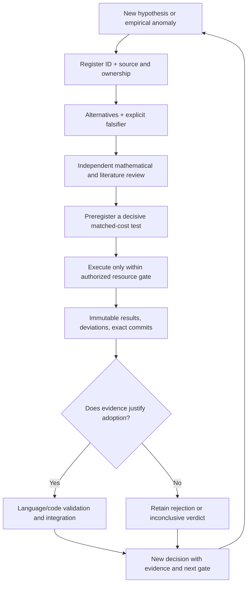

# 02 — Nano LM decision, evidence and hypothesis ledger

**Ledger snapshot:** 2026-11-21 | **Change policy:** append-only decision history; explicit supersession, never silent rewrites.  
**Existing authority:** [`research/frontier/ontogenesis/LEDGER.md`](https://github.com/wwk5q8z6kk-bit/nano-lm/blob/research/ontogenesis-phase1/research/frontier/ontogenesis/LEDGER.md) on `research/ontogenesis-phase1`. This is a **proposed reconciled decision supplement**, not a replacement for that canonical research ledger or the original protocols. It may be integrated through review.  
**Source hierarchy:** registered raw results and code > later reviewed corrections > original experimental reports > transcripts > hypotheses and prose blueprints > outside analogies. Repository contents read through the GitHub connection; local running jobs and unpublished worktrees were **not** directly inspected.

## A. One-page decision register

| ID | Question | Decision made now | Why / alternatives | Evidence classification | State and next test |
|---|---|---|---|---|---|
| D-001 | What is being built? | One native-trained general-purpose Nano LM remains the destination | Product-like external tools are separately scored | Repository charter | Retain |
| D-002 | What is the core architecture? | **Not selected**; start with a strong dense control and competing hybrid/recurrent alternatives | M21 and earlier theories have not won robustly | Repo experiment + prior-art | Open; G0–G4 |
| D-003 | May Nano LM be renamed APS/ONTOGENESIS? | **No**; APS is a test hypothesis, ONTOGENESIS a research label | Avoid confusion between projects and theories | User/repo charter | Retain |
| D-004 | Can we claim 2B–4B frontier quality now? | **No**; make size contingent on real scaling evidence/funding | Public 3B training uses many more tokens and resources | Training reference / resource reasoning | Open; scale gate |
| D-005 | Is M21 the backbone? | **No promotion** unchanged | Dense 4.65 vs M21 5.02 bits/token on 5M code time-proxy comparison; M21 had copy advantage | Merged [PR #194](https://github.com/wwk5q8z6kk-bit/nano-lm/pull/194) | Conditional-copy arm, not deletion |
| D-006 | Was DEMOS faster-learning than dense? | **Earlier claim retracted** | Tuned dense reached 99.8% vs DEMOS 98.3%; original dense LR mis-tuned | Repo `INVESTIGATION.md` / transcript | Preserve as cautionary example |
| D-007 | Did exceptions cause regular-fact forgetting? | **No general support**; refuted in tested toy world | Corrections alone reduced old regular recall to ~91%; exception-only ~99.6% | Refereed `DISCOVERY-CYCLE-1` | Promote correction/replay tests |
| D-008 | Is fixed-address learned memory capacity exhausted? | **Not demonstrated** | 16,384 nominal, ~526 effective; hash addresses and Adam reset restore acquisition by different means | `INVESTIGATION.md` one-seed pilot | Need beta2, multi-seed and occupancy controls |
| D-009 | Do learned write-time detectors work? | **Partially**; neither impossible nor solved | Inference 81.4 vs 77.6 baseline vs 88.9 oracle; only 3 seeds | `routing_loo.py` result | Dynamic rule-change test and cross-seed replication |
| D-010 | Do normalization+weight decay solve forgetting? | **No** | Maintained speed, old-task accuracy near chance; distinct endpoints | `plasticity.py`, published results | Replay/continual BP comparator |
| D-011 | Can exact records be included? | Yes **only as explicitly counted augmented system option** | Provides a correct history/measurement baseline, not intrinsic LM knowledge | Mathematical proposition D | Full byte/joule accounting |
| D-012 | Is representation drift inherently forgetting? | Not always | A known invertible transport and adjusted readout preserve outputs exactly | Algebraic proposition A | Learned transport experiment needed |
| D-013 | Does first-order constrained updating solve continual learning? | No; it has a limited local guarantee only | Nullspace update may block new learning entirely | Algebraic proposition B | Compare replay, old anchors, compute |
| D-014 | Can arbitrary independent facts be encoded with negligible memory? | No under lossless worst-case assumptions | Pigeonhole lower bound $n\log_2 V$ | Mathematical proposition C | Count external storage and side information |
| D-015 | Is 3:1 hybrid a default? | No, reference competitor only | Qwen3.5 data is strong but ICML 2026 shows scope-limited expressivity separation | [Qwen docs](https://huggingface.co/docs/transformers/en/model_doc/qwen3_5), [ICML](https://proceedings.mlr.press/v306/ye26h.html) | Mixer placement tournament |
| D-016 | Is adaptive looping always efficient? | No | Extra steps use real FLOPs and memory; looped LM pilot reportedly regressed | Repo `INVESTIGATION.md` + LOTUS | Equal joule and written scratchpad |
| D-017 | Which metric is primary? | Vector of verified quality, learning/retention, accuracy per joule/latency | A single 'intelligence per parameter' can hide expensive off-model work | Defined objective, hardware papers | Preregister per workload |
| D-018 | Are novel operators required? | No; novelty is subordinate to verified result | Previous proposals failed review; published work can be used | Historical research | Equal-cost baseline gate |
| D-019 | What can we prove now? | Five scoped mathematical/algorithmic properties; **zero** LM superiority theorems | Proofs have explicit assumptions and counterexamples | `01_ARCHITECTURE_AND_THEOREMS.md`, deterministic checks | Independent math review |
| D-020 | Should paid scale training begin? | No new material spend on this task | Need baseline, provenance, confirmed budgets, and authorization | `docs/ACTIVE_NOW.md` | Future experiment-scoped approval |
| D-021 | How to maintain the ledger? | Record every proposal, experiment, review and reversal by ID | Multiple research branches share overlapping names | Existing canonical ledger | Review PR, keep source of truth singular |
| D-022 | How to deploy this package? | Safe additive documents and tests, no destructive changes to research | Protect pending registered experiments and uncommitted worktrees | Repo inventory | Draft PR, review before merge |

## B. Contradiction and correction chain (never delete the original claim)

| Event | Initially plausible interpretation | Corrective evidence | Current interpretation | What remains unresolved |
|---|---|---|---|---|
| C-01 DEMOS one-hop | Novel learning-speed advantage | Tuned dense 99.8% vs DEMOS 98.3% | Baseline optimization artefact in this comparison | DEMOS's other structural uses not established |
| C-02 M21 copying | Better neural core | Dense lower overall bits/token at time-oriented code budget | Specialization may help copy subset but harms other tokens | Whether a gated, lightweight copy branch wins at equal cost |
| C-03 Mixed two-hop failure | Fundamental representational incapacity | Dense/looped have late learning jumps; DEMOS implementation has a proven first-order hop defect | Mix of implementation geometry and optimization difficulties | Full confirmatory 5+ seed outcomes; non-toy transfer |
| C-04 Irregular-content interference | Exceptions damage other facts | Exception-only normal retention ~99.6%; correction-only ~91% | Correction updates are principal observed damage | Adam vs missing replay vs both |
| C-05 Memory full | 16k slots exhausted | Effective ~526; resetting Adam history late acquisition 86.1%, hash 99.9% | Interacting congestion and optimizer state | Multi-seed, β2, Adam vs SGD, state snapshots |
| C-06 Self-router fails | Autonomous routing cannot learn | Leave-one-out detector raised inference to 81.4% with false alarms | Some benefit without oracle, still modest/variable | Detect genuine new rules, drift, noise, cost |
| C-07 'Order independence equals no forgetting' | Commuting updates keep facts | An append-only log preserves old facts and remains order-sensitive | No equivalence in general | State specific domain and acquisition conditions |
| C-08 2B affordable | $500 credits comfortably fund large run | Repo itself marked TPU prices unverified; published pretraining uses far more data | Large model needs measured cost and separate authorization | Verified quota, hardware throughput and training target |

## C. Hypothesis registry (this section has no experimental victory claims)

| Hypothesis | Main mechanism | Distinguishing observable | Strongest competing explanation | Registration |
|---|---|---|---|---|
| H-APS-01 Predictive-state transport | Learned reindexing of memories when embeddings change | Better retention–new acquisition frontier after all migration work | Frozen memory + replay | Proposed, unregistered |
| H-APS-02 Update constraints | Gradient components orthogonal to selected old outputs | Lower old-logit drift *without* slower new learning | Same-entity replay, Adam tuning | Proposed, unregistered |
| H-APS-03 Cross-episode procedures | Reused computation survives when demonstrations leave context | Positive forward transfer and systematic OOD generalization | Meta-trained dense + ICL + explicit scratchpad | Proposed, unregistered |
| H-APS-04 Adaptive compute | Conditional extra steps improve verified successes/joule | Positive net benefit after controller overhead | Fixed extra depth, fixed thinking budget | Proposed, unregistered |
| H-APS-05 Selective global access | Learned efficient local state with sufficient exact global communication | Better BPB/J without composition and exact-span failures | Dense/full attention and modern hybrids | Proposed, unregistered |
| H-APS-06 Correction-scope inference | Selectively preserve old relationships under evolving facts | Low collateral old loss and low stale-response rate | Exact versioned store + same-entity replay | Proposed, unregistered |
| H-APS-07 Useful self-organization | Learned operation structure rather than picking a supplied menu | Transfer to new operation family with retained skills | Fixed menu + wider dense + search | Exploratory, needs formalization |

## D. Evidence map with the observed numerical scope

| Evidence ID | Artifact | Measurement and scope | Reliability warning |
|---|---|---|---|
| E-01 | [PR #194](https://github.com/wwk5q8z6kk-bit/nano-lm/pull/194) | 5M code, 3 seeds: dense 4.65, M21 5.02 bits/token | Training time calibrated and drifted up to 30% |
| E-02 | [INVESTIGATION.md](https://github.com/wwk5q8z6kk-bit/nano-lm/blob/research/ontogenesis-phase1/research/frontier/ontogenesis/INVESTIGATION.md), Question 7 | One seed, original late new-fact 3.4%; hash 99.9%; optimizer reset 86.1% | Changed interventions have multiple effects |
| E-03 | Same, Question 8 | 3 seeds: non-oracle 81.4%, baseline 77.6%, oracle 88.9% unseen inference | Small toy, per-seed variation |
| E-04 | [DISCOVERY-CYCLE-1](https://github.com/wwk5q8z6kk-bit/nano-lm/blob/research/ontogenesis-phase1/research/frontier/ontogenesis/theory/DISCOVERY-CYCLE-1-20261121.md), section 8.1 | Exceptions-only ~99.6% old regular, corrections-only ~91% | Confounded optimizer versus replay |
| E-05 | [LEDGER.md](https://github.com/wwk5q8z6kk-bit/nano-lm/blob/research/ontogenesis-phase1/research/frontier/ontogenesis/LEDGER.md) | Historical discovery archive, positive/negative results and program map | Existing ledger dated 2026-11-20 and not fully synced with latest `INVESTIGATION` |
| E-06 | `checks/formal_sanity.py` and `results/formal_sanity_20261121.json` | Five deterministic numerical checks | **Not** neural training; numerical checks are not proofs or novelty review |
| E-07 | [ACTIVE_NOW.md](https://github.com/wwk5q8z6kk-bit/nano-lm/blob/master/docs/ACTIVE_NOW.md) | Current gate, compute and data constraints as inspected | External approvals and live prices not verified |

## E. Ledger maintenance protocol

**One decision = one stable identifier.** Each row must capture UTC timestamp, author/reviewer, exact code/data/benchmark/checkpoint commit, evidence status, alternatives considered, decision rationale, affected experiments, permission class, next gate, and reversal link. Do not treat a draft proposal, independent referee note, raw measurement, or merged code as equivalent authority.

State transitions: `proposed` → `mathematically checked` → `preregistered` → `exploratory` → `replicated` → `integrated` or `rejected`; `superseded` retains a back-reference to the new decision. Results never disappear when theory changes. Every metric stores numerator, denominator, distribution, seeds, experimental budget, model size, hardware/precision, and evaluation lineage. Distinguish *unknown* from *zero*.

**Cadence:** update on every completed meaningful experiment or new verified contradictory source, not by rewriting research documents daily without new evidence. A periodic automation may review the ledger, but it cannot claim that a new result exists unless actual commits/artifacts demonstrate one.