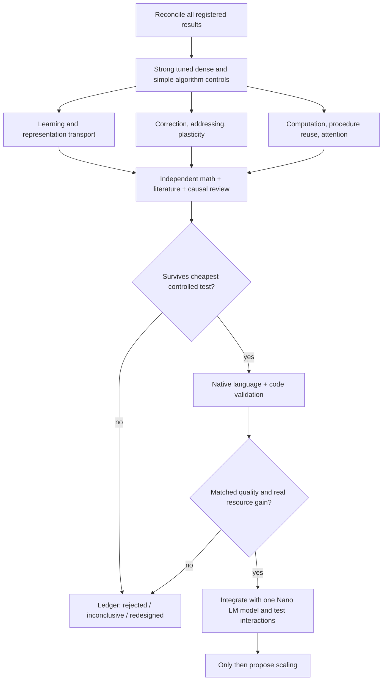
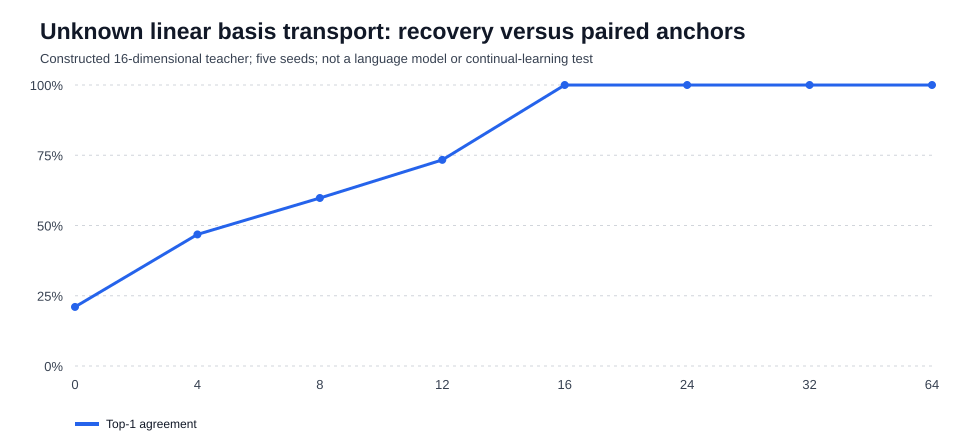

# 03 — Preregisterable experiment program, engineering implementation and scale gates

> **V3 current execution notice — 2026-11-21.** The completed store pilot and three-seed correction study are now incorporated in [09 Evidence refresh](09_EVIDENCE_REFRESH_AND_PROTOCOL_REPAIRS.md). G03 has an existing pilot; its successor is G03b with common event streams and paired durability cohorts. [07 Implementation contract](07_IMPLEMENTATION_CONTRACT.md) supplies a concrete causal reference. This file is an updated research plan, not a preregistration receipt or evidence that a new training job ran. Earlier frozen protocols remain unchanged.

A later source refresh at `8d3b03e…` adds the independently registered margin follow-up. Its rules remain intact; the G03b measurement repairs are complementary and separately labeled. No completed margin result is available at this cutoff; see [09](09_EVIDENCE_REFRESH_AND_PROTOCOL_REPAIRS.md#7-late-source-refresh-and-fixed-integration-cutoff).

**Status:** research designs, not executed GPU/TPU model-training experiments. Do not retrospectively add them to existing frozen protocols. All local and paid experiments require the live repository rules, data rights, code revision, and resources to be verified. **No paid compute authorized by this document.**

> **V2 protocol notice:** The 18 existing gate IDs G00–G17 are **candidate experiments**, not simultaneously authorized jobs. The formal proof audit and cost controls in [05](05_GAP_CLOSURE_AND_FORMAL_REVIEW.md) modify their interpretation without altering any previously preregistered protocol. Choose the first decisive cause test before proliferating new branches.

## Executive plan: test causes before building expensive architecture

| Stage | Purpose | Concrete output | Advance condition |
|---|---|---|---|
| S0 evidence repair | Authenticate canonical research, reconcile branches, local worktrees, and registered runs | Hash-linked status manifest, corrected decision ledger | No unresolved provenance-critical claim for selected hypothesis |
| S1 pure mathematical checks | Test conditional propositions and counterexamples with tiny code | Scoped proofs, executed numerical examples and counterexamples | Algebra and scope survive independent review |
| S2 cheap causal experiments | Distinguish optimizer, addressing, replay, and revision causes | Multi-seed factorized design | One mechanism shows gain against simplest strong alternative |
| S3 concept discovery | Detect learned procedures, knowledge migration and positive transfer | Cross-episode held-out families | Statistical evidence of transfer, beyond storage/ICL |
| S4 native language | Native dense versus candidate on same text/code with matched bytes and time | 15M–50M checkpoints, open BPB/latency/energy | No regression; demonstrable target benefit |
| S5 intermediate scale | Replicate useful mechanism in 125M–350M native model | Checkpoints and held-out reports | Independent confirmation justifies budget |
| S6 conditional large model | Potentially train 1B–2B+ only after justified program | Funded, measured, reproducible proposal | Explicit scoped authorization and feasibility |

### Work routing



## A. Eighteen explicit experiments and decision gates

| ID | Gap and experiment | Arms / strongest control | Primary outcome | Confounders and rejection condition | Compute posture |
|---|---|---|---|---|---|
| G00 | Repo-state truth | Master + `research/ontogenesis-phase1`, result manifests, uncommitted inventory | Evidence complete and current | Do not infer job completion from docs; cannot access user's laptop locally | Read-only, now |
| G01 | Re-run formal examples | Versioned ledger, invertible transport, nullspace, storage, compute rule | Identical deterministic expected output | Numerical checks ≠ proof of LM competence | CPU, done |
| G02 | Addressing × optimizer factorial | Original frozen/hash addresses × Adam carry/reset/lower β2; learned-address/SGD follow-ups separate | Final-quarter acquisition; retention and stale-answer guardrails | Must match fresh data and per-arm tuning; one seed insufficient | CPU/Apple GPU, no execution here |
| G03 / G03b | Correction locality and durability | Existing six-arm pilot; successor compares candidate with same-entity replay on identical event manifests | Horizon-20 accuracy on the same surviving edits; immediate success and unrelated-fact guardrails | Original random replay changes future event draws; old/current cohorts differ; see 09 | G03 recorded; G03b proposed |
| G04 | Rule-change detection | Oracle, leave-one-out router, calibrated change-point, no router | Rule changes vs exceptions discriminated; false alarms | Genuine change and noise share early evidence; no future-label access | Local |
| G05 | Representation migration | Frozen index, exact T oracle, learned T, rebuild, replay | Old/new accuracy *and* total rekey+decode cost | Oracle mapping is upper bound, not deployable | CPU then small LM |
| G06 | Nullspace update tradeoff | Unconstrained SGD/AdamW, GEM/OGD-style, same-entity replay | Old logit drift vs new target learning | Projection may eliminate all usable update direction | Tiny NN, local |
| G07 | Positive forward transfer | Meta-trained dense, same-param recurrent, operation-memory candidate, written scratchpad | New procedure samples to threshold **after examples leave context** | Split operators, not just strings; no hidden demonstrations | CPU/small GPU |
| G08 | Structural creation vs selection | Fixed menu of operators, learned parameterization, composed operators | Unseen operation family acquisition | Large menu equivalent or better; route must be learned | Local exploratory |
| G09 | Recurrence mechanism | Untied dense, tied loop, nested, teacher-forced intermediate states | Jump-time and jump-probability on cross-hops | Censoring, varying parameter/FLOP budgets and LR | Existing protocols untouched |
| G10 | Objective ablation | Causal CE, CE+multi-token, CE+state prediction, hybrid masked/causal | BPB + sample efficiency + transfer | Training token budgets and scoring bytes must match | Local/free GPU |
| G11 | Exact copying | Dense, gated pointer, posthoc CopyGen, deterministic span copy | Exact new-value/identifier match, noncopy BPB, joules | Never evaluate only copyable cases | Small LM/local |
| G12 | Sequence mixing | Dense GQA, published hybrid, Mamba-3-like, KDA-like | BPB and context tests per train hour and decode joule | Unsupported kernels can dominate | Scoped GPU after G02–10 |
| G13 | Global information placement | Move full attention layers; memory head controls | Long retrieval AND multi-hop composition | ICML hardness result has defined assumptions | 15M+ |
| G14 | Cross-depth information reuse | Standard residual, Block AttnRes, Depth-Attn, equal-cost extra FFN | BPB/time and activation stability | Cross-layer cache/traffic may null gains | 15–125M |
| G15 | Adaptive reasoning | Fixed K, learned K, equal-FLOP untied depth, external written scratchpad | Fresh verifiable tasks per actual joule | Controller cost/calibration, rollout costs | Local → scoped GPU |
| G16 | Native language integration | Strongest single gain plus combinations vs dense/hybrid | Fresh-domain BPB and honest Pareto improvement | Individually positive interventions can interact negatively | 15–125M |
| G17 | Scaling falsification | 125M and 350M matched pair; extrapolation if supported | Stability across scale, domains and devices | No paid GPU/TPU without verified price and approval | Gate only |

## B. First executable causal protocol: distinguish address congestion from optimizer history (G02)

**Background source:** `INVESTIGATION.md`, Question 7. Original learned/fixed address run used only ~526 effective slots; in one seed late-phase acquisition was 3.4%. Uniform hashing reported 99.9%, Adam reset 86.1%, and 10× learning rate 59.9%. The experiment does not prove a new memory mechanism; it suggests a tractable optimizer×address interaction.

**Revised factorial proposal:** the core is **2 address policies × 3 optimizer histories = 6 arms**. Address policies are original frozen addresses and fixed uniform-hash addresses. Optimizer histories are carried Adam moments, moment reset at phase boundaries, and a prespecified lower-β2 Adam variant with the first-moment rule unchanged. Balanced/learned addresses and SGD are separately labelled follow-ups, not silently added levels of this core experiment. Resetting both moments does not identify a second-moment mechanism alone; an m-only/v-only reset diagnostic is needed if that mechanism is claimed.

The world, all new facts and all updates are precomputed into an immutable manifest per seed, independent of arm-specific random draws. Optimizer and replay generators are separate. Match model width, slot count, read cardinality, training steps and data exposures; log any change in address representation, not only occupancy. Tune each arm on separate development seeds with the same search budget. Fresh evaluation seeds and sample size are fixed only after a variance-informed design; the original one-seed result cannot establish adequate power.

**Primary endpoint:** per-seed mean new-fact acquisition across phases 46–60. **Guardrails:** retention of eligible old facts and stale-answer rate after genuine revisions, each with explicit counts and target-version policy. These guardrails are not a second unannounced primary endpoint. Report the paired acquisition difference at each optimizer level and the address×optimizer interaction, with seed-level uncertainty. A large gain with an unacceptable retention loss does not pass the joint engineering decision.

**Mechanistic measures:** occupancy entropy, effective number of slots `1 / sum(q_j²)`, per-slot first/second moments, actual update magnitudes, read/write collision counts, gradients, objective curves and measured time. These measures distinguish candidate explanations; they do not automatically identify causality. Hashing changes more than occupancy. All attempts, failed runs, tuning work and data-processing cost enter the resource report.

**Distinct predictions:** reset benefits at fixed addresses support an optimizer-history contribution; address effects remaining after optimizer repair support an additional addressing contribution. The interaction is estimated rather than assumed. If a simple fix removes the anomaly, retire the stronger memory-capacity explanation for this regime. Native language effects remain a separate gate.

## C. Representation transport protocol (G05)

Construct tasks where identities and relations persist while the encoder basis changes. Control the transformation in one diagnostic condition (known orthogonal matrix) and make it unknown in the real learning condition. Compare:

1. **Frozen encoder:** good stability, possibly poor adaptation.
2. **Full replay/rebuild:** high-information comparator with measured migration cost and achieved quality; no performance upper bound is assumed.
3. **Known transport:** sanity ceiling; exact outputs provably preserved given a correct map.
4. **Estimated transport:** fitted from a tiny anchor set with no future-task labels.
5. **Learned state rewrite:** end-to-end trainable migration, tested against a plain model with the same extra parameters.

Report old prediction drift before/after migration, new-task sample complexity, storage bytes, all memory writes and reconstruction work, effect on compositional OOD tasks, and results when the true transformation is noninvertible or changes different semantic factors differently. A purely orthogonal synthetic task is insufficient to promote a general language-model mechanism.

### G05 exploratory pilot completed — synthetic linear basis transport only

Across five deterministic seeds, an original 16D linear classifier was viewed through a hidden orthogonal change of basis. Top-1 prediction agreement without correcting the basis was **21.0%**. With a known exact inverse it was **100%**. A general linear inverse estimated by pseudoinverse from **4/8/12/16 paired feature vectors** gave **46.8%/59.8%/73.4%/100%**, respectively. The exact scores, seeds and test sizes are in `results/transport_anchor_pilot_v0.json`; the code is `checks/transport_anchor_pilot.py`.

This illustrates the restricted rank-identification theorem. It does not demonstrate learned representation migration, transfer, retention, lower energy or superior language modeling. The next experiment must use evolving learned features and structural transport priors and compare *both* old-output retention and newly learned capability against replay and frozen controls under equal cost.



## D. Procedural reuse and positive transfer (G07–G08)

Train on compositions of simple *hidden* functions $f_i$ in a finite domain, with training families disjoint from novel test compositions and novel primitives. After each episode, remove examples from the context; allow the model to retain only whatever explicitly counted internal state or slow weights the protocol permits. A second control can keep a compact exact operation library, counted at equal total bytes.

**Compare:** (i) optimized Transformer with learning-to-learn curriculum; (ii) equal-size looped/shared network; (iii) typed small program/interpreter; (iv) stateful candidate with learned operations; (v) model with a finite fixed menu; (vi) a trivial memorizer. Evaluate **learning speed on successive new task families**, not just instantaneous in-context accuracy. Test heterogeneous sequences where later operations differ from earlier ones; otherwise a tied loop is favored by construction.

**Operationalize transfer without an unnecessary monotonicity requirement.** For unseen family `j`, measure zero-shot performance before any examples, the full learning curve, and `N_j(q)`—fresh examples needed to reach a fixed target. A positive paired difference `N_control,j(q) − N_candidate,j(q)` establishes relative sample efficiency at that target, conditional on the declared control and resource budget. Attribute the improvement to forward transfer only when a history intervention establishes a benefit from prior learning: compare the same learner under related-task history and an equal-budget control history, with initialization, adaptation protocol and evaluation families matched. A cross-architecture advantage alone does not identify that historical-learning effect. Improvement need not become steeper on every successive task. Pre-adaptation forward transfer and learning-curve acceleration are distinct outcomes; report both rather than calling every improvement the same metric. The original forward-transfer framework is discussed in [GEM](https://proceedings.nips.cc/paper_files/paper/2017/hash/f87522788a2be2d171666752f97ddebb-Abstract.html).

Runs that never reach the target are right-censored, not assigned a fictitious crossing time. Include a bounded-horizon learning-curve area and the probability of attaining the target. Split whole task families, remove demonstrations from context, and preserve separate counters for slow-weight learning and allowed persistent state. Paired family/seed uncertainty and old-task guardrails are required. A decreasing learning-curve slope across episodes can be an additional hypothesis, but is not the definition of all positive forward transfer.

## E. Native language-model replication (G10–G16)

**Repository-reported local program (owner machine not inspected here):** `BUILD-PLAN.md` reports a 32k tokenizer, a four-domain 800M-token v1 corpus, 15M native pilot plans and TPU calibration results. These were reported by the research agent; the files' existence on the owner's laptop and original licensing were not independently checked here. Corpus proportions and 1M validation per domain were recorded in that plan.

**Evaluation contract:** same training bytes, tokens where tokenizer matches, supervised target handling, sequence length, domain mixture, optimizer per-arm tuning budget, validation cutoffs, hardware, and reporting frequency. If input methods differ, compare BPB on the same *raw UTF-8 bytes*, and show token/patch counts and throughput separately. Report:

- Total training FLOPs estimate and observed wall time; physical energy when instrumented.
- Held-out BPB for general prose, code, math, textbook/science, separate from training and tuning distributions.
- Long-context source retrieval and updated fact conflicts; no future retrieval leakage.
- Fresh compositional reasoning; exact copying conditional on availability of source spans.
- OOD procedure learning, plasticity and old-task retention across the same episode stream.
- Parameter counts including embeddings, experts, all learned heads; runtime memory; optional store size.
- p50/p95 latency, tokens per second, actual joules/task at stated batch/serving load.

A win only on a synthetic memorization task cannot promote a foundation architecture. A loss advantage at equal tokens but 5× worse wall time cannot establish better capability per training hour. Benchmark outcomes with broken graders or dataset contamination need review rather than promotion.

## F. Compute and parameter feasibility

A common approximation for dense LM training is $F_{train}\approx 6ND$ FLOPs for $N$ parameters and $D$ training tokens. This is a *rough compute accounting proxy*, not measured throughput or a universal law across recurrent/sparse methods. In a shared-block model, unique parameter count is not the number of applied block parameters: charge every logical block execution. The exact candidate inventories and forward-operation terms are in [07](07_IMPLEMENTATION_CONTRACT.md#3-parameter-and-cache-inventory).

| Scenario | Parameters N | Training tokens D | Dense proxy 6ND | Implication |
|---|---:|---:|---:|---|
| Stage S4 | 15M | 800M | $7.2\times10^{16}$ FLOPs | Feasible research-scale scope if real throughput confirms |
| Intermediate comparison | 125M | 2B | $1.5\times10^{18}$ FLOPs | Price/availability must be verified |
| Larger pilot | 350M | 5B | $1.05\times10^{19}$ FLOPs | Budget and checkpoint retention matter |
| Moderate 2B run | 2B | 100B | $1.2\times10^{21}$ FLOPs | Not frontier pretraining budget by assertion |
| Ambitious 3.5B training | 3.5B | 1T | $2.1\times10^{22}$ FLOPs | Cannot infer GPU-hours from FLOPs without measured device utilization |

**Parameter budget sensitivity:** A shared 2,560-wide embedding table is about 0.168B learned parameters for a 65,536 vocabulary, but ~0.636B for 248,320 tokens. That increase of roughly 0.468B alone can push an illustrative 'sub-4B' design over its upper target. Every final proposed architecture must instantiate exact counts instead of extrapolating a layout table.

**Infrastructure rule:** `ACTIVE_NOW.md` authorizes certain exploratory training but requires experiment-scoped authorization for material costs and confirmatory runs. Verify quotas and billing independently before any paid run; do not claim a $500 TPU budget is sufficient solely on estimated price summaries. A reported TPU throughput is an instrumented result only on its recorded architecture, precision, sequence length, batch and compiler; it is not automatically transferable to a different model.

## G. Engineering work required (implementation layers)

| Area | Ownership and deliverable | Gate / tests |
|---|---|---|
| Data | Source/license and dedup manifests; exact token/byte split | No private data or PHI; held-out chronology verified |
| Baselines | Mature dense/loop/hybrid, explicit version/parameters | Unit train correctness; optimizer tuning against controls |
| Attention/recurrent kernels | Device-specific tested implementations | Numerical equivalence vs PyTorch reference; throughput/power on target |
| State/runtime | Reset, eviction, snapshot, recovery, versioning | No cross-request leakage; stale-event tests |
| Learning | Replay/regularizers/objective versions; optimizer-state probes | Hyperparameter provenance; no retrospective tuning |
| Formal checks | Proposition and edge-case test suite | Small CPU tests; mathematical reviewer separately |
| Benchmark and energy | Paired seeds, full-system metering, CI test outcomes | Include failed jobs and actual cost |
| Research ledger | Stable decision/event/result IDs and supersession links | All new proposals and contradictory findings filed |
| Integration | One model config and diffable deterministic checkpoints | Cross-task no-regression gate before promoting mechanisms |

## H. Dependency-ordered execution queue

This is a dependency order, **not** a promise to deliver days later or evidence that any job is running.

| Priority | Work item | Current disposition | Required evidence before next |
|---|---|---|---|
| 0 | Preserve the existing registered nested/routing/LM pilots and identify owner of V4 untracked files | Pending owner-side reconciliation | Worktree/status manifest |
| 1 | Merge or link new theory+decision snapshot into canonical ledger through review | Draft docs in current package | Human or delegated review, then merge if desired |
| 2 | Run deterministic sanity checks | **Completed here, 5/5** | Math reviewer confirms assumptions and counterexamples |
| 3 | Reconcile completed G03; implement G03b and G02 shared-stream protocols | G03 existing pilot reviewed; successors not run | Immutable exogenous streams, solver receipts and same-event horizons |
| 4 | Evaluate G05 transport beyond a known inverse | Boundary contract and synthetic diagnostic available; learned LM migration open | Adaptation and retention measured jointly with migration cost |
| 5 | Decide whether G07 procedure test excludes ICL | Planned | Cross-episode retrieval control |
| 6 | Audit 800M corpus and modern baseline recipe | Planned | Data license/dedup and checkpoint identity |
| 7 | Execute 15M equal-time native language tournament | Planned, *only on authorized environment* | Fresh held-out language/coding differences |
| 8 | Benchmark hardware and fix bottlenecks before scaling | Planned | Measured joules/latency/bytes per success |
| 9 | Submit 125M proposal with explicit quota and price | Gate, not authorization | Repeated 15M win and reproducible budget |

## I. Acceptance and independence rules

**Experimental correctness:** registered protocol cannot change after seeing confirmatory data. Tune separately on exploratory seeds; use untouched final seeds. Report censoring in time-to-jump models, no cherry-picking, paired runs where meaningful, and confidence intervals or bootstrap summaries with actual denominators. Each claim must state which outcome would have falsified it.

**Scientific claims:** 'proved' means the theorem and assumptions were checked, not that benchmarks passed. 'Published' means another team's measurements, not Nano evidence. 'Pilot' is not 'replicated'. 'System-level win' must show all retrieval/verification costs. No benchmark contamination, leaked future values, misleading token-matched comparison or miscounted external model allowed.

**Authorized writes:** New documents, code and local CPU checks are in scope. Destructive branch operations, blanket merges, local worktree cleanup, PHI, private owner data, and materially costly compute are not. Prior experiments and raw result files remain frozen.

## J. Versioned protocol contract and stopping logic

The next training action is **G03b protocol repair and locality/durability controls**, alongside the independent **G02 address×optimizer core**. The completed G03 pilot and the store result are preserved and reviewed in09. Do not overwrite running protocols or edit raw results. The exact baseline/cost of each arm must be measured before any conclusion; a toy success cannot authorize 125M training.

**Pre-registration template (fill and commit before confirmatory runs):**

```yaml
experiment_id: G02-<unique revision>
branch_sha: <exact source SHA>
world_event_manifest_sha256: <identical across paired arms>
rng_streams: <world / corrections / replay / optimizer / evaluation>
metric_denominators: <event, key, document or family; never implicit>
research_question: <one causal contrast>
status: proposed              # proposed | preregistered | exploratory | confirmatory | completed
seed_rule: <fixed deterministic seed derivation; development and final seeds separate>
independent_unit: <data-generating seed / task family / document, not token>
train_data_sha256: <exact manifest/checksum>
evaluation_manifest_sha256: <exact held-out split>
comparators: <arms and independently tuned search budgets>
primary_endpoint: <one measurable outcome, direction, denominator and horizon>
secondary_endpoints: <acquisition, retention, stale edits, latency, state bytes>
fail_or_stop: <decided before reading final seeds>
censoring_rule: <if time-to-learn threshold does not occur>
resource_budget: <device, precision, total maximum run time, known prices if paid>
permission: <free exploratory / experiment-authorized paid>
output_dir: <immutable artifact destination>
```

**Model quality versus resource:** compare paired quality at equal verified train-time budget *and* time/energy to reach a fixed quality, not just final loss after equal steps; matching total tokens does not guarantee equal wall time. Keep native weights, externally adapted weights and augmented tool/store systems on separate scoreboards. If the same corpus is reused for several seeds, seed is a replication unit for optimization, **not** independent evidence of data-distribution generality. Confirm with a second held-out corpus and data-family split.

**Required failure-path checks:** incomplete/failed seeds included; hyperparameter tuning accounted; never infer 'no improvement' from an under-trained baseline; record numerical precision/kernels; dropout and state reset deterministic; no future-token or oracle-label access to controllers; report the primary endpoint even if negative. If G02 is resolved by a simple address/optimizer fix, close that research branch rather than inventing a new mechanism to rescue it.

**Negative-transfer budget:** For an auxiliary loss or state memory, track the clean general-language and code BPB difference by domain, not just an aggregate. If it regresses outside the targeted task, rollback the integration candidate and preserve the result. Extra compute is acceptable only if verified task value pays for it under an explicit workload/resource contract.

**Scaling:** The 2B–4B ambition is a *conditional* destination; it is not an approved 4B model config or a promise to train frontier quality on the current credit pool. Instantiated parameter counts, data rights, measured throughput, device-specific kernels and an authorization receipt precede any nontrivial paid run.
