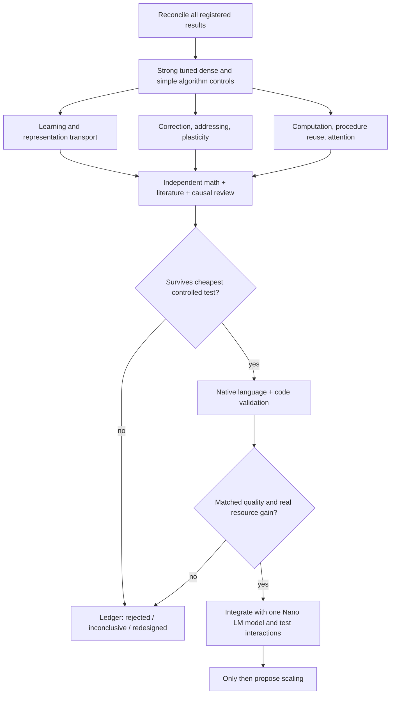

# 03 — Preregisterable experiment program, engineering implementation and scale gates

**Status:** research designs, not executed GPU/TPU model-training experiments. Do not retrospectively add them to existing frozen protocols. All local and paid experiments require the live repository rules, data rights, code revision, and resources to be verified. **No paid compute authorized by this document.**

## Executive plan: test causes before building expensive architecture

| Stage | Purpose | Concrete output | Advance condition |
|---|---|---|---|
| S0 evidence repair | Authenticate canonical research, reconcile branches, local worktrees, and registered runs | Signed/hashed status manifest, corrected decision ledger | No unresolved provenance-critical claim for selected hypothesis |
| S1 pure mathematical checks | Test conditional propositions and counterexamples with tiny code | Five deterministic checks and counterexamples | Algebra and scope survive independent review |
| S2 cheap causal experiments | Distinguish optimizer, addressing, replay, and revision causes | Multi-seed factorized design | One mechanism shows gain against simplest strong alternative |
| S3 concept discovery | Detect learned procedures, knowledge migration and positive transfer | Cross-episode held-out families | Statistical evidence of transfer, beyond storage/ICL |
| S4 native language | Native dense versus candidate on same text/code with matched bytes and time | 15M–50M checkpoints, open BPB/latency/energy | No regression; demonstrable target benefit |
| S5 intermediate scale | Replicate useful mechanism in 125M–350M native model | Checkpoints and held-out reports | Independent confirmation justifies budget |
| S6 conditional large model | Potentially train 1B–2B+ only after justified program | Funded, measured, reproducible proposal | Explicit scoped authorization and feasibility |

### Work routing

## A. Eighteen explicit experiments and decision gates

| ID | Gap and experiment | Arms / strongest control | Primary outcome | Confounders and rejection condition | Compute posture |
|---|---|---|---|---|---|
| G00 | Repo-state truth | Master + `research/ontogenesis-phase1`, result manifests, uncommitted inventory | Evidence complete and current | Do not infer job completion from docs; cannot access user's laptop locally | Read-only, now |
| G01 | Re-run formal examples | Versioned ledger, invertible transport, nullspace, storage, compute rule | Identical deterministic expected output | Numerical checks ≠ proof of LM competence | CPU, done |
| G02 | Addressing × optimizer factorial | Learned/frozen/hash addresses × Adam reset/β2/SGD | Final quarter acquisition plus old retention | Must match fresh data and per-arm tuning; one seed insufficient | CPU/Apple GPU, no execution here |
| G03 | Correction edit cause | One-fact Adam, Adam reset, full-entity replay, regularized/projected update | Current correction accurate; old other facts retained | Old facts may be stored for replay; count bytes; distinct seeds | Local |
| G04 | Rule-change detection | Oracle, leave-one-out router, calibrated change-point, no router | Rule changes vs exceptions discriminated; false alarms | Genuine change and noise share early evidence; no future-label access | Local |
| G05 | Representation migration | Frozen index, exact T oracle, learned T, rebuild, replay | Old/new accuracy *and* total rekey+decode cost | Oracle mapping is upper bound, not deployable | CPU then small LM |
| G06 | Nullspace update tradeoff | Unconstrained SGD/AdamW, GEM/OGD-style, same-entity replay | Old logit drift vs new target learning | Projection may eliminate all usable update direction | Tiny NN, local |
| G07 | Positive forward transfer | Meta-trained dense, same-param recurrent, operation-memory candidate, written scratchpad | New procedure samples to threshold **after examples leave context** | Split operators, not just strings; no hidden demonstrations | CPU/small GPU |
| G08 | Structural creation vs selection | Fixed menu of operators, learned parameterization, composed operators | Unseen operation family acquisition | Large menu equivalent or better; route must be learned | Local exploratory |
| G09 | Recurrence mechanism | Untied dense, tied loop, nested, teacher-forced intermediate states | Jump-time and jump-probability on cross-hops | Censoring, varying parameter/FLOP budgets and LR | Existing protocols untouched |
| G10 | Objective ablation | Causal CE, CE+multi-token, CE+state prediction, hybrid masked/causal | BPB + sample efficiency + transfer | Training token budgets and scoring bytes must match | Local/free GPU |
| G11 | Exact copying | Dense, gated pointer, posthoc CopyGen, deterministic span copy | Exact new-value/identifier match, noncopy BPB, joules | Never evaluate only copyable cases | Small LM/local |
| G12 | Sequence mixing | Dense GQA, published hybrid, Mamba-3-like, KDA-like | BPB and context tests per train hour and decode joule | Unsupported kernels can dominate | Scoped GPU after G02–10 |
| G13 | Global information placement | Move full attention layers; memory head controls | Long retrieval AND multi-hop composition | ICML hardness result has defined assumptions | 15M+ |
| G14 | Cross-depth information reuse | Standard residual, Block AttnRes, Depth-Attn, equal-cost extra FFN | BPB/time and activation stability | Cross-layer cache/traffic may null gains | 15–125M |
| G15 | Adaptive reasoning | Fixed K, learned K, equal-FLOP untied depth, external written scratchpad | Fresh verifiable tasks per actual joule | Controller cost/calibration, rollout costs | Local → scoped GPU |
| G16 | Native language integration | Strongest single gain plus combinations vs dense/hybrid | Fresh-domain BPB and honest Pareto improvement | Individually positive interventions can interact negatively | 15–125M |
| G17 | Scaling falsification | 125M and 350M matched pair; extrapolation if supported | Stability across scale, domains and devices | No paid GPU/TPU without verified price and approval | Gate only |

## B. First executable causal protocol: distinguish address congestion from optimizer history (G02)

**Background source:** `INVESTIGATION.md`, Question 7. Original learned/fixed address run used only ~526 effective slots; in one seed late-phase acquisition was 3.4%. Uniform hashing reported 99.9%, Adam reset 86.1%, and 10× learning rate 59.9%. The experiment does not prove a new memory mechanism; it suggests a tractable optimizer×address interaction.

**Preregistration proposal** (must be committed *before* implementation changes): 3 address arms (original frozen/learned addressing; uniform hash; approximately balanced learned keys) crossed with 3 optimizer arms (baseline Adam; per-phase Adam moment reset; altered β2 with same first-moment rule). Keep data stream, model width, slot count, $k$, number of train steps, batch sequence and phase order fixed within each seed. Tune learning rates on distinct development seeds only; final confirmation on at least five new seeds, or justify sample size from observed effect. Do not mutate running earlier protocols.

**Primary endpoint:** mean new-fact acquisition across phases 46–60. **Co-primary safety endpoint:** old-fact retention on phases 46–60 and stale-answer rate after corrections. **Mechanistic measures:** occupancy entropy, $K_{eff}=1/\sum_j q_j^2$, per-slot Adam second moments, gradient norms, actual write/read collisions, step-size quantiles, and per-phase wall time.

**Distinct predictions:** if only congestion matters, hash helps but resetting moments should not dramatically help at unchanged addresses; if optimizer history contributes, reset or faster β2 forgetting helps at fixed addresses; if interaction matters, the factorial interaction (hash×reset) is not explained by independent main effects. Report each factor and the interaction with uncertainty; call one-seed results exploratory.

## C. Representation transport protocol (G05)

Construct tasks where identities and relations persist while the encoder basis changes. Control the transformation in one diagnostic condition (known orthogonal matrix) and make it unknown in the real learning condition. Compare:

1. **Frozen encoder:** good stability, possibly poor adaptation.
2. **Full replay/rebuild:** upper bound with high migration cost.
3. **Known transport:** sanity ceiling; exact outputs provably preserved given a correct map.
4. **Estimated transport:** fitted from a tiny anchor set with no future-task labels.
5. **Learned state rewrite:** end-to-end trainable migration, tested against a plain model with the same extra parameters.

Report old prediction drift before/after migration, new-task sample complexity, storage bytes, all memory writes and reconstruction work, effect on compositional OOD tasks, and results when the true transformation is noninvertible or changes different semantic factors differently. A purely orthogonal synthetic task is insufficient to promote a general language-model mechanism.

## D. Procedural reuse and positive transfer (G07–G08)

Train on compositions of simple *hidden* functions $f_i$ in a finite domain, with training families disjoint from novel test compositions and novel primitives. After each episode, remove examples from the context; allow the model to retain only whatever explicitly counted internal state or slow weights the protocol permits. A second control can keep a compact exact operation library, counted at equal total bytes.

**Compare:** (i) optimized Transformer with learning-to-learn curriculum; (ii) equal-size looped/shared network; (iii) typed small program/interpreter; (iv) stateful candidate with learned operations; (v) model with a finite fixed menu; (vi) a trivial memorizer. Evaluate **learning speed on successive new task families**, not just instantaneous in-context accuracy. Test heterogeneous sequences where later operations differ from earlier ones; otherwise a tied loop is favored by construction.

**Preregister positive forward transfer:** $N_j(q)$ = number of fresh examples needed to reach accuracy $q$ on unseen family $j$. Transfer exists only if the slope of $N_j(q)$ decreases over disjoint successive tasks relative to an equally experienced control, without collapsing retained performance and after accounting for additional memory. The success rule must be calibrated using a development study; do not invent a numeric threshold without pilot variance.

## E. Native language-model replication (G10–G16)

**Existing local program:** `BUILD-PLAN.md` reports a 32k tokenizer, a four-domain 800M-token v1 corpus, 15M native pilot plans and TPU calibration results. These were reported by the research agent; the files' existence on the owner's laptop and original licensing were not independently checked here. Corpus proportions and 1M validation per domain were recorded in that plan.

**Evaluation contract:** same training bytes, tokens where tokenizer matches, supervised target handling, sequence length, domain mixture, optimizer per-arm tuning budget, validation cutoffs, hardware, and reporting frequency. If input methods differ, compare BPB on the same *raw UTF-8 bytes*, and show token/patch counts and throughput separately. Report:

- Total training FLOPs estimate and observed wall time; physical energy when instrumented.
- Held-out BPB for general prose, code, math, textbook/science, separate from training and tuning distributions.
- Long-context source retrieval and updated fact conflicts; no future retrieval leakage.
- Fresh compositional reasoning; exact copying conditional on availability of source spans.
- OOD procedure learning, plasticity and old-task retention across the same episode stream.
- Parameter counts including embeddings, experts, all learned heads; runtime memory; optional store size.
- p50/p95 latency, tokens per second, actual joules/task at stated batch/serving load.

A win only on a synthetic memorization task cannot promote a foundation architecture. A loss advantage at equal tokens but 5× worse wall time cannot establish better capability per training hour. Benchmark outcomes with broken graders or dataset contamination need review rather than promotion.

## F. Compute and parameter feasibility

A common approximation for dense LM training is $F_{train}\approx 6ND$ FLOPs for $N$ parameters and $D$ training tokens. This is a *rough compute accounting proxy*, not measured throughput or a universal law across recurrent/sparse methods.

| Scenario | Parameters N | Training tokens D | Dense proxy 6ND | Implication |
|---|---:|---:|---:|---|
| Stage S4 | 15M | 800M | $7.2\times10^{16}$ FLOPs | Feasible research-scale scope if real throughput confirms |
| Intermediate comparison | 125M | 2B | $1.5\times10^{18}$ FLOPs | Price/availability must be verified |
| Larger pilot | 350M | 5B | $1.05\times10^{19}$ FLOPs | Budget and checkpoint retention matter |
| Moderate 2B run | 2B | 100B | $1.2\times10^{21}$ FLOPs | Not frontier pretraining budget by assertion |
| Ambitious 3.5B training | 3.5B | 1T | $2.1\times10^{22}$ FLOPs | Cannot infer GPU-hours from FLOPs without measured device utilization |

**Parameter budget sensitivity:** A shared 2,560-wide embedding table is about 0.168B learned parameters for a 65,536 vocabulary, but ~0.636B for 248,320 tokens. That increase of roughly 0.468B alone can push an illustrative 'sub-4B' design over its upper target. Every final proposed architecture must instantiate exact counts instead of extrapolating a layout table.

**Infrastructure rule:** `ACTIVE_NOW.md` authorizes certain exploratory training but requires experiment-scoped authorization for material costs and confirmatory runs. Verify quotas and billing independently before any paid run; do not claim a $500 TPU budget is sufficient solely on estimated price summaries. A reported TPU throughput is an instrumented result only on its recorded architecture, precision, sequence length, batch and compiler; it is not automatically transferable to a different model.

## G. Engineering work required (implementation layers)

| Area | Ownership and deliverable | Gate / tests |
|---|---|---|
| Data | Source/license and dedup manifests; exact token/byte split | No private data or PHI; held-out chronology verified |
| Baselines | Mature dense/loop/hybrid, explicit version/parameters | Unit train correctness; optimizer tuning against controls |
| Attention/recurrent kernels | Device-specific tested implementations | Numerical equivalence vs PyTorch reference; throughput/power on target |
| State/runtime | Reset, eviction, snapshot, recovery, versioning | No cross-request leakage; stale-event tests |
| Learning | Replay/regularizers/objective versions; optimizer-state probes | Hyperparameter provenance; no retrospective tuning |
| Formal checks | Proposition and edge-case test suite | Small CPU tests; mathematical reviewer separately |
| Benchmark and energy | Paired seeds, full-system metering, CI test outcomes | Include failed jobs and actual cost |
| Research ledger | Stable decision/event/result IDs and supersession links | All new proposals and contradictory findings filed |
| Integration | One model config and diffable deterministic checkpoints | Cross-task no-regression gate before promoting mechanisms |

## H. Fifteen-day (not a promised wall-clock schedule) execution queue

This is a dependency order, **not** a promise to deliver days later or evidence that any job is running.

| Priority | Work item | Current disposition | Required evidence before next |
|---|---|---|---|
| 0 | Preserve the existing registered nested/routing/LM pilots and identify owner of V4 untracked files | Pending owner-side reconciliation | Worktree/status manifest |
| 1 | Merge or link new theory+decision snapshot into canonical ledger through review | Draft docs in current package | Human or delegated review, then merge if desired |
| 2 | Run deterministic sanity checks | **Completed here, 5/5** | Math reviewer confirms assumptions and counterexamples |
| 3 | Run G02 addressing×optimizer and G03 correction controls | Planned, no training executed | Multi-seed causal factor separation |
| 4 | Decide whether G05 transport has information gain over replay | Planned | A discriminating toy-to-real bridge with cost |
| 5 | Decide whether G07 procedure test excludes ICL | Planned | Cross-episode retrieval control |
| 6 | Audit 800M corpus and modern baseline recipe | Planned | Data license/dedup and checkpoint identity |
| 7 | Execute 15M equal-time native language tournament | Planned, *only on authorized environment* | Fresh held-out language/coding differences |
| 8 | Benchmark hardware and fix bottlenecks before scaling | Planned | Measured joules/latency/bytes per success |
| 9 | Submit 125M proposal with explicit quota and price | Gate, not authorization | Repeated 15M win and reproducible budget |

## I. Acceptance and independence rules

**Experimental correctness:** registered protocol cannot change after seeing confirmatory data. Tune separately on exploratory seeds; use untouched final seeds. Report censoring in time-to-jump models, no cherry-picking, paired runs where meaningful, and confidence intervals or bootstrap summaries with actual denominators. Each claim must state which outcome would have falsified it.

**Scientific claims:** 'proved' means the theorem and assumptions were checked, not that benchmarks passed. 'Published' means another team's measurements, not Nano evidence. 'Pilot' is not 'replicated'. 'System-level win' must show all retrieval/verification costs. No benchmark contamination, leaked future values, misleading token-matched comparison or miscounted external model allowed.

**Authorized writes:** New documents, code and local CPU checks are in scope. Destructive branch operations, blanket merges, local worktree cleanup, PHI, private owner data, and materially costly compute are not. Prior experiments and raw result files remain frozen.