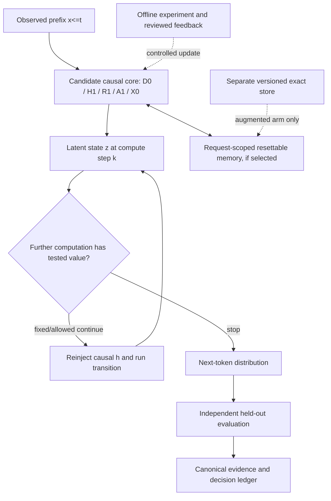

# 05 — Independent gap closure, theory audit, and implementation contracts (v2)

**V5 current gap notice.** The new register at the end of this chapter distinguishes repaired engineering defects, narrowed claims and unresolved empirical work. The [optimizer/geometry review](12_OPTIMIZER_FACTORIAL_AND_UPDATE_GEOMETRY.md), [causal memory review](13_CAUSAL_MEMORY_AND_RESOURCE_FRONTIER.md) and [native comparison](14_NATIVE_UPDATE_COMPARISON.md) control current conclusions. A documented experiment or conditional proof does not close an unexecuted language-quality gate.

**V4 precedence.** The new F-31–F-39 register at the end records additional closures. Current training/measurement contracts are in [10](10_TRAINING_AND_CONTROLLED_UPDATE_CONTRACT.md); completed margin evidence and cumulative-drift proofs are in [11](11_MARGIN_RESULTS_AND_DURABILITY_THEORY.md). V2/V3 findings below retain their original review scope.

**V3 precedence notice:** This document retains the 18-item V2 review and now includes follow-up repairs. Current theorem statements are in [01](01_ARCHITECTURE_AND_THEOREMS.md), executable tensor/cache details in [07](07_IMPLEMENTATION_CONTRACT.md), source inspection depths in [08](08_LITERATURE_AUDIT.md), and new repository evidence in [09](09_EVIDENCE_REFRESH_AND_PROTOCOL_REPAIRS.md). A repair to wording or a diagnostic is not closure of an empirical learning claim.

**Status:** research review and corrigenda, 2026-11-21. **Not a proof of superior intelligence, not an adoption of APS or another model family.** The native Nano LM model remains the target; dense, hybrid, recurrent, adaptive predictive-state and other yet-undiscovered substrates remain competitors. Scope: reviewable, reversible design and local deterministic tests. No paid training or owner-device inspection.

## Executive findings and resolutions

The earlier architecture specification has five mathematically valid *conditional examples*, but its practical bottlenecks were under-specified. A known invertible feature transformation can preserve output predictions; identifying that transformation, updating every dependent computational state, paying migration cost, and retaining the ability to learn are distinct, unproved research problems. Likewise, a null-space update eliminates *linearized* change to sampled logits, not forgetting in a nonlinear network. An exact event ledger implements a declared storage policy, not knowledge or truth. A one-step compute gate is not an optimal multi-step reasoning policy. These corrections replace any broader interpretation in earlier summaries.

| ID | Issue in v1 | Correction in v2 | Test / acceptance evidence | Status |
|---|---|---|---|---|
| F-01 | A generic known invertible map appeared to imply practical continual learning | Exact invariance requires transforming **all** downstream uses (readout, keys, queries, cache/state, optimizer coordinates if relevant); unknown map incurs identification and migration cost | Paired old/new outputs, end-to-end state consistency, bytes and joules; unknown map vs replay | Conditional theorem; benefit open |
| F-02 | Representation error bound covered only top-1 classes | Add an explicit bound on normalized log probabilities when every logit is within epsilon; analyze calibration and sequence drift separately | Max/log-prob error and KL on held-out prefixes; no future labels | Conditional theorem; empirical status open |
| F-03 | Null-space protection could be read as an exact non-forgetting rule | Add second-order remainder for Lipschitz Jacobian, approximation residuals, anchor coverage and cost of JVP/VJP | Compare exact anchors, finite steps, gradient conflicts, new capability learned | Conditional theorem; practical effect open |
| F-04 | Bounded memory lower bound was overgeneralized | Applies to arbitrary independent lossless symbols, with specified side information; does not forbid compression of structured data or useful approximate memory | Explicit information model, total storage including indexes/weights, error budget | Conditional lower bound |
| F-05 | 'Latest valid' exact event conflated transaction time with world truth | Specify event-time and recorded-time, conflict/authority, retraction and as-of semantics | Permutation, duplicate, out-of-order, stale/corrected events and source permissions | Deterministic policy, not verified truth |
| F-06 | Myopic compute rule appeared globally optimal | Use a budgeted Bellman formulation; train/validate an imperfect causal gain estimator; include controller overhead | Cost-quality frontier, harmful extra steps, stopping calibration/regret | Conditional local rule |
| F-07 | APS named before a settled mathematical advantage | Treat APS as an unselected **candidate interface**, compare dense/hybrid/recurrent, allow alternatives not in this document | Equal-quality / equal-resource comparisons, non-inferiority guardrails | Not selected |
| F-08 | V1 lacked a precise causal memory and session-state contract | Make token/training/iteration clocks separate, cache and state scoped/resettable, source-copy bounded to current available prefix | Invariant tests for reset, leakage, updates, old/new keys | Specification only |
| F-09 | Missing optimizer/data confounds in the known memory failure | Factorialize address × optimizer state, replay and correction scope; don't attribute gain to new architecture | Multiple independent seeds, per-arm tuning, joint data streams, raw curves | Planned, not run |
| F-10 | Missing formal anti-oracle condition for rule-change routing | Detector must decide before fitting current sample without true 'exception' labels, future examples or ground-truth change points | Dynamic-rule and novelty streams with prequential scores and false-alarm cost | Planned |
| F-11 | Synthetic transport pilot promoted to headline without enough qualification | Five-seed 16D linear rank diagnostic is **identifiability**, not improved continual learning, forward transfer or efficiency | Distinct unseen nonlinear and language-model tests | Existing toy diagnostic only |
| F-12 | 18 gates had inconsistent success criteria | Add pre-registration template, one primary endpoint per experiment family, complete tuning accounting, confirmatory seeds/strata | Valid protocol and manifest before evaluating | Protocol specified |
| F-13 | Ledger IDs and changes were prose-only, not validated | Introduce append-only JSONL events and schema-validation checks; link original canonical LEDGER rather than replacing it | Test for ID collision, status, evidence type, supersession and valid paths | Implemented locally; branch review needed |
| F-14 | Package scripts overwrote fixed result paths | Pure read-only default: tests print to stdout; `--out` opt-in, atomic file replacement in writable directory | Run from extracted read-only location and clean location | Implemented, tested locally |
| F-15 | Duplicate README anchors and inconsistent names | Single report table, explicit v2 inventory and newest-correction precedence | Link checker and packaging verification | Implemented |
| F-16 | Existing source descriptions were sometimes stronger than full source review | Differentiate direct abstract/metadata checks from complete-paper verification and local replication | Source-specific level in references register | Revised |
| F-17 | Architecture budgets ignored post-training, data provenance and exact model interface at scale | Parameter counter, model/augmented score separation; 6ND only proxy; hard data/license and throughput gates | Instantiated model parameter count and GPU/TPU meter, no assumed market price | Planned scale gate |
| F-18 | Research status drifted across overlapping ledgers | Canonical history remains `research/frontier/ontogenesis/LEDGER.md`; decision supplements are explicitly subordinate, versioned, and reviewed through a draft PR | Same observed values, link to exact result code and no silent status promotion | Process correction |

## 1. Architecture competition and state semantics

### 1.1 One native model, competing *implementations* of the same contract

The final artifact should have a single trained parametric prediction system, even if it internally learns multiple operations. An optional external exact store is scored as an **augmented system** and never silently included in a native-model win. Do not prejudge whether learned states are tensors, recurrent matrices, typed relations, sparse memories, or something unexpected.

| Arm | Neural computation | Memory | Unique question | Earliest fair comparison |
|---|---|---|---|---|
| D0 | Modern dense causal Transformer, tuned GQA/pre-norm/FFN | Native KV cache only | How strong is the simpler option after comparable tuning? | Every pilot |
| H1 | Published hybrid recurrent/linear mixer + selected full attention | Bounded recurrent state, KV where used | Can it preserve global composition and BPB with lower full-system cost? | G12–G14 |
| R1 | Tied block repeated at fixed depth | Resettable latent state | Does weight reuse improve learning of procedures when old examples leave context? | G09/G07 |
| A1 | **Unselected:** causal backbone with optional learned transport and adaptive refinement | Explicit local working state | Can learned organization improve retention and transfer without regressions? | G05–G08 then G16 |
| X0 | Any competing mathematical operator discovered later | Implementation-defined | Does an unexpected simpler substrate beat all of these? | New registered branch, same harness |
| S0 | D0/H1/R1/A1 plus indexed/versioned external records | Fully counted store, indexes, queries | Does a whole-system intervention win despite memory/IO? | Separate augmented scoreboard |

Never test a hybrid by giving it unfused reference kernels while the dense arm uses optimized kernels and then call the difference architectural. Both *math-equivalent reference* and *deployment-optimized* comparisons are needed. The Qwen3.5 3:1 layout is prior art, not a mandated ratio; an ICML 2026 expressiveness result concerns a specific sequential-composition setting rather than proving every hybrid inferior. [P-01/P-24, P-04]

### 1.2 Explicit causal interface

For a batch of token IDs `x ∈ {0,…,V-1}^{B×T}` and optional initial state `s_0`, a native inference step returns `logits ∈ R^{B×T×V}`, next *streaming* state `s_T`, and a transparent cost receipt. At token time `t`, the recurrent computation sees only `x_{≤t}` and memory committed no later than `t`; the model-parameter version is `θ_n` (training step `n`), and latent compute step is `k ∈ [0,K_t]`.

Define encoder/backbone state `h_t = H_{θ_n}(x_{≤t},s_{t-1})`, optional working-memory read `r_t = R_{θ_n}(h_t,s_{t-1})`, and iteration:

\[
 z_{t,0}=P_{\theta_n}(h_t,r_t),\qquad
 z_{t,k+1}=z_{t,k}+\alpha_{\theta_n}(z_{t,k},h_t,r_t) F_{\theta_n}(z_{t,k},h_t,r_t).
\]

Readout: `p(x_{t+1}|x_{≤t}) = softmax(W_out z_{t,K_t}+b)`. Write to streaming state only after the current step has finished using its permitted input; distinct documents/requests reset state unless an explicit authorized persistent-state protocol says otherwise. Causal source copying may point only to an already-visible, permitted input span and must account for pointer/copy-head inference costs. **There is no inference-time `θ` update in the default model benchmark.** If test-time training is evaluated, its writes are explicitly counted and training/evaluation boundaries are redefined.

`K_t=0` is a mandatory ablation for an optional refinement module, with a complete nonzero-depth core still present. It is not permission to remove all causal computation. A controller selecting integer `K_t` is discrete; choose one documented gradient/supervision/REINFORCE/relaxation route if and only if fixed-depth controls earn it. Do not assume the additional loop sees current or future answer tokens. Log token-level stopping decisions and whether extra steps helped or harmed.

### 1.3 State, safety and synchronization invariants

| State | Scope and lifecycle | Update/validation | Failure to detect |
|---|---|---|---|
| Weights `θ_n` | Trained checkpoint; version, optimizer state and data provenance | Only explicit training/editing transactions | Silent online learning or stale checkpoint mix |
| KV/recurrent state `s_t` | Scoped to one authorized request or explicitly permitted stream | Deterministic reset, eviction and snapshot semantics | Cross-user/context leakage, incorrect positional reset |
| Procedure state `z_{t,k}` | Internal to token/latent pass | Must be causal, bounded by `K_max` and numerically stable | Divergence, unnecessary repeated compute |
| Optional exact record `L` | Separate augmented system; explicit provenance/permissions | Bitemporal event/version index with retractions | Stale corrections, untrusted or permission-denied retrieval |
| Updated representation map `T_n` | Only in candidate A1; versioned alongside every dependent state/readout | Mapping, inverse/approximation and failure rollback | Unreachable memories and silent prediction drift |

The abstract interface is instantiated by the forward-only NumPy dense/shared-block reference in [07](07_IMPLEMENTATION_CONTRACT.md). It specifies tensor shapes, RMSNorm/RoPE behavior, per-logical-depth caches and exact counts. A shared parameter block does not imply a shared activation cache. Native training and optimized kernels remain unimplemented in this reference.

## 2. Theorems: exactly what has and has not been proved

### 2.1 Representation conjugacy and prediction preservation

Let `E:X→Z`, `D:Z→R^V` produce logits, and let `T:Z→Z` be bijective. Define `E'=T∘E`, `D'=D∘T^{-1}`. Then `D'(E'(x))=D(E(x))` by substitution for **each** input. If the network has internal operations beyond this two-function factorization, all stateful/lookup dependencies must be transformed consistently; changing only a decoder is insufficient. A rank-deficient map destroys distinguishability **in general**, but might be harmless for a particular decoder constant on its kernel.

**Log-probability extension.** If each corresponding old/new logit differs by at most ε (`||l'-l||∞≤ε`), then their log-normalizers differ by at most ε because `e^{-ε}Σe^{l_i} ≤ Σe^{l'_i} ≤ e^{ε}Σe^{l_i}`. Hence:

\[
 \left|\log p'_i-\log p_i\right|\le 2\varepsilon\quad\forall i,
 \qquad D_{KL}(p\Vert p')\le 2\varepsilon.
\]

This is a **worst-case one-step distribution bound under a supplied logit bound**. It says nothing about how to estimate `T`, which states were omitted, error compounding over many generated tokens, whether a changed model is more intelligent, or real truth of predictions.

**Unknown linear-map identifiability.** An arbitrary unknown invertible `d×d` matrix is uniquely determined by `d` linearly independent paired anchors `(z_i,Tz_i)` (matrix equation `T Z=Z'` with `rank(Z)=d`). With fewer than `d`, infinitely many linear maps agree on the anchor span; recovering the map globally is not generally identifiable. This is not a lower bound for preserving a particular classifier with invariances nor for structured priors/low-rank transport. The synthetic five-seed rank test in this package is an illustration only.

### 2.2 First-order constrained edits: second-order error bound

Let old anchor logits be `f:R^P→R^m`, `J=∂f/∂θ`, and `Δθ∈ker(J)`. A linearized prediction change is zero: `JΔθ=0`. If `J` is `L`-Lipschitz in operator norm along the update segment, the fundamental theorem of calculus yields:

\[
 \|f(\theta+\Delta\theta)-f(\theta)\|_2
 \le \int_0^1 \|J(\theta+s\Delta\theta)-J(\theta)\|_{op}\|\Delta\theta\|_2\,ds
 \le \tfrac L2\|\Delta\theta\|_2^2.
\]

Here Δθ means the complete realized parameter displacement after optimizer preconditioning, momentum, weight decay, clipping and any auxiliary writes. Projecting only the raw gradient does not enforce this condition. If a numerically approximate projection leaves residual `r=JΔθ≠0`, use `||r||_2 + (L/2)||Δθ||²`. These are **anchor-output bounds only**. They do not establish old-task accuracy or fairness on unseen old inputs. In high dimensions exact null-space projections require costly Jacobian operations; damping changes the guarantee. If the new-task gradient lies wholly in the constrained subspace, the permissible update can be zero, preventing learning. Compare with replay, distillation, low-rank edits, optimizer resets and a no-projection control. The direct gradient-space precedent is OGD [P-27 in08]; AlphaEdit [P-36 in08] protects a fixed-key layer under an exact-nullspace assumption. The activation-space reference [P-25 below] has a distinct scope.

### 2.3 Independent fact storage: limit and exception

For `n` arbitrary independent symbols from an alphabet of size `V`, an exact injective fixed-length encoding needs at least `ceil(n log2 V)` bits, absent additional side information; otherwise by the pigeonhole principle two inputs would collide. This counts **all** information-bearing parameters, auxiliary memory, external stores, indexes and shared priors where they encode those facts. The bound does not prohibit efficient compression for structured distributions, prediction-based coding, amortized procedures, or approximate task-conditional retrieval (rate–distortion tradeoff). It is not a universal lower bound on how many neural parameters are needed for a named benchmark.

### 2.4 Bitemporal events: index correctness does not prove factual truth

For event `(key, value, valid_from, recorded_at, event_id, authority, action)`, a specific *policy* can return the latest authoritative visible event by `(valid_from, recorded_at, event_id)` among events that were recorded by observation cutoff `r` and valid at world time `t`. The maximum of the same finite totally ordered eligible set does not depend on ingestion order. However, if `valid_to` is needed, the interval and correction/supersession rules must be explicit; real authorities may disagree, timestamps may be wrong, and indexes can be out of sync. A `retract` tombstone invalidates active state under the chosen rule but does not erase historical evidence. Permission denial must be treated as **unknown/inaccessible**, not as absence. This is an augmented-system data-integrity mechanism, not native neural memory.

### 2.5 Adaptive compute: myopic decision versus budgeted optimal stopping

Given a known single-step utility increment `ΔU(s)` and cost `ΔC(s)` with conversion `λ`, a **myopic** objective chooses `continue` iff `E[ΔU(s)] > λΔC(s)+controller_overhead`. The true multi-step problem requires a state/budget value function:

\[
 V(s,b)=\max\big\{U_{stop}(s),\ \max_{a\in A_{continue},\;c_a\le b}\big[-\lambda c_a+\mathbb E[V(S',b-c_a)\mid s,a]\big]\big\}.
\]

Costs must include controller overhead in consistent utility units; the Bellman equation assumes sufficient Markov state, known action transitions for an optimal-policy claim, and a finite horizon or strictly positive budget consumption. Neither identity gives a learned model oracle access to `ΔU` or the transition distribution. A usable controller must estimate them using **causal** information, be validated on held-out difficulty strata, detect when additional computation worsens answers, and count every controller and branch cost. Regret relative to a hindsight oracle must be described explicitly as an **oracle benchmark, not a deployable baseline**.

## 3. Causal experimental priorities and controls

### 3.1 The actual diagnostic program has a simpler hypothesis to beat

The existing repo's one-seed memory-saturation study found late acquisition of 3.4% with original addressing, 99.9% with uniform hashing, 86.1% after Adam-state reset, and 59.9% with 10× LR. Address concentration and optimizer history are competing or interacting explanations; the factorial interaction is not yet measured; no new learned memory principle has yet outperformed the simplest baseline. In `forgetting_split.py`, exceptions alone left old regular facts around 99.6–99.7%, whereas corrections alone reduced them to ~91%. The leave-one-out non-oracle write-time router produced unseen-relation inference 81.4% versus baseline 77.6% and oracle 88.9%, with seed variation. These observations are **toy-task results with stated limitations** and should direct the next controlled experiments, not justify a large-scale APS design.

| Priority | Discriminating experiment | Strongest necessary control | Primary decision | Do not conclude |
|---|---|---|---|---|
| 1 | Address(learned/frozen/hash) × optimizer(Adam carry/reset/β2/SGD), paired streams | Best tuned hash + reset combination, same budget | Which factor causes acquired-fact collapse? | Theoretical memory impossibility from one seed |
| 2 | G03b successor: paired correction durability after the completed same-entity replay pilot | Tuned AdamW + same-entity replay and an exact map | Does projection/migration add anything to corrections? | Any general forgetting law from single-fact updates |
| 3 | Rule changed vs one-off exception vs label noise | No oracle, prequential LOO/change-point detector, same inputs | Can structure be learned without future labels? | Detector learned if it sees ground truth |
| 4 | Unknown learned transport under evolving features | Frozen, full replay, correct known `T` ceiling, low-cost estimation, projection | Gain in both old/new behavior per resource? | Synthetic inversion = continual learning |
| 5 | Cross-episode operation reuse | Meta-trained Transformer, explicit program library, ICL permitted/denied conditions | Does ability persist across episodes and transfer? | Wider context alone = self-organization |
| 6 | Real native LM cross-domain confirmation | Modern dense plus published hybrid, independently tuned with held-out seeds | Language/code/reasoning quality at fixed compute | A toy synthetic win = frontier language win |

### 3.2 Experimental fairness and pre-registration contract

Every confirmatory study needs a frozen **experiment manifest** with: hypothesis ID and exact contrast; seed-generation rule and units of independent replication; eligible task/data distribution; data split by document/entity/task family/time; one primary endpoint and direction; diagnostic secondary endpoints; baseline versions and planned hyperparameter-tuning compute; duration/budget/censoring; error bars and uncertainty method; failure/stop rule; available hardware/precision; output/checkpoint destination; and who can authorize paid runs. Exploratory pilots may be adaptive but must not be retrospectively described as preregistered confirmatory outcomes. If an experimental arm uses more memory or an oracle, it must be counted or labeled as a ceiling.

**Pairing:** use identical underlying data streams for compared arms and report per-seed paired differences, not a fabricated combined confidence from pooled tokens. **Time-to-jump:** treat runs not reaching threshold by the cap as right-censored; compare learned probability and survival curves. **Optimization:** independently tune arms on development seeds with an equal optimization-search budget; keep fresh confirmatory seeds untouched. **Data leakage:** code repository and document duplicates, future timestamps, side-channel hints, and repetition across train/validation must be audited. **Cost:** report wall-clock, GPU occupancy, bytes moved, memory, and if energy metering is available, actual joules for the complete workload including retries and system memory.

### 3.3 Model scaling is gated, not inferred

The rough `6ND` dense-LM training-FLOP proxy is useful for budgeting only; recurrent iteration, sparse activation, optimizer states, kernels, and context lengths alter actual cost. At fixed nominal parameter width, changing vocabulary from 65,536 to 248,320 increases a tied 2,560-dimensional embedding by **467,927,040 parameters**. A true sub-4B plan must count every learned weight including embeddings, heads, experts and verifier adapters. It must also include source/license validation, benchmark contamination audit, and measured available GPU/TPU pricing and quota. No experiment in this v2 review implies paid-compute authorization.

## 4. Source traceability and limits

- **Repository evidence:** [Nano LM PR #194](https://github.com/wwk5q8z6kk-bit/nano-lm/pull/194), [INVESTIGATION.md](https://github.com/wwk5q8z6kk-bit/nano-lm/blob/research/ontogenesis-phase1/research/frontier/ontogenesis/INVESTIGATION.md), [DISCOVERY-CYCLE-1](https://github.com/wwk5q8z6kk-bit/nano-lm/blob/research/ontogenesis-phase1/research/frontier/ontogenesis/theory/DISCOVERY-CYCLE-1-20261121.md), and [canonical ledger](https://github.com/wwk5q8z6kk-bit/nano-lm/blob/research/ontogenesis-phase1/research/frontier/ontogenesis/LEDGER.md). Distinguish branch snapshot from latest master and from unavailable owner-local worktrees.
- **[P-01/P-24]** [Qwen3.5 model-family implementation notes](https://huggingface.co/docs/transformers/model_doc/qwen3_5) — 3:1 hybrid used in a published architecture; official model card is the proper source for 4B configuration details.
- **[P-04]** [Ye et al., ICML 2026](https://proceedings.mlr.press/v306/ye26h.html) — theoretical separation for a specified sequential-composition task, not a blanket hybrid impossibility.
- **[P-12]** [Kim, Kim & Sohn, ICML 2025](https://proceedings.mlr.press/v267/kim25p.html) — metrics and analysis of representation shift; **does not prove** the proposed Nano transport works.
- **[P-25]** [Anthes et al., Lifelong Learning Agents 2025](https://proceedings.mlr.press/v274/anthes25a.html) — activation task-relevant subspaces; relevant direct prior art for change outside readout range.
- **[P-14]** [Lyle et al., 2025](https://proceedings.mlr.press/v274/lyle25a.html) — combination of layer normalization and weight decay can preserve plasticity in their conditions, does not guarantee retention.
- **[P-26]** [Zhang et al., 2025](https://proceedings.mlr.press/v274/zhang25a.html) — separates stability, plasticity and cross-task consolidation; informs formal transfer tests.
- **[P-09]** [Memory Layers at Scale, ICML 2025](https://proceedings.mlr.press/v267/berges25a.html) — reported capacity-per-FLOP trade-offs with extra parameters; model-size accounting remains necessary.
- **[P-05]** [LOTUS, 2026](https://arxiv.org/abs/2606.31779) — intermediate-supervised latent loops; compare its actual training objective, not merely weight tying.
- **[P-08]** [CopyGen, 2026](https://arxiv.org/abs/2610.28393) — copying boundary controls and post-hoc integration as strong alternatives.
- **[P-11]** [Nested Learning, NeurIPS 2025](https://proceedings.neurips.cc/paper_files/paper/2025/hash/4309616aaed8e848009bc4a7ef73b493-Abstract-Conference.html) — multilevel optimization hypothesis and comparator, not evidence that Nano LMS already implements it.
- **[P-13]** [Dohare et al., Nature 2024](https://www.nature.com/articles/s41586-024-07711-7) — sustained plasticity problem; different experimental setting.

**Verification level:** the above external references were checked against primary abstracts/model documentation during this review. The full methods, available implementation commits, benchmark splits and licensing of every paper/code release have **not** all been independently re-executed. No new Nano LM native model was trained in this task.

## 5. Remaining open limitations — not silently 'fixed'

1. The available GitHub connector exposes committed branches, **not the owner's live Mac, running process tree, or untracked V4 research**. Preserve and explicitly request owner-agent reconciliation when necessary; do not delete worktrees.
2. A pure mathematical equivalence of representational coordinates does not guarantee a trainable efficient state-transport method. Learning under partial supervision, non-invertible changes, evolving semantic bases and attention/cached-state transforms remain open.
3. Stable anchor logits and low forget rate do not imply new knowledge formation, causal reasoning, calibration, or continued ability to learn. Those are separate outcomes.
4. The current source text and code pilot results remain highly heterogeneous: some are one seed, many are synthetic, and some historical descriptions have already been superseded. Promotion needs truly independent confirmation.
5. Training a 2B–4B-class native foundation model competitive with major models requires validated data, measured hardware and substantial funding, not an extrapolation from short pilots or free compute.
6. New research avenues—including alternative learning objectives, non-neural computation, compiler/runtime techniques, self-organizing operator libraries, and entirely new representations—remain eligible. **Nothing in APS is a mandatory future module.**

## 6. V3 closure register

| Item | Concrete repair | Verification / remaining boundary |
|---|---|---|
| F-19 | Restrict transport to a coherent architecture boundary and specify normalization/RoPE/tied-weight compatibility | Algebra and counterexamples in01; learned migration still unproved |
| F-20 | Project the complete optimizer displacement; state approximate and damped residual bounds | Deterministic optimizer counterexample; no billion-parameter implementation |
| F-21 | Replace single-time historical invariance with fixed recorded-time cutoff and immutable receipts | Backdated-event counterexample; domain authority remains a policy |
| F-22 | Replace existential falsification language with candidate/protocol-specific rejection | Finite registered comparison needed; one candidate cannot disprove all architectures |
| F-23 | Make decision events extensible with revision pointers and validated provenance | Full schema, prefix preservation and corruption tests; labels do not grant authority |
| F-24 | Replace tautological curvature test with executed function/Jacobian/remainder | Mutation check rejects linear replacement |
| F-25 | Add executable forward contract, causal caches and exact parameter inventories | Tiny NumPy inference tests; no trained 15M checkpoint |
| F-26 | Incorporate completed store and correction studies at pinned commits | Arithmetic reanalysis and source copies; no training rerun |
| F-27 | Detect random-replay coupling of future correction events | Source draw-order diagnostic and independent instrumentation; corrected training still needed |
| F-28 | Distinguish solver failure, local infeasibility, prediction preservation and temporal cohorts | New reporting contract; historical missing trajectories cannot be recovered from averages |
| F-29 | Audit 36 primary sources and account for teacher/plugin/parameter dependencies | Identity and stated-method scope; independent paper replication remains open |
| F-30 | Use reproducible result receipts and file hashes for checks | Final report 06 records actual runs; remote CI must be checked separately |

## V4 gap register: F-31–F-39

| ID | Gap | Resolution and evidence | Closure boundary |
|---|---|---|---|
| F-31 | Margin follow-up listed as pending | Five immutable result files reanalysed at9d88a2c; M1–M4 evaluated | Completed upstream pilot; no original model rerun here |
| F-32 | Solver success treated as individual acquisition | Per-write and phase-end endpoints separated; constructed LP counterexample | Historical cause of the100%/99.52% gap remains unknown |
| F-33 | Revisions and same-value assignments alter cohorts invisibly | Immutable event instrument, two explicit censor policies, no-op strata and missingness | A real experiment must use the interface correctly |
| F-34 | Executable core had no gradients or optimizer | Analytical native training, shared/tied accumulation, AdamW and exact resume | Tiny fixtures, not corpus quality |
| F-35 | Update receipts could become false under exceptional state | Pre-commit norm validation and rejection of overlapping tensor storage | Checked sequential reference API, not concurrent/crash atomicity |
| F-36 | LP status and requested increments overstated deployed validity | Source provenance, original-threshold residuals and actual-logit checks | Float64 diagnostic, not interval certification |
| F-37 | Large initial margin interpreted as future protection | Joint address/readout decomposition and cumulative sufficient bound | Needs bounded actual drift; no necessity or universal retention claim |
| F-38 | New implementation components lacked direct attribution | AdamW, RMSNorm, RoPE and GLU primary sources added, reading depth explicit | No external empirical replication |
| F-39 | Training and measurement could remain disconnected specifications | Tiny native bridge with actual updates/predictions and event/state/exposure receipts | Fixed engineering fixture; scientific G03b benchmark remains open |

These closures repair definitions, executable mechanics, evidence and mathematical scope. Native language quality, learned representation migration, forward transfer, compute/energy advantages and universal continual learning are not closed. Their acceptance artifacts are named in [03](03_EXPERIMENTS_AND_EXECUTION.md), [10](10_TRAINING_AND_CONTROLLED_UPDATE_CONTRACT.md) and [11](11_MARGIN_RESULTS_AND_DURABILITY_THEORY.md).

## V5 gap register: repaired contracts and still-open science

| Gap ID | Finding | Action in this revision | State and remaining evidence |
|---|---|---|---|
| F-40 | One-seed memory-reset result overstated robust recovery | Recompute five-seed paired factorial; keep F3/F6 failures and F5 partial outcome | Arithmetic/interpretation closed; unique causal mechanism remains open |
| F-41 | “Two thirds caused by optimizer” conflates descriptive ratio with attribution | Define 62.596% ratio-of-means and observed address/reset interaction | Claim narrowed; mechanism-isolating interventions remain needed |
| F-42 | Detached correction candidates can share deployed entity rows | Reconstruct duplicate-index events, cite API limits, require joint/ordered deployment receipts | Defect documented; historical outcome attribution and corrected upstream rerun open |
| F-43 | Stored loop index presented as update cost | Distinguish 199 from200 updates and stopping summaries from per-write counters | Interpretation repaired; resource measurements remain absent |
| F-44 | Tie in minimum-edit example labeled universally wrong | Prove all minimizers and exact protected-margin trade-off | Elementary proof corrected; no global model theorem |
| F-45 | Store receives pre-crop context unavailable to native baseline | Execute source counterexample; implement explicit crop/reset contract | Reference fixed; actual upstream language evaluation still requires correction |
| F-46 | Scalar shuffled probabilities and identity-routed cache are invalid | Preserve invalidated values, reproduce mechanisms, separate proper shifted control from independence | Historical claims excluded; new valid language outcomes pending |
| F-47 | Baseline and weighted-byte claims exceed available summaries | Record0.0001 mismatch and missing raw mixture/byte/crop manifest | Open until valid evaluator receipts exist |
| F-48 | Causal cache input/mixture numeric boundaries are incomplete | Independent review fixes real-number serialization, malformed predictions and tiny-positive mixing | Local code/checks closed; no LM performance implication |
| F-49 | Replay advantage can hide reallocated or extra exposure | Four common-state arms distinguish matched total updates from additive work | Instrumented; primary H1 endpoint does not favor replay here |
| F-50 | Hidden labels could affect learner or reported transfer | Coordinator-only independent random labels, counterfactual tests, explicit negative-control status | Causal fixture checked; useful forward transfer not tested |
| F-51 | Short horizon cohorts can be empty or selectively acquired | Preserve full revision/censor counts, failed acquisitions and undefined endpoints | Short fixture accurately measured; meaningful long horizons remain open |
| F-52 | Parallel contributor evidence could be erased or overclaimed | Preserve full latestPR canonical prefix, separate fixed cutoffs and historical audit scopes | Maintenance contract closed locally; publication independently verified |
| F-53 | Reference count confuses headline lookup with full methods review | Add3 explicit primary sources and retain historical reading depths |43 identities; deeper assumptions/licensing/reproduction still source-specific |
| F-54 | Complete architecture cannot yet claim useful quality/cost superiority | Tie current interfaces to next real-data and frontier gates | Open; no proof or fixture substitutes for that evidence |

“Closed locally” refers to the specified code, arithmetic or documentation defect. It does not mean all research issues are solved. The three current chapters and individual review notes provide evidence and qualification for each row.

**Late-evidence refinement of F-46/F-47.** The c597d5f addendum supplies S/M cache and M store results. The40M cache's numerical stopping branch is met, with unresolved baseline/provenance controls; the101M/L store gate remains pending. All90source copies are accounted for across the unchanged85-copy core manifest and separate5-copy addendum. The earlier absence statements are cutoff-specific history, not current claims. D-058 records the revision.
