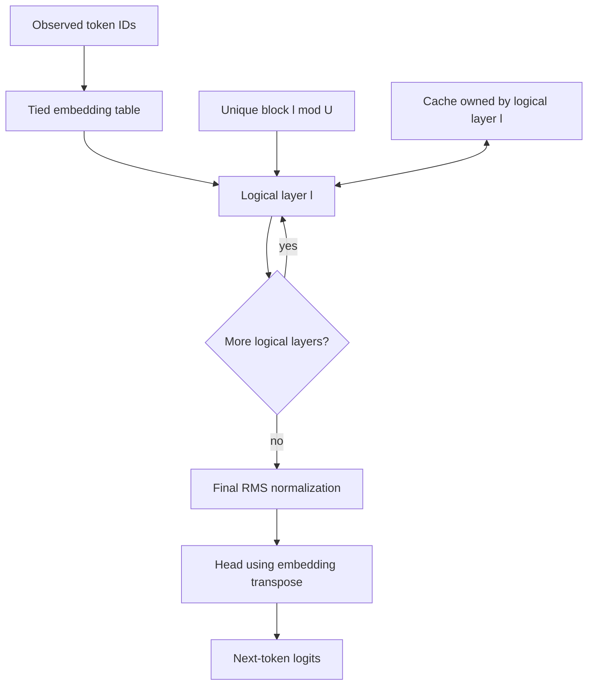

# 07 — Executable native-model contract and resource accounting

**Status:** a small forward-only correctness reference and a specified illustrative configuration. The reference uses random weights and NumPy; it has no optimizer, corpus, training run, learned migration or measured language-model result. **The Nano LM architecture remains unselected.** This contract makes a dense/recurrent comparison implementable and gives later mechanisms a precise interface.

## Executive summary

The first implementation question is whether the architecture computes the intended causal function with consistent state. The reference addresses that question for two tiny models: a four-layer dense Transformer and four logical layers sharing two blocks. It exposes tensors, parameter counts, token clocks, cache ownership and request resets. Thirteen behavioral checks exercise full-prefix/incremental equivalence, suffix noninterference, request separation, cache allocation, parameter inventories, masked loss and failure paths, including parameter replacement and invalid numeric inputs.

| Deliverable | Concrete content | Evidence level |
|---|---|---|
| [Native reference](prototype/native_reference.py) | Bias-free causal attention, interleaved RoPE, RMSNorm, SwiGLU, tied embeddings; fixed logical depth and optional block sharing | Implemented forward computation with random weights |
| [Behavioral checks](prototype/test_native_reference.py) | Two execution paths plus input/state/output failure checks | Small deterministic examples, not a proof for every shape or a production runtime |
| Dense illustrative configuration | Vocabulary 32,768; width 256; four heads; FFN 768; eight distinct blocks | Exact inventory: **15,208,704** learned scalars |
| Recurrent illustrative configuration | Same dimensions and eight logical blocks; four unique blocks used twice | Exact inventory: **11,798,784** learned scalars; a different parameter budget |
| Migration boundary | A separately declared transformation after final normalization | Conditional algebra from document 01, not learned migration |
| Initial objective | Causal next-token cross-entropy on valid document-local targets | Defined mathematically; no optimizer in this reference |

The two illustrative configurations have the same logical depth and attention shapes. Sharing weights reduces parameter storage; it does **not** halve attention computation or KV-cache size. These configurations alone cannot support a parameter-matched quality claim.

## 1. Exact fixed-depth computation

This implementation uses row-vector layout. Token IDs
$X\in\{0,\ldots,V-1\}^{B\times T}$ index an embedding
$E\in\mathbb R^{V\times d}$, giving $H^0=E[X]$ of shape $B\times T\times d$.
No learned absolute position embedding or bias is present.

The model has $L$ logical layers and $U$ unique blocks, with $L$ a multiple of $U$.
At layer $\ell\in\{0,\ldots,L-1\}$, use block $j=\ell\bmod U$.
The eight-layer recurrent illustration uses **0, 1, 2, 3, 0, 1, 2, 3**.
Intermediate states and caches still belong to their logical layer.

With normalization gain $g^a_j\in\mathbb R^d$,

$$
N^a=\frac{H^\ell}{\sqrt{\operatorname{mean}_d[(H^\ell)^2]+\epsilon}}\odot g^a_j,
\qquad Q=N^a W^Q_j,\quad K=N^a W^K_j,\quad V'=N^a W^V_j.
$$

All four attention matrices $W^Q_j,W^K_j,W^V_j,W^O_j$ have shape $d\times d$.
Reshape Q/K/V to $B\times h\times T\times d_h$, where $d_h=d/h$ is even.
At zero-based position $t$, interleaved RoPE rotates each adjacent coordinate
pair using angle $t\,10000^{-2i/d_h}$ for pair $i$. Rotate Q/K only.

$$
A^\ell=\operatorname{softmax}_{\rm row}
\left(\frac{\operatorname{RoPE}(Q)\operatorname{RoPE}(K)^\top}{\sqrt{d_h}}+M\right),
\qquad
\widetilde H^\ell=H^\ell+\operatorname{MergeHeads}(A^\ell V')W^O_j,
$$

where $M_{ts}=0$ for $s\le t$ and $-\infty$ otherwise. The diagonal is visible:
logits at position $t$ predict the next token, so observing $x_t$ is causal.

The feed-forward part uses another RMS gain $g^f_j$:

$$
N^f=\operatorname{RMSNorm}(\widetilde H^\ell;g^f_j),\qquad
H^{\ell+1}=\widetilde H^\ell+
\left[\operatorname{SiLU}(N^f W^G_j)\odot(N^f W^U_j)\right]W^D_j.
$$

Gate/up matrices have shape $d\times f$; the down matrix has shape $f\times d$.
Finally,

$$
\Lambda=\operatorname{RMSNorm}(H^L;g_{\rm final})E^\top
\in\mathbb R^{B\times T\times V}.
$$

The head is tied to the input embedding table and introduces no extra learned
weights. The reference uses float64, no dropout and no forward-pass randomness.
The seed controls initialization only. These are verification choices, not a
production precision or training recipe.



Optional APS mechanisms are separate experiments, not hidden operations here.

## 2. Tensor and state contract

| Object | Shape / identifier | Scope and update |
|---|---|---|
| Input tokens | $B\times T$, integer IDs | A fresh contiguous document/request per row |
| Hidden state | $B\times T\times d$ | Local forward-pass activations |
| Q/K/V per logical layer | $B\times h\times T\times d_h$ | Produced at that logical depth |
| Incremental KV per logical layer | Two arrays $B\times h\times t\times d_h$ | One request prefix; cached keys already contain RoPE |
| Unique blocks | $U$ distinct parameter collections | Selected by $\ell\bmod U$ |
| Cache collections | **$L$** distinct KV collections | Never indexed only by the unique-weight ID |
| Checkpoint identity | SHA-256 of configuration, parameter names/shapes/dtypes and initialized bytes | Another identity or changed live parameter definition is rejected |
| Decode position | Nonnegative integer $t$ | Advances once per consumed observed token |
| Training update index | $n$ | Absent from this forward-only implementation |

### 2.1 Shared weights require separate logical caches

The first and second application of a shared block receive different residual
states. Their keys and values generally differ at the same token position.
Combining their caches would make a token attend to the wrong logical depth.
The recurrent test checks distinct logical caches and full-prefix/incremental
agreement.

At position $t$, each logical layer reads its cached positions $0,\ldots,t-1$,
computes current Q/K/V and appends one K/V pair. Reusing a block at another
depth does not increment the token position. The returned state has $L$
caches of length $t+1$.

### 2.2 Reset and snapshot behavior

**new_state(batch_size)** creates empty caches and position zero. A new request
must use a new state. **forward(tokens)** always evaluates a fresh request.
**step(token_ids, state)** returns a new state without mutating the supplied
one; tests compare its old bytes before and after every step.

The implementation rejects another checkpoint, a wrong batch size, malformed
cache shape, invalid token or exceeded context bound. It has no eviction,
sliding window, cross-request persistence, retrieval, test-time learning or
packed-document support. Adding any such behavior requires explicit semantics.
A loss mask alone does not stop attention or memory from crossing packed
document boundaries; packing also needs attention, position and reset rules.

Array read-only flags prevent ordinary in-place writes but do not prevent
replacing entries in a Python dictionary. The reference therefore recomputes
and checks its initialized parameter/configuration digest at `forward`,
`new_state` and `step`; changed parameters are rejected rather than accepting
a stale cache. It has no supported weight-update API. These checks are not a
security boundary or a production checkpoint attestation system. Rehashing all
parameter bytes on every call is an intentional correctness-reference cost,
not a recommended production per-token operation or a performance result.

## 3. Parameter and cache inventory

For this bias-free architecture,

$$
P=Vd+U(4d^2+3df+2d)+d.
$$

The terms count the tied embedding/head, four attention matrices, three SwiGLU
matrices, two RMS gains per unique block and one final gain. Logical reuse
adds no learned scalars. Fixed-frequency RoPE contributes zero parameters.

| Component | Dense: $L=U=8$ | Shared blocks: $L=8,U=4$ |
|---|---:|---:|
| $V=32,768,\ d=256,\ h=4,\ f=768$ | Same shape | Same shape |
| Embedding and head, $Vd$ | 8,388,608 | 8,388,608 |
| Attention matrices, $4Ud^2$ | 2,097,152 | 1,048,576 |
| SwiGLU matrices, $3Udf$ | 4,718,592 | 2,359,296 |
| Block RMS gains, $2Ud$ | 4,096 | 2,048 |
| Final RMS gain, $d$ | 256 | 256 |
| **Distinct learned scalars** | **15,208,704** | **11,798,784** |
| Logical block applications | 8 | 8 |
| Logical KV caches | 8 | 8 |
| KV bytes, batch 1, context 1,024, 2-byte elements | 8,388,608 | 8,388,608 |

The cache formula is

$$
M_{\rm KV}=2LBTd\,b_{\rm element}.
$$

It counts K/V tensors only. Allocation overhead, temporary attention scores,
activations, checkpoint buffers, runtime workspaces, gradients and optimizer
state are additional. The float64 prototype's batch-2, length-11, four-layer,
width-16 cache is **22,528 bytes** in both arms.

Tests allocate tiny configurations only. Larger illustrative counts are
verified by arithmetic, without constructing or training either larger model.

### 3.1 Forward arithmetic and its limits

Ignoring normalization, nonlinearities, masks and other elementwise work,
the dense full-prefix NumPy path has matrix-multiply operation terms

$$
L(8BTd^2+6BTdf+4BT^2d)+2BTdV,
$$

counting a multiply and add separately. The $T^2$ term describes this reference's
fully materialized attention before masking, not an optimized causal kernel.
Incremental decode at prefix length $t$ has matrix-multiply terms

$$
L(8Bd^2+6Bdf+4B(t+1)d)+2BdV.
$$

These are accounting estimates, not measured training time, latency or energy.
NumPy concatenates cached arrays, causing extra copies; this reference is
unsuitable for performance comparisons. Training adds backward passes and
accumulation into shared weights. Equal logical depth does not establish
equal training cost. Wall time, peak memory and energy require measurements
on each optimized implementation.

## 4. Objective and training boundary

For a document $x_0,\ldots,x_T$, score logits from $x_0,\ldots,x_{T-1}$
against targets $x_1,\ldots,x_T$. At eligible positions $\mathcal I$,

$$
\mathcal L_{\rm CE}
=-\frac1{|\mathcal I|}\sum_{(b,t)\in\mathcal I}
\log p_\theta(x_{b,t+1}\mid x_{b,\le t}).
$$

**cross_entropy(logits, targets, valid_mask)** takes explicitly aligned arrays
with floating-point logits, integer targets and a boolean mask,
and returns mean **nats per scored target**. It does not train the model.
A uniform 32-way distribution gives $\log 32$, an independent known-answer
check. Empty scoring masks are rejected.

A future experiment must freeze tokenizer identity, document split,
padding/BOS/EOS handling, sample order and masks. When tokenizations differ,
score the same raw bytes and compute BPB as total negative log probability
divided by eligible raw-byte count and $\ln2$. Token CE alone is not BPB.

The initial trainable experiment uses CE only. Extra state, retention, copy
or operation losses require exact definitions and ablations. A trainer must
specify optimizer momentum, decay, clipping, scheduling, accumulation,
precision and handling of shared parameters. Register each shared tensor
once with the optimizer. This forward reference does not establish correct
gradients or stable optimization; both are trainer acceptance requirements.

## 5. Optional mechanisms and insertion points

### 5.1 Output-boundary transport

For normalized row state $z$, logits are $zE^\top$. A diagnostic transforms
$z'=zA$ with invertible $A$ and uses $W'=A^{-1}E^\top$:
$z'W'=zE^\top$. This boundary avoids assuming that arbitrary maps commute
with internal normalization or rotary attention.

| Implementation | Exact identity or assumption | Resources and interpretation |
|---|---|---|
| Forward/inverse wrappers | $zAA^{-1}E^\top=zE^\top$ | Two extra $d\times d$ maps and arithmetic; an algebra check |
| Materialized compensated head | $zA(A^{-1}E^\top)=zE^\top$ | Extra storage; if independently trainable, extra parameters and broken original tie |
| Coherent restricted orthogonal reparameterization | Norm/head compatibility under explicit transformations | Every affected embedding, projection, gain, state and cache must meet document 01's conditions |
| Estimated/learned map | Equality replaced by measured drift or an error bound | Count anchors, fit cost, conditioning, rewrites and held-out error |

Derived matrices can consume storage without adding independent trainable
degrees of freedom; report both. Do not replay an old cache against a new
checkpoint without validating its explicit migration.

### 5.2 Conditional depth

This reference uses **fixed** logical depth. An initial adaptive experiment
can choose fixed depth for an entire request or place pointwise refinement
after a backbone whose KV computation always runs. The latter avoids
incomplete depth caches but still needs training, cost and quality controls.

Skipping deep layers for earlier tokens and later using those layers leaves
missing deep K/V entries. Tokenwise depth needs an additional state/cache
algorithm and causal equivalence tests; a stop flag alone is insufficient.

Controller inputs must be available at decision time. Next-token labels may
supervise training, but cannot choose inference routes. A diagnostic that
evaluates every depth to label an oracle must charge that work. Fixed-depth
and equal-cost untied controls precede adaptive-reasoning claims.

### 5.3 Other APS components

Persistent learning, projected edits, procedure memory and learned migration
are absent here. Each requires a separate protocol and an identified failure
of a simpler control. Integration must measure acquisition, durable retention
and full cost. The refreshed Q9 correction evidence distinguishes immediate
edit locality from retention after later updates.

## 6. Validation and practical limits

Run from the architecture directory:

```bash
python3 prototype/native_reference.py
python3 prototype/test_native_reference.py
```

Both print reports. **--out NEW_PATH.json** explicitly creates a file and
refuses overwriting an existing one. The test script disables package-local
bytecode creation and uses a temporary directory for overwrite refusal.

| Behavioral check | What it detects | Observed result |
|---|---|---|
| Full-prefix versus incremental decode, both arms | Wrong causal mask, position, cache depth or append order | Pass; maximum absolute logit error below $1.5\times10^{-15}$ |
| Change future suffix and compare shorter prefix | Future-token dependence | Both pass |
| Fresh requests and separate/batched rows | State leakage and batch mixing | Both pass |
| Parameter enumeration versus formula | Double-counted ties or missing learned scalars | Tiny dense 10,896; tiny shared 5,712 |
| Separate logical caches and actual bytes | Wrong cache sharing or accounting | 22,528 bytes per arm |
| Nominal counts without allocation | Configuration arithmetic | 15,208,704 and 11,798,784 |
| Masked CE with a known answer | Incorrect reduction or scoring masked targets | Pass |
| Context/token/checkpoint rejection | Silent invalid state acceptance | Rejected as intended |
| Parameter replacement and numeric input contracts | Stale checkpoint digest, unsigned-logit overflow, fractional cache inventory | Rejected; float64 known-answer CE is 255 nats |
| Existing output file | Frozen-result overwrite | Refused; original retained |

These are **13 recorded behavioral cases** in NumPy 2.3.5. The final receipt is
[native_reference_v3_final.json](results/native_reference_v3_final.json); the
earlier 12-case receipt remains as historical evidence. They exercise tiny
configurations and a stated numerical tolerance. They do not certify every
dimension, precision, distributed runtime, adversarial case, gradient,
training procedure, language quality or hardware efficiency. Numerical
agreement errors are not evaluation-loss improvements.

## 7. Requirements before native-model training

| Required receipt | Minimum content | Purpose |
|---|---|---|
| Code/configuration | Exact revision, depth map, dependencies, dtype, kernels | Reconstruct function and costs |
| Data/tokenizer | Sources/licenses, split/dedup manifest, bytes/tokens, tokenizer digest, masks | Comparable authorized and uncontaminated evidence |
| Training protocol | Optimizer, seeds, separate tuning, budgets, stopping and failure handling | Equal optimization opportunity |
| Gradient/trainer checks | Tiny overfit, gradient checks, shared-tensor optimizer registration | Forward correctness alone is insufficient |
| Checkpoint | Tensor/config hashes, training step, data position, optimizer and initialization lineage | Distinguish native, random, adapted and edited models |
| Runtime | Hardware, batch/context, cache policy, memory, throughput and power where available | Replace arithmetic with actual resource evidence |
| Decision | Primary endpoint, regression tolerances, uncertainty/multiplicity and total cost | Apply a fixed promotion rule |

A real trainer and audited public/licensed data are the next implementation
dependencies. This contract closes the diagram-to-forward-function gap while
keeping those empirical dependencies visible.
