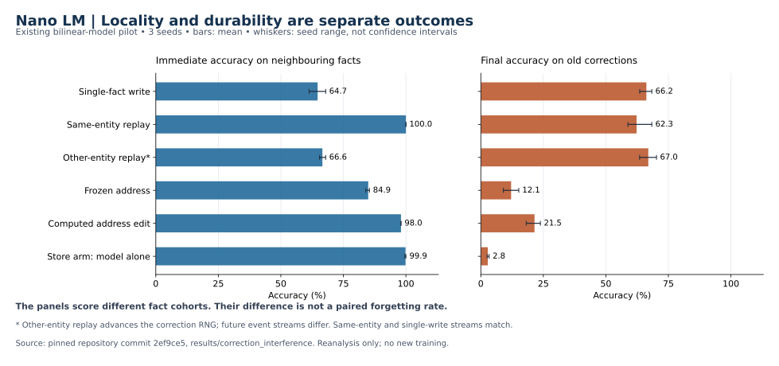

# 09 — New repository evidence, independent reanalysis and repaired experiment contracts

**Review date:** 2026-11-21, America/New_York. **Evidence cutoff:** research branch commit `2ef9ce5827cb8ea1fb6c8946df32fbcf5e06dec0`. **Status:** existing repository results reanalysed; new CPU source diagnostics executed; no neural experiment rerun.

## Executive decision

The V2 queue was stale in two material places: the language-model store pilot has a final result, and the basic correction/replay controls in G03 have been executed. Neither result selects a new backbone. They sharpen the next question: **can a correction be written locally and remain correct after later learning, at a cost that beats targeted replay?**

| Question | What the current evidence supports | What changes now |
|---|---|---|
| Does the exact store improve the native model? | Adding the store after training improves the combined system in one pilot; joint training performs worse | Keep system and native-model scoreboards separate; test document-excluded training before a general routing conclusion |
| Can a correction avoid immediate collateral damage? | Same-entity replay protected the measured neighbouring facts in all three seeds of the bilinear world | Use it as the main locality control; stop treating replay locality as wholly untested |
| Does immediate protection imply durable corrections? | Late correction accuracy remains low for every parametric write arm | Add matched-event survival curves and later drift controls |
| Does a common seed imply a common stream? | No: the random-replay arm consumes the same generator used for future corrections | Precompute and hash a shared stream; separate replay randomness |
| Does a failed linear-program call certify impossible storage? | No: the saved helper collapses every nonzero solver status into failure | Distinguish infeasibility, numerical failure, timeout and verified feasible solutions |
| Is the architecture now proven? | Only conditional mathematical properties and small implementation contracts have been checked | Continue native language/code evaluation with explicit equal-resource controls |

## 1. Provenance and what was recomputed

The current [investigation](https://github.com/wwk5q8z6kk-bit/nano-lm/blob/2ef9ce5827cb8ea1fb6c8946df32fbcf5e06dec0/research/frontier/ontogenesis/INVESTIGATION.md) records both studies. The package preserves byte-identical copies of six correction result JSONs, the store JSON, and the three relevant source files under [evidence/upstream](evidence/upstream). The [source manifest](evidence/source_manifest.json) records repository paths, commit, Git blob IDs, SHA-256 digests and byte counts. Every copied file was checked against its Git blob hash.

[Reanalysis code](analysis/reconcile_repository_evidence.py) recomputes means from the committed per-seed summaries and executes the random-generator and solver-control-flow diagnostics. Its [output](results/repository_reanalysis_v3.json) includes ranges, source hashes and the missing evidence fields. This establishes arithmetic and code behavior, not reproducibility of training. Rounded four-decimal upstream summaries cannot recover discarded precision, individual test denominators or complete event trajectories. No token-level confidence interval is inferred from three training seeds.

## 2. Completed language-model store pilot

**Recorded design:** one seed, 48 million training tokens, 2,000 optimization steps, four held-out domains. Lower bits per byte is better. The figures below come from the pinned [raw result](evidence/upstream/results/lm/store-pilot.json), not an extrapolation from the M21 bits-per-token experiment.

| Arm | Parameters | Web BPB | Textbook BPB | Math BPB | Code BPB | Weighted BPB |
|---|---:|---:|---:|---:|---:|---:|
| Eight blocks, no store | 14,292,224 | 1.4986 | 1.2418 | 1.7038 | 1.5432 | 1.4972 |
| Eight blocks, store added afterwards | 14,292,224 | 1.4506 | 1.1680 | 1.6388 | 1.4565 | 1.4391 |
| Eight blocks, trained with store | 14,292,224 | 1.5333 | 1.2375 | 1.8676 | 1.9018 | 1.5826 |
| Four blocks, no store | 11,340,544 | 1.5264 | 1.2719 | 1.7761 | 1.6118 | 1.5360 |
| Four blocks, store added afterwards | 11,340,544 | 1.4762 | 1.1937 | 1.7043 | 1.5209 | 1.4745 |
| Four blocks, trained with store | 11,340,544 | 1.5359 | 1.2423 | 1.8532 | 1.8837 | 1.5807 |

The eight-block post-hoc system improves weighted BPB by **0.0581**. Joint training is **0.1435 BPB worse than post-hoc mixing** and **0.0854 worse than the model alone**. The stored table occupies **1,022,224,980 bytes**. It cannot disappear from the accounting when the parameter count is quoted. The four-block post-hoc system is 0.0227 BPB better than eight blocks alone, but this is a one-seed augmented-system observation with much more external storage.

The originally recorded S1/S4 outcomes held and S2/S3 failed in this implementation. Preserve these outcomes. A threat recorded before results—training counts exclude the current position while retaining other occurrences in the same document—creates a train/evaluation mismatch. It motivates a *new* leave-document-out comparison; it does not retrospectively turn failed S2 into a success. The store uses the whole training subset, so this is a fixed offline system, not an online causal memory. The original machine was swapping while other jobs ran; its timing fields cannot establish efficiency.

**Architectural implication:** an exact store remains an optional augmented comparator. There is no evidence here that routing memorisable content out of the core improves native learning, and no basis for making a large exact store mandatory inside Nano LM.

## 3. Completed correction/replay pilot

The [source](evidence/upstream/correction_interference.py.txt) uses a 24-dimensional bilinear entity/relation model, Adam at 0.003, 200 steps per phase, 40 phases, and seeds 8001–8003. It studies a synthetic structured world, not a pretrained or native language model. The table averages the committed rounded per-seed values; percentages are descriptive.

| Write method | Correction right immediately | Other shown facts on corrected entities, immediately | Old regular facts on corrected entities, late | Old corrections still right, late | Inference on unseen relations |
|---|---:|---:|---:|---:|---:|
| Train correction alone among that entity's facts | 100.00% | 64.70% | 59.60% | 66.20% | 98.00% |
| Replay that entity's other shown facts | 100.00% | 100.00% | 99.51% | 62.28% | 98.61% |
| Replay as many facts from other entities | 100.00% | 66.61% | 68.79% | 66.97% | 97.88% |
| Freeze corrected entity's address | 100.00% | 84.94% | 54.70% | 12.12% | 66.73% |
| Computed address edit | 99.84% | 98.03% | 83.45% | 21.47% | 99.69% |
| Exact-store arm, **model alone** | 2.77% | 99.85% | 99.48% | 2.81% | 99.95% |

The store's perfect lookup answer is a property of the additional dictionary under the stated update policy; it is not the model-alone result in the raw JSON. The computed-edit arm also has a one-record fallback store in each seed, which must be counted if its answers are ever used.

**Interpretation with proper scope.** Same-entity rehearsal is a strong observed control for immediate locality. The solver reported success in 99.84% of tested calls, and measured immediate correction acquisition was also 99.84%. These observations support many successful address-only edits in this synthetic setting; without per-edit residuals and deployed-precision checks, the records do not certify every protected constraint for each solver-success case. Subsequent training presents a different problem: high immediate accuracy coexists with poor late correction accuracy. For the arms with 100.00% immediate acquisition, the lower late scores support loss of some previously acquired corrections under the pinned source contract. However, the historical aggregates are not paired survival measurements on the same correction events, so their difference is not an estimated decay curve.

The raw data support separating locality from durability. They do not establish that any replay strategy is useless, that no neural representation can retain corrections, or that an external store is universally necessary. Sequential-editing literature already treats editing success, interference, later retention and general model competence separately; see [the primary-source audit](08_LITERATURE_AUDIT.md), particularly P-32–P-36.

## 4. New code-level findings

### Q9-A — Replay randomness changes future correction data

In the original `run`, a single NumPy generator constructs the world, samples corrections, draws replacement values, and selects random replay examples. Only the random-replay arm performs the extra replay draw. Therefore subsequent corrections differ from the other arms even at the same seed.

The new diagnostic reproduces the original draw order without training. For **each of seeds 8001, 8002 and 8003**, the first correction phase matches, but the streams differ starting at phase **2 using the original zero-based phase index**, in **38 of the 39 correction phases**. Both complete stream digests are saved in the reanalysis JSON.

This affects interpretation of *paired* comparisons involving random replay. It does not erase the descriptive scores, and it does not break the matched stream between the single-write and entity-replay arms, which do not consume these extra NumPy draws. It also does not establish the size or direction of bias. The remedy is common exogenous data, not a retrospective adjustment to the old scores.

**Required repair:** generate a world/event manifest once per seed, including all future correction IDs, keys and values, before any arm runs; each arm consumes the same immutable manifest. Give minibatch/replay sampling separate, named generators derived from the seed. Assert identical world and event SHA-256 digests across arms before comparing outcomes. Publish the actual replay-selection record and count the extra training work.

### Q9-B — Solver non-success is not a representation impossibility proof

The helper returns `(None, False)` for every `linprog` status other than zero. A controlled execution of the actual saved function returns the same value for status 2 and status 4. The historical files keep only `lp_feasible`, so they cannot distinguish infeasible constraints from numerical solver failure. These probes do not reveal which status occurred in the old runs.

**Required repair:** retain status, message, tolerances, primal residual and constraint margins for every edit. A solver-reported feasible point must also pass direct constraint evaluation in the deployed precision after conversion from float64 to float32. An infeasible local address-only problem establishes only infeasibility under its fixed decoder, protected targets and margin constraints; it does not rule out joint decoder edits, a different parameterization, or all neural storage. Other solver failures receive an `unknown` outcome, not an impossibility verdict. Official return-code semantics are documented in [SciPy's linprog reference](https://docs.scipy.org/doc/scipy/reference/generated/scipy.optimize.linprog.html).

### Q9-C — The durability comparison changes cohorts

`corrected_now` averages immediate accuracy over phase-specific writes. `corrected_old` evaluates the final set whose most recent correction was at least twenty phases ago. Repeated corrections update the timestamp and remove some events from the old cohort. Subtracting these aggregate values cannot reconstruct an individual correction's decay curve.

**Required repair:** persist `(event_id, entity, relation, new_value, write_phase, previous_revision)` and score the same event at horizons 0, 1, 5, 10 and 20. If a later legitimate correction replaces it, right-censor its durability trajectory at that point; do not count the superseded value as a forgetting failure. Report eligible counts and censoring separately for every horizon.

### Q9-D — Protected predictions and protected truths are different

Random replay excludes entities corrected in the current phase, not all ever-corrected entities. The collateral metric excludes every previously corrected relation; same-type comparisons can contain repeated fact occurrences. These eligibility rules must accompany their denominators.

The computed edit protects the model's current argmax on the other seven relations, which can already be wrong. The reported collateral metric checks uncorrected *shown true facts*, a different set. A fixed-decoder feasible solution cannot guarantee the truth of those predictions or their preservation after later decoder updates. Multiple edits within a phase also protect different intermediate states.

**Required repair:** log which constraints use model predictions and which use previously observed verified targets, with their pre-edit correctness. Report same-event pre/post changes, old-target retention and corrected-target acquisition separately. A hypothetical oracle of every true relation belongs only in a diagnostic ceiling. Exclude the corrected or superseded target from the preservation set.

## 5. Revised execution order and closure criteria

| Work item | Current state | Concrete next deliverable | Gate to advance |
|---|---|---|---|
| G01 mathematical checks | Conditional proofs refined; deterministic diagnostics executed | Keep counterexamples and fixed assumptions linked to code | No contradiction between prose and executed check |
| G03 original correction study | Recorded three-seed pilot; source audit reveals limitations | Preserve old result and registered verdict, append this review | Never silently rerun under the old experiment ID |
| **G03b correction locality and durability** | New successor protocol, unexecuted | Immutable common event streams; solver receipts; paired horizon logs; matched tuning budgets | Clear benefit beyond targeted replay on locality **and** durable edits, with cost and generalization reported |
| G02 address × optimizer | One-seed motivating evidence; full factorial unexecuted | Fixed-address original/hash × carried/reset/fast-decay Adam core, followed by separately labelled learned-address controls | Main effects and interaction estimated on truly shared streams; acquisition and retention both visible |
| Store follow-up | Original S2/S3 failed; document-excluded control unexecuted | Keep no-store and post-hoc controls; train joint model with whole-document exclusion; isolate timings | Improvement survives exposure correction and complete store cost |
| G05 representation migration | Linear synthetic diagnostic only | First boundary-transport compatibility and budget checks; then evolving native features | Retention/new-learning/cost frontier exceeds freezing and replay |
| G07 forward transfer | No verified Nano result | Fresh-family learning curves after demonstrations leave context | Improvement relative to equal-experience controls, with uncertainty and retained quality |
| G16 native language integration | Implementation contract available; no new trained checkpoint | Recovered baseline identity/data rights; one mechanism per native experiment | Same-byte quality, actual budget and domain guardrails pass |

### G03b protocol contract

The next implementation should separate world generation, update policies, evaluation and reporting. A frozen manifest declares arm definitions, development seeds, fresh evaluation seeds, allowed replay budget, optimization budget, epoch/phase horizon and tie/censoring rules. Do not retrofit new labels onto the old K1–K6 record.

The principal contrast is **candidate correction procedure minus targeted same-entity replay** on horizon-20 accuracy of the same surviving correction events. Immediate correction success and unrelated-fact retention are mandatory guardrails; they prevent an apparent durability win achieved by refusing the edit or damaging the rest of the model. Horizon-zero and horizon-twenty rates have explicit denominators. Report both update work and the cost of obtaining, retaining and scoring constraints.

Start with implementation smoke cases and development seeds. Use their variance to justify a fresh-seed sample size and minimum relevant effect *before* any confirmatory run. With only three historical seeds and changed future streams in one arm, there is no defensible retrospective claim that a precise new effect threshold is powered. An inconclusive interval remains inconclusive; it is not transformed into equivalence. Any confirmatory or materially costly run follows the existing experiment-scoped authorization rules.

## 6. What has been closed in this pass

Closed: stale completion status, inconsistent metric names, missing result arithmetic, untracked source revisions, conflation of immediate locality and long-term retention, undetected common-generator coupling, overly strong solver interpretation, and missing cohort definitions in the successor protocol.

Open: a rerun with the corrected event manifest, faithful training reproduction, paired event survival measurements, observed migration advantages on native language models, fresh-domain generalization, real joules, checkpoint/corpus provenance and any architecture selection. These require new evidence; this document neither fabricates that evidence nor changes the protected original experiments.

## 7. Late source refresh and fixed integration cutoff

The research branch advanced while this review was being prepared. The final integration cutoff is **`8d3b03e08a5c14d2e9ab330ac8d5006e87e61613`**. The completed-pilot numbers above remain tied to `2ef9ce5…`; the two later commits add source and protocol changes, not new recorded results. Their contents are preserved when the research base is carried into the review branch.

| New source | What is recorded at the cutoff | Consequence for this architecture program |
|---|---|---|
| [Correction-margin protocol and implementation](evidence/upstream/correction_margins.py.txt) | Five arms compare a minimal L1 edit without neighboring constraints, half-margin preservation with correction margins 1/3/6, and 90% neighboring-margin preservation with correction margin 3; seeds 8001–8003 | Preserve the registered M1–M4 predictions. It complements G03b's measurement repairs and supplies no completed result here |
| [Nested-protocol execution deviation](evidence/upstream/PROTOCOL-NESTED-DEVIATION.md.txt) | The latest note reports stopping the laptop attempt before any result and moving to cloud-host CPUs, with both reused-device and fully matched-device evaluations | The earlier CPU-plan withdrawal is superseded. Device-sensitive disagreement must remain visible; no live job or hardware outcome was verified in this review |
| TPU launcher and resumable training source | The same upstream change adds execution infrastructure | Keep its bytes intact. Reading or preserving that code does not execute it, authorize spend or validate its runtime behavior |

The margin follow-up directly tests whether a smaller or more constrained address edit changes immediate collateral damage and late retained margins. Its source retains the original distinction between a successful LP return and a validated deployed update: it still collapses solver non-success into a boolean, casts the address increment to float32, protects current predictions and reports aggregate final cohorts. The residual, target-provenance and same-event durability diagnostics above therefore remain relevant. Add them through an explicitly labeled diagnostic or successor protocol; do not quietly alter the registered experiment after seeing its results.

Its same-arm exogenous draw sequence does not use the original random-replay sampling branch, so the random-replay stream defect must not be attributed to these margin arms without evidence. The register does not convert any finite-arm prediction into a universal theorem about permanent memory. Await actual immutable results before revising an empirical conclusion. Decision D-046 records this cutoff and distinction.
