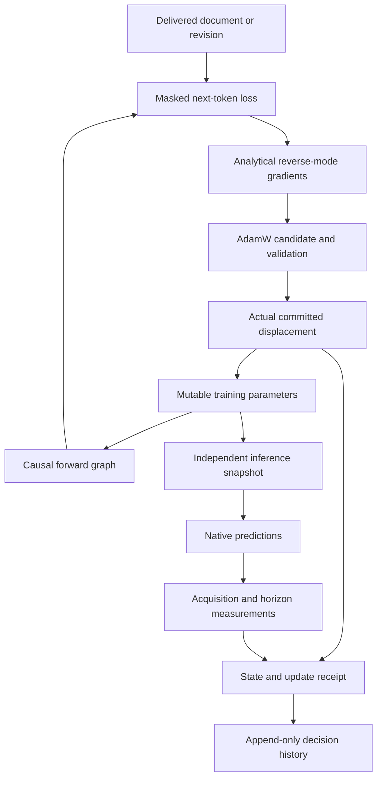

# 10 — Native training and controlled-update measurement

**V5 current integration notice.** The V4 training and measurement implementation below is unchanged. [14](14_NATIVE_UPDATE_COMPARISON.md) now branches four arms from identical weights and optimizer states on a locally frozen synthetic protocol. This progresses beyond a single bridge smoke fixture, while remaining short-horizon, untuned and separate from a natural-language G03b result. Exact target/optimizer-call matching is not measured FLOP or energy equality.

**Review date:** November 21, 2026, America/New_York. V4 extends the immutable forward architecture in [07](07_IMPLEMENTATION_CONTRACT.md) with an explicit training implementation and a causal correction-measurement interface. These are small NumPy reference components. The executed learning fixtures demonstrate mechanics; they do not establish general-purpose language quality, continual-learning superiority or hardware efficiency.

## 1. Implementation boundary

| Component | Implemented behavior | Evidence | Remaining scientific boundary |
|---|---|---|---|
| Native learned core | Dense or shared blocks; tied embeddings; analytical reverse-mode gradients | Forward parity, finite differences, shared-gradient identity | No corpus-scale training result |
| Training objective | Shifted document-local next-token CE, boolean target mask | Causality, masking and row-isolation checks | No tokenizer, packed corpus or sampler recovery |
| Update rule | AdamW, global raw-gradient clipping, actual/proposed displacement receipts | Known answer and rejection-without-mutation tests | No nullspace projection or retention algorithm |
| Model snapshots | Independent immutable inference copy with parameter/config digest | Updated snapshots reject old-version caches | No concurrent serving/update implementation |
| Checkpoint | Exclusive pickle-free NPZ; model, optimizer, configuration and digest | Exact resume and corruption checks | No sampler cursor, crash-atomic publication or authenticated provenance |
| Event instrument | Immutable revisions, causal prefix delivery, explicit endpoint cohorts | Behavioral and independent history-oracle checks | No completed native G03b efficacy comparison |
| Numerical edit audit | Solver classification, actual deployed-vector residuals, actual logit check | Cast/addition rounding and tie examples | No whole-model floating-point certificate |

The parameterization is still the architecture of 07. V4 adds learning mechanics rather than silently changing its inference equations. Dense and shared configurations keep separate activations at each logical depth, while a shared parameter receives contributions from all uses.

The event coordinator is outside the learner. A complete future event schedule may exist for reproducibility, but only delivered prefixes and current query keys are passed to the model adapter. This is a programming contract, not a security sandbox.

## 2. Loss, shapes and derivative contract

The [trainable implementation](prototype/trainable_native.py) accepts integer document rows of length \(T+1\). Each row supplies inputs \(x_{0:T-1}\) and targets \(x_{1:T}\). Its boolean mask \(q_{b,t}\) selects scored targets:

\[
\mathcal L=-\frac{1}{N}\sum_{b,t}q_{b,t}
\log p_\theta(x_{b,t+1}\mid x_{b,0:t}),\qquad
N=\sum_{b,t}q_{b,t}>0.
\]

Rows do not attend to other rows. Masking a target removes it from the loss numerator and denominator; it does not reset attention within a row. Consequently packed independent documents require explicit attention boundaries, which this reference does not implement. An all-false mask is invalid.

For vocabulary logits \(z\), the cross-entropy derivative is

\[
\frac{\partial\mathcal L}{\partial z_{b,t,v}}
=\frac{q_{b,t}}N
\left(p_{b,t,v}-\mathbf 1[v=x_{b,t+1}]\right).
\]

The implementation propagates this derivative through the tied output table, final RMSNorm, residual paths, SwiGLU, attention output, causal softmax, rotary coordinates and input lookup. It uses float64 and stable softmax arithmetic. No automatic differentiation framework is required.

### Checks on the less obvious derivative paths

For RMS normalization \(r=(d^{-1}\sum_i x_i^2+\epsilon)^{-1/2}\) and output \(y_i=\gamma_i x_i r\), let \(g_i=\partial\mathcal L/\partial y_i\). Then

\[
\frac{\partial\mathcal L}{\partial x_i}
=r\gamma_i g_i
-\frac{x_i r^3}{d}\sum_j\gamma_jg_jx_j.
\]

The gain derivative sums \(g_i x_i r\) across batch/time axes. This explicit convention includes the chosen epsilon; the mathematical scaling identity without epsilon must not be substituted blindly. RMSNorm's source identity and methodological attribution are recorded as P-38 in [04](04_EVIDENCE_AND_REFERENCES.md).

For a softmax row \(p\) and upstream derivative \(g\), the derivative with respect to the row logits is \(p\odot(g-\langle p,g\rangle)\). The causal mask excludes future positions. Rotary embeddings have no learned parameters in this reference; their backward map is the transpose of the same position-specific rotation. P-39 supplies the rotary-position precedent. SwiGLU uses the product rule through the two projections and the SiLU derivative; P-40 supplies the gated-feed-forward precedent.

For a shared block parameter \(\theta\) used at logical depths \(j\), the chain rule gives

\[
\nabla_\theta\mathcal L=\sum_j
\left.\nabla_{\theta^{(j)}}\mathcal L\right|_{\theta^{(j)}=\theta}.
\]

The test constructs an independently untied graph with identical block values and compares the sum of its gradients against the shared graph. The tied embedding/output matrix likewise accumulates both lookup-path and readout-path contributions. Weight sharing is represented by repeated logical use of one named tensor; accidental storage overlap between different tensor names is rejected.

## 3. Optimizer and state transaction

AdamW uses a clipped raw gradient \(g_t\), first moment \(m_t\), second moment \(v_t\), their bias-corrected versions, learning rate \(\eta\), epsilon and explicit decay \(\lambda\):

\[
m_t=\beta_1m_{t-1}+(1-\beta_1)g_t,\qquad
v_t=\beta_2v_{t-1}+(1-\beta_2)g_t^2,
\]

\[
\Delta\theta_t^{\mathrm{proposed}}
=-\eta\left(\frac{\widehat m_t}{\sqrt{\widehat v_t}+\epsilon}
+\lambda\theta_t\right).
\]

Decay is applied to every distinct tensor in this reference, including embeddings and norm gains. That is an explicit simple reference policy, not a tuned recommendation for a large model. The decay is outside the moment estimates, following the decoupled formulation of P-37, [Loshchilov and Hutter](https://arxiv.org/html/1711.05101v3).

The stored update can differ from the proposed arithmetic because addition is rounded. The receipt therefore records the complete arrays

\[
\Delta\theta_t^{\mathrm{actual}}
=\theta_{t+1}^{\mathrm{stored}}-\theta_t^{\mathrm{stored}},
\]

as well as norms and rounding differences. Any later output-preservation condition must apply to this actual displacement.

The optimizer validates inputs, shapes, finite candidates, moments and receipt values before committing any parameter, moment or step counter. Independent review reproduced two cases that matter for trustworthy receipts:

| Defect reproduced during V4 | Why it mattered | Repair |
|---|---|---|
| An extreme finite learning rate produced finite candidate arrays but an overflowing receipt norm | A post-commit exception could leave changed weights without a valid receipt | Validate candidate state and all receipt values before committing |
| Different parameter names could reference overlapping storage | Sequential commits could overwrite each other; reported displacements and checkpoint semantics became false | Require C- or F-contiguous, internally nonoverlapping arrays and reject overlap between distinct names before forward, backward, optimizer, snapshot, digest or checkpoint use |

The alias reproduction produced about 0.006 discrepancy between a reported and actual parameter displacement. A checkpoint could remove that accidental alias while retaining equal serialized values, making the next step diverge. The repaired contract checks direct, transposed and sliced overlap; regression cases verify rejection leaves the entire relevant state unchanged. The [independent training review](reviews/trainable_native_review.md) records the before/after evidence.

This transaction covers checked in-process state mutation under the stated API. It is not a claim of multi-process atomicity, recovery from hardware failure or hostile-memory protection.

## 4. Snapshots, checkpoints and resume

Training parameters are mutable. An inference snapshot copies them into the original immutable reference, computes a configuration/parameter digest and owns its own fixed semantics. An older snapshot remains usable with its older cache; a newer snapshot rejects a cache from a different parameter version.

Checkpoints store exact tensor names, float64 weights, optimizer moments, step count, hyperparameters and model configuration in an NPZ container with non-pickle metadata. Loading rejects malformed names, shapes, dtypes and metadata, then verifies an internal digest. Digest equality detects accidental inconsistency; it is not a signature or external source authentication.

Writes use exclusive creation and refuse an existing path. They do not claim crash-atomic publication. The bitwise resume check covers the default C-contiguous fixture in the recorded environment with identical subsequent documents and masks. A valid F-contiguous parameter can reload as C-contiguous; review observed a few-ulp difference in diagnostic norms even when checked parameters and moments still matched. No universal cross-layout or cross-environment bitwise guarantee is claimed. No data-loader position, external tokenizer state or random sampler cursor is present to restore.

## 5. Executed training checks and what they establish

The [training suite](prototype/test_trainable_native.py) checks exact initial forward equality, independent central finite differences, shared-use gradient accumulation, suffix/mask causality, row isolation, AdamW known answers, atomic rejection, snapshot boundaries and checkpoint resume.

Central finite differences cover **62 directions over 31 named tensors** across dense and shared configurations. The maximum absolute directional-derivative discrepancy is **6.8032e-9** in the executed environment. This is strong small-instance evidence for these derivative paths, not a formal proof over all shapes, magnitudes or floating-point conditions.

| Fixed learning fixture | Logical layers | Unique blocks | Parameters | Initial training CE | Training CE after 60 steps |
|---|---:|---:|---:|---:|---:|
| Dense | 2 | 2 | 1,384 | 2.086440 | 0.004251 |
| Shared block | 2 | 1 | 728 | 2.088624 | 0.008330 |

Both use four rows of nine cyclic integer tokens modulo eight, 32 target positions per step and learning rate 0.02. Each arm sees 1,920 repeated target presentations. These are **training-set engineering fixtures**. They do not measure held-out language, few-shot transfer, durable correction, data efficiency, throughput or architecture superiority.

V4 therefore changes the earlier forward-only status: a native causal core can now compute gradients, update and resume at tiny scale. A reproducible native corpus baseline and meaningful learning comparison remain distinct gates.

## 6. Causal event and cohort interface

The [correction instrument](experiments/correction_protocol.py) implements a model-independent contract:

| Interface | Responsibility |
|---|---|
| WorldSpec and generate_manifest | Bounded synthetic instrument data with named PCG64 world randomness |
| Manifest | Immutable event tuple, canonical JSON hash, validated revision chain and exclusive persistence |
| replay_rng | Separate named replay stream whose consumption cannot alter world events |
| deliveries | Learner-facing immutable copies of delivered events and observed current targets |
| new_log and record_after_write | Manifest-bound evaluation history and individual immediate acquisition |
| phase_end_queries and record_phase_end | Query keys without future labels; complete endpoint observations |
| summarize | Horizon cohorts, explicit censoring, same-value strata, missingness and rates |

The new synthetic generator is for instrument development. It is not a reconstruction of the earlier latent-type world or a promise that the same integer seed produces the same historical events.

Each event retains phase, global order, key, visible value, previous revision and previous value. Initial observations, changed-value assignments and same-value assignments are distinct. A complete evaluation must retain same-value events even if they are excluded from a declared semantic-change primary stratum.

For an event written in phase \(p\), horizon \(h\) means the end of phase \(p+h\). **Horizon 0 is phase end**, not immediately after that individual write. Every summary reports eligible, censored, not-yet-due, measured, missing and correct counts. Explicit abstention is a measured incorrect answer; an absent observation remains missing.

The primary rate includes failed initial acquisitions. Due missing observations make that rate undefined. Acquired-only retention is secondary and has its own denominator; unknown immediate acquisition prevents a complete acquired-only estimate. A model that failed to acquire an edit but becomes correct later can improve the primary rate without entering the acquired-only cohort.

Two explicit policies are supported. Under *new_revision*, the next assignment to the same key censors the earlier revision, including a same-value assignment. Under *value_change*, only the first later assignment with a different value ends the trajectory. The latter can create overlapping same-value trajectories; those are correlated observations, not independent sample size. A future supersession beyond the reporting cutoff cannot retroactively change a current cohort.

## 7. Solver and actual-output audit

The instrument does not solve an LP or promise successful editing. It labels status 0 as a candidate, status 2 as reported infeasibility and other failures as unknown. The [SciPy linprog documentation](https://docs.scipy.org/doc/scipy/reference/generated/scipy.optimize.linprog.html) is the implementation reference for the source pilot's status vocabulary; the numeric residual, target provenance and actual model output are separate evidence.

For inequalities \(Ax\le b\), the audit retains immutable coefficients and the original thresholds. It checks a candidate and, separately, the actual deployed value. If constraints concern an increment, the caller must supply the realized increment after both cast and addition, not merely the cast requested increment. At a float32 state of \(10^8\), adding a requested increment of 1 can realize an increment of zero.

Each constraint names whether its target came from a current model prediction, an already observed label or the new assignment. A current argmax can be wrong; protecting it is not the same as preserving a known correct fact.

The audit reports explicit tolerances, residuals, minimum slack, maximum violation and vector/constraint hashes. It evaluates supplied floating-point values in float64 and does not certify every low-precision kernel or nonlinear model path. A separate actual-logit check reports requested-margin satisfaction and argmax correctness: a zero-margin tie can satisfy the inequality while losing the implementation's tie-break.

## 8. Integration and research progression

The event and training contracts permit a small native integration fixture with actual forward predictions, visible-only updates and state identities. Its final reviewed interface and receipt are described in the integration addendum below. Such a fixture closes wiring and measurement gaps; it does not replace a native-data experiment.

| Gate | Concrete acceptance evidence |
|---|---|
| Training mechanics | Independent derivative checks, tied/shared accumulation, optimizer and exact resume |
| Event mechanics | Common manifest identity, causal delivery, revision semantics and complete denominators |
| Native integration | Actual native predictions and updates flow through the event instrument with state/exposure receipts |
| Scientific G03b protocol | Fixed fresh seeds, arm definitions, workloads, budgets, leakage controls and guardrails |
| Native mechanism comparison | Acquisition and horizon curves, new learning, broad quality and total cost on legitimate data |
| Scale decision | Measured kernels, memory, energy/latency and benefit over appropriate controls |

The first three gates are local engineering work. The latter three require a concrete dataset/model/compute experiment and cannot be inferred from a passing tiny fixture. The earlier source pilots remain frozen under their original names; a repaired experiment receives its own identity.

**Decision links:** D-049–D-052 and D-054 in [02](02_DECISION_LEDGER.md). **Numerical durability theory and new margin results:** [11](11_MARGIN_RESULTS_AND_DURABILITY_THEORY.md). **Current receipts and reproduction:** [06](06_VALIDATION_AND_UNRESOLVED_WORK.md).

## 9. Executed native integration fixture

The [native bridge](experiments/native_correction_smoke.py) now connects the trainable model to the event instrument. A fixed handwritten sequence contains three initial observations, four changed-value assignments and one same-value assignment. Two assignments to the same key occur within one phase. A late assignment intentionally lacks complete long-horizon follow-up.

The model has width8, two attention heads, FFN width16 and two logical layers sharing one unique block. Its eight-token vocabulary uses distinct entity, relation, query-marker and value tokens. The query contains only entity, relation and marker; the observed value appears solely as the final training target. Full-vocabulary argmax supplies a prediction, and a non-value token becomes an explicit abstention. There is no external answer lookup at inference.

The fixed recipe uses seed20261122, AdamW learning rate0.003, betas(0.9,0.95), epsilon1e-8, decay0.01 and global gradient cap1. Each delivered event receives two updates using only that event: **16 optimizer steps,16 scored target-token exposures,48 input tokens and32 masked target positions**. The recipe was selected before its first execution, with no accuracy target or tuning. Initial observations and same-value assignments consume their declared exposure.

| Horizon | Eligible | Censored | Not yet due | Total assignments |
|---|---:|---:|---:|---:|
|0|4|1|0|5|
|1|3|2|0|5|
|5|1|2|2|5|
|10|0|2|3|5|
|20|0|2|3|5|

Immediate acquisition has five assignment observations and remains separate from the horizon0 row. These partitions follow event timing, not success filtering. Failed acquisitions remain in the primary endpoint; acquired-only retention is separately reported. No accuracy threshold is required for this engineering fixture.

The receipt binds the manifest, model configuration, recipe and source hashes to initial/final optimizer-state identities, per-event before/after state identities, delivered-prefix hashes, actual forward logits, native predictions, phase checkpoints, update/exposure totals and the evaluation log. State hashes identify in-memory checkpoints; the command does not save checkpoint payloads. No LP solve occurs, so AdamW updates receive no feasibility label.

Nine integration tests check actual changed weights, exact accounting, actual masked training calls and forward outputs, same-runtime determinism, complete denominators, checkpoint chronology and exclusive outputs. A future-label counterfactual changes a later assignment and verifies all preceding event receipts, states and phase predictions are identical. The learner receives only delivered prefix objects and query keys. The [independent integration review](reviews/native_correction_smoke_review.md) assesses the final implementation.

This closes the local wiring gap. It does not execute a scientific G03b comparison, measure natural-language correction quality, demonstrate retention effectiveness, establish generalization or compare architectures. A future native-data experiment still needs independent task families/paraphrases, fresh seeds, fixed arms, quality guardrails and total cost accounting.
