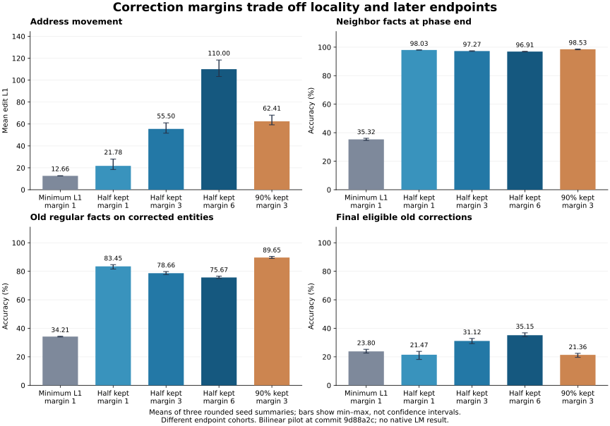
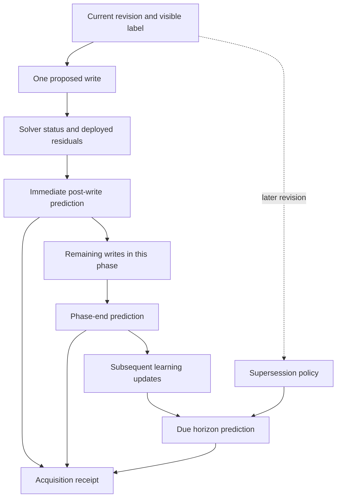

# 11 — Correction margins, sequential writes and conditional durability

**V5 current theory notice.** The finite V4 margin results and cumulative-drift theorem remain valid within their stated scope. [12](12_OPTIMIZER_FACTORIAL_AND_UPDATE_GEOMETRY.md) supplies a separate exact L1 feasibility trade-off and corrects tie-versus-error language. [14](14_NATIVE_UPDATE_COMPARISON.md) adds short synthetic native trajectories; it does not establish the theorem's sufficient bound for useful language tasks or long-horizon retention.

**Review date:** November 21, 2026, America/New_York. **Evidence cutoff:** research commit 9d88a2c20233f42b4a49c4430264b20f842895ad. This chapter supersedes the pending margin-result status recorded at the V3 cutoff; it preserves the earlier protocol, raw results and ledger event. It adds a conditional theorem about accumulated margin drift, not a proof that Nano LM has solved continual learning.

## 1. High-level result

The completed three-seed margin pilot compares five write recipes in one bilinear model and stream. Minimum L1 address displacement alone did not protect neighboring facts. Increasing the initial correction margin improved one final correction endpoint but missed the registered 60% target. Stronger preservation of neighboring margins improved old regular facts while worsening old corrections.

The architecture consequence is to evaluate a correction over its whole subsequent update path. An initially successful write and a large initial margin do not control future representation or readout drift. Conversely, explicit rehearsal at every later update is not mathematically necessary: an update that leaves the relevant output differences invariant preserves the fact without rehearsal. The useful research question is which implementable mechanism controls interference while allowing new learning at acceptable cost.

| Question | Current answer | Evidence limit |
|---|---|---|
| Does minimum address movement suffice for locality? | The tested minimum-L1 recipe had only 35.32% phase-end neighboring-fact accuracy | Conditional on coordinates, decoder, constraints, model and stream |
| Do larger initial margins help? | Half-preservation arms rise from 21.47% to 35.15% final old-correction accuracy | Three tested margins; registered 60% target fails |
| Does stronger protection solve both endpoints? | At correction margin 3, old-regular accuracy improves by 11.00 percentage points, old-correction accuracy falls by 9.76 points | Descriptive contrast; cohorts differ across endpoints |
| Is solver success equal to successful acquisition? | No: the source evaluates acquisition after all writes in a phase | Per-write predictions and post-cast residuals were not saved |
| Is there a valid preservation theorem? | Yes, conditional on cumulative drift staying below every initial rival margin | Sufficient, often loose; future drift itself still needs control |
| Has a native language model demonstrated durable learning? | No such result is supplied by this pilot or the V4 engineering fixtures | Native benchmark bridge remains an empirical gate |

## 2. Evidence identity and descriptive results

The five new result files, source implementation and relevant dependencies are copied without alteration under the V4 evidence directory. The [source manifest](evidence/source_manifest.json) records source commit, Git blob identity and SHA-256. The implementation blob is unchanged from the earlier protocol cutoff: 4e14e8f25a22fa743dd6ffcc51a812df11ecad16. This establishes source-level ordering of predictions and results; it does not independently recover runtime arguments, checkpoint identities or uncommitted code.

Each arm contains seeds 8001, 8002 and 8003. Values below are means of rounded per-seed summaries, not pooled event estimates. L1 is in the source model's address coordinates and is averaged over successful LP writes before the per-seed rounding. The source's “half” recipe requires the other relation's current predicted target to retain a margin of min(1, 0.5 × current top-two gap): the threshold is capped at 1, so it does not preserve half of gaps greater than 2. The “90%” recipe uses 90% of that pre-write gap without this half-recipe cap. “Solver success” is the source's boolean field called *feasible*; its name alone is not a mathematical feasibility certificate.

| Arm | Mean edit L1 | Reported solver success | Correction at phase end | Neighbor facts at phase end | Old regular facts on corrected entities | Final eligible old corrections |
|---|---:|---:|---:|---:|---:|---:|
| Minimum L1, margin 1, no other constraints | 12.6623 | 100.00% | 99.52% | 35.32% | 34.21% | 23.80% |
| Half-preservation, margin 1 | 21.7763 | 99.84% | 99.84% | 98.03% | 83.45% | 21.47% |
| Half-preservation, margin 3 | 55.5033 | 99.89% | 99.89% | 97.27% | 78.66% | 31.12% |
| Half-preservation, margin 6 | 109.9973 | 99.89% | 99.89% | 96.91% | 75.67% | 35.15% |
| 90% preservation, margin 3 | 62.4117 | 99.84% | 99.84% | 98.53% | 89.65% | 21.36% |

The plot's error bars are the minimum and maximum of three stored seed summaries. They are not confidence intervals. Neither the table nor the plot establishes significance, selects an optimal hyperparameter or measures wall-clock efficiency.

### Registered predictions M1–M4

| Registered condition | What the committed results show | Verdict for this finite test |
|---|---|---|
| M1: unconstrained minimum-L1 collateral accuracy is at most 90% | Every seed is below 90%; mean 35.32% | Condition holds |
| M2: old-correction accuracy increases with margins 1, 3, 6 and reaches 60% at 6 | Every seed increases monotonically, but every margin-6 seed is below 60% | Direction holds; compound success criterion fails |
| M3: preserving 90% of neighboring margins gives at least 93% old-regular accuracy and at least 90% solver success | Every seed misses 93% old-regular accuracy; all exceed 90% solver success | Compound success criterion fails |
| M4: every tested arm remains below 90% final old-correction accuracy | All five arms, all three seeds are below 90% | Finite condition holds; universal permanence claim unsupported |

The half-preservation margin-1 arm matches the earlier constrained arm's four common rounded performance fields and solver-success field for every reused seed. It does not supply an independent fresh-seed replication or equality of weights, full trajectories and residuals. The [reanalysis receipt](results/margin_reanalysis_v4.json) preserves this restricted comparison.

## 3. Three times that must be measured separately

The source field *corrected_now* is scored **after all 16 corrections in a phase**. It cannot identify whether an individual edit failed immediately, was invalid after a dtype conversion, or was undone by a subsequent write in the same phase. The minimum-L1 arm's 100% solver success and 99.52% phase-end correction accuracy therefore compare different events in the execution order.

The repaired measurement contract in [10](10_TRAINING_AND_CONTROLLED_UPDATE_CONTRACT.md) records immediate acquisition, phase-end survival and later horizons separately. Missing observation is not failure, success or an excuse to shrink a denominator silently.

### A concrete counterexample to equating the endpoints

Consider a two-dimensional entity address \(u=(u_0,u_1)\), two binary relations and class-1 minus class-0 score differences

\[
g_0(u)=u_0,\qquad g_1(u)=-2u_0+u_1.
\]

Starting at \(u=(0,0)\), the minimum-L1 margin-1 write for relation 0 produces \(u=(1,0)\). The next minimum-L1 margin-1 write for relation 1 produces \(u=(-1/2,0)\). Both solves succeed; the second target is correct and the first is wrong. Both targets can be satisfied jointly, for example at \(u=(1,3)\).

The diagnostic executes the actual source edit function, extracted without importing or training its model. The example establishes a logical failure mode even with exactly representable states. It does not recover the historical learned weights or identify the cause of historical errors.

### What the reconstructed event stream establishes

Distinct fact pairs are sampled without replacement, but several relations of one entity can still be selected. Reconstructing the pinned exogenous generator gives:

| Seed | Correction events | Phases with repeated entities | Earlier same-entity writes followed by a later write | Errors compatible with rounded minimum-L1 phase score | Same-value assignments |
|---|---:|---:|---:|---:|---:|
| 8001 | 624 | 2 | 2 | 2 | 16 |
| 8002 | 624 | 4 | 4 | 2 | 18 |
| 8003 | 624 | 5 | 6 | 5 | 19 |

The collision counts can accommodate the observed phase-end errors. They cannot prove that those collisions caused the errors. Numerical residuals and other effects remain unresolved because per-write observations were not saved. A claim that float32 necessarily caused the discrepancy is unsupported.

The reconstruction assumes the pinned defaults: 40 phases, 64 new entities per phase, 16 corrections per noninitial phase and the declared world constants. These are derived diagnostics, not saved runtime-argument records.

## 4. Revision semantics and denominators

The original *corrected_old* endpoint includes keys whose latest selected update occurred at least 20 phases earlier. A later assignment resets that age, even when the assigned value equals the current value. This makes “correction event,” “changed semantic fact” and “currently eligible old correction” different units.

| Seed | Unique keys ever corrected | Repeat-key assignments | Final old-correction denominator | Final old-regular facts on corrected entities |
|---|---:|---:|---:|---:|
| 8001 | 587 | 37 | 272 | 749 |
| 8002 | 589 | 35 | 277 | 782 |
| 8003 | 583 | 41 | 270 | 743 |

These denominators are conditional reconstructions from the generator. The raw summary files do not themselves provide all event-level counts. Subtracting the phase-end accuracy from the final old-correction accuracy does not produce a paired forgetting rate.

The successor protocol logs every assignment with a stable event ID, phase and order, key, revision number, previous value and visible new value. It distinguishes an initial assignment, a changed value and a same-value assignment. The default revision-survival endpoint censors an earlier revision at the next assignment. A separately declared semantic-value endpoint can instead follow it until the first later value change. The policy must be chosen before comparing methods; it cannot be changed to improve a result.

## 5. Exact decomposition of a bilinear margin change

Let one relation's logits at step \(t\) be

\[
z_t=W_tu_t,\qquad W_t\in\mathbb R^{V\times d},\quad u_t\in\mathbb R^d.
\]

Fix the target label \(y\) for one semantic version and rival \(k\ne y\). Define

\[
a_{t,k}=W_{t,y}-W_{t,k},\qquad
m_{t,k}=a_{t,k}^{\mathsf T}u_t,
\]

\[
\Delta a_{t,k}=a_{t+1,k}-a_{t,k},\qquad
\Delta u_t=u_{t+1}-u_t.
\]

**Proposition 11.1 — Joint address/readout drift.** In real arithmetic,

\[
m_{t+1,k}-m_{t,k}
=a_{t,k}^{\mathsf T}\Delta u_t
+\Delta a_{t,k}^{\mathsf T}u_t
+\Delta a_{t,k}^{\mathsf T}\Delta u_t.
\]

Consequently,

\[
|m_{t+1,k}-m_{t,k}|\le b_{t,k},
\]

where

\[
b_{t,k}
=\|a_{t,k}\|_2\|\Delta u_t\|_2
+\|\Delta a_{t,k}\|_2\|u_t\|_2
+\|\Delta a_{t,k}\|_2\|\Delta u_t\|_2.
\]

**Proof.** Expand \((a_{t,k}+\Delta a_{t,k})^{\mathsf T}(u_t+\Delta u_t)\), subtract \(a_{t,k}^{\mathsf T}u_t\), then apply the triangle inequality and Cauchy–Schwarz to each of the three remaining terms. The interaction term is essential when both address and readout change. \(\square\)

This bound accommodates entity-address movement and shared-decoder movement together. Bounding only the address step misses later decoder changes. Raw gradient projection also does not bound the actual step unless momentum, preconditioning, decay and rounding are included, as explained in [01](01_ARCHITECTURE_AND_THEOREMS.md).

## 6. A finite-horizon preservation theorem

**Proposition 11.2 — Cumulative drift budget.** Fix a finite horizon \(T\), a target \(y\) with unchanged semantics and finite real states \((W_t,u_t)\) for \(0\le t\le T\). Assume \(m_{0,k}>0\) for every rival. Then

\[
m_{t,k}\ge m_{0,k}-\sum_{j=0}^{t-1} b_{j,k}
\quad\text{for every }0\le t\le T.
\]

If

\[
\sum_{j=0}^{T-1}b_{j,k}<m_{0,k}
\quad\text{for every }k\ne y,
\]

then \(y\) remains the unique argmax at every supplied state through \(T\).

**Proof.** Proposition 11.1 gives \(m_{j+1,k}\ge m_{j,k}-b_{j,k}\). Summing telescopes. Every \(b_{j,k}\) is nonnegative, so the full-horizon condition also bounds every prefix. All resulting margins are strictly positive, which makes \(y\) the unique argmax. \(\square\)

This is an elementary sufficient condition, not a novelty claim. It does not assume that a large initial margin will survive arbitrary updates. Without an update bound, even one later update can reverse a margin of any finite size. It also does not imply forgetting when the inequality fails: cancellation and invariant transformations can make the norm bound loose.

### Counterexamples and limits

| Situation | Mathematical fact | Architectural implication |
|---|---|---|
| Arbitrarily large initial margin, unconstrained later update | A sufficiently large adverse update can reverse it | Write-time margin alone cannot guarantee future retention |
| Fixed decoder; nonzero address-only update orthogonal to its relevant row differences | All affected pairwise margins can remain exactly unchanged | Explicit rehearsal at every step is not necessary |
| Coherent coordinate change \(u'=Au,\ W'=WA^{-1}\) | The complete logits are identical for invertible \(A\) | Coordinate movement and norm budgets can overestimate functional change |
| A nonpositive lower bound | The sufficient test is inconclusive | Do not record “forgotten” without evaluating the actual output |
| Semantic target changes | The earlier target no longer defines current truth | Apply the declared revision policy before interpreting retention |
| Only a finite anchor set is bounded | Only those evaluated inputs are covered | No automatic paraphrase, distributional or whole-model guarantee |

Coordinate invariance also limits interpretation of “smallest write.” Under \(u'=Au\), the L1 objective becomes \(\|A\Delta u\|_1\), which generally ranks candidate updates differently. The pilot tests a specified coordinate-dependent optimization problem.

## 7. What carries to a native language model

A transformer's hidden state is input-, prefix- and parameter-dependent. The bilinear theorem cannot be imported as a certificate for the complete network by naming its final layer a decoder.

For a fixed prefix \(x\), fixed target \(y\), rival \(k\) and differentiable margin \(m_k(\theta;x)\), suppose a Hessian operator-norm bound \(L_{t,k}\) holds along the entire actual step segment. Taylor's theorem gives the sufficient one-step bound

\[
|m_k(\theta_{t+1};x)-m_k(\theta_t;x)|
\le
\|\nabla_\theta m_k(\theta_t;x)\|_2\|\Delta\theta_t\|_2
+\tfrac12L_{t,k}\|\Delta\theta_t\|_2^2.
\]

Summing such valid bounds yields the same finite-horizon argument. In practice, obtaining useful full-model curvature bounds, covering all rivals and prefixes, and paying for those measurements may be costly. An estimated Jacobian, stale anchors or a local Hessian sample is not a certified global bound. V4 implements the exact bilinear decomposition and finite numerical diagnostics; it does not implement native interval certification or a learned protection algorithm.

The [executable diagnostic](analysis/margin_durability.py) reports the three exact terms, actual margins, norm bounds, residuals and whether a positive sufficient lower bound was obtained. The [nine-case suite](checks/test_margin_durability.py) includes joint drift, accumulated drift, large-margin reversal, orthogonal preservation, coherent transport, ties and malformed inputs. Its NumPy float64 evaluation is **not outward-rounded interval arithmetic**. A production numerical certificate would need an explicit error enclosure and a strict positive margin after that enclosure.

## 8. Consequences for mechanism design and the next experiment

A plausible monitor is the accumulated risk ratio

\[
\rho_{t,k}=\frac{\sum_{j<t}b_{j,k}}{m_{0,k}}.
\]

For an initially positive margin, \(\rho_{t,k}<1\) is sufficient in the stated real-arithmetic model. Using an estimate of this ratio to trigger targeted replay, isolation or constrained updates is a **new experimental hypothesis**, not an implemented winning method. Its cost, false alarms, missed drift and effect on future acquisition must be measured.

| Control or candidate | What it tests | Required cost and quality accounting |
|---|---|---|
| Frozen relevant parameters | Retention with restricted plasticity | New-fact acquisition and remaining trainable capacity |
| Same-entity or targeted replay | Protection through repeated evidence | Stored bytes, extra exposures, tokens and update compute |
| Realized-step constraints | Explicit control of relevant output change | Projection/solve work, feasibility, post-cast residuals and acquisition |
| Structural isolation | Reduced shared interference | Parameter growth, capacity and inference routing |
| Coherent transport | Preservation despite coordinate change | Map identification, conditioning, all dependent state and migration cost |
| Drift-triggered protection | Spend protection budget when measured risk rises | Monitoring cost, calibration, false decisions and held-out quality |

The ordered progression connects the trainable native reference to the event measurement contract on deterministic fixtures, then requires a separately specified native-data experiment. The tiny integration fixture in 10 checks the first wiring step. It does not settle data rights, model scale, compute budget, statistical power or a final architecture choice.

**Decision links:** D-046 revision, D-047–D-048 and D-053–D-054 in [02](02_DECISION_LEDGER.md). **Independent source audit:** [margin review](reviews/margin_evidence_review.md). **Related prior art:** projected updates and sequential editing, P-27 and P-32–P-36 in [04](04_EVIDENCE_AND_REFERENCES.md); their published results do not establish the Nano-specific claims above.
