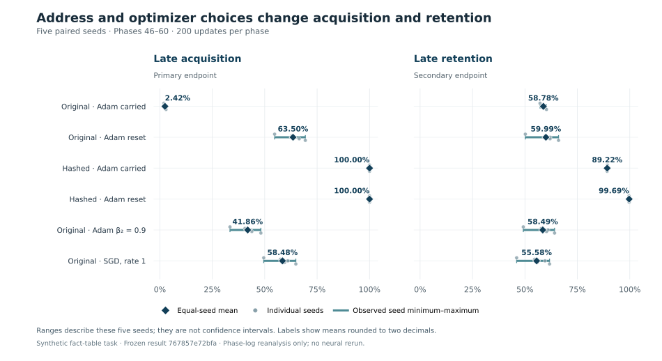

# 12 — Optimizer evidence, identification limits and exact update geometry

**V5 review date:** November 21, 2026, America/New_York. This chapter reconciles two different synthetic experiments and corrects an overstatement in a geometric example. The source arithmetic is reproducible; the upstream neural experiments were not rerun here. Nano LM's native architecture remains a research candidate.

## Executive findings

| Finding | Supported conclusion | Limit that remains |
|---|---|---|
| Resetting optimizer state helps acquisition in the original-address memory experiment | Mean late acquisition increases from 2.417% to 63.500% across five paired seeds | All five results miss the registered 70% threshold; changing address representation has additional effects |
| Hashed-address variants acquire all late training facts in these runs | Both carried and reset Adam cells report 100% late acquisition | The task is an arbitrary fact table, and exact lookup solves it; no language-model capacity theorem follows |
| Reset effects interact with address choice | The acquisition difference between reset and carried Adam is 61.083 percentage points for original addresses and zero for hashed addresses | The observed contrast is conditional on complete recipes; it is not a unique causal allocation of failure to optimizer history |
| Three new correction recipes retain substantial collateral damage | The registered collateral threshold holds in every audited seed/arm | Update counts, fit quality and optimizer geometry are not matched; duplicate entity candidates complicate deployment |
| Minimum L1 edits can destroy a positive protected margin | The two-dimensional example admits an exact trade-off | A tie is not necessarily an argmax error; this is a fixed linear example, not a general model-capacity bound |

The evidence and provenance are in [the reanalysis receipt](results/optimizer_factorial_reanalysis_v5.json), [the frozen-input manifest](evidence/upstream_v5_optimizer/manifest.json), and [the independent source review](reviews/optimizer_factorial_review.md). The calculator recomputes factorial means from phase logs rather than averaging rounded headline values.

## 1. Keep the two experiments distinct

The address-by-optimizer factorial concerns acquisition of new arbitrary associations in a fixed-size learned memory. The correction experiment concerns revising selected associations in a structured rule/exception world while checking interference. Their endpoints, data-generating processes, optimizer resets and address mechanisms differ. Agreement that optimizer details matter is useful; pooling their numerical outcomes is not meaningful.

| Item | Address × optimizer factorial | Correction optimizer control |
|---|---|---|
| Reviewed result source | [767857e](https://github.com/wwk5q8z6kk-bit/nano-lm/tree/767857e72bfa51e3fa6f32d047507aabef077fde/research/frontier/ontogenesis) | [0afd562](https://github.com/wwk5q8z6kk-bit/nano-lm/tree/0afd5629990b4e442fb3aa8f7c700b030d8faede/research/frontier/ontogenesis) |
| Registration | [b82d0f0](https://github.com/wwk5q8z6kk-bit/nano-lm/commit/b82d0f018ebcbe1e6604afc129731d96774d0f69), direct parent of the result commit | [27cc27c](https://github.com/wwk5q8z6kk-bit/nano-lm/commit/27cc27c80d969f765785a5c5da5ca8d3870278b6), source-only commit before result additions |
| Main seeds | 3101–3105, five fresh seeds | 8001–8003, reused synthetic-world seeds |
| Additional development | Six SGD rates on seed 3001; all attain the selection maximum, so the declared tie rule selects rate 1 | Three fixed recipes; no equal-fitted-efficacy comparison |
| Primary aggregation | Each seed's mean acquisition over phases 46–60 | Selected correction events and phase-level collateral summaries |
| Rerun here | Read-only arithmetic from phase logs | Read-only arithmetic and exogenous event reconstruction |

The correction registration was committed at 01:32:08 UTC on November 22. The SGD-stop and Adam-200 results first appeared at 01:45:05 UTC; Adam-stop followed at 01:54:49 UTC. That order supports the existence of a prior committed specification for these artifacts. It does not independently authenticate the time of every local trial or convert a small synthetic result into general confirmation. The factorial protocol/source blobs are unchanged between the registration and result commits.

## 2. Five-seed factorial outcomes

Late acquisition is averaged within each seed over the final fifteen phases, then across seeds. A seed is the replicate unit; the fifteen repeated phases are not fifteen independent replications. Ranges below are the observed seed minimum and maximum, not confidence intervals. Secondary retention uses the source's late-retention endpoint and is not guaranteed to track acquisition.

| Recipe | Mean late acquisition | Observed five-seed range | Mean late retention |
|---|---:|---:|---:|
| Original address + carried Adam | 2.417% | 1.927–2.917% | 58.777% |
| Original address + reset Adam | 63.500% | 54.740–69.375% | 59.992% |
| Hashed address + carried Adam | 100.000% | 100.000–100.000% | 89.222% |
| Hashed address + reset Adam | 100.000% | 100.000–100.000% | 99.687% |
| Original address + Adam β₂=0.9 | 41.865% | 33.438–48.177% | 58.493% |
| Original address + selected SGD | 58.479% | 49.531–64.844% | 55.577% |

The source registration makes six finite predictions. The reconstruction retains the original thresholds and counts:

| Prediction | Registered test, summarized | Outcome |
|---|---|---|
| F1 | Original-address carried Adam has late acquisition strictly below 20% in at least four seeds | Holds, 5/5 |
| F2 | Hashed-address carried Adam is strictly above 90% in at least four seeds | Holds, 5/5 |
| F3 | Original-address reset Adam is at least 70% in at least four seeds | Fails, 0/5 |
| F4 | Absolute hashed reset-minus-carried acquisition difference is at most 5 percentage points in every seed | Holds, 5/5 |
| F5 | Lowering β₂ gives at least 70% in at least four seeds; below 30% in at least four seeds is the refutation rule | Partial/intermediate: 0/5 at least 70%, 0/5 below 30% |
| F6 | Original-address selected SGD is at least 70% in at least four seeds, conditional on an informative hashed-SGD selection control | Fails, 0/5; development selection is informative |

The table preserves the literal registered predicates, including strict and non-strict boundaries. In particular, the earlier single-seed 86.1% reset result lies above every fresh reset seed; it cannot remain the main estimate of that recipe's effectiveness.

### 2.1 What the paired contrast identifies

Let \(A_{o,c}\), \(A_{o,r}\), \(A_{h,c}\) and \(A_{h,r}\) denote late acquisition for original/hashed addresses and carried/reset optimizer state. For the five common seeds:

\[
\overline{A_{o,r}-A_{o,c}}=0.6108333333,\qquad
\overline{A_{h,r}-A_{h,c}}=0.
\]

The first contrast ranges from 0.528125 to 0.6645833333 across seeds. Their difference, 0.6108333333, is an observed interaction between interventions in the specified recipes. It supports the claim that reset effects depend on address representation in this experiment.

The often paraphrased “two thirds” is a particular descriptive recovery fraction:

\[
\frac{\overline{A_{o,r}}-\overline{A_{o,c}}}
     {\overline{A_{h,c}}-\overline{A_{o,c}}}
=\frac{0.635-0.0241666667}{1-0.0241666667}
=0.6259607173.
\]

This is approximately 62.596%, using a ratio of means. Averaging the five seed-specific ratios gives 62.611%, a distinct quantity. Neither is a unique percentage of failure “caused by Adam.” The address intervention changes representation, address distribution and training behavior; the interaction and ceiling effects prevent an additive mechanism decomposition. A narrower statement is that resetting optimizer state recovers a substantial fraction of the observed original-to-hashed acquisition gap under these recipes.

Secondary retention also needs precise language. Resetting Adam in the original-address cell changes mean late retention by **+1.215 percentage points**, with a paired range from **−7.036 to +5.770 points**. Calling that literally “no improvement” would conceal a positive mean and heterogeneous seed effects. In hashed addresses the reset effect is **+10.465 points**, positive in every seed. These are descriptive secondary endpoints without a new confirmatory test.

### 2.2 Threats to interpretation

The factorial has stronger replication than its one-seed predecessor, but important limits survive. Thresholds were chosen after the earlier pilot. The SGD rate was chosen on one development seed using hashed addresses, which may not optimize original addresses. Three unfinished driver jobs were killed and restarted; their incomplete execution history is retained in the frozen logs. Elapsed times were collected under concurrent work and cannot support speed ratios. Occupancy counts depend on the address definition and do not alone measure usable semantic capacity.

A nominal address-space count is not a count of independent stored propositions. A hash intervention may reduce collisions and change representation/optimization together. A careful next isolation would vary address distribution while holding the representation family fixed, inspect actual optimizer states and updates, and keep the acquisition/retention denominator and training budget explicit. No new factorial run is claimed here.

## 3. Correction optimizer controls

| Recipe | Phase-end corrected accuracy | Mean collateral accuracy | Final old regular accuracy on corrected entities | Final eligible old-correction accuracy |
|---|---:|---:|---:|---:|
| Fresh Adam, 200 updates | 47.86% | 62.53% | 60.89% | 38.95% |
| Fresh Adam, stop/cap | 99.04% | 39.84% | 39.06% | 47.38% |
| Fresh SGD, stop/cap | 99.36% | 14.33% | 11.96% | 65.32% |

The finite registered condition that collateral accuracy stays at or below 85% holds in all nine seed/arm combinations. No arm reaches the rival trigger of at least 95%. This supports a finite observation: interference remains under the tested fresh-Adam and SGD recipes. It does not establish that optimizer choice cannot matter, that an ideal optimizer must fail, or that geometry is the sole cause.

The Adam-200 arm fits only about 47.86% of current corrections at phase end, while both stopping arms are near 99%. That efficacy mismatch alone prevents interpreting the collateral ranking as an equal-success comparison. The stored write_steps field also has different semantics from its informal name: for the 200-update loop it records the zero-based loop index 199. The stopping versions report a phase-level stopping index/cap summary, not a list of per-write optimizer counts. The mean reported indices, 4,182.23 for Adam-stop and 748.73 for SGD-stop, must not be labeled a measured computational speedup. They omit hardware and differ in optimization geometry.

### 3.1 Detached candidate fit versus one deployed entity state

The correction source creates a detached address candidate for every selected fact. Two selected facts can concern different relations of the same entity. They are optimized as separate candidate rows, then assigned back to the shared entity table using entity indices that may repeat.

There are two problems:

1. **Semantic commitment:** two candidates that each fit their own target need not fit both targets when represented by one entity row. Candidate success does not certify the resulting shared state.
2. **Indexing contract:** the PyTorch documentation specifies undefined behavior for duplicate indices in assignment without accumulation. Therefore this review does not assume guaranteed “last write wins” order or infer which historical prediction was affected. See [the official index_put_ contract](https://docs.pytorch.org/docs/2.11/generated/torch.Tensor.index_put_.html). The separate factorial records Torch 2.11.0; the correction summaries do not record their Torch version. The reviewed 2.11 API contract provides no portable duplicate-index order guarantee.

Exogenous reconstruction finds duplicate-entity candidate phases in 2, 4 and 5 of the 39 correction phases for seeds 8001–8003, respectively. The corresponding counts of candidates beyond distinct entities are 2, 4 and 6. Those are source event properties; they do not reconstruct scatter order or identify the cause of any particular accuracy error.

A minimal counterexample makes the semantic issue clear. Suppose two required margins are \(u_0\ge1\) and \(u_1\ge1\). Detached candidates \((1,0)\) and \((0,1)\) each satisfy the target for which they were produced, but neither satisfies both margins. The joint state \((1,1)\) is feasible. A duplicate-row overwrite is therefore not a joint optimization procedure. The new native comparison uses explicit sequential committed updates with logged identities; historical source/results remain unchanged.

### 3.2 Denominators that matter

There are 624 selected assignment events over 39 correction phases per seed. Collateral accuracy is a mean over phase-level cohorts whose sizes vary: 25–32, 26–32 and 23–32 in the three seeds. It is not automatically the same as pooling all collateral fact observations. The final old-correction denominators are 272, 277 and 270; the final old-regular-on-corrected-entities denominators are 749, 782 and 743.

Same-value assignments, repeated keys and revisions affect age/cohort membership. Chapters [10](10_TRAINING_AND_CONTROLLED_UPDATE_CONTRACT.md) and [11](11_MARGIN_RESULTS_AND_DURABILITY_THEORY.md) retain the instrument's separation of individual acquisition, phase-end survival, later horizons and revision censoring. Small aggregate differences should not be reinterpreted as changes in those unobserved individual trajectories.

## 4. Exact correction of the two-dimensional example

The [source decision note](https://github.com/wwk5q8z6kk-bit/nano-lm/blob/0afd5629990b4e442fb3aa8f7c700b030d8faede/research/frontier/ontogenesis/theory/RESEARCH-DECISION-20261121.md) offers a useful small example, but its tie and minimality statements require precision.

Let \(u=(x,y)\), initially \((2,1)\). The two relation scores are

\[
s_A=x,\quad s_B=y,\qquad s_C=x,\quad s_D=\tfrac25y.
\]

The desired revision requires \(s_B-s_A=y-x\ge3\). The protected margin is \(m_C=x-\tfrac25y\), initially \(8/5\). The ideal point reached along direction \((-1,1)\) when the target margin first equals 3 is \((0,3)\); its protected margin is \(-6/5\). This point is a geometric construction, not a recorded gradient-descent trajectory.

### Proposition 12.1: all target-only minimum L1 edits

The minimum L1 displacement from \((2,1)\), subject only to \(y-x\ge3\), is 4. All minimizers are

\[
u=(x,x+3),\qquad -2\le x\le2.
\]

**Proof.** Write \(a=x-2\) and \(b=y-1\). The target constraint is \(b-a\ge4\). The triangle inequality gives \(|a|+|b|\ge b-a\ge4\). Equality requires \(b-a=4\), \(a\le0\) and \(b\ge0\), hence \(a\in[-4,0]\). Substituting \(x=2+a\) gives the stated segment. Conversely every point on the segment attains cost 4.

Along this segment,

\[
m_C=x-\tfrac25(x+3)=\tfrac35x-\tfrac65\le0.
\]

Thus no minimum L1 edit keeps C a **strict** winner. At the endpoint \((2,5)\), C and D tie. A deterministic argmax that selects C first remains correct; an ordering that selects D first does not. A zero margin establishes loss of a positive separation, not an ordering-independent classification error.

### Proposition 12.2: the exact joint trade-off

If we additionally require \(m_C\ge\mu\) for a prescribed \(\mu\ge0\), then

\[
\min \|u-(2,1)\|_1=4+\tfrac{10}{3}\mu,
\qquad
u^*=\left(2+\tfrac53\mu,\;5+\tfrac53\mu\right).
\]

**Proof.** In displacement coordinates, the constraints are \(b-a\ge4\) and \(a-\tfrac25b\ge\mu-\tfrac85\). Substituting \(b\ge a+4\) into the second inequality gives \(a\ge\tfrac53\mu\). Therefore \(b\ge4+\tfrac53\mu\). Both are nonnegative, so \(|a|+|b|\ge4+\tfrac{10}{3}\mu\). The displayed point attains equality in both constraints and in this bound.

| Protection requirement | Optimal point | Exact minimum L1 edit | Interpretation |
|---|---|---:|---|
| Nonnegative margin, μ=0 | (2,5) | 4 | Tie allowed |
| Margin μ=1/10 | (13/6,31/6) | 13/3 | Small positive separation |
| Margin μ=1 | (11/3,20/3) | 22/3 | Source's rounded joint example made exact |
| Preserve initial margin, μ=8/5 | (14/3,23/3) | 28/3 | More expensive than merely keeping the answer correct |

Requiring only strict positivity, without a specified positive lower bound, has infimum 4 but no attained minimum: arbitrarily small \(\mu>0\) approaches the tie endpoint from feasible strict winners.

The proof is elementary and local to these coordinates. [Exact rational diagnostics](analysis/update_feasibility_geometry.py) and [known-answer/independent LP checks](checks/test_update_feasibility_geometry.py) support the example; they are not formal proof-assistant verification. The [receipt](results/update_feasibility_geometry_v5.json) records the exact fractions.

## 5. Consequences for the architecture and theory

A “smallest edit” is smallest relative to an explicit metric and parameterization. Reparameterization changes L1 distances, and a small distance need not preserve predictions. Protection constraints should name the actual output/semantic margin, the deployment dtype, the protected reference and the horizon.

The example does not show that old facts must be replayed at every later update. Fixed invariant subspaces, structurally disjoint updates or coherent representation/readout transport can preserve outputs without reasserting each fact. Chapter 11 supplies a conditional cumulative-drift bound, while chapter 01 gives transport examples and their compatibility restrictions. The real engineering question is how to obtain useful invariance or reliable protection at an acceptable acquisition and resource cost.

Likewise, a fixed \(d\)-dimensional linear feature/readout subspace has rank constraints, but this does not prove that a nonlinear model can store at most \(d\) facts. Capacity statements must specify the function family, finite precision, allowable error, side information and data distribution. The lossless finite-bit counting argument in chapter 01 has those explicit boundaries.

The source's storage/computation/search taxonomy remains a useful design checklist, not an exhaustive theorem or an additive causal decomposition of competence. Learned representations alter retrieval; memory changes training; regularities reduce conditional description length only after paying for the rule/decoder and residual exceptions. These coupled effects should be measured through declared interventions.

## 6. Decisions and next experiment

The ledger adds separate entries for the factorial, correction deployment defect and geometry correction. D-008's historical “capacity exhausted” question remains open in its broad form; the five-seed evidence narrows the empirical story without deleting its earlier one-seed record.

The next engineering comparison is in [chapter 14](14_NATIVE_UPDATE_COMPARISON.md): common native checkpoints and optimizer states, a fixed visible event stream, matched-update and additional-replay arms, full per-event receipts, and random-label negative controls. It tests the machinery needed to distinguish update effects. A natural-language claim still requires legitimate held-out data, tuned baselines, independent repeats and full resource measurement.
