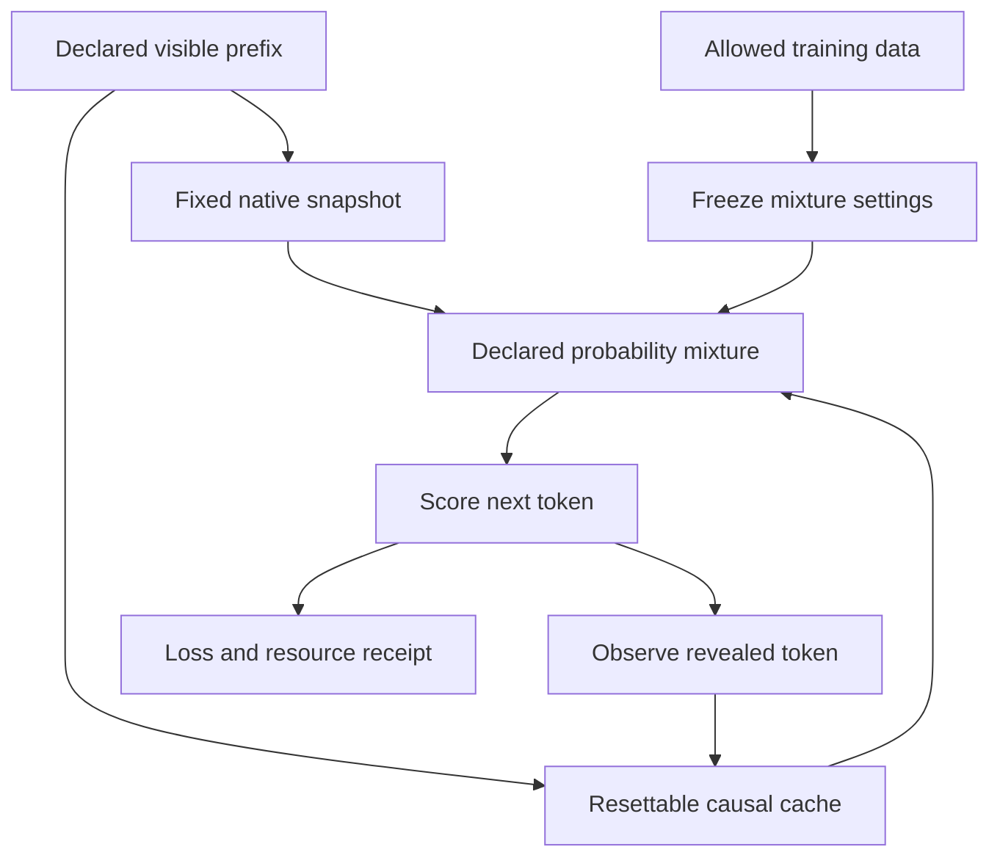

# 13 — Causal memory, equal information and the quality–resource frontier

**V5 late-addendum notice.** Sections1–6 preserve the audit at0afd562. Section7 incorporates three newly available result JSONs at fixed cutoff c597d5f: the40M cache meets the registered numerical stopping branch with unresolved control qualifications, while the101M store gate remains pending. The earlier absence statement is historical, and the invalidated0.62 result stays invalidated.

**Current evidence:** V5 review on November 21, 2026, America/New_York, against research cutoff 0afd5629990b4e442fb3aa8f7c700b030d8faede. The native causal model remains the architectural core. A count store or cache is an optional augmented comparator with its own state, training/calibration exposure and costs. No external-memory architecture is selected by this review.

## Executive summary

The latest store-S result reports a small BPB gain, while the first in-context cache result is invalidated. The audit recovers the store's arithmetic, reproduces two information-boundary defects on integers, and supplies a new causal comparator with explicit reset and prediction timing. These engineering repairs do not produce a new language-model score.

| Item | Current status | Consequence |
|---|---|---|
| Store-S weighted BPB | 1.1442 to 1.1398, reported reduction 0.0044 | A qualified result for one frozen checkpoint and fitted store |
| External count/key arrays | 1,022,224,980 bytes, about 0.952 GiB | Charge external memory and construction; parameter count alone is incomplete |
| Baseline agreement | Four rounded rows differ by 0.0001 | Literal registered four-decimal equality is not met |
| Store context | First two targets in each crop can use extra pre-crop context | The current comparison does not enforce equal visible prefixes |
| Original scalar-shuffle control | Invalid predictive probability construction | Preserve the old result as invalidated control evidence |
| Repaired shifted-context control | Coherent distribution; gain rounds to zero | Independence and deployment causality are separate questions |
| First cache result, described as 0.62 BPB | Source explicitly voided it for future leakage | Exclude it from evidence of model quality |
| Valid causal-cache language result | No committed rerun at the fixed cutoff | The 40M cache gate remains open |
| New local causal cache | Eight fixture groups pass after independent input-contract repairs | Ready as a small correctness reference, without a BPB or efficiency claim |

The detailed numerical/source audit is [the store/cache review](reviews/store_cache_review.md). Its [reanalysis receipt](results/store_cache_reanalysis_v5.json) records what was recomputed and what was not. The [source manifest](evidence/upstream_v5_store/source_manifest.json) preserves ten exact source/result files, including historical faulty versions.

## 1. What the store measurement actually says

| Domain | Model BPB | Model plus store BPB | Reported-row difference |
|---|---:|---:|---:|
| Web | 1.1945 | 1.1929 | 0.0016 |
| Textbook | 0.8940 | 0.8887 | 0.0053 |
| Math | 1.2963 | 1.2851 | 0.0112 |
| Code | 0.9903 | 0.9798 | 0.0105 |
| Reported weighted mix | 1.1442 | 1.1398 | 0.0044 |

The weighted reduction is about 0.3845% relative to the reported model BPB. This is decimal arithmetic on committed rounded summaries, not an independently reconstructed loss over raw tokens. The domain weights and corpus byte manifest are not included in this evidence set, so the weighted value is preserved as reported rather than claimed as independently recomputed.

The store fits its mixture using 1,048,576 sampled target positions. Those are presentations, not a count of unique tokens. Source defaults would evaluate 20 × 16 × 512 target positions per domain; overlapping crops can repeat positions. The result names one checkpoint path, but checkpoint payload/digest, exact executed CLI, raw crop offsets and the corpus manifest were not recovered. A path label is weaker provenance than a verified checkpoint identity.

The same checkpoint removes one source of variation between model-only and augmented evaluation. It does not make the complete systems equal in memory, preprocessing, fitting data or inference work. Nor does the small difference from an earlier store pilot isolate “longer model training” as its cause: pipeline and exposure changes remain coupled. [The immutable result](https://github.com/wwk5q8z6kk-bit/nano-lm/blob/0afd5629990b4e442fb3aa8f7c700b030d8faede/research/frontier/ontogenesis/results/lm/store-exchange-S.json) is the source of the table.

## 2. Three distinct validity requirements

A valid predictive distribution, a causal input boundary, and equal information between competitors are separate requirements. Satisfying one does not imply the others.

**Distribution coherence.** Shuffling scalar probabilities of other positions' true targets does not generally produce the probability of the current target under one normalized vocabulary distribution. The old shuffled-control gain of 0.1752 therefore cannot serve as a legitimate negative-control estimate. The replacement queries a real count distribution using a shifted context, which repairs this coherence problem.

**Causality.** The first cache evaluator selected its behavior using object identity. Passing the same token list twice selected causal processing; passing two equal but distinct lists selected a full-window path that inserted future transitions. On the source-function fixture [0,1,2,3], the causal path gives true-target probabilities [0,0,0], while the equal-copy path gives [1,1,1]. The explicit corrected mode removes this demonstrated bug. The historical 0.62 result remains invalidated. A valid corrected evaluation would create new evidence, not rehabilitate that result.

**Equal information.** The store performs lookup on a complete validation file and then crops the returned arrays; the native model receives only the crop. Two files with the same visible crop [3,4] but different preceding tokens produce source-store probabilities 1 and 0 for target 4. Restricting lookup to the visible crop produces 0.5 in both cases. This is extra causal context, not future leakage. Its effect on the aggregate BPB cannot be bounded by simply multiplying the gain by the small affected-position fraction.

The shifted-context control has a further limitation: a cyclic shift can consult future validation contexts and wrap the file. It is a diagnostic intervention, not a causal deployable arm. Even statistically independent memory can supply a helpful frequency prior to a miscalibrated model, so “independent control implies zero gain” is not a general theorem. A foreign-window control drawn from the next validation crop may overlap the current crop or share document/topic content. Independence requires a sampling and split argument.

## 3. The implemented causal comparator

The new [reference implementation](prototype/causal_ngram_cache.py) has a deliberately small contract. It observes integer tokens after an explicit document/crop reset, retains a bounded prefix window and predicts using only completed transitions inside that window. It does not take a target or future suffix as a prediction argument. The scorer predicts first, records loss, then observes the target.

| Interface | Required semantics |
|---|---|
| Configuration | Positive finite smoothing; vocabulary at least two; positive maximum order and retained window |
| Context identity | Explicit nonempty document and crop identities; a changed identity requires reset |
| Observe | Append one actually observed token; discard tokens outside the retained window |
| Predict | Read-only distribution and immutable state snapshot; no target/future input |
| Score then observe | The target affects later predictions only after the current probability is recorded |
| Masked target | Skip its loss, but observe a real token for later context; padding is not an observation |
| Boundary | Clear all retained tokens at both crop and document boundaries |
| Native mixing | Same prefix, frozen allowed calibration, normalized positive distributions |
| Empty/no match | Cache is uniform; the mixture returns the validated Python-float native representation exactly |
| State digest | Identifies local config/prefix/state; does not authenticate external document labels or provenance |

Let \(z_{1:L}\) be the retained observed prefix. Choose the longest suffix of order \(n\) for which there is a completed matching transition entirely within this prefix. If \(c_v\) counts observed followers of token value \(v\), \(C=\sum_v c_v\), vocabulary size is \(V\), and \(\alpha>0\), define

\[
q(v\mid z_{1:L})=\frac{c_v+\alpha/V}{C+\alpha}.
\]

**Normalization.** Every numerator is positive and the sum of numerators is \(C+\alpha\); therefore all probabilities are positive and sum to one. The implementation additionally rejects finite-precision inputs that cannot represent the promised positive normalized distribution.

**Prefix invariance.** Starting from the same reset identity and configuration, two identical observed prefixes produce identical retained windows by induction on observations. Counting completed transitions is a deterministic function of that window. Therefore the entire predicted vocabulary distribution is identical, regardless of an unobserved suffix. The argument requires the application to respect score-before-observe and reset boundaries; a dishonest caller can still supply a token it should not have observed.

**Mixture validity.** Given a valid native distribution \(p\) on the same prefix and fixed \(\lambda\in[0,1]\),

\[
p_{\rm aug}(v)=(1-\lambda)p(v)+\lambda q(v)
\]

is normalized and nonnegative, and is positive under the stated positive inputs. For no match or \(\lambda=0\), the implementation returns the validated Python-float representation of the native probabilities exactly. These are distribution/cause-order properties, not a guarantee that interpolation improves held-out loss.

Eight grouped [fixture checks](prototype/test_causal_ngram_cache.py) include 1,093 exhaustive short prefixes against a separately grouped transition oracle, 40 target/future-suffix variants on complete distributions, reset isolation, recomputation parity, mask timing and snapshot immutability. Independent review found and repaired accepted real-number configurations/weights that failed serialization, malformed public prediction objects that could break mixture validity, and a convex-mixture arithmetic edge case that rounded a smallest-positive component to zero. The final arithmetic uses a stable endpoint-plus-difference form and checks the output distribution. The theorem is in exact arithmetic; the implementation converts inputs to Python floats and checks normalization with math.fsum and absolute tolerance 1e-12. The [review](reviews/causal_cache_review.md) and [receipt](results/causal_cache_checks_v5_final.json) record the final scope. This transparent implementation rescans its retained window; no production-kernel or throughput claim follows.

## 4. Architecture consequence

The required model path remains causal native next-token prediction, with explicit parameter versions and logical-depth state. Optional augmented paths receive the same declared prefix and expose their state/resource identity. Training updates, inference cache observation and evidence recording have separate clocks.

No lookup answer is counted as an intrinsic learned-model answer. Conversely, an augmented system is not disqualified merely because it uses memory: it should be judged with its full costs and the same information contract. The correct conclusion depends on the workload's quality and resource budgets.

The literature supplies direct precedents. Grave, Joulin and Usunier's continuous cache uses previously observed hidden-state/follower pairs and interpolation; Khandelwal and colleagues' kNN-LM uses a training datastore of representations and targets with normalized neighbor aggregation and a documented context convention. We inspected the relevant first three PDF pages and methods equations, not all appendices or their implementations. These are distinct mechanisms from this integer n-gram reference, and neither paper establishes a Nano LM gain. See P-41 and P-42 in [the reference register](04_EVIDENCE_AND_REFERENCES.md).

## 5. Compare a frontier with explicit resource budgets

A proposed replacement must name a workload and a feasible resource vector before “more efficient” has a measurable meaning.

| Resource/quality axis | Required observation | Current evidence |
|---|---|---|
| Held-out native quality | Same documents/bytes, target convention, tokenizer and splits | No new native language run here |
| Augmented quality | Model and memory share allowed context and evaluation targets | Current store rows are qualified by the prefix and control defects |
| Training exposure | Unique source IDs plus actual target presentations and tuning rounds | Store fitting count is reported; full source manifests incomplete |
| Persistent memory | Model tensors, optimizer if retained, store keys/values/indexes, working state | Store array bytes and tiny native arrays are known separately |
| Peak memory | Measured construction/training/inference maxima including workspace | Unmeasured for current store comparison |
| Inference cost | Isolated latency distribution and energy at stated batch/concurrency | One combined elapsed time does not identify these |
| Update cost | Actual optimizer calls, target presentations and memory movement | Exact tiny-native counts in chapter 14; no matched energy estimate |
| Uncertainty | Independent training seeds and paired document/crop units | No uncertainty interval for current store summary |
| Reproducibility | Checkpoint/data hashes, command, environment and per-example receipts | Exact inspected source bytes; checkpoint/corpus identities unresolved |

For a deployment with \(N\) queries, a simple accounting identity is

\[
T_{\rm aug}(N)=T_{\rm base\ train}+T_{\rm store\ build}+T_{\rm fit}+N\,t_{\rm aug}.
\]

Against an alternative \(T_{\rm alt}(N)=T_{\rm alt\ train}+N\,t_{\rm alt}\), feasibility requires

\[
\Delta T_0+N\Delta t\le0,
\]

as well as quality, storage and latency constraints. This is an amortization identity, not a measured break-even result. If the augmented path has higher per-query time, sufficient training savings may help only below a query-volume threshold. If its per-query time is lower, a construction overhead can amortize above a threshold. Energy and bytes require their own measurements; time is not interchangeable with either.

Do not treat “two times the observed seed noise” or two favorable seeds as a formal significance guarantee. Prespecify an effect size worth the resource cost, the independent sampling unit, stopping/tuning policy and interval method. For shared held-out documents, pair the losses; respect document dependence and report training-seed variation separately. A sampled-token NLL converted with a whole-file average bytes-per-token ratio should be labeled as that approximation until its byte attribution is verified.

## 6. Ordered closure plan

| Priority | Work | Exact completion evidence |
|---|---|---|
| 1 | Repair the actual evaluation contract | Same prefix for both paths; direct zero-weight equality; causal suffix noninterference; document-aware crops |
| 2 | Bind identities and denominators | Checkpoint and tokenizer hashes, dataset/split/document IDs, actual crop offsets, NLL sums, byte convention and mixture weights |
| 3 | Define and fit a legitimate control | Disjoint or explicitly diagnostic memory source; proper distribution; frozen train-only calibration |
| 4 | Execute at the registered scale when authorized resources are available | Valid 101M store or 40M cache receipt, all registered outcomes retained |
| 5 | Measure the deployment frontier | Quality with paired uncertainty plus total construction, storage, latency and energy costs |
| 6 | Consider architecture adoption | Independent validation and a material advantage for the chosen workload |

The source's 101M store rule and 40M cache rule remain pending because the available S result is at a different registered scale. No completed cache/M/L store exchange JSON was present in the non-truncated recursive tree at the reviewed cutoff; this is a repository-bound observation, not proof that no off-repository work occurred. The original source and raw summaries remain intact. Scientific gaps that require new data or model runs stay explicitly open.

## 7. Late evidence addendum at c597d5f

A bounded final review recovered three result files committed after the core audit. The [five-copy addendum manifest](evidence/source_manifest_v5_addendum.json) preserves those JSONs, the updated investigation and the changed training source. The [late reanalysis](results/store_cache_late_reanalysis_v5.json) checks15 rounded rows, source dimensions and the unchanged model/evaluation ASTs. This is a source/result audit, not a new language evaluation.

| Newly available result | Web gain | Textbook gain | Math gain | Code gain | Reported weighted-mix gain |
|---|---:|---:|---:|---:|---:|
| Cache S |0.0023|−0.0005|0.0068|0.0114|0.0036|
| Cache M |0.0012|−0.0003|0.0036|0.0059|0.0018|
| Store M |−0.0026|−0.0014|0.0016|0.0016|−0.0014|

Positive gain means lower reported BPB. Cache-M changes weighted BPB1.0481→1.0463. Store-M changes1.0481→1.0495, a worsening. These rounded summaries have no uncertainty intervals and do not establish a training-size scaling law.

### Which registered gates apply?

Counting the actual tensor shapes in the source yields S=14,292,224, M=40,379,904 and L=100,684,032 parameters. This count includes tied embeddings, final/block normalization, query/key head scales, attention and gated feed-forward matrices. It is a source-configuration count; no checkpoint payload was loaded.

Cache-M is the approximately40M registered branch. All four domain gains are below0.01, so its **numerical stopping branch is met**. This does not satisfy every control condition or prove that all copy mechanisms are useless. The proper recorded status is a finite negative/small-gain outcome under an incompletely cleared evaluation contract. The smaller S code gain of0.0114 does not substitute for the registered M decision.

Store-M is approximately40M, not the source's approximately101M/L scale. Its negative mixed gain is recorded, while the L store gate stays pending. Do not infer a completed large-store rejection from an M-sized result.

### Qualifications retained

All three JSONs report maximum baseline difference0.0001. Store-M contains the training-run baseline fields and differs on web/textbook/math; code and mix agree at recorded precision. The cache JSONs contain only the maximum difference. Their per-domain comparison is an explicit cross-record inference using matching checkpoint paths and identical model BPB rows in the corresponding store record, not a direct cache-record field.

Both cache results record a passing causality check and foreign-control gains that round to zero. The source check covers a limited training-window suffix test, not independent reconstruction of complete held-out probabilities. Foreign-window disjointness, document boundaries, exact fitted weights, raw NLL/byte denominators and checkpoint hashes remain unresolved. The cache fits524,288 sampled target positions; count-store fitting uses1,048,576. Neither count is unique source exposure or a complete cost measure.

The exact-cache support shares are identical across the S/M results:13.2%web,9.4%textbook,32.5%math and44.5%code. They describe how often a true target has positive cache mass, not prediction accuracy, a guaranteed exploitable gain or a model's copying ability.

The new training source replaces device-side sampling with a host NumPy sampler and introduces an “-hs” naming convention. The source reports a prior sampling-bias concern, which this review did not independently verify. These result checkpoint names lack that suffix; that suggests first-version checkpoints, but naming alone does not authenticate their training history. Eight model/evaluation function ASTs and both exchange-script blobs remain unchanged across the cutoffs. No repaired-sampler training outcome, distillation result or new corpus build is claimed from the presence of infrastructure.

The full [late source review](reviews/store_cache_late_review.md) gives the exact identities and boundaries. D-058's appended event records the updated evidence without changing the earlier85-copy manifest, its45-event V5 core prefix, or any old result.
