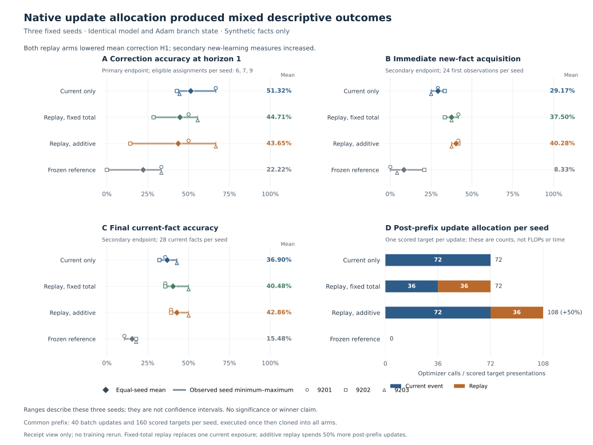

> **V6 current entry point:** [Full architecture](00_FULL_ARCHITECTURE.md). This chapter preserves the V5/historical contract and results. [15](15_NATIVE_BASELINE_AND_RESEARCH_UPDATE.md), [16](16_GENERATIVE_REASONING_EVALUATION.md) and [17](17_CORRECTION_MEASUREMENT_AND_PROTECTION.md) carry the newer evidence, instruments and corrections. In particular the101M store status is no longer pending; see chapter15 for the scoped stopping decision.

# 14 — Native update allocation: a fixed exploratory comparison

## Executive finding

**The native comparison executed real model updates and returned mixed outcomes. Both replay schedules reduced mean accuracy on the fixed primary correction endpoint.** Across three seeds, all-assignment horizon-one accuracy was **51.32% for current-only updates, 44.71% for replay with equal total updates, and 43.65% for additive replay**. New-fact acquisition and final current-fact accuracy increased in the replay arms. This establishes an auditable mechanism comparison with competing effects; it does not select a winning architecture or establish a general retention benefit. [S, R]

| Equal-seed mean | Current only | Replay, fixed total | Replay, additive | Frozen |
|---|---:|---:|---:|---:|
| **Correction horizon 1 — primary** | **51.32%** | **44.71%** | **43.65%** | **22.22%** |
| Immediate assignment acquisition | 41.67% | 44.44% | 50.00% | 22.22% |
| Immediate new-fact acquisition | 29.17% | 37.50% | 40.28% | 8.33% |
| Final current observed facts | 36.90% | 40.48% | 42.86% | 15.48% |
| Final previously observed current facts | 31.82% | 33.33% | 36.36% | 18.18% |

These are arithmetic means of three seed accuracies. They are not pooled event accuracies, confidence estimates or independent replications for every token. All seed outcomes remain visible. The primary endpoint was fixed before execution and remains primary despite the more favorable secondary results. [P, S]

*Diamonds are equal-seed means; markers identify seeds; lines span observed minima and maxima. Ranges are descriptive, not confidence intervals. Panel D counts updates and scored targets rather than measured FLOPs or runtime. The renderer reads saved results without training. [S, F]*

## 1. What was implemented

This continuation connects the existing native trainable model to the existing causal correction protocol. Every prediction comes from native forward execution. There is no fact-table answer substitution, restricted four-class head or external retrieval system in the prediction path. The fixed model has width 8, two attention heads, feed-forward width 16, two logical layers sharing one unique block, a tied embedding/output matrix, context length three and **840 distinct learned scalars**. It runs in NumPy float64 on CPU. [P, N, R]

Each query contains entity, relation and marker tokens. Training appends the observed value token, while a mask scores only that final target. Inference receives the three query tokens alone and takes the argmax over all **22** native vocabulary entries. A non-value output is an explicit incorrect abstention. This arrangement tests elementary synthetic association and revision, not text tokenization, language understanding or long-context behavior. [N, R]

Three fixed world seeds, 9201–9203, each generate seven phases. Every phase introduces two entities, each with two observed relations out of three; values lie in a four-value vocabulary. Phases one through six also assign two previously observed keys. Each world contains 40 events: 28 first observations and 12 assignments. In these realized worlds, each assignment cohort contains nine value changes and three same-value assignments. Same-value events consume updates and remain reported. [P, R]

## 2. Common checkpoint and controls

The four phase-zero facts receive 40 batch updates, giving 160 scored target presentations per seed. All four facts are answered correctly at that checkpoint in every seed. The implementation then clones weights, Adam first and second moments, step number and hyperparameters into each arm. Array copies are independent; the recorded branch digests are identical within a seed. This removes unequal pretraining budgets and optimizer resets from the intended branch comparison. [N, R, V]

AdamW uses learning rate 0.01, first-moment coefficient 0.9, second-moment coefficient 0.95, epsilon 10⁻⁸, weight decay 0.01 and a global raw-gradient norm cap of 1. Decay applies to all distinct learned tensors. These settings are a frozen fixture recipe, with no claim of optimality. [P, N]

| Arm | Current updates/event | Replay updates/event | Current targets/seed | Replay targets/seed | Post-prefix updates/seed |
|---|---:|---:|---:|---:|---:|
| Current only | 2 | 0 | 72 | 0 | 72 |
| Replay, fixed total | 1 | 1 | 36 | 36 | 72 |
| Replay, additive | 2 | 1 | 72 | 36 | 108 |
| Frozen | 0 | 0 | 0 | 0 | 0 |

The first contrast changes allocation of the same update and target budget: replay replaces one current exposure. It cannot attribute every difference to replay independently of that reduction. The additive contrast preserves current exposure and adds replay, spending **50% more post-prefix updates**. Frozen preserves the common state and establishes a no-learning reference. It is not a matched-cost competitor. Replay selection, storage, optimizer chronology and examples differ even where update counts match. [P, R]

## 3. Causal replay and transaction timing

The learner receives only the next delivered prefix. It checks both prefix extension and agreement between the latest-target table and delivered revisions. Replay excludes the current key where another key exists, prefers another visible key on the same entity, and otherwise chooses the oldest latest-visible target on another entity. Selection is deterministic and cannot consult future labels or success measurements. Superseded labels are not replayed. [N, V]

Each replay arm actually used **24 same-entity steps and 12 other-entity fallback steps per seed**; current-event fallback never occurred. A new entity's first observed key has no sibling yet, explaining the fallback. In seed 9201, event 4 presents key (2, 0), value 0. Fixed-total replay spends one update there and one on event 0, whose value is 3; additive replay spends two current updates plus that replay. At event 5, key (2, 2), value 0, the replay source becomes event 4. The exact source identities and exposures are recorded for every transaction. [R]

Immediate acquisition is measured after the entire transaction, including any replay step. Consequently replay can affect the immediate answer within that transaction. Phase-end horizon zero is a later, separately recorded endpoint; it must not be relabeled as immediate acquisition. [P, N]

## 4. Primary outcome and complete denominators

Horizon one asks whether an assignment's value is answered correctly at the end of the following phase, provided that revision remains current. A later revision censors the earlier event under the declared new-revision policy, even when the value is unchanged. Failed immediate acquisitions remain in the primary eligible denominator. All eligible measurements are present. [P, S]

The structural partition is identical across arms within a seed:

| Seed | Assignments | Eligible | Censored | Not yet due | Measured | Missing |
|---|---:|---:|---:|---:|---:|---:|
| 9201 | 12 | 6 | 4 | 2 | 6 | 0 |
| 9202 | 12 | 7 | 3 | 2 | 7 | 0 |
| 9203 | 12 | 9 | 1 | 2 | 9 | 0 |

The eligible set further partitions into acquired and failed initial acquisitions. Unknown initial acquisition is zero in every row:

| Seed | Arm | H1 correct/eligible | H1 accuracy | Initially acquired eligible | Failed acquisition eligible | Correct/acquired subset |
|---|---|---:|---:|---:|---:|---:|
| 9201 | Current only | 4/6 | 66.67% | 5 | 1 | 4/5 |
| 9201 | Fixed-total replay | 3/6 | 50.00% | 4 | 2 | 3/4 |
| 9201 | Additive replay | 3/6 | 50.00% | 5 | 1 | 3/5 |
| 9201 | Frozen | 2/6 | 33.33% | 2 | 4 | 2/2 |
| 9202 | Current only | 3/7 | 42.86% | 1 | 6 | 1/1 |
| 9202 | Fixed-total replay | 2/7 | 28.57% | 1 | 6 | 1/1 |
| 9202 | Additive replay | 1/7 | 14.29% | 1 | 6 | 0/1 |
| 9202 | Frozen | 0/7 | 0.00% | 0 | 7 | 0/0 — undefined |
| 9203 | Current only | 4/9 | 44.44% | 2 | 7 | 1/2 |
| 9203 | Fixed-total replay | 5/9 | 55.56% | 4 | 5 | 3/4 |
| 9203 | Additive replay | 6/9 | 66.67% | 5 | 4 | 5/5 |
| 9203 | Frozen | 3/9 | 33.33% | 3 | 6 | 3/3 |

“Initially acquired” here means a correct immediate answer, including chance correctness by the frozen control; it does not prove an update caused acquisition. [S]

| H1 paired difference from current only | Seed 9201 | Seed 9202 | Seed 9203 | Mean |
|---|---:|---:|---:|---:|
| Fixed-total replay | −16.67 pp | −14.29 pp | +11.11 pp | **−6.61 pp** |
| Additive replay | −16.67 pp | −28.57 pp | +22.22 pp | **−7.67 pp** |
| Frozen | −33.33 pp | −42.86 pp | −11.11 pp | −29.10 pp |

Both replay interventions improve H1 in one seed and reduce it in two. The additional current exposure in the additive arm does not remove the negative mean primary result. No p-value, statistical superiority claim or outcome-based selection is attached to these three observations. [S]

At horizon five, eligible/censored/not-yet-due counts are respectively **1/5/6**, **0/4/8**, and **1/2/9** across the three seeds. Horizons ten and twenty have no eligible events in any seed and therefore undefined accuracy. The short stream supplies no evidence about those longer retention periods. Full semantic-change and same-value strata remain in the receipt. [S, R]

## 5. Secondary results and small cohorts

Each seed supplies 24 post-prefix first observations and 28 current facts at the final phase. Fixed-total replay raises mean new-fact acquisition by **8.33 percentage points** and final current-fact accuracy by **3.57 points**; additive replay raises them by **11.11** and **5.95 points**. These endpoints describe different requirements from persistence of a specific corrected revision. Improvement on them does not cancel the adverse primary contrast. Previously observed current facts exclude keys revised during the final phase, leaving 22 eligible keys per seed. [S, R]

The unrevised common-prefix cohort is especially small:

| Seed | Remaining unrevised common facts | Current only | Fixed-total replay | Additive replay | Frozen |
|---|---:|---:|---:|---:|---:|
| 9201 | 2 | 0/2 | 2/2 | 2/2 | 2/2 |
| 9202 | 1 | 0/1 | 0/1 | 0/1 | 1/1 |
| 9203 | 1 | 0/1 | 1/1 | 1/1 | 1/1 |

The replay mean of 66.67% on this endpoint represents only four surviving facts across three worlds. The frozen 100% reflects unchanged predictions on unchanged, previously learned targets, alongside weak new-fact acquisition. Neither percentage establishes scalable durable memory. The denominator warning belongs beside any reuse of these numbers. [R]

The permanently unobserved relation for each entity has a random, coordinator-only label from an independent generator. Those labels never enter the model, initialization, event stream, replay selection or inference inputs. Final random-label-control means are 16.67%, 14.29%, 11.90% and 11.90% for current, fixed-total replay, additive replay and frozen respectively, each based on 14 labels per seed. These are negative-control diagnostics; there is no learnable relation tying the withheld labels to the observations. They must not be reported as language generalization scores. [P, S, N]

## 6. Work, storage and provenance

The main comparison executes **876 optimizer calls**: 120 shared-prefix calls and 756 post-branch calls. There are **1,236 scored target presentations**, because each shared-prefix batch scores four targets. Prefix training executes once per seed and is cloned, not executed four times. Every arm makes 204 inference queries per seed, giving 2,448 queries overall, plus six common-prefix diagnostic loss calls. Validation reruns are additional work and are excluded from these main-run totals. [R, V]

Each model stores 6,720 parameter-array bytes and 13,440 Adam-moment bytes. Replay's canonical latest-target inventory reaches 1,768–1,769 JSON bytes; audit history reaches 5,387–5,388 bytes and is retained by every arm. These serialized payloads and array sizes exclude Python overhead, temporary activations and allocator peaks. They are not measured incremental or peak RAM, and no matched latency, energy or FLOP result is claimed. [R]

The recipe was locally frozen at **2026-11-22T02:21:42Z** before execution. Its SHA256 is **4cd9bdabedd2b507663f5d5d368dab34c037c2b078b386d872d9238b23f18425**. Independent source review preceded the coordinator's execution. This establishes a local review/freeze sequence, not independent prior Git preregistration or cryptographic proof of custody. Source, manifest, hidden-target, branch and displacement hashes are retained. [P, V, R]

The exact original UTF-8 receipt is stored losslessly as gzip: **8,453,400 uncompressed bytes**, SHA256 **75df20be30342b30664da2f656026b9bc8eb2b57c9ca816c3267605fea8e9911**. The 1,088,605-byte gzip has SHA256 **7bcbe0b22d2ba1930e435db80e635396e135fa44c31f295f0e0f66d5eb0f2bab**. The readable summary is a derived view, not another experiment. Load the raw receipt through gzip, for example with Python's gzip.open followed by json.load. [S, R]

## 7. Theory, transfer and next gates

Replay changes the examples and sequence used by an unconstrained optimizer. It does not impose an invariant protecting every old output. A proof of preservation would need explicit conditions on actual parameter displacement, protected margins, revisions and the evaluation horizon. The margin framework in [A] supplies conditional reasoning, but this comparison neither measures the required native curvature bounds nor implements a certified projection. Recorded hashes and correct causal execution are audit evidence, not a theorem that learning will preserve knowledge.

The fixed shared-depth model also provides no evidence that sharing is preferable to independent layers: architecture is held constant across all arms. Transfer remains open from width-eight integer associations to text, broader tasks, longer streams, production precision and useful scale. Seven phases and three seeds support descriptive diagnosis. They do not establish the mechanism's population effect or a deployable memory system. [P, A]

| Next gate | Concrete requirement before a stronger claim |
|---|---|
| Independent reproduction | Match frozen receipt identity and run behavioral tests covering real forward/update calls, branch nonaliasing, future-label counterfactuals, hidden-label noninterference and exclusive output creation. |
| Adequate retention horizon | Freeze a new stream long enough for horizons 5, 10 and 20, with sufficient uncensored revisions and stable-fact counts. Keep failed acquisitions in primary denominators. |
| Stronger causal contrast | Prespecify replay allocation controls and exposure budgets; retain both fixed-total and additive comparisons. If comparing against random replay, fix its RNG and selection policy before outcomes. |
| Mechanism diagnosis | Record native target/rival margins and actual before/after update effects on declared protected keys, including replay-induced effects and optimizer-state evolution. |
| Generalization and engineering | Use a separately defined learnable held-out task and leakage controls; then measure runtime, selection overhead, memory and useful quality under authorized workloads. Random hidden labels cannot substitute for that task. |

Any new tuning or revised endpoint belongs to a new protocol and receipt. Preserve this mixed primary result and its denominator tables as the evidence for the present recipe. [P, R]

## Sources and reproducible artifacts

- **[P]** [Frozen protocol](experiments/native_update_comparison_protocol.json).
- **[N]** [Native comparison implementation](experiments/native_update_comparison.py), using [trainable native model](prototype/trainable_native.py) and [correction protocol](experiments/correction_protocol.py).
- **[S]** [Readable result summary](results/native_update_comparison_summary_v5.json), including all per-seed correction cohorts and exposure counts.
- **[R]** [Exact complete receipt, gzip JSON](results/native_update_comparison_v5.json.gz), including logits, transactions, manifests and state hashes.
- **[V]** [Independent preexecution source review](reviews/native_update_comparison_review.md) and [behavioral test suite](experiments/test_native_update_comparison.py).
- **[F]** [Plot renderer](analysis/plot_native_update_comparison.py), [SVG](figures/native_update_comparison.svg) and [PNG](figures/native_update_comparison.png).
- **[A]** [Architecture and theorem assumptions](01_ARCHITECTURE_AND_THEOREMS.md), [margin durability theory](11_MARGIN_RESULTS_AND_DURABILITY_THEORY.md) and [optimizer identification limits](12_OPTIMIZER_FACTORIAL_AND_UPDATE_GEOMETRY.md).
