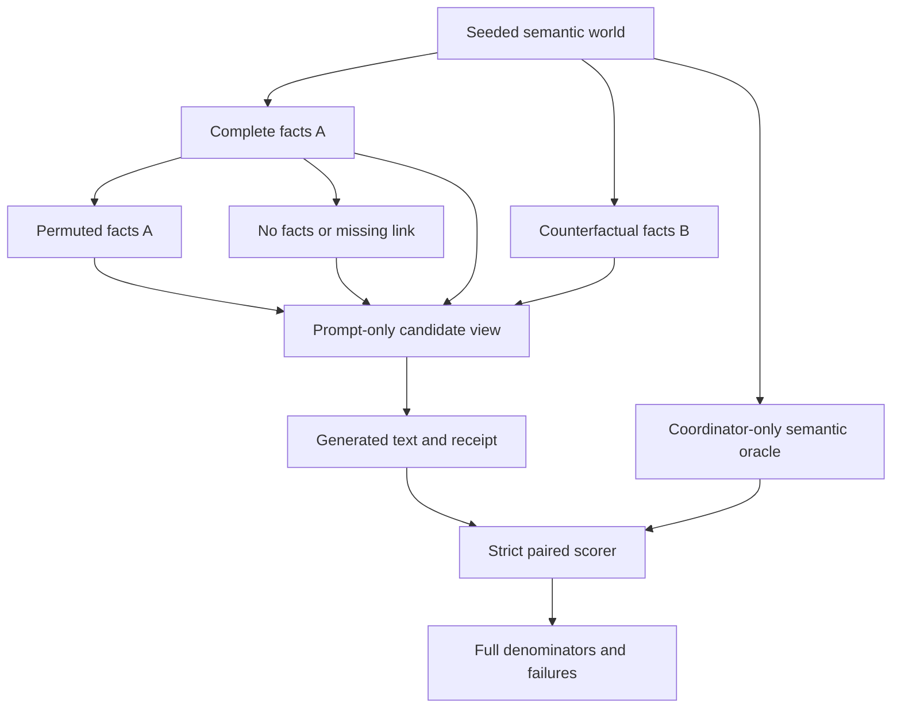

# 16 — A controlled generative evaluation for Nano LM

**V6 status:** implemented evaluation instrument and software checks; no learned checkpoint evaluated. **Model result:** `NOT_RUN`. **Training-corpus contamination:** `NOT_CHECKED`.

The new evaluation makes the project's next generative-reasoning task executable. It asks whether a model can use supplied facts, combine a pointer with a value fact, change its answer when the relevant fact changes, tolerate a fact-order permutation and abstain when a needed fact is absent. Those are narrow, interpretable behaviors. The instrument does not equate success with general reasoning or select a backbone.

## 1. Why this test is needed

The existing benchmark harness scores candidate continuations and exact target-token predictions. Its results are useful, but they do not cover free generated answers with explicit stopping, formatting, unsupported-answer or counterfactual policies. The source audit also identifies missing checkpoint/benchmark identity binding, unequal tokenization conventions and unverified maximum-length claims. [Context source audit](reviews/v6_context_audit_review.md)

For LAMBADA, an all-target-tokens greedy match under teacher forcing is a valid exact-target check when every supplied preceding target also matches the model's greedy choice. The gap is therefore not that all teacher-forced evaluation is invalid. The gap is a missing controlled generated-response protocol and the receipts needed to compare implementations.

RULER provides primary precedent for configurable retrieval and multi-hop tracing; GSM-Symbolic provides precedent for controlled template variations. This instrument borrows those measurement ideas at a much smaller scope. It does not reproduce either benchmark or transfer their published scores to Nano LM. [P-46–P-47](04_EVIDENCE_AND_REFERENCES.md)

## 2. Frozen protocol and artifacts

The protocol was written before generated checks at `2026-11-23T21:01:36Z`. Its SHA256 is `1d86c0b00d4c6db8974fd2bb3f739ba54809daedaa8a839109521c2184fd49b6`. This is a local recipe freeze, not independently witnessed preregistration. Repairs that enforce the frozen contract receive new code hashes and receipts without changing that recipe.

| Artifact | Purpose |
|---|---|
| [Machine protocol](experiments/generative_reasoning_protocol_v6.json) | Exact task, split, information, metric and receipt policy |
| [Human protocol](experiments/generative_reasoning_protocol_v6.md) | Detailed explanation and commands |
| [Generator, runner and scorer](experiments/generative_reasoning_v6.py) | Deterministic worlds, prompt-only adapter, strict validation and offline scoring |
| [Tests](experiments/test_generative_reasoning_v6.py) | Semantic and adversarial checks |
| [Published dataset](evidence/generated_relations_v6/manifest.json) | Immutable public prompts, private-to-candidate oracle and hashes |
| [Initial receipt](results/generative_reasoning_checks_v6.json) | Historical first validation and controls |
| [Final validation](06_VALIDATION_AND_UNRESOLVED_WORK.md) | Current source hashes, independent review and repaired checks |

The default dataset has 16 development worlds and 32 evaluation worlds **per family**, giving 96 worlds and 480 condition records. Development and evaluation world IDs, entity/value vocabularies and full fact sets are disjoint. They share grammar templates. This is a world-held-out test, not a template or natural-language distribution-shift claim.

## 3. Visible semantics and five paired conditions

Names and values are arbitrary strings. Direct retrieval asks for an entity's value. Two-hop composition asks for the value of the entity reached by the queried entity's pointer. Gold follows the visible fact semantics; it is not a hidden random label that the model could not infer from the prompt.

| Condition | What changes | Correct answer policy |
|---|---|---|
| Full A | Original complete facts | Value derived from visible facts |
| Full B | Same query/order; only relevant value changes | A different derived value |
| Permuted A | Identical facts in a guaranteed different order | Same value as A |
| No context | Facts removed; same query | UNKNOWN for abstention; A target retained separately for contextual-gain analysis |
| Broken chain | Remove queried value or relevant pointer | UNKNOWN |

Two-hop broken-chain prompts keep the destination's value visible while removing the required pointer. Merely selecting a visible value cannot justify the answer. Distractors and random order allow first/last-value shortcuts to be measured rather than assumed absent.



The public file includes a coordinator ID and prompt. The adapter itself receives only `CandidateView(prompt)`; IDs, condition, split, seed, target and oracle facts are not fields on that object. A trusted coordinator resets state between cases. This is an application contract, not isolation against an adversarial process that reads private files.

## 4. Endpoints and denominators

The primary endpoint for each family and split is joint A/B correctness:

$$
J=\frac{\#\{i:\hat y_{i,A}=y_{i,A}\ \text{and}\ \hat y_{i,B}=y_{i,B}\}}{N_{\rm worlds}}.
$$

Worlds remain eligible for the denominator even when an output is missing, malformed, too long for the model context, blocked by a backend error or stopped at the generation budget. These failures are reported separately and score incorrect. Filtering to successful outputs would reward a model for failing on difficult cases.

Original-target contextual gain is

$$
\Delta_{\rm context}=\frac1N\sum_i
\left(\mathbf1[\hat y_{i,A}=y_{i,A}]
-\mathbf1[\hat y_{i,\varnothing}=y_{i,A}]\right).
$$

The no-context comparison still uses A's original answer. UNKNOWN policy accuracy is a separate abstention measure. Subtracting UNKNOWN accuracy from full-answer accuracy would compare different targets and would not estimate the above gain.

Secondary metrics include policy accuracy by condition, A/permutation joint correctness, same-answer consistency, and UNKNOWN accuracy on absent-information conditions. Consistency alone is weak: an always-UNKNOWN predictor can be consistently wrong on both full and reordered prompts. The report retains correct counts and denominators so that such cases remain visible.

### Conditional mathematical check

If A and B have the same query and distinct targets, a context-blind predictor with identical output distribution `p` has average accuracy at most one-half because `p(yA)+p(yB)≤1`. A deterministic such predictor has zero joint accuracy. This explains the primary endpoint's resistance to a constant answer. It does not eliminate position heuristics that sometimes select the changed fact; permutation and missing-chain controls test those separately. Stochastic joint bounds require a declared coupling of random draws and are not asserted.

## 5. Generation and receipt contract

The decoder is greedy with at most 32 new tokens and stops at the first newline or EOS. Budget exhaustion is censored and incorrect even if the accumulated text resembles the answer. Only outer ASCII space, tab, CR and LF are stripped for answer normalization; case changes, punctuation, extra explanation, interior whitespace and Unicode lookalikes are not normalized into a correct answer. The first-newline stop policy still constrains which text may precede that normalization.

Eligibility requires actual tokenizer input IDs, including BOS/special tokens, plus the full output allowance to fit the model's declared context limit. Character and byte counts are reported as exposure units only. They cannot substitute for tokenizer counts. The runner must not silently crop a prompt to make it eligible.

| Receipt field | Why it matters |
|---|---|
| Checkpoint, tokenizer, config and adapter SHA256 | Identifies the intended model and implementation |
| Exact input IDs and count | Binds preflight length to the executed prompt |
| Prompt hash and dataset/protocol identity | Prevents accidental cross-run scoring |
| Output IDs/count, raw text and stop reason | Supports answer, cost and completion checks |
| Context limit and max-new-token budget | Makes eligibility reproducible |
| Truncation=false and per-case reset | Makes inference information boundaries explicit |
| Generation-attempt and error status | Counts prompt exposure after a failed call; output cost may remain unknown |

Receipts validate internal consistency; they do not independently attest that an external backend ran the declared checkpoint. A real adapter must verify that raw text decodes from output token IDs and that the checkpoint/tokenizer identities actually match the loaded assets. The generic contract cannot certify an uninspected backend. No actual tokenizer or checkpoint is used by the symbolic checks.

## 6. What the controls show

The independent visible-text parser and the structured semantic oracle agree on the generated cases. On the 64 evaluation worlds, the instrument controls give:

| Control | Joint A/B correct | Meaning |
|---|---:|---|
| Symbolic parser of visible facts |64/64|The generated semantics are solvable and scorer accepts correct paired outputs |
| Always UNKNOWN |0/64|Abstention alone cannot pass the primary endpoint |
| Constant value |0/64|A context-blind fixed answer cannot solve both distinct targets |
| First visible value |7/64|A position shortcut can occasionally get both answers by chance placement |
| Last visible value |5/64|Same warning for the final fact |

These are **instrument controls only**. No score in this table is Nano LM accuracy. Evaluation includes 320 prompts, totaling 222,368 UTF-8 prompt bytes and 112,608 context bytes. These byte counts are not model token counts. Actual model context eligibility remains NOT_CHECKED.

The first 27-test suite passed but independent review reproduced three gaps: in-memory dataset mutation could retain a stale manifest identity; EOS-labelled text could bypass the first-newline rule; and a mutable input-ID list could change after preflight. V6 repairs these with exact content binding at scoring time, strict stop validation and immutable token-ID snapshots, plus targeted regression checks. The original receipt/source and final receipt remain separate. [Validation and current review](06_VALIDATION_AND_UNRESOLVED_WORK.md)

## 7. Reproduction and real-model next step

From the architecture directory, the tests run without a checkpoint:

```bash
python -m unittest discover -s experiments -p test_generative_reasoning_v6.py -v
```

To generate a new immutable dataset and score instrument controls, choose destinations that do not already exist:

```bash
python experiments/generative_reasoning_v6.py generate --out /tmp/nanolm_relations_new
python experiments/generative_reasoning_v6.py controls --dataset /tmp/nanolm_relations_new --out /tmp/nanolm_controls_new.json
```

The published dataset can be loaded and checked without generating new cases. The offline `score` command takes `--dataset`, `--predictions`, `--run-manifest` and an exclusive `--out` path. Its caller must not label symbolic predictions as checkpoint evidence.

A real Nano LM binding must load the exact native checkpoint/config and tokenizer, implement the frozen greedy decoder, verify input/output IDs and stopping, then supply full prediction receipts. That is the next concrete dependency. It has not been executed here. A later expansion to richer tasks, alternate templates, longer chains or different decoding is a new protocol version, not an unrecorded change to this evaluation.

## 8. Remaining limits

The generated split has no direct world overlap, but training-corpus contamination remains NOT_CHECKED. Publication itself exposes these cases. Shared grammar, few worlds, arbitrary labels, fixed prompt style and a short output budget limit generalization. The report uses descriptive paired counts and differences, with no efficacy threshold or confirmatory p-value. Cases within a world are dependent.

The instrument closes a missing measurement implementation and several demonstrated scorer defects. It does not close native-model reasoning quality, architecture superiority, transfer, longer-context performance or contamination clearance.
