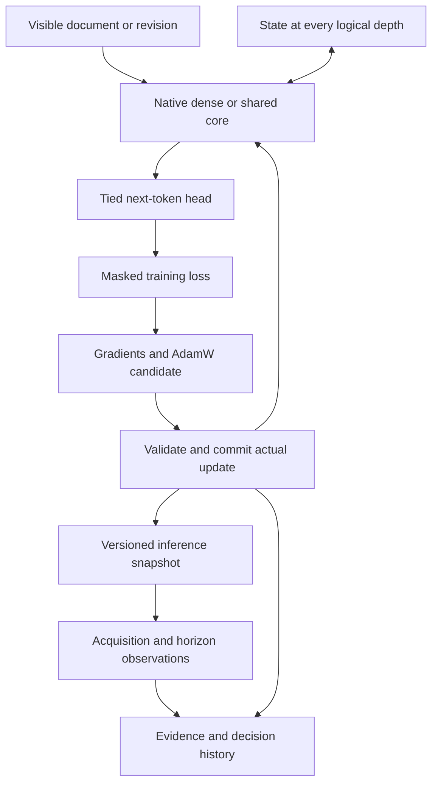
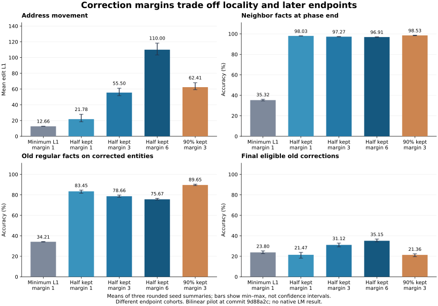

# Nano LM — Architecture, Theory and Decision Ledger V4

**Review date:** November 21, 2026, America/New_York. **Status:** research architecture with tiny native training, controlled-update measurement, current evidence and explicit mathematical limits. Nano LM remains the project; APS remains an unselected hypothesis.

## What V4 delivers

The architecture now has analytical gradients, an optimizer, checkpoint/resume and native update/predict integration at small synthetic scale. The newly completed correction-margin pilot is incorporated with its registered successes and failures. A cumulative-drift theorem explains when an initially correct margin is sufficient for finite-horizon preservation, and why the initial margin alone cannot supply that guarantee.

| Area | V4 outcome | Main artifact |
|---|---|---|
| Native architecture | Dense/shared causal core, tied head, analytical backward, AdamW, immutable snapshots and checkpoints | [Training contract 10](10_TRAINING_AND_CONTROLLED_UPDATE_CONTRACT.md) |
| Controlled updates | Common event manifests, independent replay randomness, individual acquisition, phase-end survival, revision censoring and complete horizon denominators | [Measurement code](experiments/correction_protocol.py) |
| Integrated fixture | Native predictions and actual weight updates connected to the event instrument, with state and exposure receipts | [Native bridge](experiments/native_correction_smoke.py) |
| New empirical evidence | Five margin arms, three reused seeds, exact finite M1–M4 verdicts | [Results and theory 11](11_MARGIN_RESULTS_AND_DURABILITY_THEORY.md) |
| Theory | Joint address/readout drift, cumulative sufficient bound, necessity counterexamples and explicit native-model limits | [11](11_MARGIN_RESULTS_AND_DURABILITY_THEORY.md), [01](01_ARCHITECTURE_AND_THEOREMS.md) |
| Decision history | 54 stable human IDs; 36 machine events covering31 decisions; the complete V3 event prefix is preserved | [Ledger 02](02_DECISION_LEDGER.md) |
| Research attribution | 40 primary identities with source-specific reading-depth and claim boundaries | [Evidence 04](04_EVIDENCE_AND_REFERENCES.md), [audit 08](08_LITERATURE_AUDIT.md) |
| Verification | Source arithmetic, gradients, mutation/corruption cases, cohort oracle, native integration and historical preservation | [Validation 06](06_VALIDATION_AND_UNRESOLVED_WORK.md) |

Tiny synthetic training is now executed. No new corpus-scale, GPU/TPU, held-out language or architecture-superiority result is claimed. The upstream margin pilot was reanalysed from committed results; its original model was not retrained here.

## Architecture at a glance

The causal learned core and native next-token head remain the model interface. Training produces a new parameter version; inference uses an independent fixed snapshot. Shared blocks accumulate gradients from every use and retain separate activation/KV state at each logical depth. The exact-store comparator remains a separately costed augmented-system option.

For the illustrative vocabulary32,768, width256, four heads and SwiGLU width768, the unchanged exact count is

\[
P=Vd+U(4d^2+3df+2d)+d,
\]

where U is the number of unique blocks. Eight unique blocks at eight logical layers contain15,208,704 parameters; four unique blocks reused over the same eight layers contain11,798,784. Both have eight logical KV caches. Parameter sharing does not halve execution depth, attention work or KV storage. These illustrative configurations are not recovered trained checkpoints; executable fixtures use much smaller dimensions.

## The most consequential new result

| Arm | Mean successful-write L1 | Neighbor accuracy at phase end | Old regular accuracy | Final eligible old-correction accuracy |
|---|---:|---:|---:|---:|
| Minimum L1, margin1 |12.66|35.32%|34.21%|23.80%|
| Capped-half preservation, margin1 |21.78|98.03%|83.45%|21.47%|
| Capped-half preservation, margin3 |55.50|97.27%|78.66%|31.12%|
| Capped-half preservation, margin6 |110.00|96.91%|75.67%|35.15%|
|90% preservation, margin3 |62.41|98.53%|89.65%|21.36%|

The registered60% correction-retention target and93% old-regular target were missed. Increasing initial margin helped one endpoint while harming another. The source's capped-half threshold is min(1,0.5×current top-two gap); see11 for exact definitions and conditional denominators.

The source's “corrected now” field is measured after all writes in the phase. Later writes can undo earlier successful writes. V4 consequently separates per-write acquisition, phase-end survival and later learning horizons. The available historical summaries cannot identify which errors came from later-write interference or numerical residuals.

## What the training checks show

Dense and shared versions learn a fixed cyclic-token training fixture: cross-entropy falls from2.086440 to0.004251 and from2.088624 to0.008330 after60steps. Analytical gradients agree with62 finite-difference directions over31 named tensors; maximum absolute directional discrepancy is6.8032e-9. These are engineering checks on repeated training examples, with no held-out generalization or speed conclusion.

Independent review repaired both between-tensor and within-tensor storage aliasing, which could make displacement receipts false, plus an overflowing diagnostic norm that previously threatened atomic rejection. Current storage, checkpoint and numerical boundaries are explicit in10 and the independent review notes.

## Reading map

| Need | File |
|---|---|
| Full candidate architecture and scoped proofs | [01_ARCHITECTURE_AND_THEOREMS.md](01_ARCHITECTURE_AND_THEOREMS.md) |
| Decisions, reasons, alternatives and revision history | [02_DECISION_LEDGER.md](02_DECISION_LEDGER.md) |
| Ordered experiments and resource/data gates | [03_EXPERIMENTS_AND_EXECUTION.md](03_EXPERIMENTS_AND_EXECUTION.md) |
| Repository evidence and40-source bibliography | [04_EVIDENCE_AND_REFERENCES.md](04_EVIDENCE_AND_REFERENCES.md) |
| F-01–F-39 gap and correction register | [05_GAP_CLOSURE_AND_FORMAL_REVIEW.md](05_GAP_CLOSURE_AND_FORMAL_REVIEW.md) |
| Executed receipts and unresolved research | [06_VALIDATION_AND_UNRESOLVED_WORK.md](06_VALIDATION_AND_UNRESOLVED_WORK.md) |
| Unchanged forward tensors, caches and costs | [07_IMPLEMENTATION_CONTRACT.md](07_IMPLEMENTATION_CONTRACT.md) |
| Source inspection depth and attribution limits | [08_LITERATURE_AUDIT.md](08_LITERATURE_AUDIT.md) |
| Earlier completed store/correction pilots and control defect | [09_EVIDENCE_REFRESH_AND_PROTOCOL_REPAIRS.md](09_EVIDENCE_REFRESH_AND_PROTOCOL_REPAIRS.md) |
| Gradients, optimizer, checkpoints and event instrument | [10_TRAINING_AND_CONTROLLED_UPDATE_CONTRACT.md](10_TRAINING_AND_CONTROLLED_UPDATE_CONTRACT.md) |
| New margin evidence and cumulative-drift theorem | [11_MARGIN_RESULTS_AND_DURABILITY_THEORY.md](11_MARGIN_RESULTS_AND_DURABILITY_THEORY.md) |
| Source identities and frozen copies | [source_manifest.json](evidence/source_manifest.json) |
| Machine decision history | [ledger_events.jsonl](ledger_events.jsonl), [schema](ledger_event.schema.json), [original pin](ledger_history.json) |
| Independent reviews | [Review directory](reviews/) |

## Reproduction and evidence boundaries

Use Python3 with [checks/requirements-checks.txt](checks/requirements-checks.txt). NumPy and jsonschema cover core checks; SciPy executes the preserved LP counterexample. Matplotlib is only needed for chart regeneration. Run the commands in06 from this directory. Defaults print results and leave package files unchanged; explicit output paths use exclusive creation.

The final V4 receipt records commands, runtime versions, source hashes and exact comparison against the full V3 ledger and historical results. A local digest verifies bytes; it does not authenticate an author or prove a scientific claim. The original ten-event pin remains unchanged, and the full27-event V3 prefix is separately checked. Old receipts retain their historical counts and scopes.

## Remaining research gates

| Question | Evidence that would resolve it |
|---|---|
| Durable useful learning | Fresh-seed native acquisition, paired horizon curves, new-learning and unrelated-quality guardrails |
| Useful representation migration | Learned mapping and all-state migration beat frozen/replay controls after total cost |
| Forward transfer | Held-out task-family learning curves beyond context/retrieval and equal-experience advantages |
| Efficient native model | Same-byte held-out quality with valid isolated timing, memory, energy and preprocessing accounting |
| Scale readiness | Identified data rights/checkpoints, measured kernels and a concrete authorized experiment |

The current source cutoff is9d88a2c20233f42b4a49c4430264b20f842895ad. Newly committed TPU infrastructure is preserved, but no completed nested/native TPU result appears in the inspected compare. The existing research PR remains draft and unmerged.
