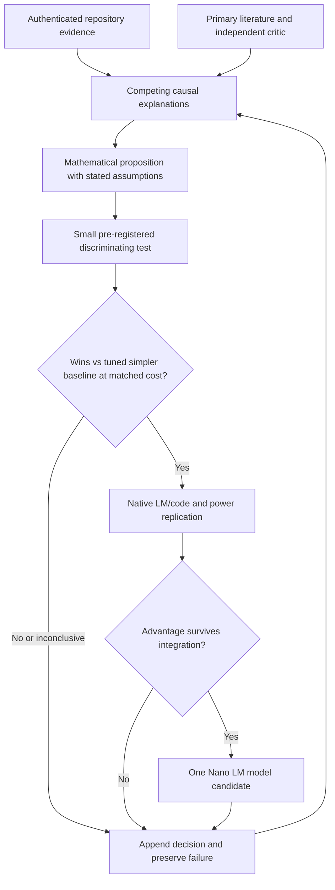
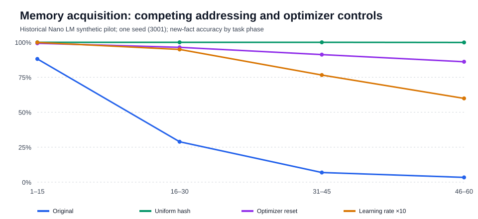

# Nano LM — Unified Architecture, Theory, Evidence and Decision Ledger (V2)

**Snapshot:** November 21, 2026. **Status:** reviewed mathematical candidate and empirical research program; not a selected architecture or approved scale run. **Native scientific objective:** one competitively capable Nano LM language/code/reasoning model that delivers greater verified quality per training resource, inference joule, memory traffic and cost. Novelty is useful only if it produces a verified advantage. **Existing canonical ledger:** `research/frontier/ontogenesis/LEDGER.md`; this package is a *reviewable supplement* and must not erase its history.

## High-level outcome of the review

| Question | Decision / latest evidence | What remains unresolved |
|---|---|---|
| Which neural architecture wins? | None. Dense D0 is reference; published hybrid H1, loop R1, APS hypothesis A1 and unexpected X0 compete | Held-out native-language/compute comparison |
| What is the strongest actual anomaly? | In a **one-seed toy** memory pilot, uniform hashing gave 99.9% late acquisition, optimizer reset 86.1%, versus 3.4% original | Address × optimizer causal factorial, diverse streams, real text |
| What caused earlier regular-fact loss? | **Corrections** reduced old regular fact retention to ~91%; exception-only ~99.6–99.7% | Adam history versus missing entity replay; transfer to real LMs |
| What did the non-oracle write router achieve? | Three-seed toy inference 81.4% vs baseline 77.6%; oracle 88.9% | Rule change versus exception/label noise; forward transfer |
| What do mathematical propositions guarantee? | Known invertible representation conjugacy, bounded approximate logits, local first-order protection, exact independent storage lower bound, deterministic versioning, myopic compute threshold | No proof these mechanisms can be efficiently **learned** or beat dense/hybrid |
| What was fixed in v2? | 18 gap-closure items, corrected theorem scope, one source table, machine event ledger, reusable read-only checks | Confirmatory model experiments and broader paper/implementation audits |

## Files (read in order)

| File | Contains | Status |
|---|---|---|
| [01 Architecture and Theorems](01_ARCHITECTURE_AND_THEOREMS.md) | Candidate causal model, mathematical derivations, counterexamples, Mermaid scheme, safe interpretation | Corrected, **candidate** |
| [02 Decision Ledger](02_DECISION_LEDGER.md) | D-001–D-033, evidence/status tables, reversals, reasons and review rules | Append-only supplement |
| [03 Experiments and Execution](03_EXPERIMENTS_AND_EXECUTION.md) | G00–G17 experiment matrix, G02 causal design, G05 transport, training/budget gates, manifest template | Proposed, no new GPU run |
| [04 Evidence and References](04_EVIDENCE_AND_REFERENCES.md) | Repository provenance, literature references with checked identity/scope and uncertainties | Metadata/abstract check, not replication |
| [05 V2 Gap Closure and Formal Review](05_GAP_CLOSURE_AND_FORMAL_REVIEW.md) | F-01–F-18 corrections, proof revisions, exact interface, prior-art contrasts, open blockers | **V2 interpretive authority** |
| [Machine ledger events](ledger_events.jsonl) | Immutable events D-024–D-033 with rationales, alternatives and next gates | Machine-validated supplement |
| [Event schema](ledger_event.schema.json) | Required fields and legal evidence/status values | JSON Schema draft 2020-12 |
| [Package checks](checks/validate_research_package.py) | Ledger and Markdown-link verification | Read-only check |
| [Formal examples](checks/formal_sanity.py) | 5 deterministic tests of *conditional* properties, optional `--out` | Read-only default |
| [Stdlib properties and counterexamples](checks/repo_lightweight_checks.py) | No external dependencies, extra bounded-logit/nonlinear/multi-step checks | Read-only default |
| [Transport synthetic pilot](checks/transport_anchor_pilot.py) | Constructed 16D five-seed rank-identifiability demonstration, `--out` opt-in | Toy only, not LM |
| [Existing results](results/) | Historical check JSON and five-seed synthetic output, plus v2 validation outputs | Preserve historical measurements |
| [Figures](figures/) | Prior one-seed address diagnostic; five-seed synthetic anchor chart | Descriptive only |
| [V2 verification and open-work report](06_VALIDATION_AND_UNRESOLVED_WORK.md) | Check results, failed paths, what remains experimental and unverified | Reviewable, not a model-performance proof |
| [Editable architecture diagram](architecture_scheme.mmd) | Mermaid, competing components and explicit augmented boundary | Candidate, not final model |

## Evidence-to-design diagram

## Numerical evidence reproduced as a table

The following values are **from the existing repo's one-seed** `INVESTIGATION.md` Question 7, not from new runs or a generalizable language model.

| Task phases | Original addresses | Uniform hash | Adam-state reset | Original, LR×10 |
|---|---:|---:|---:|---:|
| 1–15 | 88.1% | 100.0% | 99.3% | 99.9% |
| 16–30 | 28.9% | 100.0% | 96.4% | 94.9% |
| 31–45 | 6.9% | 100.0% | 91.2% | 76.6% |
| 46–60 | 3.4% | 99.9% | 86.1% | 59.9% |

A separate **constructed** 16-dimensional linear teacher and orthogonal hidden-basis shift yielded five-seed average class agreement 21.0% without correction; pseudoinverse estimated from 4, 8, 12, 16 independent paired anchors yielded 46.8%, 59.8%, 73.4%, 100%. A known inverse also reached 100%. This shows general linear-map identification under the construction, **not** efficient learned LM memory, retention or self-improvement.

## Reproduction and safety

Run the checks from an extracted copy using `python checks/repo_lightweight_checks.py`, `python checks/formal_sanity.py`, `python checks/transport_anchor_pilot.py`, and `python checks/validate_research_package.py`. By default they only print and **do not write** to packaged result paths. To save new data, pass `--out /path/to/new-file.json`; output already present is never overwritten by default. No new GPU/TPU training or external paid service was authorized or executed for this revision.

**Precedence:** raw source experiments and preregistered protocols > later documented independent corrections > 05 formal/caveat review > 01 candidate design and 02 supplemental ledger > older narrative summaries. If a new experiment contradicts this package, append a superseding decision rather than rewriting original evidence.
