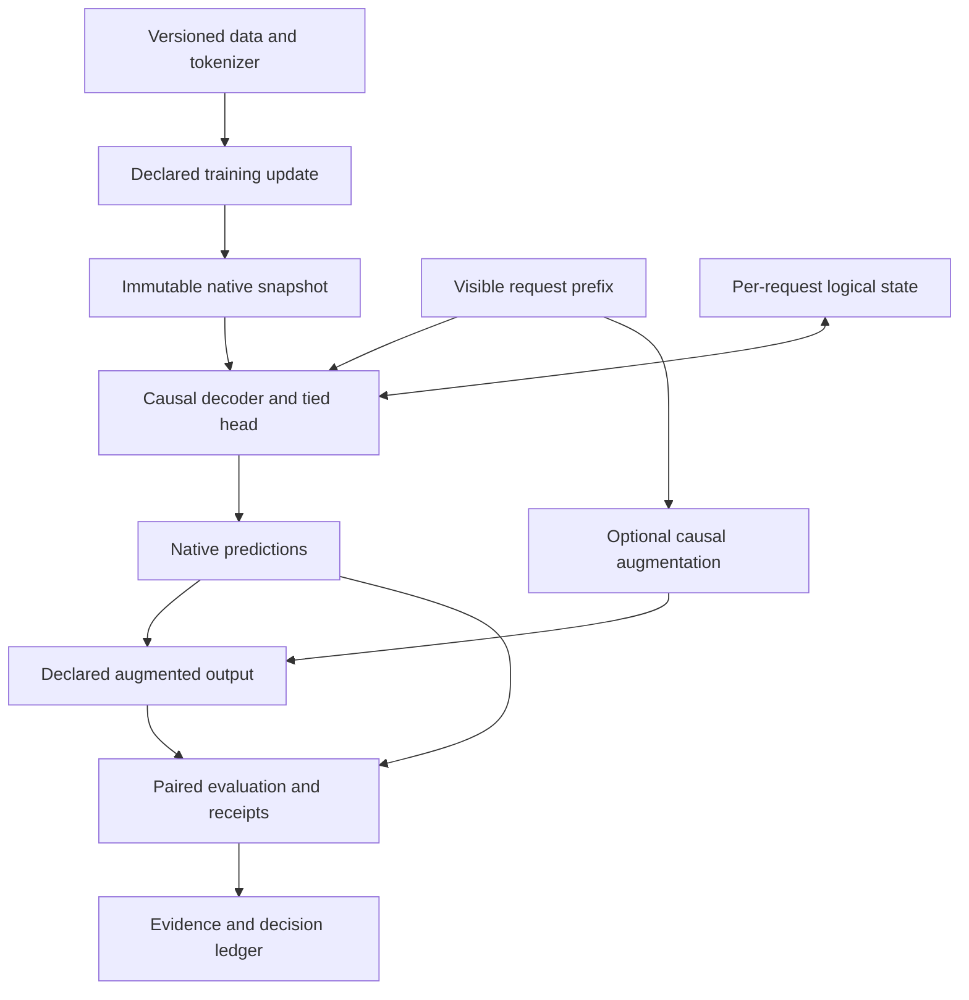

# Nano LM V6 — Full Architecture, Theory and Decision Ledger

**Review date:** November 23, 2026, America/New_York. **Status:** research architecture, source audit and executable measurement release. No new learned checkpoint was trained or scored in this continuation. Nano LM remains the project; APS/AETHER remain unselected hypotheses.

## Start with the complete architecture

**[00_FULL_ARCHITECTURE.md](00_FULL_ARCHITECTURE.md)** contains the whole current design: goals, exact native model, interfaces, training, optimizer/checkpoint contracts, state ownership, optional mechanisms, theoretical propositions, evaluation, resource accounting and adoption gates.

It distinguishes the reported 386M language model from the small NumPy correctness reference and optional research mechanisms. The current evidence does not select an overall superior backbone.

| Read next | Purpose |
|---|---|
| [Decision ledger](02_DECISION_LEDGER.md) | Decisions, reasons, alternatives and reopening conditions; current V6 section K |
| [Native baseline and research update](15_NATIVE_BASELINE_AND_RESEARCH_UPDATE.md) | 386M recipe, seven tasks, shared depth, transfer, hardware and memory stopping decisions |
| [Generative reasoning evaluation](16_GENERATIVE_REASONING_EVALUATION.md) | New direct/two-hop counterfactual instrument and exact scoring contract |
| [Correction measurement and protection](17_CORRECTION_MEASUREMENT_AND_PROTECTION.md) | Temporal scorer repair, corrected G04/G06 results and proof boundaries |
| [Execution plan](03_EXPERIMENTS_AND_EXECUTION.md) | Ordered remaining dependencies and native-model experiments |
| [Validation](06_VALIDATION_AND_UNRESOLVED_WORK.md) | Actual checks, preservation and unresolved science |
| [References](04_EVIDENCE_AND_REFERENCES.md) | 48 primary identities with reading-depth qualifications |

## What changed

| Area | Current result | Meaning |
|---|---|---|
| Full architecture | Dedicated standalone design | One directly accessible entry point |
| Native baseline | Reported 386,062,080 parameters; 7,698,841,600 token presentations; sampled mixed BPB 0.8049 | Stronger native reference, audited from exact sources rather than rerun here |
| Benchmarks | Correct total 22,348; tokenizer/context limitations retained | Reporting corrected without changing raw scores |
| Shared depth | Whole-block contrast 4/5 versus 0/5; single-layer 2/5 versus 1/5 | Registered combined verdict stays mixed |
| Transfer | Dense replay retains 100% but gets 2.78% on new combinations | No useful transfer under the tested procedure; no impossibility proof |
| Generation instrument | 96 worlds / 480 records, counterfactual and absence controls | Learned-model result NOT_RUN |
| Code review | Three defects found after initial 27 tests passed; repaired version passes 31 focused and 21 independent checks | Dataset identity, stopping and token-buffer contracts strengthened |
| Temporal repair | 20 checks including 1,350 small-history plans | Early adaptation and final truth now have separate reference endpoints |
| Protection theory | Finite-alpha operator is soft attenuation; address invariance needs evidence | Scoped assumptions replace overbroad invariance claims |
| History | 73 human IDs; 58 events covering 50 IDs; all 27 V5 result files preserved | New interpretations retain earlier evidence |

The symbolic facts parser solves 64/64 evaluation A/B pairs; always-UNKNOWN and constant controls solve 0/64. First/last-value shortcuts solve 7/64 and 5/64. These are **instrument controls**, not Nano LM scores. Actual tokenizer eligibility and corpus contamination remain **NOT_CHECKED**.

## Architecture and proof boundary



The reported native baseline uses width 1,280, 20 distinct layers, 20 query heads, 4 KV heads, head dimension 64, FFN width 3,456 and vocabulary 32,768. Its source inventory includes Q/K normalization gains. The small reference has a separate dense/shared implementation; weight sharing does not remove logical computation or cache ownership.

Conditional proofs cover causality, coherent transport, margins, actual-displacement protection, finite-horizon drift, finite storage, counterfactual context dependence and a specified L1 edit trade-off. No theorem proves architecture superiority, useful learned migration or unlimited retention.

## Evidence and preservation

The main source cutoff is `3a38b5f1529a718838b5bc83a010574bfa9a4c6e`; G04/G06 draft cuts remain explicit. The V6 collection has **231 exact copies across 217 distinct commit/path identities**. Overlapping copies are not independent experiments. [Source manifest](evidence/source_manifest_v6.json)

G04's corrected narrow-router N4/N5 claims fail. Later cooldown policies have separate favorable mean predicates and revision trade-offs. The remaining historical-target defect affects `revise_next5/10`, not the audited N/K/Q gates that use other fields. V6's reference repair does not invent missing historical predictions.

G06's corrected localized protection retains strong bilinear results. Finite-alpha filtering is full rank, and normalized trace is mean attenuation. Fixed old-address behavior is neither enforced nor logged; its actual effect remains unmeasured. This qualification does not declare the retention scores false.

The 101M LDO store complement and 40M cache line now meet scoped numerical stopping branches. A new D-058 event supersedes the old pending status. Broader memory and joint-training questions remain open; the historical invalid 0.62 cache result stays excluded.

The branch owner relocated this workstream to `LEDGER-FIRST-PRINCIPLES.md`. V6 appends to its complete current prefix and leaves the shared `LEDGER.md` unchanged. All 46 V5 machine events, 27 old result files and existing scientific code are preserved. The initial generation source/receipt remains alongside its repaired successor. The 23 historical human-only IDs receive no invented machine provenance.

## Verification

From the architecture directory:

```bash
python -B analysis/validate_release_v6.py
```

The read-only default performs bounded current checks, independent adversarial review, source/result reconciliation and preservation gates. `--out` creates a new receipt exclusively. It does not train a model or replay every historical experiment. Reproduce the full V5 gate from its published commit, whose ledger-path assumptions preceded the later relocation.

Current receipt: [validation_v6_final.json](results/validation_v6_final.json). Hashes check byte identity, not scientific truth or backend authenticity.

## Remaining work

The next dependency is a real native adapter binding checkpoint, tokenizer, configuration and greedy decoder, verifying output-token semantics and executing the frozen evaluation. Then come a tuned native dense/shared comparison, longer revision horizons, calibrated new-family transfer and measured resource frontiers. Training and architecture adoption remain separate decisions. **PR #195 stays draft and unmerged.**

Historical chapters 01 and 07–14 retain the earlier architecture, exact forward/training contracts, source reviews, margin/optimizer theory, causal memory and unchanged V5 native-update experiment. Chapter 05 adds F-55–F-66 dispositions; chapter 08 retains the source-by-source literature audit. The complete package includes their source, code, results and review history.
