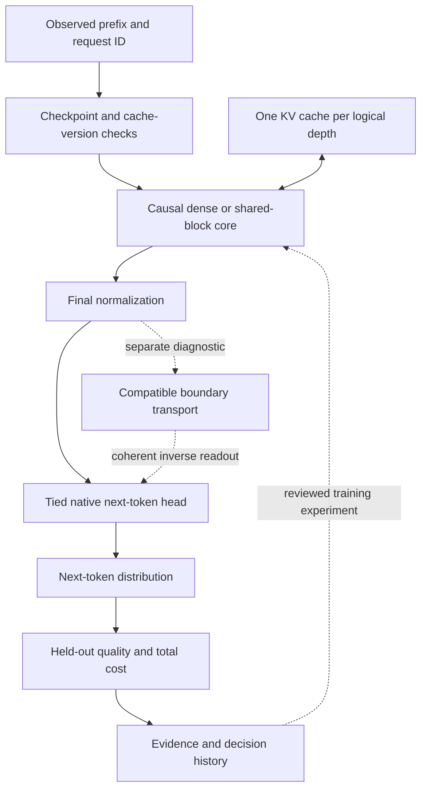
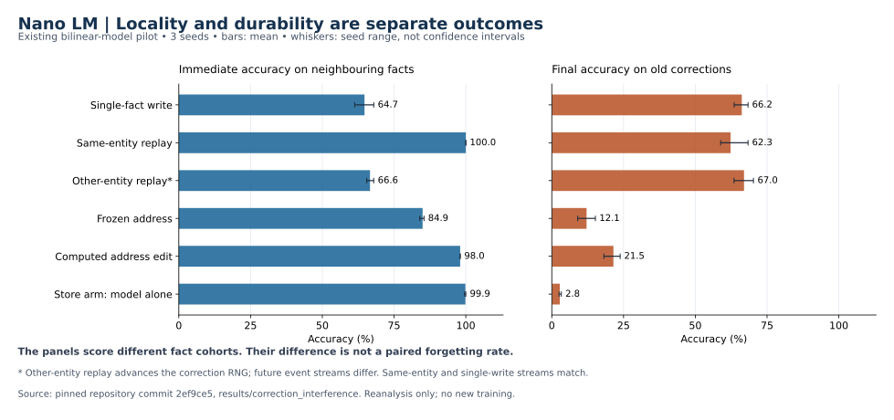

# Nano LM — Architecture, Theory and Decision Ledger V3

**Review date:** November 21, 2026 (America/New_York). **Status:** research architecture with an executable forward reference, corrected proofs, current evidence and a maintainable decision history. Nano LM remains the project; APS remains an unselected research hypothesis.

## What changed and why it matters

This revision makes the architecture concrete enough to inspect and execute at tiny scale. It also catches a new experimental-control defect, incorporates results that were missing from V2, and repairs the ledger so it can record later decisions without erasing earlier ones. It establishes no new language-model quality win.

| Area | V3 outcome | Evidence or artifact |
|---|---|---|
| Full architecture | Explicit tensors, causal masks, logical-depth KV caches, RMSNorm/RoPE, tied output, loss and reset rules | [Implementation contract 07](07_IMPLEMENTATION_CONTRACT.md), [NumPy reference](prototype/native_reference.py) |
| Theory | Functional versus parameter equivalence; actual optimizer displacement; bitemporal history; finite candidate claims and budgeted stopping | [Architecture and proofs 01](01_ARCHITECTURE_AND_THEOREMS.md) |
| Current experiments | Completed store and correction pilots incorporated at immutable repository revisions | [Evidence refresh 09](09_EVIDENCE_REFRESH_AND_PROTOCOL_REPAIRS.md), [source manifest](evidence/source_manifest.json) |
| Newly detected control defect | Random replay changes future correction draws in 38 of 39 correction phases for each of three seeds | [Reanalysis output](results/repository_reanalysis_v3.json), [independent review](reviews/reanalysis_independent_review.md) |
| Decision history | 46 stable human decision IDs; 27 machine events covering 23 decisions; older 23 human decisions preserved without invented metadata | [Decision ledger 02](02_DECISION_LEDGER.md), [event log](ledger_events.jsonl) |
| Literature | 36 primary-source identities and narrow claim boundaries audited; supervision/plugin dependencies explicit | [Audit 08](08_LITERATURE_AUDIT.md) |
| Verification | Executed mathematical examples, corruption tests, causal-reference checks and source diagnostics with recorded scope | [Validation report 06](06_VALIDATION_AND_UNRESOLVED_WORK.md) |
| Next research step | G03b: correct locality and durability comparison on identical event manifests; G02 factorial remains independent | [Execution plan 03](03_EXPERIMENTS_AND_EXECUTION.md) |

## Architecture at a glance

The reference has one causal learned core and one next-token head. Dense and shared-block configurations implement the same interface. Sharing parameters leaves separate activation caches at every executed depth. Optional transport and adaptive-compute experiments must preserve this causal interface and carry their own costs.



The arrows from research decisions do not imply online weight updates. Weights remain fixed in the default inference contract. An exact external store belongs in a separately measured augmented-system arm.

### Exact illustrative parameter inventory

For vocabulary 32,768, width 256, four attention heads and SwiGLU hidden width 768, the count is

\[
P=Vd+U(4d^2+3df+2d)+d,
\]

where `U` is the number of **unique** blocks. Logical execution depth is a separate quantity.

| Configuration | Unique blocks | Logical depth | Parameters | Logical KV caches |
|---|---:|---:|---:|---:|
| Dense reference |8|8|15,208,704|8|
| Four shared blocks executed twice |4|8|11,798,784|8|

These are exact counts for the new proposed configuration, not a recovered trained checkpoint. The existing store pilot used a different 14.3M configuration. The new NumPy implementation runs at tiny dimensions to check semantics. Shared weights save parameter storage here; they do not halve executed layers, attention work or KV storage. This is a same-logical-depth comparison, not a same-parameter comparison.

## Most consequential empirical update

The existing three-seed bilinear-model study separates local edit behavior from later retention:

| Arm | Correction right immediately | Neighbouring fact accuracy immediately | Old correction accuracy at final evaluation |
|---|---:|---:|---:|
| Single-fact write |100.00%|64.70%|66.20%|
| Same-entity replay |100.00%|100.00%|62.28%|
| Computed address edit |99.84%|98.03%|21.47%|

The table is a reanalysis of existing results. Its columns use different cohorts, so subtracting them does not produce a paired forgetting rate. The old random-replay arm has an additional stream-pairing defect. Details, seed ranges, solver limitations and the revised event-level protocol are in 09.



The language-model store pilot is also complete: post-hoc mixing improved weighted BPB by 0.0581, while joint training was 0.1435 BPB worse than post-hoc mixing. The store consumed 1,022,224,980 bytes. This is a one-seed system observation; crowded-machine wall times are unusable for efficiency claims. A document-excluded training control remains necessary before rejecting the broad routing principle.

## Reading map

| Need | File |
|---|---|
| Mathematical model, assumptions, proof and counterexample | [01_ARCHITECTURE_AND_THEOREMS.md](01_ARCHITECTURE_AND_THEOREMS.md) |
| Decisions, reasons, alternatives, current status and history | [02_DECISION_LEDGER.md](02_DECISION_LEDGER.md) |
| Ordered research plan, G00–G17 and G03b successor | [03_EXPERIMENTS_AND_EXECUTION.md](03_EXPERIMENTS_AND_EXECUTION.md) |
| Repository evidence and bibliography | [04_EVIDENCE_AND_REFERENCES.md](04_EVIDENCE_AND_REFERENCES.md) |
| V2 findings F-01–F-18 and V3 repairs F-19–F-30 | [05_GAP_CLOSURE_AND_FORMAL_REVIEW.md](05_GAP_CLOSURE_AND_FORMAL_REVIEW.md) |
| Actual checks, risks, reproducibility and remaining work | [06_VALIDATION_AND_UNRESOLVED_WORK.md](06_VALIDATION_AND_UNRESOLVED_WORK.md) |
| Concrete forward architecture, tensors, memory and cost | [07_IMPLEMENTATION_CONTRACT.md](07_IMPLEMENTATION_CONTRACT.md) |
| 36-source inspection register and methodological boundaries | [08_LITERATURE_AUDIT.md](08_LITERATURE_AUDIT.md) |
| New results, reanalysis, RNG/solver/cohort findings | [09_EVIDENCE_REFRESH_AND_PROTOCOL_REPAIRS.md](09_EVIDENCE_REFRESH_AND_PROTOCOL_REPAIRS.md) |
| Historical records and new event semantics | [ledger_events.jsonl](ledger_events.jsonl), [schema](ledger_event.schema.json), [legacy pin](ledger_history.json) |
| Independent audit notes | [Formal review](reviews/formal_audit.md), [ledger review](reviews/ledger_audit.md), [reanalysis review](reviews/reanalysis_independent_review.md), [reference-code review](reviews/native_reference_review.md) |

## Reproduction

Use Python 3 with NumPy and the dependencies in [checks/requirements-checks.txt](checks/requirements-checks.txt). Matplotlib is needed only to regenerate the optional chart. The forward reference and mathematical checks are unoptimized CPU diagnostics. Run from this directory:

```bash
python3 -B checks/repo_lightweight_checks.py
python3 -B checks/formal_sanity.py
python3 -B checks/transport_anchor_pilot.py
python3 -B checks/test_research_package.py
python3 -B prototype/test_native_reference.py
python3 -B analysis/reconcile_repository_evidence.py
python3 -B checks/validate_research_package.py
```

To verify a ledger update against the complete prior history, add `--baseline-ledger /absolute/path/to/previous-ledger.jsonl` to the validator. The permanent legacy pin protects the original ten events; full-history comparison requires the previous Git version as input. Default checks print results. Where offered, `--out NEW_PATH.json` uses exclusive creation and refuses an existing file.

[Historical numerical results](results/formal_sanity_20261121.json) and the [original transport result](results/transport_anchor_pilot_v0.json) are preserved. The newly recorded receipts in 06 identify their executed code and scope. The earlier V2 package-level PASS claim was not reproducible from its initial committed validator; the historical defect and the repaired checks are disclosed in 06.

## Remaining gates

| Gap | What would actually close it |
|---|---|
| Correct gradients and training implementation | Autodiff/reference agreement, optimizer/checkpoint tests and a finite native training run |
| Useful learned representation migration | Old/new learning benefit on evolving native features, above freezing/replay after every migration cost |
| Durable correction | Same-event horizon curves, no future-label leakage, proper supersession and independent fresh seeds |
| Positive forward transfer | Held-out task-family learning curves beyond context/retrieval advantages and equal-experience controls |
| Efficient language model | Same-byte held-out quality, valid isolated timing, full memory and measured energy |
| Scale readiness | Data rights/checkpoint identities, measured kernels/throughput and experiment-scoped resource authorization |

The updated package closes concrete specification, logic, evidence-tracking and diagnostic defects. These remaining questions require training or external evidence. The existing research PR remains the review destination; model selection and promotion depend on those results.

### Integration cutoff

A final source refresh at `8d3b03e08a5c14d2e9ab330ac8d5006e87e61613` adds a registered correction-margin follow-up and revised nested-protocol device plan. No result from either is included at that cutoff. See [09, late source refresh](09_EVIDENCE_REFRESH_AND_PROTOCOL_REPAIRS.md#7-late-source-refresh-and-fixed-integration-cutoff). The completed-pilot reanalysis remains pinned to `2ef9ce5…`.
