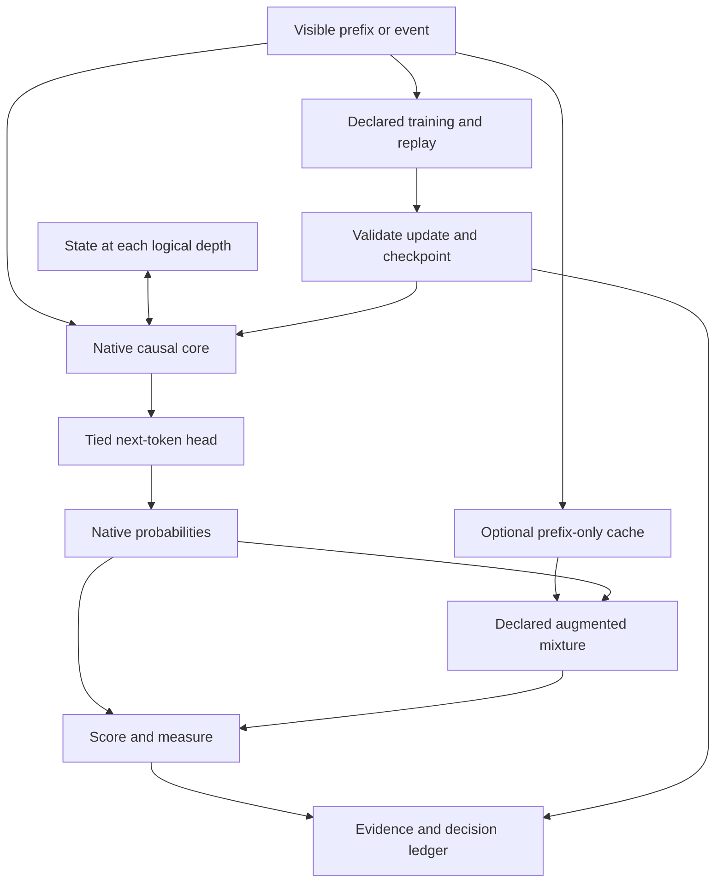

# Nano LM — Architecture, Theory and Decision Ledger V5

**Review date:** November 21, 2026, America/New_York. **Status:** executable research architecture with scoped proofs, source-audited evidence, a causal cache reference and a completed tiny native update comparison. Nano LM remains the project. APS/AETHER remain unselected hypotheses.

## What V5 changes

V5 strengthens the implemented architecture and the evidence behind its decisions. It reconciles a five-seed optimizer factorial, identifies a correction deployment ambiguity, repairs a theoretical tie claim, audits the latest store/cache work and executes a paired native comparison. The new run has mixed outcomes: replay helps some secondary endpoints while lowering the mean of the chosen correction-horizon endpoint.

| Area | Current outcome | Evidence |
|---|---|---|
| Native core | Dense/shared causal model, tied head, analytical backward, AdamW, versioned checkpoints; existing implementation preserved | [Architecture01](01_ARCHITECTURE_AND_THEOREMS.md), [training10](10_TRAINING_AND_CONTROLLED_UPDATE_CONTRACT.md) |
| Native update comparison | Three fixed seeds, four arms cloned from common weights and Adam state; all outcomes and costs recorded | [Results14](14_NATIVE_UPDATE_COMPARISON.md) |
| Optimizer factorial | Reset helps substantially, but F3/F6 fail and F5 is intermediate; no unique causal decomposition | [Evidence12](12_OPTIMIZER_FACTORIAL_AND_UPDATE_GEOMETRY.md) |
| Edit theory | Exact L1 protection trade-off and all target-only minimizers; tie is not universally an argmax error | [Proof12](12_OPTIMIZER_FACTORIAL_AND_UPDATE_GEOMETRY.md) |
| Store/cache | Small reported store gain is qualified; invalid control/cache results stay excluded; the40M cache meets a qualified numerical stopping branch;101M store remains pending | [Audit13](13_CAUSAL_MEMORY_AND_RESOURCE_FRONTIER.md) |
| Causal comparator | Explicit document/crop reset, prefix-only prediction, score-before-observe, stable positive mixture | [Implementation](prototype/causal_ngram_cache.py), [review](reviews/causal_cache_review.md) |
| Decision history |62 human IDs;46 events covering39 decisions; all previous prefixes and17 old results retained | [Ledger02](02_DECISION_LEDGER.md) |
| Provenance |90 exact source copies across core and late manifests, and43 primary-source identities with reading-depth limits | [Source manifest](evidence/source_manifest_v5.json), [references04](04_EVIDENCE_AND_REFERENCES.md) |
| Verification |24-group release gate covering old and new contracts, exact saved-output comparisons and history preservation | [Validation06](06_VALIDATION_AND_UNRESOLVED_WORK.md) |

This continuation executes bounded CPU synthetic work. It does not execute new corpus-scale/GPU/TPU training, claim useful native language quality, or adopt a new architecture.

## The new native result

The fixture uses840 learned scalars, width8, one block shared over two logical depths and a full22-token native head. Each arm starts from the same learned model and optimizer state. “Matched” below means the same number of optimizer calls and scored targets, not measured FLOPs, time or energy.

| Arm | Post-prefix updates per seed | Primary correction H1 | Immediate new-fact acquisition | Final current observed facts |
|---|---:|---:|---:|---:|
| Current only |72|51.32%|29.17%|36.90%|
| Replay within fixed total |72|44.71%|37.50%|40.48%|
| Additional replay |108|43.65%|40.28%|42.86%|
| Frozen common checkpoint |0|22.22%|8.33%|15.48%|

The entries are equal-seed means. There are only6,7 and9 eligible H1 revisions in the three worlds; all failed acquisitions remain in those denominators. Both replay arms improve H1 in one seed and reduce it in two. The additional-replay arm spends50% more post-prefix updates. Horizons10 and20 have no eligible events and remain undefined.

The main run contains876 optimizer calls and1,236 scored target presentations, excluding validation reruns. The recipe was locally frozen before first execution; this is not independent prior Git preregistration. The full8,453,400-byte receipt is [losslessly stored as gzip JSON](results/native_update_comparison_v5.json.gz); the [readable summary](results/native_update_comparison_summary_v5.json) preserves all seed/cohort and exposure summaries. Neither the short correction stream nor the random-label negative control establishes language generalization or forward transfer.

## The most consequential source findings

| Question | Revised conclusion |
|---|---|
| Did optimizer reset solve memory acquisition? | Original-address late acquisition rises from2.417% to63.5% across five fresh seeds, but every seed misses70%; hash recipes attain100% in this arbitrary-table task |
| Does “two thirds” identify Adam's share of failure? | The exact62.596% ratio is a conditional descriptive recovery fraction; interactions and representation changes prevent unique causal attribution |
| Do fitted correction candidates certify the deployed entity state? | No. Different selected relations can produce incompatible detached candidates for one row; duplicate-index assignment has no portable ordering guarantee |
| Is a minimum L1 edit necessarily safe or unsafe? | Only relative to specified outputs/metric. In the reviewed2D example, all minimum edits lose strict protected margin, but one is a tie rather than a guaranteed wrong answer |
| Does the store-S gain establish a cost benefit? | No. Reported BPB improves1.1442→1.1398 with1,022,224,980 store-array bytes, unequal prefix information and a baseline mismatch |
| Is the historical0.62 cache result usable now that code changed? | No. It remains invalidated; a valid corrected evaluation would be new evidence |

The factorial and correction results are read-only reanalyses of exact committed inputs. Their neural experiments were not rerun here. The reviewed research source cutoff is0afd5629990b4e442fb3aa8f7c700b030d8faede; the separately audited factorial result is767857e72bfa51e3fa6f32d047507aabef077fde. A bounded late addendum atc597d5fefdd378c3e5c66a51e7690cdb90853287 reviews new S/M cache and M store records. Later unreviewed research belongs to a subsequent evidence update.

### Bounded late store/cache update

New result files appeared before this release closed, so a separate addendum records them without rewriting the core audit. Cache-M reports domain gains0.0012,−0.0003,0.0036 and0.0059BPB, satisfying the registered all-domains-below0.01 stopping branch at the source-derived40,379,904-parameter scale. Its mixed gain is0.0018. Full control clearance is not claimed: the0.0001 baseline discrepancy and missing checkpoint/raw-byte identities remain.

Store-M's mixed gain is−0.0014, a worsening; this does not decide the registered100,684,032-parameter L/approximately101M gate. Cache-S reports mixed gain0.0036. These are new qualified results, not rehabilitation of the old invalidated0.62 claim. [Chapter13§7](13_CAUSAL_MEMORY_AND_RESOURCE_FRONTIER.md#7-late-evidence-addendum-at-c597d5f) and the [five-copy addendum](evidence/source_manifest_v5_addendum.json) preserve the source boundary.

## Architecture and theoretical scope

The native next-token path remains the model interface. Training updates create a new parameter version; inference uses a fixed snapshot. Replay changes training exposure. A causal cache changes an explicitly augmented predictive distribution. Their state, permissions and costs are distinct.

Existing conditional results remain: coherent representation/readout transport can preserve outputs; projected raw gradients do not guarantee protected actual optimizer displacements; finite-bit lossless storage has a scoped counting bound; initial classification margin needs a bound on subsequent drift.

V5 adds a fully specified example. Starting at(2,1), requiring target margin \(y-x\ge3\) costs minimum L1 displacement4. Requiring protected margin \(x-\tfrac25y\ge\mu\), for \(\mu\ge0\), raises the exact minimum to \(4+\tfrac{10}{3}\mu\). At zero protected margin the endpoint(2,5) is tied. The proof neither bounds general nonlinear-model fact capacity nor establishes that old facts must be replayed at every later update.

The causal cache's normalization and prefix-invariance arguments are likewise conditional on correct observed input and resets. Its finite-precision implementation is checked separately, including positive subnormal mixtures. These are useful contracts; no theorem proves the architecture superior to a strong dense baseline.

## Reading map

| Need | File |
|---|---|
| Full architecture, candidate alternatives and scoped proofs | [01_ARCHITECTURE_AND_THEOREMS.md](01_ARCHITECTURE_AND_THEOREMS.md) |
| Decisions, reasons, alternatives, history and current changes | [02_DECISION_LEDGER.md](02_DECISION_LEDGER.md) |
| Ordered experiments and real-data/resource gates | [03_EXPERIMENTS_AND_EXECUTION.md](03_EXPERIMENTS_AND_EXECUTION.md) |
| Repository evidence and43-source bibliography | [04_EVIDENCE_AND_REFERENCES.md](04_EVIDENCE_AND_REFERENCES.md) |
| Historical and current gap register throughF-54 | [05_GAP_CLOSURE_AND_FORMAL_REVIEW.md](05_GAP_CLOSURE_AND_FORMAL_REVIEW.md) |
| Executed checks, reproduction and unresolved science | [06_VALIDATION_AND_UNRESOLVED_WORK.md](06_VALIDATION_AND_UNRESOLVED_WORK.md) |
| Exact forward tensors, caches and parameter costs | [07_IMPLEMENTATION_CONTRACT.md](07_IMPLEMENTATION_CONTRACT.md) |
| Source-by-source inspection depth | [08_LITERATURE_AUDIT.md](08_LITERATURE_AUDIT.md) |
| Earlier pilot results and protocol repairs | [09_EVIDENCE_REFRESH_AND_PROTOCOL_REPAIRS.md](09_EVIDENCE_REFRESH_AND_PROTOCOL_REPAIRS.md) |
| Native gradients, optimizer, checkpoints and correction instrument | [10_TRAINING_AND_CONTROLLED_UPDATE_CONTRACT.md](10_TRAINING_AND_CONTROLLED_UPDATE_CONTRACT.md) |
| Margin pilot and conditional durability bound | [11_MARGIN_RESULTS_AND_DURABILITY_THEORY.md](11_MARGIN_RESULTS_AND_DURABILITY_THEORY.md) |
| Factorial/control evidence and exact edit geometry | [12_OPTIMIZER_FACTORIAL_AND_UPDATE_GEOMETRY.md](12_OPTIMIZER_FACTORIAL_AND_UPDATE_GEOMETRY.md) |
| Causal memory contract, evidence limits and cost frontier | [13_CAUSAL_MEMORY_AND_RESOURCE_FRONTIER.md](13_CAUSAL_MEMORY_AND_RESOURCE_FRONTIER.md) |
| New native comparison, full denominators and mixed results | [14_NATIVE_UPDATE_COMPARISON.md](14_NATIVE_UPDATE_COMPARISON.md) |
| Review notes and machine history | [Reviews](reviews/), [events](ledger_events.jsonl), [schema](ledger_event.schema.json), [original history pin](ledger_history.json) |

## Reproduction and maintenance

The [V5 gate](analysis/validate_release_v5.py) reuses the historical16 command groups and adds8 current groups. It checks source hashes, all90 frozen copies, exact native-output equality, final cache behavior,62 human decision IDs,46 events and39 machine-covered decisions. It compares the full36-event V4 prefix and the latest PR canonical-ledger prefix, including the external43-line contribution, and every one of the17 historical result files. Defaults leave package bytes unchanged; optional output uses exclusive creation.

The final gate receipt is written as results/validation_v5_final.json in the [results directory](results/). It records the observed outcome, environment, command counts and preservation evidence. Older receipts keep their historical counts and scope. A digest proves byte identity against a supplied value; it does not prove author identity or scientific truth.

The ledger is maintained by appending evidence, reversals and next gates. New D-054 and late D-058 events link to their preceding events, and D-055–D-062 record this continuation. The separate contributor's reported44-reference headline check remains attributed and distinct from our43-identity register.

## Remaining scientific gates

| Question | Evidence still required |
|---|---|
| Useful native learning and durable revision | Legitimate held-out language/task data, longer uncensored horizons, tuned controls and fresh seeds |
| Helpful representation migration | Learned compatible mapping and all-state transport beat frozen/replay alternatives after total cost |
| Positive forward transfer | Learnable held-out task families and a history intervention; random labels cannot demonstrate it |
| Beneficial external memory | Corrected equal-prefix evaluation, checkpoint/document/byte identities and measured construction/storage/inference cost |
| Efficient architecture | Verified quality on a feasible latency, energy and memory frontier, with independent repetition |

PR#195 is maintained as draft and unmerged. All earlier results and decisions remain reviewable. The engineering defects addressed here are closed within their tested scope; the research questions above remain open.
