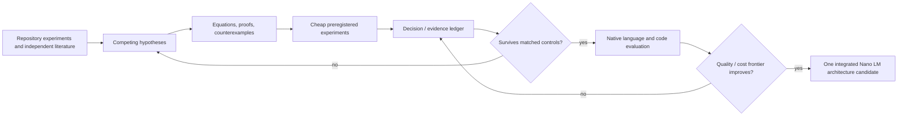

# Nano LM — Research-to-architecture package (2026-11-21)

**One native model as the scientific destination; candidate architecture and narrow mathematical results only; research ledger maintained by explicit evidence updates, not optimistic prose.**

## Quick conclusions

| Question | Current decision | Evidence status |
|---|---|---|
| Which architecture wins? | **Not known**; dense is mandatory reference, hybrids and APS are competing hypotheses | Observed M21 code loss, otherwise incomplete |
| Which finding changed the plan? | Original fixed-address acquisition 3.4% late; hashing 99.9% and Adam-state reset 86.1% | Repository, one-seed pilot |
| What has been proved? | Invertible transport preserves decodes; nullspace protects sampled old logits to first order; exact facts require bits; versioned records answer history; compute routing has threshold | Conditional mathematics, with 5/5 numerical checks |
| What was *not* proved? | No superior language-model architecture, general self-improvement, or true continual learning | Unproven |
| Next decisive research | Address×optimizer and correction/replay factorial, then learned state migration and cross-episode procedural transfer | Planned; not executed here |
| Compute policy | No paid experiment launched or authorized by this package | Verified repository rules |

## Contents

1. [Architecture candidate and mathematical propositions](01_ARCHITECTURE_AND_THEOREMS.md) — diagram, governing equations, five scoped proofs, counterexamples, modern baselines.
2. [Decision and research ledger](02_DECISION_LEDGER.md) — 22 decisions, corrections/reversals, evidence inventory, open hypotheses, maintenance rule.
3. [Experimental program and engineering plan](03_EXPERIMENTS_AND_EXECUTION.md) — 18 experiment gates, controls, native training and scale budgets.
4. [Evidence and primary research register](04_EVIDENCE_AND_REFERENCES.md) — repository citations, contemporary literature and audit limitations.
5. [Repository lightweight sanity-check script](checks/repo_lightweight_checks.py) — five pure-Python deterministic checks, independently executed locally; the companion downloadable pack contains the more extensive NumPy check and its JSON result. Both are **not** neural model experiments.
6. The companion package contains a rendered diagnostic chart. For GitHub review, the exact pre-existing values are shown below.

| Task phases | Original | Uniform hash | Original + Adam state reset | Original + 10× LR |
|---|---:|---:|---:|---:|
| 1–15 | 88.1% | 100.0% | 99.3% | 99.9% |
| 16–30 | 28.9% | 100.0% | 96.4% | 94.9% |
| 31–45 | 6.9% | 100.0% | 91.2% | 76.6% |
| 46–60 | 3.4% | 99.9% | 86.1% | 59.9% |

*Source: `INVESTIGATION.md`, Question 7; one seed (3001). These are historical reported pilot values, not new model experiments.*

## New first-principles diagnostic: representation transport (2026-11-21)

A constructed 16D example tested whether predictions survive an unknown change of feature basis. An exactly known inverse preserves outputs by construction. Recovering a *general* linear inverse from anchor pairs requires a full-rank span; fewer observations may work if structured priors or task-specific invariants hold. The experimental evidence (five seeds, not an LM) was:

| Paired anchors | 0 | 4 | 8 | 12 | 16 |
|---|---:|---:|---:|---:|---:|
| Held-out top-1 agreement | 21.0% | 46.8% | 59.8% | 73.4% | 100% |

See [the scoped proof](01_ARCHITECTURE_AND_THEOREMS.md) and the companion downloadable package for the raw JSON and chart. This **does not** establish a new LM mechanism. Reproduce with [the committed experiment script](checks/transport_anchor_pilot.py) (requires NumPy); the output is a JSON file under `results/`. The companion downloadable package also includes raw results and the chart.

## Research-architecture lifecycle

### Use and restrictions

This package augments—not overwrites—the existing `research/frontier/ontogenesis/LEDGER.md` on the repository research branch. All past results remain attached to their original commit/protocol. It does not rename Nano LM or assume any one model configuration is chosen. Private owner data and PHI are not authorized. No large training or dataset download is implied.